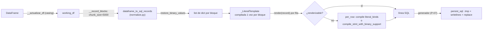

# Auditoría de rendimiento — serialización de ficheros SQL (`generar_sql=True`)

<!-- arquetipo: informativo-libre -->

- **Fecha**: 2026-09-25
- **Alcance**: `src/util_bbdd/bulk/` — camino `generar_sql=True` de `bulk_insert_from_df`, `bulk_update_from_df`,
  `bulk_delete_from_df` (y `bulk_insert_from_chunks` indirectamente, por compartir la normalización)
- **Dialectos**: PostgreSQL, MySQL, Oracle, SQL Server, SQLite
- **Volumen de referencia**: 1M filas por fichero
- **Veredicto**: **MODERADO** — los grandes costes ya se retiraron (P-06 plantilla, P-07 streaming); quedan mejoras del
  25–40 % sin cambio de salida y un caso **ALTO** (columnas binarias) que multiplica ×12 el coste por fila.

---

## Fase 1 — MAP_CURRENT_STATE

| Etapa | Fichero | Estado previo |
|---|---|---|
| Normalización por columnas | `bulk/normalize.py` `dataframe_to_sql_records` | P-03: vectorizado para numéricos/fechas; texto celda a celda |
| Plantilla de literales | `bulk/_support/sql_helpers.py` `_LiteralTemplate` | P-06: 1 compilación por bloque; render por fila y celda |
| Fallback por fila | `compile_stmt_with_binary_support` | Compila la sentencia entera por fila (~120–165 µs) |
| Escritura | `bulk/_support/persistence.py` `persist_sql` | P-07: streaming a `.tmp` + rename atómico |

DELETE no usa `dataframe_to_sql_records`: `df[pk_cols].to_dict(orient="records")` (`crud.py:1259`).

## Fase 2 — MEASURE_OVERHEAD (baseline)

Entorno: Windows 11, Python 3.14.2, SQLAlchemy 2.0.50, pandas 3.0.3, numpy 2.4.6. Dataset de `scripts/bench_bulk.py`
(`make_dataframe`: 4 int, 2 float con NaN, 3 texto con None, 1 datetime). Objetos de dialecto sin servidor
(`psycopg2`, `pymysql`, `oracledb`, `pyodbc`, `pysqlite`).

### Extremo a extremo (API pública, SQLite, 1M filas, `chunk_size=5000`)

| Operación | Tiempo | µs/fila |
|---|---:|---:|
| INSERT | 11,60 s | 11,60 |
| UPDATE | 11,89 s | 11,89 |
| DELETE | 2,16 s | 2,16 |

### Desglose por etapa y dialecto (100K filas, µs/fila)

| Dialecto | Op | Normalización | Render | Escritura | Fichero (100K) |
|---|---|---:|---:|---:|---:|
| sqlite | INSERT | 2,82 | 8,31 | 0,31 | 21,8 MB |
| postgresql | INSERT | 2,86 | 8,87 | 0,30 | 21,1 MB |
| mysql | INSERT | 2,93 | 9,05 | 0,31 | 21,1 MB |
| oracle | INSERT | 2,83 | 7,50 | 0,32 | 24,5 MB |
| mssql | INSERT | 2,71 | 7,44 | 0,32 | 23,3 MB |
| (todos) | UPDATE | 2,9–3,1 | 7,7–9,3 | 0,30–0,34 | 21,6–25,0 MB |
| (todos) | DELETE | 0,78 | 1,1–1,3 | 0,25 | 6,9–7,5 MB |

**Reparto (INSERT)**: render ≈ 73 %, normalización ≈ 25 %, escritura ≈ 3 %.

### Perfil del render (cProfile, PostgreSQL, 50K filas INSERT)

| Función | tottime | cumtime | % acumulado |
|---|---:|---:|---:|
| `_LiteralTemplate.render` (bucle por fila) | 0,449 s | 2,593 s | 17 % propio |
| `PGCompiler.render_literal_value` → `SQLCompiler.render_literal_value` | 0,665 s | 1,496 s | 57 % |
| `_LiteralTemplate._literal` | 0,293 s | 1,976 s | 11 % propio |
| `TypeEngine._cached_literal_processor` (+ `weakref.__getitem__`) | 0,351 s | — | 13 % |
| `_undo_percents` (llamada por literal) | 0,121 s | 0,187 s | 7 % |

### Normalización por columna (100K filas, µs/celda)

| Tipo | µs/celda |
|---|---:|
| int64 / float64 | 0,01–0,03 |
| datetime64 | 0,25 |
| texto (`str`, pandas 3) | **0,52–0,57** |
| Construcción de `dict` por fila | 0,91 µs/fila |

## Fase 3 — ANALYZE_CODE (hallazgos)

Leyenda: **C** = confirmado con medición; **H** = hipótesis.

### P-30 · ALTA · C — Columnas binarias con bytes no UTF-8: fallback de compilación completa por fila

- **Fichero**: `bulk/_support/sql_helpers.py:198-221` (`_literal` / `render`), `:448-475`
  (`compile_stmt_with_binary_support`)
- **Descripción**: el `literal_processor` de `LargeBinary` de SQLAlchemy lanza `CompileError` con bytes no UTF-8. `render`
  devuelve `None` y la fila pasa por `per_row`, que construye y compila la sentencia entera dos veces (con y sin
  `literal_binds`).
- **Evidencia**: 2.000 filas `(id, bin=b"\x00\xff"*50)`: **119–136 µs/fila** (sqlite 122,8; postgresql 135,6; mssql
  119,3) frente a ~1–2 µs/fila de una fila renderizada por plantilla con 2 columnas.
- **Impacto**: ×12 sobre el total por fila en tablas con BLOB/BYTEA/VARBINARY con contenido binario real. Con 1M filas,
  ~2 min frente a ~10 s.
- **Remediación**: en `_LiteralTemplate._literal`, para huecos de tipo `_Binary` con valor `bytes`, devolver
  `format_sql_param_value(value)` (la misma cadena `0x…` que produce hoy el fallback).
- **⚠️ No es byte-idéntico**: en el fallback, **todas** las columnas de esa fila se formatean con
  `format_sql_param_value` (fechas como `'2026-01-01 00:00:00'`, booleanos `1/0`, sin escape de `\` en MySQL/PG), no con el
  renderizador del dialecto. Con la remediación, las columnas no binarias de esas filas pasarían a formatearse igual que
  en el resto de filas del fichero (más coherente), pero cambia la salida. Requiere test de regresión y anotarlo en
  el CHANGELOG.
- **Esfuerzo**: 1–2 h con tests.

### P-31 · MEDIA · C — Render celda a celda con despacho por método (≈ 15–21 %)

- **Fichero**: `bulk/_support/sql_helpers.py:198-243`
- **Descripción**: por cada celda: `self._literal` → `self._undo_percents` → `compiler.render_literal_value`, y por fila
  `zip` + dos `append` + `"".join`. Son ~10 llamadas Python por fila que no aportan nada.
- **Remediación**: render por bloque y columna (`render_block(records)`): para cada hueco, un bucle local con
  `render = compiler.render_literal_value` ligado, `None` → `"NULL"`, `"%%" in s` solo si `_undouble`; filas no
  renderizables marcadas en un `bytearray` y enviadas a `per_row`; ensamblado con una cadena de formato precalculada
  (`fmt % tuple(fila)`, con `%` de las partes escapado).
- **Evidencia (prototipo, 100K filas INSERT, salida byte-idéntica)**:

  | Dialecto | Actual | Por columnas | Mejora |
  |---|---:|---:|---:|
  | sqlite | 8,54 µs | 6,84 µs | 20 % |
  | postgresql | 9,10 µs | 7,40 µs | 19 % |
  | mysql | 9,05 µs | 7,69 µs | 15 % |
  | oracle | 7,68 µs | 6,24 µs | 19 % |
  | mssql | 7,68 µs | 6,10 µs | 21 % |

- **Esfuerzo**: 3–4 h (sustituye `render` + `_render_lines`; API interna, sin cambios públicos).

### P-32 · MEDIA · C — `literal_processor` resuelto por celda (≈ +18 pp en sqlite/oracle/mssql)

- **Fichero**: `bulk/_support/sql_helpers.py:205`
- **Descripción**: `SQLCompiler.render_literal_value` busca el procesador en `dialect._type_memos` (weakref) en **cada**
  celda. Cuando el compilador del dialecto no redefine `render_literal_value` (SQLite, Oracle, SQL Server con el
  compilador por defecto), el procesador se puede resolver una vez por hueco y llamarse directamente.
- **Remediación**: sobre P-31, si `type(compiler).render_literal_value is SQLCompiler.render_literal_value`, precalcular
  `proc = type_.dialect_impl(dialect).literal_processor(dialect)` (API pública) para los huecos de VALUES/SET. PostgreSQL y
  MySQL mantienen `render_literal_value` (escapan `\` según `_backslash_escapes`). Excepciones → fallback (igual que hoy).
- **Evidencia (acumulado P-31 + P-32)**: sqlite **−39 %** (5,18 µs), oracle **−37 %** (4,83), mssql **−39 %** (4,68),
  postgresql −21 %, mysql −22 %. Salida byte-idéntica en los 5 dialectos.
- **Esfuerzo**: 1 h sobre P-31.

### P-33 · MEDIA · C — Normalización de texto celda a celda (≈ 10 % del INSERT, también sin `generar_sql`)

- **Fichero**: `bulk/normalize.py:207-210` (`_normalize_column`, rama objeto/extensión)
- **Descripción**: cada celda de texto pasa por `maybe_box_native` + `normalize_sql_literal` (≈ 10 `isinstance` antes
  del `strip`). Es 0,52–0,57 µs/celda, 20–40 veces más que las columnas numéricas.
- **Remediación**: vía rápida por columna: si todos los valores son `str` o nulos (`None`, `pd.NA`, `NaN` float), lista
  por comprensión `v.strip() if v else v` / `None`; en cualquier otro caso, camino actual.
- **Evidencia**: prototipo 0,13 µs/celda en `s1` (−75 %), resultado igual. Una versión inicial sin tratar el `NaN` de la
  dtype `str` de pandas 3 caía al camino actual en `s3`, así que el tratamiento de nulos es obligatorio.
- **Impacto**: ~1,2 µs/fila con 3 columnas de texto (≈ 10 % del INSERT con SQL). **Beneficia también
  `generar_sql=False`** (ejecución real), porque `dataframe_to_sql_records` es compartido.
- **Esfuerzo**: 1–2 h con tests de equivalencia (Hypothesis sobre `normalize_sql_literal`).

### P-34 · BAJA · C — `dict` por fila solo para leerlo de nuevo por columnas (≈ 8 %)

- **Fichero**: `bulk/normalize.py:193-195`, `crud.py:674-684`
- **Descripción**: la normalización ya produce columnas; se transponen a un `dict` por fila (0,91 µs/fila) y P-31 las vuelve
  a leer por columna.
- **Remediación**: API interna `dataframe_to_sql_columns(df) -> (keys, columns)` para el camino SQL, y construir `dict`
  solo para las filas que caen al fallback. Afecta a `restore_binary_values` (pasaría a operar por columna).
- **Esfuerzo**: 4–6 h. Hacerlo solo después de P-31/P-33 y si se quiere el último ~8 %.

### P-35 · BAJA · H — Plantilla recompilada en cada bloque

- **Fichero**: `bulk/_support/sql_helpers.py:257-262`, `:340-352`, `:369-374`
- **Descripción**: `generate_*_sql` se llama por bloque de 5.000 filas: 200 compilaciones por 1M filas. Estimado < 1 %
  (una compilación es del orden de 1 ms). **Sin medir aislado**: confirmar antes de actuar.
- **Remediación**: cachear la plantilla en el cierre de `__prepare_*_operation` (la sentencia y los huecos no cambian
  entre bloques).

### P-36 · INFO · C — Escritura del fichero (≈ 3 %)

- **Fichero**: `bulk/_support/persistence.py:99-120`
- **Descripción**: 0,25–0,34 µs/fila. `writelines` sobre generador con buffer por defecto. Pasar la escritura a un hilo
  (patrón `QueueHandler`/escritor asíncrono) solo solaparía ese ~3 %, a cambio de complejidad y de perder la
  propagación síncrona de errores y la atomicidad `.tmp` → `replace`. **No recomendado.** No se hizo búsqueda web sobre
  logging asíncrono: la medición deja la E/S fuera del camino crítico.

### C-1 · Corrección (fuera de alcance de rendimiento) — Literal `0x…` en el fallback binario

- **Fichero**: `bulk/_support/sql_helpers.py:482-483` (`format_sql_param_value`)
- **Descripción**: el fallback emite `0xHEX` en **todos** los dialectos. Válido en SQL Server y MySQL. En PostgreSQL
  (`bytea` espera `'\x…'` o `decode('…','hex')`), Oracle (`HEXTORAW('…')`) y SQLite (`X'…'`; `0x…` es un entero
  hexadecimal) el fichero generado no carga o carga otro valor.
- **Acción**: abrir `/hotfix` aparte. Interacciona con P-30: conviene resolver ambos juntos (literal binario por
  dialecto dentro de la plantilla).

## Fase 4 — PROPOSE_OPTIMIZATIONS

| # | Hallazgo | Mejora estimada (INSERT, 1M) | Riesgo | Salida idéntica | Quick win |
|---|---|---:|---|---|---|
| 1 | P-31 render por columnas | −15–21 % | Bajo | Sí | ⚠️ (3–4 h) |
| 2 | P-32 procesador directo | −18 pp adicionales en sqlite/oracle/mssql | Bajo | Sí | ✅ (sobre P-31) |
| 3 | P-33 vía rápida de texto | −10 % (y también en ejecución real) | Bajo | Sí | ✅ |
| 4 | P-30 binarios en plantilla | ×12 en filas con BLOB no UTF-8 | Medio | **No** (ver nota) | ⚠️ |
| 5 | P-34 sin `dict` por fila | −8 % | Medio | Sí | ❌ |

**Proyección P-31 + P-32 + P-33** (INSERT, 1M filas, sin binarios; calculada a partir de las mediciones por etapa, no
medida de extremo a extremo): SQLite 11,6 s → **~7,0 s (−40 %)**; Oracle/SQL Server ≈ −38 %; PostgreSQL/MySQL ≈ −28 %.
UPDATE, en proporción similar. DELETE (2,2 s) apenas cambia.

## Fase 5 — VALIDATE_MULTI_DIALECT

| Comprobación | sqlite | postgresql | mysql | oracle | mssql |
|---|---|---|---|---|---|
| P-31/P-32: igualdad byte a byte, dataset bench 100K INSERT | ✅ | ✅ | ✅ | ✅ | ✅ |
| P-31/P-32: casos límite INSERT (`'`, `%`, `%(x)s`, `\`, emoji, `\n`, Decimal `1.00`/`1.0`, tz ±, `-0.0`, `inf`, bytes, JSON, NULL) | ✅ | ✅ | ✅ | ✅ | ✅ |
| P-31/P-32: UPDATE con PK `NULL` en WHERE → fallback igual | ✅ | ✅ | ✅ | ✅ | ✅ |
| Rutas de fallback conservadas (fila con bytes no UTF-8 → `per_row`) | ✅ | ✅ | ✅ | ✅ | ✅ |

**Límites de la validación**:

- Dialectos instanciados sin servidor (`server_version_info=None`). No se ejecutaron los ficheros contra servidores
  reales. El render de literales no depende de la versión en SQLAlchemy 2.0.50, salvo `_backslash_escapes` en MySQL
  (depende de `sql_mode`), que P-32 respeta porque no toca PostgreSQL ni MySQL.
- El descarte de la memoización por valor (probada en el prototipo) se debe a una ganancia de ≤ 5 % y a que no es segura
  para `Decimal`, `float` (`0.0 == -0.0`) ni `datetime` con zona (valores iguales con render distinto).
- La validación posterior a la implementación (benchmark antes/después) queda en el roadmap: esta auditoría no modifica
  código.

## Reproducibilidad

Scripts usados (scratchpad de la sesión; ver roadmap para incorporarlos al repo):

- `bench_sqlgen.py` — desglose normalización/render/escritura por dialecto: `python bench_sqlgen.py 100000`
- `e2e.py` — API pública con SQLite: `python e2e.py 1000000`
- `proto.py` — prototipo P-31/P-32 con comprobación de igualdad; `edge.py` — casos límite
- Perfil: `cProfile` sobre `generate_insert_sql`, PostgreSQL, 50K filas
