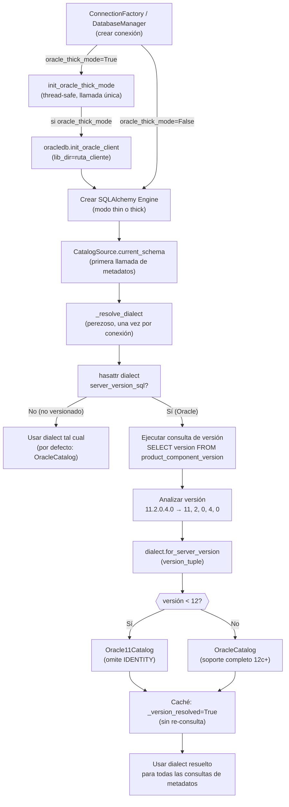

# ⚙️ Runtime & Environment - util_bbdd

## Development Environment

### Prerequisites

- Python ≥3.12
- pip, virtualenv (o conda)
- Git
- (Opcional) Docker Compose — para tests de integración con BD reales

### Setup

```bash
git clone <repo>
cd util_bbdd
python -m venv venv
source venv/bin/activate       # Linux/Mac
# venv\Scripts\activate        # Windows
pip install -e ".[dev]"
pip install -e ".[docs]"       # Para mkdocs build
```

### Project Root

| Ruta | Propósito |
|---|---|
| `src/util_bbdd/` | Código fuente (namespace package) |
| `tests/` | Tests pytest (discovery automático) |
| `scripts/` | Utilidades: `build_docs_zip.py`, `gen_arquitectura_capas.py`, `start-server.py` |
| `docs/` | Documentación MkDocs (fuente) |
| `site/` | Salida de build (git-ignored) |
| `dist/` | ZIP offline + checksums |
| `.ai/` | Contexto persistente para IAs |
| `.github/` | Workflows, agents, prompts, instrucciones |
| `.claude/` | Settings de Claude Code (hooks, commands) |

## Essential Commands

```bash
# Tests
python -m pytest
python -m pytest -v --cov=src/util_bbdd --cov-report=html

# Lint y formato
python -m ruff check src tests
python -m ruff format src tests

# Type-checking (2º arg: Protocols de la Regla #6, docs/architecture.md)
python -m mypy src tests/unit/test_protocol_conformance.py

# Build del paquete
python -m build

# Documentación
python -m mkdocs build --strict   # Build completo
python -m mkdocs serve            # Preview local en http://127.0.0.1:8000
zensical build                    # Alternativa (mismo mkdocs.yml)
zensical serve

# Distribución offline
python scripts/build_docs_zip.py  # Genera dist/util_bbdd-docs-{version}.zip + SHA256

# Diagrama de capas e imports (docs/architecture.md)
python scripts/gen_arquitectura_capas.py  # Regenera SVG + CSS; falla si el dibujo no coincide con el código
```

## Database Testing

- **SQLite in-memory** (`":memory:"`): BD por defecto en todos los tests unitarios
- **Docker Compose**: `docker-compose.yml` incluye `docker-compose.bench.yml`, proyecto `util_bbdd_bench`: PostgreSQL 17, MySQL 8.4, MariaDB 11.4, SQL Server 2022 y Oracle 23 Free en `127.0.0.1` y puertos no estándar (55432, 53306, 53307, 51433, 51521). Contraseña en `UTIL_BBDD_BENCH_PASSWORD`; URLs con `scripts/bench_env.example.{sh,ps1}`. Esos scripts exportan también `UTIL_BBDD_TEST_ORACLE_ADMIN_URL` (`SYSTEM`, misma contraseña), con la que `test_doc_matches_golden[oracle]` crea y borra el usuario aislado `ZZ_GOLD_DOC` (sin ella, ese test se salta). Los usan los tests de integración (`UTIL_BBDD_TEST_<MOTOR>_URL`) y `scripts/bench_bulk.py`. No usar ningún servidor local en puertos estándar. MariaDB se prueba con sus dos drivers: PyMySQL (la URL del banco) y, si el paquete `mariadb` está instalado, el conector original (`mariadb+mariadbconnector`, el que usa la librería para `db_type="mariadb"`), sin configurar nada (motor `mariadb_connector` de los tests de `bulk`, `test_mariadb_engine_e2e.py`, `test_update_auto_increment_mariadb.py`).
- **HSQLDB** (sin contenedor): `tests/integration/metadata/test_hsqldb_catalog.py` usa un HSQLDB en memoria por JDBC si `UTIL_BBDD_TEST_HSQLDB_JAR` apunta al `hsqldb-2.x.jar` (Maven Central `org.hsqldb:hsqldb`), hay Java (`JAVA_HOME` si JPype no encuentra `jvm.dll`) y `jaydebeapi`; sin ellos se salta.
- **HSQLDB en red** (opcional): `docker-compose.bench-hsqldb.yml` levanta HSQLDB 2.7.4 (`eclipse-temurin:21-jre`, base en memoria `bench`, usuario `SA` sin contraseña) en `127.0.0.1:59001` con el jar de `build/bench_hsqldb/` (descargado de Maven Central, verificado con su `.sha1`); `scripts/bench_env.example.*` define `UTIL_BBDD_TEST_HSQLDB_JAR` y `UTIL_BBDD_TEST_HSQLDB_SERVER_URL` si el jar existe; `tests/integration/test_hsqldb_server.py`. Las propiedades de creación (`sql.syntax_*`) solo actúan si la conexión crea la base (en memoria), no contra un servidor.
- **Validación de cambios de conexión**: los cambios en parámetros de driver (TLS, charset, pools) se validan contra el banco antes de cerrar, no solo con tests unitarios (una regresión de v0.35.6 solo se vio con servidor real). TLS: `SHOW SESSION STATUS LIKE 'Ssl_cipher'` (vacío = sin cifrar); el MariaDB 11.4 del banco tiene TLS con certificado autogenerado. aiomysql en Windows necesita `asyncio.run(..., loop_factory=asyncio.SelectorEventLoop)`.
- **TLS con CA propia (MariaDB)**: `python scripts/bench_tls_certs.py` genera CA y certificado (SAN `IP:127.0.0.1`) en `build/bench_tls/`; `docker compose -f docker-compose.bench.yml -f docker-compose.bench-tls.yml up -d --wait --force-recreate -V mariadb` los monta (borra los datos de MariaDB). `tests/integration/test_mariadb_tls_own_ca.py` se salta sin la CA.
- **Test isolation**: Cada test abre su propia conexión; sin estado compartido entre tests
- **Markers**: `@pytest.mark.asyncio` para tests async; `@pytest.mark.integration` para tests con BD reales

## Async Runtime

- **Event loop:** `asyncio.new_event_loop()` (aislamiento por test)
- **Marker:** `@pytest.mark.asyncio` configurado vía `pytest-asyncio`
- **Timeout:** 30 s por defecto (configurable en `pytest.ini`)

## CI/CD

- **`.github/workflows/`**: GitHub Actions — test, lint, mypy, coverage, docs build/deploy, docs-zip-release
- **Branches**: `main` (estable), `develop` (integración), `feature/*` (trabajo en curso)
- **Gate de merge**: ≥90% coverage + all checks pass + `mkdocs build --strict` limpio
- **Docs publish**: `github-pages` en cada push a `main` con cambios en `docs/`
- **ZIP release**: Workflow `docs-zip-release.yml` publica release `docs-vX.Y.Z` automáticamente

## Configuración de Claude Code

Ver `CLAUDE.md` para:
- Slash commands disponibles (`/new-feature`, `/hotfix`, etc.)
- Hooks PostToolUse (ruff → mypy → pytest)
- Flujos estructurados por fases

## Dependencias principales

| Dependencia | Versión mínima | Rol |
|---|---|---|
| `sqlalchemy` | ≥2.0.46 | Abstracción de engine y SQL |
| `pandas` | ≥3.0.0 | DataFrames para operaciones bulk |
| `openpyxl` | ≥3.1.5 | Generación de Excel |
| `python-docx` | ≥1.2.0 | Generación de Word |
| `oracledb` | ≥3.4.0 | Driver Oracle sync/async |
| `jinja2` | ≥3.0.0 | Templates HTML para doc/ y comparar/reporters/ |
| `util` | git+develop | Medición de tiempos (`medir_tiempo`) |

### Dependencias opcionales

```bash
pip install -e ".[analysis]"   # graphviz≥0.20 (grafos de relaciones)
pip install -e ".[doc-svg]"    # cairosvg≥2.7 (SVG→PNG en doc/)
pip install -e ".[docs]"       # zensical + mkdocs-material + mkdocstrings[python]
pip install -e ".[dev]"        # pytest + ruff + mypy + build + tipos
```

## Flujo de Detección de Versión de Oracle

Util_bbdd detecta y se adapta automáticamente a versiones de servidor Oracle (11g vs 12c+) mediante resolución perezosa de versión:

### Diagrama de Flujo



### Propiedades Clave

| Propiedad | Comportamiento |
|---|---|
| **Activador** | Primera llamada a `current_schema()` o `_load(kind, schema, tables)` |
| **Consulta** | Consulta de versión única por conexión (caché mediante flag `_version_resolved`) |
| **Latencia** | Un viaje de ida y vuelta adicional a la base de datos en la primera consulta de metadatos |
| **Caché** | `_version_resolved=True` previene consultas de versión repetidas |
| **Seguridad en Threads** | Inicialización de modo thick protegida por `threading.Lock`; sin condiciones de carrera |
| **Segura para Async** | Conexiones async se protegen contra modo thick; genera `ConnectionError` si se intenta |

### Configuración

**Modo thin (por defecto, capaz de async, solo 12c+):**
```python
manager = AsyncDatabaseManager(
    db_type="oracle",
    conn_params={
        "user": "scott",
        "dsn": "oracle-host:1521/ORCL",
        "oracle_thick_mode": False,  # Por defecto
    },
)
```

**Modo thick (solo sync, soporte 11g+, requiere Instant Client 19):**
```python
manager = DatabaseManager(
    db_type="oracle",
    conn_params={
        "user": "scott",
        "service_name": "ORCL",
        "oracle_thick_mode": True,
        "oracle_client_path": "/ruta/a/instantclient_19_x",
    },
)
```

### Detalles de Implementación

- **Módulo de Detección de Versión**: `src/util_bbdd/metadata/source.py` (método _resolve_dialect)
- **Módulo de Modo Thick**: `src/util_bbdd/connection/oracle/_thick_mode.py` (función init_oracle_thick_mode)
- **Variantes de Dialect**: `src/util_bbdd/metadata/oracle/catalog.py` (clases OracleCatalog y Oracle11Catalog)
- **ADR-004**: [docs/adr/ADR-004-lazy-oracle-version-resolution.md](../docs/adr/ADR-004-lazy-oracle-version-resolution.md)
- **Guía de Drivers**: [docs/guides/drivers.md](../docs/guides/drivers.md)

