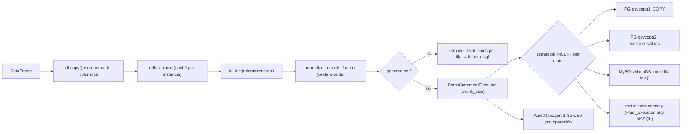

# PERFORMANCE AUDIT — `src/util_bbdd/bulk/`

- Fecha: 2026-09-23 · Rama: `develop` (commit `f0f221f`) · Skill: `performance-audit`
- Veredicto final: **SIGNIFICATIVO**
- Veredicto AUDIT_PLAN: **GO_CONDICIONAL** (benchmark con motores reales antes de fusionar P-01, P-02 y P-04)

## Scope

| Aspecto | Valor |
|---|---|
| Módulo | `src/util_bbdd/bulk/` (21 ficheros, ~4.600 líneas) |
| Operaciones | INSERT, UPDATE, DELETE, generación de SQL (`generar_sql=True`), carga paralela |
| Escalas | 1K, 10K, 100K, 1M filas × 10 columnas (int, float con NaN, texto con None, datetime) |
| Motores | Oracle, MySQL/MariaDB, PostgreSQL, SQL Server, SQLite |
| Restricciones | Compatibilidad multi-BBDD; contrato de la auditoría CSV intacto |
| Métricas base | No aportadas → generadas en esta sesión (tabla del PLAN) |
| Entorno de medida | Windows 11, Python 3.14.2, pandas 3.0.3, numpy 2.4.6, SQLAlchemy 2.0.50, SQLite en fichero |

**Límite de la evidencia**: solo se ha ejecutado contra SQLite. El coste en Python (`to_dict`, normalización,
compilación SQL, construcción de `text()`) no depende del motor y se considera CONFIRMADO. Lo que depende del
servidor (latencia de red, comportamiento del driver con un servidor real) se marca HIPÓTESIS o DEPENDE_DE_BBDD.

### Reproducir

```bash
# Desde la raíz del repo
PYTHONPATH=src python .ai/sessions/2026-09-23-performance-audit-bulk/bench/bench_bulk.py 1000 10000 100000 1000000
PYTHONPATH=src python .ai/sessions/2026-09-23-performance-audit-bulk/bench/bench_sqlgen.py
PYTHONPATH=src python .ai/sessions/2026-09-23-performance-audit-bulk/bench/bench_mysql_strat.py
```

---

## PLAN

### Flujo actual de carga



- UPDATE: mismo flujo; siempre `executemany` de un `UPDATE ... WHERE pk = :pk_x` (las estrategias INSERT hacen fallback).
- DELETE: `DeleteBatchExecutor` → `SqlBasedDeleteStrategy` (`IN (...)` con `chunk_size` parámetros) para
  mysql/mariadb/mssql/hsqldb; `GenericDeleteStrategy` (`executemany` por fila) para el resto.

### Línea base medida (SQLite, segundos)

| Filas | copy | `to_dict` | normalizar | prototipo vectorizado¹ | INSERT total | INSERT solo ejecución | UPDATE | DELETE |
|---|---|---|---|---|---|---|---|---|
| 1K | 0,000 | 0,023 | 0,006 | 0,007 | 0,045 | 0,014 | 0,040 | 0,021 |
| 10K | 0,000 | 0,037 | 0,063 | 0,029 | 0,151 | 0,065 | 0,180 | 0,042 |
| 100K | 0,003 | 0,291 | 0,540 | 0,189 | 1,376 | 0,497 | 1,663 | 0,302 |
| 1M | 0,032 | 2,918 | 5,272 | **1,780** | **13,281** | 4,649 | 17,131 | 3,608 |

¹ Sustituye a `to_dict` + normalizar (incluye construir los dicts). Salida idéntica comprobada en filas 0, 7, 11 y n−1
(cubren NaN, None, strip y datetime).

Otras mediciones:

| Medida | Resultado |
|---|---|
| Preparación en Python del INSERT 1M | 8,19 s de 13,28 s (62 %) |
| Pico de memoria INSERT 100K (`tracemalloc`) | 102,1 MB frente a 24,1 MB del DataFrame (4,2×) |
| `generar_sql` INSERT 10K | 1,65 s (165 µs/fila) → ~165 s por 1M |
| `generar_sql` UPDATE 10K | 1,96 s |
| `MySQLMultiRowInsertStrategy` vs `DefaultInsertStrategy` (100K, conexión SQLite) | 2,80 s vs 0,34 s (8×) |
| `text()` con 1000×10 binds | 11,3 ms; con compilación + parámetros 40 ms por sublote |
| DELETE `IN` con 5000 binds | 19,5 ms por lote (~3,9 s por 1M) |
| `generar_sql` con `literal_processor` (prototipo, 2000 filas, dialecto mssql) | 8,9 ms frente a 0,29 s (33×), salida idéntica en la muestra |

### Cuellos de botella teóricos por área

| # | Área | Hipótesis inicial | Resultado |
|---|---|---|---|
| 1 | Batching | `chunk_size` único para todos los motores | Confirmado; ignora límites de parámetros (P-05, P-13) |
| 2 | Paralelización | GIL + BulkCrud por partición | Hipótesis (P-08) |
| 3 | Normalización | Coste Python por celda | Confirmado, 62 % del INSERT (P-03) |
| 4 | Conexiones | Reuso vía `bulk_session` | Correcto; sin hallazgos |
| 5 | Auditoría | Coste por fila | Descartado: 1 fila CSV por operación (P-11) |
| 6 | Memoria | Doble materialización | Confirmado, 4,2× (P-07) |
| 7 | Generación SQL | Compilación por fila | Confirmado, 165 µs/fila (P-06) |
| 8 | Específico por motor | Vías rápidas efectivas | 2 vías rotas o contraproducentes (P-01, P-02); UPDATE fila a fila (P-04) |
| 9 | Sincronización PK | SELECT por fila | Descartado: 1–2 consultas por tabla (P-12) |
| 10 | Validación | Introspección repetida | Solo en `ParallelBulkLoader` (P-08) |

### Estrategia de benchmark para validar lo que depende del servidor

1. Banco de pruebas con los 5 motores (contenedores o instancias de integración existentes), misma tabla de 10 columnas.
2. Para cada motor × {1K, 10K, 100K, 1M} × {INSERT, UPDATE, DELETE}: tiempo total, tiempo de ejecución,
   pico de memoria, 3 repeticiones, mediana.
3. Variantes A/B por hallazgo: estrategia actual frente a la propuesta, en el mismo proceso.
4. Registrar driver y versión de servidor en cada fila de resultados.

---

## AUDIT_PLAN

### Viabilidad y compatibilidad por mejora

| ID | Mejora | Rompe API | Compatibilidad multi-BBDD | Riesgo | Pruebas requeridas |
|---|---|---|---|---|---|
| P-05 | Tope de parámetros en DELETE MSSQL + PK compuesta | No | Solo afecta a mssql | Bajo | Unit: lote ≤ 2100 params; PK compuesta genera SQL válido; integración SQL Server 10K |
| P-02 | MySQL vuelve a `DefaultInsertStrategy` | No (multi-fila sigue disponible vía `insert_resolver`) | Solo mysql/mariadb | Bajo | Benchmark A/B en MySQL y MariaDB (PyMySQL y `mariadb`) |
| P-01 | fast_executemany efectivo en INSERT MSSQL | No | Solo mssql+pyodbc | Medio: cambiar el flag del dialecto afecta a otros usos del engine; la estrategia con cursor crudo lo evita | Unit: listener recibe `executemany=True`; benchmark SQL Server |
| P-03 | Normalización por columna | No (`normalize_records_for_sql` pública intacta) | Todos | Medio: debe conservar la semántica exacta | Test de equivalencia contra `normalize_records_for_sql` por tipo de columna (int, float+NaN, bool, datetime+NaT, tz-aware, str+None, bytes, dict/list, Decimal, category, Int64 nullable) |
| P-07 | Pipeline por bloques + `copy(deep=False)` | No | Todos | Bajo: misma conexión y transacción | Atomicidad (rollback total en fallo), una sola fila de auditoría por operación, `rowcount` |
| P-09 | UPDATE solo con columnas necesarias | No | Todos | Muy bajo | Tests existentes de UPDATE |
| P-04 | UPDATE vía tabla temporal (opcional) | No (parámetro nuevo, desactivado por defecto) | mysql, mssql, postgresql | Medio: requiere permiso para crear tablas temporales | Semántica idéntica (solo filas existentes), `rowcount`, integración por motor |
| P-06 | `generar_sql` con `literal_processor` | No | Todos (fallback a la ruta actual) | Medio: salida textual debe ser idéntica | Golden tests byte a byte por dialecto, incluidos binarios, fechas, comillas, NULL |
| P-10 | DELETE PG con `= ANY(:ids)` | No | Solo postgresql | Bajo | Unit + integración PG |
| P-08 | Reflexión compartida en `ParallelBulkLoader` | No | Todos | Bajo: `Table` es de solo lectura tras reflejar | Tests existentes del loader |

### Orden de ejecución y dependencias

1. **Fase 0**: banco de pruebas y línea base con motores reales (bloquea la fusión de P-01, P-02, P-04).
2. **Fase 1**: `/hotfix` P-05 (fallo funcional, independiente).
3. **Fase 2**: quick wins P-02, P-01, P-09, `copy(deep=False)`.
4. **Fase 3**: `/refactor` P-03 + P-07 (P-07 reutiliza el preparador por columna de P-03).
5. **Fase 4**: `/new-feature` P-04, P-06, P-10.
6. **Fase 5**: P-08 y P-14 (el beneficio de P-08 depende de P-03, que libera el GIL en gran parte del trabajo).

**Veredicto: GO_CONDICIONAL.**

---

## AUDIT_CODE

### Hallazgo P-05: DELETE en SQL Server supera el límite de 2100 parámetros
**Severidad**: CRÍTICA (fallo funcional a partir de 2.101 filas)
**Área**: 1 (batching) / 8 (específico de motor)
**Archivo/Función**: `_execution/batch.py:16` (`_DEFAULT_SQL_BASED_DELETE_DIALECTS`), `_execution/batch.py:370-411` (`SqlBasedDeleteStrategy.execute`), `_execution/batch.py:562-568` (`DeleteBatchExecutor._iter_batches`)
**Descripción**: `mssql` usa `SqlBasedDeleteStrategy`, que pone `chunk_size` parámetros (5000 por defecto) en un único `IN (...)`. SQL Server admite como máximo 2100 parámetros por petición con pyodbc. Además, con PK compuesta genera `WHERE (a, b) IN ((..), (..))`, sintaxis que SQL Server no admite.
**Impacto estimado**: de error a funcionar. Adicionalmente, el `text()` con 5000 binds cuesta 19,5 ms por lote.
**Confirmación**: CONFIRMADA (código + límite documentado); no ejecutado contra servidor. Con pymssql la sustitución es en cliente y el límite no aplica, pero la sintaxis de PK compuesta sigue siendo inválida.

#### Evidencia
- Código actual: `sql = f"DELETE FROM {quoted_table} WHERE {pk_col} IN ({', '.join(placeholders)})"` con `len(placeholders) == chunk_size`.
- Referencia: <https://learn.microsoft.com/en-us/sql/sql-server/maximum-capacity-specifications-for-sql-server> (Parameters per user-defined function / batch: 2100).
- SQLAlchemy fija para el mismo motor `insertmanyvalues_max_parameters = 2099` (`dialects/mssql/base.py:3091`).
- No hay ninguna referencia a `2100` en `src/` ni en `tests/`; los tests de DELETE solo usan mocks.

#### Remediación propuesta
- Cambios de código: en mssql, filas por lote = `min(chunk_size, 2000 // len(pk_cols))`; con PK compuesta, `GenericDeleteStrategy` (executemany, acelerado por fast_executemany) o `WHERE (a = ? AND b = ?) OR (...)`.
- Tests requeridos: tamaño de lote y SQL generado para mssql con PK simple y compuesta; integración SQL Server 10K.
- Compatibilidad: sin cambios de API.
- Overhead de cambio: bajo.

---

### Hallazgo P-02: la vía multi-fila de MySQL/MariaDB es más lenta que el executemany del driver
**Severidad**: CRÍTICA (DEPENDE_DE_BBDD)
**Área**: 8 (específico de motor) / 7 (generación SQL)
**Archivo/Función**: `_execution/batch.py:170-308` (`MySQLMultiRowInsertStrategy`), `_execution/batch.py:346-347` (`InsertStrategyResolver.resolve`)
**Descripción**: por cada sublote de 1000 filas construye `text(template_sql)` con 1000 × ncols parámetros con nombre. SQLAlchemy recorre la cadena con un regex para crear un `BindParameter` por marcador y después genera la clave de caché recorriendo todos ellos. Mientras tanto, PyMySQL ya reescribe `executemany` de un INSERT como INSERT multi-fila (sentencias de hasta 1 MB) y el conector `mariadb` usa su protocolo de envío masivo.
**Impacto estimado**: ~25 s de Python eliminados por cada millón de filas. Las idas y vueltas por red deberían ser equivalentes, así que se espera que la estrategia actual sea más lenta en términos netos.
**Confirmación**: CONFIRMADA en cliente (8×); efecto neto contra servidor = HIPÓTESIS.

#### Evidencia
- Benchmark (`bench_mysql_strat.py`, 100K filas × 10 columnas, lotes de 5000): `default_executemany` 0,34 s, `mysql_multirow` 2,80 s.
- cProfile de 20.000 filas: 0,999 s totales, de los cuales `text()` 0,511 s (regex `sub` + 200.000 llamadas a `repl`) y `_generate_cache_key` 0,315 s.
- PyMySQL 1.1.2, `cursors.py`: `RE_INSERT_VALUES` acepta `%(name)s` (el paramstyle que SQLAlchemy emite para pymysql); `Cursor.max_stmt_length = 1024000`.
- Referencias: <https://docs.sqlalchemy.org/en/20/core/connections.html#engine-insertmanyvalues>, <https://github.com/PyMySQL/PyMySQL/blob/main/pymysql/cursors.py>.

#### Remediación propuesta
- Cambios de código: `InsertStrategyResolver.resolve` devuelve `self._default_strategy` para mysql/mariadb. `MySQLMultiRowInsertStrategy` se conserva, disponible vía `insert_resolver`. Si tras el benchmark se quisiera mantener multi-fila, construir la sentencia con `exec_driver_sql` y marcadores `%s` para saltarse `text()`.
- Tests requeridos: benchmark A/B en MySQL 8 y MariaDB 11 con PyMySQL y `mariadb`; tests unitarios del resolver.
- Compatibilidad: sin cambios de API; `get_min_max_allowed_packet()` sigue disponible.
- Overhead de cambio: una línea + tests.

---

### Hallazgo P-01: fast_executemany nunca se aplica al INSERT en SQL Server/pyodbc
**Severidad**: ALTA
**Área**: 8 (específico de motor) / 1 (batching)
**Archivo/Función**: `_execution/batch.py:19-42` (`_fast_executemany_listener`, `_register_fast_executemany`), `_execution/batch.py:483-484`
**Descripción**: `BulkCrud` activa fast_executemany con un listener `before_cursor_execute` que solo actúa si `executemany=True`. Como el engine no se crea con `fast_executemany=True`, el dialecto mantiene `use_insertmanyvalues_wo_returning=True`. SQLAlchemy convierte entonces el INSERT en sentencias multi-VALUES de hasta 2099 parámetros ejecutadas con `cursor.execute`, el listener recibe `executemany=False` y fast_executemany no se activa. Solo el UPDATE lo aprovecha. El docstring de `BulkCrud.__init__` promete una mejora de 5–15× que no se produce en el INSERT.
**Impacto estimado**: entre −30 % y −70 % en el INSERT de SQL Server.
**Confirmación**: CONFIRMADA (código de SQLAlchemy + prueba de compilación); magnitud = HIPÓTESIS.

#### Evidencia
- `sqlalchemy/dialects/mssql/pyodbc.py:676-678`: `self.fast_executemany = fast_executemany; if fast_executemany: self.use_insertmanyvalues_wo_returning = False`.
- `sqlalchemy/sql/crud.py:1659-1673`: insertmanyvalues se activa con `for_executemany and dialect.use_insertmanyvalues and dialect.use_insertmanyvalues_wo_returning`.
- Prueba: `insert(t).compile(dialect=MSDialect_pyodbc(fast_executemany=False), column_keys=[...], for_executemany=True)._insertmanyvalues` → **activo**; con `fast_executemany=True` → no.
- Documentación oficial en el propio docstring del dialecto ("Fast Executemany Mode", cambio en 2.0.9): <https://docs.sqlalchemy.org/en/20/dialects/mssql.html#fast-executemany-mode>.

#### Remediación propuesta
- Cambios de código (preferente): `MSSQLFastExecutemanyStrategy` que, para `Insert`, use el cursor DBAPI crudo (`cursor.fast_executemany = True; cursor.executemany(sql_qmark, tuplas)`), igual que `PostgresCopyStrategy`. Alternativa rápida: en `_register_fast_executemany`, poner también `engine.dialect.use_insertmanyvalues_wo_returning = False` (afecta a todo el engine, igual que el listener actual).
- Tests requeridos: unit que verifique que el INSERT llega al cursor como `executemany`; benchmark SQL Server.
- Compatibilidad: sin cambios de API; `enable_fast_executemany=False` sigue siendo la salida para entornos con problemas de `NVARCHAR(MAX)`.
- Overhead de cambio: bajo.

---

### Hallazgo P-03: normalización celda a celda
**Severidad**: ALTA
**Área**: 3 (normalización)
**Archivo/Función**: `normalize.py:197-268` (`normalize_sql_literal`), llamado desde `crud.py:458-459`, `crud.py:591-592`, `crud.py:628-629`
**Descripción**: cada celda pasa por hasta 8 `isinstance` y un `pd.isna` escalar, después de un `to_dict(orient="records")` que ya construye un dict por fila. Es trabajo Python puro que retiene el GIL.
**Impacto estimado**: −48 % en el INSERT de 1M en SQLite (8,19 s → 1,78 s de preparación). La proporción aumenta en motores cuya ejecución es más rápida (COPY, fast_executemany).
**Confirmación**: CONFIRMADA.

#### Evidencia
- Tabla del PLAN: `to_dict` 2,92 s + normalizar 5,27 s frente a 1,78 s del prototipo vectorizado (`bench_bulk.py::vectorized_records`).
- Prototipo: enteros/bool sin nulos → `to_numpy().tolist()`; float → objeto con `None` donde `isna`; datetime → `to_pydatetime()` con `None` en NaT; objeto/texto → `normalize_sql_literal` por celda (conserva strip, bytes, JSON).

#### Remediación propuesta
- Cambios de código: nuevo preparador interno por columna (`_support/records.py`) que devuelva lista de dicts o de tuplas; `normalize_records_for_sql` pública sin cambios. Las estrategias que aceptan tuplas (COPY, execute_values, cursor crudo MSSQL) pueden evitar construir dicts.
- Tests requeridos: equivalencia estricta contra `normalize_records_for_sql` para la matriz de tipos del AUDIT_PLAN, incluidos `Int64`/`boolean` nullable, tz-aware, `category` y dtype `str` de pandas 3.
- Compatibilidad: sin cambios de API.
- Overhead de cambio: medio (medio día con tests).

---

### Hallazgo P-04: UPDATE fila a fila en MySQL, PostgreSQL y pymssql
**Severidad**: ALTA
**Área**: 8 (específico de motor)
**Archivo/Función**: `crud.py:625-656` (`__prepare_update_operation`), fallback en `_execution/batch.py:101-105`, `149-153`, `281-286`
**Descripción**: el UPDATE siempre es `executemany` de una sentencia por fila. PyMySQL solo reescribe INSERT/REPLACE, así que con UPDATE hace una ida y vuelta por fila; pymssql también. psycopg 3 usa modo pipeline (mejor, pero sigue siendo una sentencia por fila). Oracle (array DML de oracledb) y pyodbc con fast_executemany están bien.
**Impacto estimado**: con 0,3 ms por ida y vuelta, 1M filas en MySQL ≥ 300 s; con tabla temporal + `UPDATE … JOIN`, entre 10 y 50 veces más rápido.
**Confirmación**: DEPENDE_DE_BBDD / HIPÓTESIS (magnitud).

#### Evidencia
- PyMySQL `Cursor.executemany`: si `RE_INSERT_VALUES` no coincide, recorre los argumentos con `execute()` ("Otherwise it is equivalent to looping over args with execute()").
- SQLite (local, sin red) ya tarda 17,1 s en 1M UPDATE.

#### Remediación propuesta
- Cambios de código: estrategia UPDATE opcional (`update_strategy="staging"`) que cree una tabla temporal con PK + columnas a actualizar, la cargue por la vía rápida de INSERT y ejecute `UPDATE t JOIN tmp` (MySQL), `UPDATE t SET … FROM tmp` (PostgreSQL / SQL Server), dentro de la misma transacción.
- Tests requeridos: semántica idéntica (solo filas existentes, sin inserciones), `rowcount`, integración por motor.
- Compatibilidad: opcional y desactivado por defecto.
- Overhead de cambio: medio-alto.

---

### Hallazgo P-06: `generar_sql` compila una sentencia por fila
**Severidad**: ALTA (es la ruta por defecto: `generar_sql=True` en `crud.py:299`, `crud.py:342`, `crud.py:375`)
**Área**: 7 (generación SQL)
**Archivo/Función**: `_support/sql_helpers.py:31-33` (`generate_insert_sql`), `:81-101` (`generate_update_sql`), `:104-117` (`generate_delete_sql`), `:191-212` (`compile_stmt_with_binary_support`); `_support/persistence.py:42` (`persist_sql`)
**Descripción**: `stmt.values(record).compile(literal_binds=True)` por fila, sin caché posible. Luego todo el SQL se junta en memoria con `"\n".join` antes de escribir.
**Impacto estimado**: 1M INSERT ~165 s → ~5 s (33× en el prototipo).
**Confirmación**: CONFIRMADA.

#### Evidencia
- `generar_sql` INSERT 10K: 1,65 s; UPDATE 10K: 1,96 s.
- `bench_sqlgen.py`: 2000 filas con dialecto mssql, 0,29 s actual frente a 8,9 ms con `column.type.literal_processor(dialect)` y cabecera precalculada; primera línea idéntica (incluido escapado de comillas).

#### Remediación propuesta
- Cambios de código: compilar una vez la cabecera (`INSERT INTO t (cols) VALUES `) y renderizar cada valor con el `literal_processor` de su columna; si algún tipo no tiene `literal_processor` (binarios, JSON), usar la ruta actual para esa fila. Escribir las líneas en streaming al fichero.
- Tests requeridos: golden tests byte a byte por dialecto (fechas, NULL, comillas, booleanos, binarios, Decimal).
- Compatibilidad: el formato de salida no cambia.
- Overhead de cambio: medio.

---

### Hallazgo P-07: doble materialización en memoria
**Severidad**: MEDIA
**Área**: 6 (memoria)
**Archivo/Función**: `crud.py:526` (`df.copy()`), `crud.py:591-592` (lista completa de registros + lista normalizada), `crud.py:445` (streaming: `chunk.copy()`)
**Descripción**: `bulk_insert_from_df` construye la lista completa de dicts y después otra lista completa normalizada antes de ejecutar el primer lote. Además hace una copia profunda del DataFrame solo para renombrar columnas.
**Impacto estimado**: pico de memoria de 4,2× a ≤ 2× el DataFrame; mejor uso de caché de CPU en 1M+.
**Confirmación**: CONFIRMADA (pico 102,1 MB frente a 24,1 MB a 100K filas).

#### Remediación propuesta
- Cambios de código: preparar y ejecutar por bloques de `chunk_size` (`df.iloc[i:i+chunk]`) dentro de la misma conexión; `df.copy(deep=False)` (seguro con Copy-on-Write de pandas 3, porque solo se reasignan las columnas).
- Tests requeridos: atomicidad (rollback total si falla un bloque), una sola fila de auditoría por operación, `rowcount` total.
- Compatibilidad: sin cambios de API.
- Overhead de cambio: medio (se apoya en P-03).

---

### Resto de hallazgos

| ID | Sev. | Área | Archivo/Función | Descripción | Impacto | Confirmación | Remediación |
|---|---|---|---|---|---|---|---|
| P-08 | MEDIA | 2, 10 | `_execution/parallel_loader.py:335-341`; `crud.py:226-275`, `crud.py:731-768` | Cada partición crea un `BulkCrud`: refleja la tabla y (en MySQL) abre una conexión para validar variables N veces. La normalización retiene el GIL, así que los hilos escalan poco hasta resolver P-03. | Reflexión: de N a 1 (en Oracle puede costar segundos). Escalado: por medir. | HIPÓTESIS | Reflejar una vez en `load()` y pasar el `Table` a los workers; saltarse la validación MySQL en workers. |
| P-09 | MEDIA | 3 | `crud.py:628-633` | El UPDATE normaliza todas las columnas del DataFrame, también las que no están en la tabla, y hace una pasada extra para añadir los alias `pk_*`. | Proporcional a las columnas sobrantes. | CONFIRMADA | `df[pk_cols + update_cols]` antes de `to_dict`. |
| P-10 | MEDIA | 8 | `_execution/batch.py:414-427` | En PostgreSQL el DELETE es `executemany` de una sentencia por fila. | Una sentencia por lote en lugar de N. | DEPENDE_DE_BBDD | `DELETE FROM t WHERE pk = ANY(:ids)` para PK simple. |
| P-13 | MEDIA | 1 | `crud.py:114`; `_execution/batch.py:189` | Un único `chunk_size` para todos los motores; `max_rows_per_statement=1000` fijo sin tener en cuenta el número de columnas. El conector `mariadb` (65.535 parámetros por sentencia preparada) falla con 1000 filas × 66+ columnas. | Robustez | CONFIRMADA (código) | Tamaño de lote derivado del límite de parámetros del motor (MSSQL 2100, SQLite 32766, MariaDB 65535). |
| P-14 | BAJA | 8 | `_execution/batch.py:319` | Oracle usa `executemany` (array DML de oracledb, ya eficiente); no hay opción de carga directa `/*+ APPEND_VALUES */`. Bloquea la tabla, incompatible con carga paralela. | Depende del volumen | DEPENDE_DE_BBDD | Opción explícita, desactivada por defecto. |
| P-11 | INFO | 5 | `audit.py:243-245`; `_audit/repository.py:175` | La auditoría no es un cuello de botella (1 fila CSV por operación, con lock por fichero). Solo ruido de log: un WARNING "Auditoría deshabilitada" y un INFO "Caché limpiado" por operación (por bloque en `bulk_insert_from_chunks`). | < 1 ms por operación | CONFIRMADA | Bajar ambos a DEBUG o avisar una sola vez. |
| P-12 | INFO | 9 | `_support/pk_sync.py` | Se ejecuta tras la carga, 1–2 consultas por tabla. Sin problema. | — | CONFIRMADA | Ninguna. |
| P-15 | INFO | — | `tests/` | No hay tests de integración ni benchmarks de `bulk/` contra motores reales; P-01, P-02 y P-05 no se detectaron por eso. | — | CONFIRMADA | Fase 0: `scripts/bench_bulk.py` + tests de integración marcados. |
| P-16 | INFO | 8 | `_execution/batch.py:76-120` | Con SQLAlchemy 2.0 y psycopg2, `executemany` de INSERT ya usa insertmanyvalues (`use_insertmanyvalues_wo_returning = True` en `postgresql/psycopg2.py:622`), equivalente a `execute_values`. | Nulo | CONFIRMADA (código) | Mantenimiento: se puede retirar `PostgreSQLExecuteValuesStrategy` tras medir. |

---

## VERSION

**Veredicto: SIGNIFICATIVO.** La arquitectura (estrategias por motor, COPY, streaming, commits por lotes,
auditoría desacoplada) es correcta. Los problemas están localizados: dos vías rápidas de motor ineficaces o
contraproducentes, la preparación de datos en Python como coste dominante, y un fallo funcional de DELETE en SQL Server.

### Top 5 mejoras de mayor impacto
1. P-03: normalización por columna (−48 % en INSERT y UPDATE, todos los motores).
2. P-02: executemany nativo en MySQL/MariaDB (~−25 s de Python por 1M filas).
3. P-01: fast_executemany efectivo en INSERT de SQL Server.
4. P-04: UPDATE por tabla temporal en MySQL/PostgreSQL/pymssql.
5. P-06: `generar_sql` con `literal_processor` (33×).

### Quick wins (< 1 h, ≥ 5 %, sin romper compatibilidad)
- P-02: una línea en `InsertStrategyResolver.resolve` (condicionado al benchmark en MySQL).
- P-01: `use_insertmanyvalues_wo_returning = False` al registrar fast_executemany.
- P-09: limitar el DataFrame del UPDATE a PK + columnas actualizables.
- P-07 parcial: `df.copy(deep=False)`.

### Fases recomendadas
| Fase | Contenido | Comando |
|---|---|---|
| 0 | Banco de pruebas con los 5 motores + línea base | `/new-feature` |
| 1 | P-05 | `/hotfix` |
| 2 | P-02, P-01, P-09, `copy(deep=False)` | `/refactor` |
| 3 | P-03 + P-07 | `/refactor` |
| 4 | P-04, P-06, P-10 | `/new-feature` |
| 5 | P-08, P-14, P-13 | `/new-feature` |

### Métricas de éxito

| Métrica | Antes (medido) | Objetivo |
|---|---|---|
| INSERT 1M SQLite | 13,3 s | ≤ 8 s |
| Preparación Python 1M | 8,2 s | ≤ 2 s |
| UPDATE 1M SQLite | 17,1 s | ≤ 10 s |
| Pico de memoria INSERT | 4,2× DataFrame | ≤ 2× |
| `generar_sql` INSERT 1M | ~165 s | ≤ 10 s |
| DELETE SQL Server/pyodbc 10K | Falla (esperado) | Funciona |
| INSERT SQL Server 1M | Por medir | ≥ 30 % más rápido |
| INSERT MySQL 1M | Por medir | ≤ 50 % del tiempo actual |
| UPDATE MySQL 100K | Por medir | ≥ 10× más rápido (con tabla temporal) |
