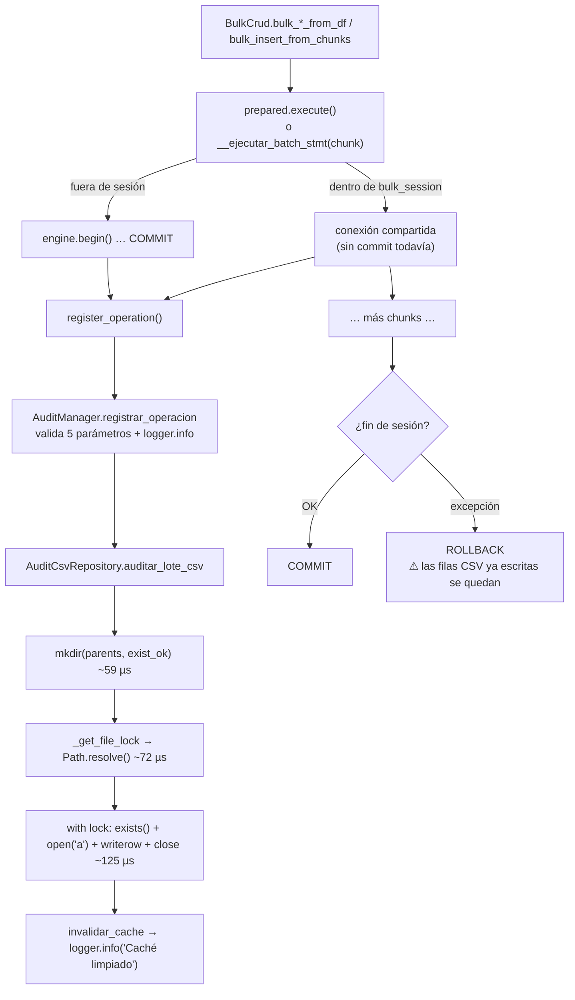

# AUDIT REPORT — `AuditManager` (auditoría integrada del módulo `bulk`, Área A5)

- Fecha: 2026-09-25 · Rama: `develop` (commit `5499828`) · Skill: `/audit-code`
- Referencia metodológica: `.github/prompts/audit_audit_manager_bulk.prompt.md` (5 fases)
- Modo: **solo lectura**. No se ha modificado código de `src/`.
- Reproducibilidad: `bench/bench_audit.py`, `bench/prof_audit.py` y `bench/repro_audit.py` (ejecutar con `PYTHONPATH=src PYTHONIOENCODING=utf-8`)

> **Nota previa sobre el prompt de referencia.** El prompt apunta a `src/util_bbdd/bulk/audit_manager.py`,
> `bulk_crud.py`, `log_operation()`, `flush()`, buffers y un modo async. **Nada de eso existe.** El código real
> es `bulk/audit.py` (fachada) + `bulk/_audit/` (repository, service, exporters) + `bulk/_support/persistence.py`
> (puente con `BulkCrud`), y la escritura es síncrona, sin buffer. Se ha auditado el código real. Ver hallazgo **H14**.

---

## Executive Summary

**Estado actual (rendimiento)**: **ACEPTABLE**. **Estado actual (fiabilidad de la traza)**: **SUBOPTIMIZADO**.

- La auditoría escribe **una fila CSV por operación** (por llamada en `bulk_*_from_df`, por chunk en `bulk_insert_from_chunks`), nunca por fila de datos.
- Overhead medido: **0,02 %–0,2 %** con `bulk_insert_from_df`; **3,4 %** en streaming con `chunk_size=5000` en SQLite; **16,5 %** en streaming con `chunk_size=500` en SQLite. En motores servidor, por proyección: **0,03 %–0,6 %** con chunk 5000.
- El coste real (~0,3–0,8 ms por fila CSV en Windows) no viene de escribir la fila: viene de `Path.resolve()` + `mkdir()` + `open/close` en cada llamada.
- **Lo grave no es el rendimiento sino la coherencia auditoría ↔ BD**. En los 3 casos se ha reproducido:
  1. la fila CSV se escribe **antes** del commit, así que un rollback deja filas de auditoría fantasma (y los reintentos de `ParallelBulkLoader` las duplican);
  2. si falla la escritura del CSV **después** del commit, el llamador recibe una excepción aunque los datos ya están en la BD, y si reintenta duplica filas o choca con la PK;
  3. si el CSV existe vacío, no se escribe nunca la cabecera y toda la analítica falla.

| Severidad | N.º | IDs |
|---|---|---|
| CRÍTICA | 0 | — |
| ALTA | 2 | H1, H2 |
| MEDIA | 5 | H3, H4, H5, H9, H12 |
| BAJA | 4 | H6, H7, H8, H10 |
| INFO | 3 | H11, H13, H14 |

**Recomendación**: **se puede usar en producción con configuración**: `chunk_size ≥ 5000` o `bulk_insert_from_df`, y no abrir el CSV en Excel mientras corre la carga. **Antes de usar la traza como evidencia de cumplimiento hay que corregir H1 y H2.**

**Veredicto `/audit-code`**: **APROBADO CON CONDICIONES** (ver § Veredicto).

---

## FASE 1 — MAP_CURRENT_STATE

### Componentes reales

| Pieza | Fichero | Responsabilidad |
|---|---|---|
| `AuditManager` | `bulk/audit.py:149-349` | Fachada pública: valida, delega, expone filtros/exports |
| `AuditTransaction` | `bulk/audit.py:27-146` | Context manager **en memoria**; no lo usa `BulkCrud` ni persiste nada |
| `AuditCsvRepository` | `bulk/_audit/repository.py:42-179` | Escritura CSV (TSV) con lock por ruta + caché de lectura TTL |
| `AuditAnalyticsService` | `bulk/_audit/service.py` | Estadísticas y filtros sobre `pd.DataFrame` |
| `AuditExporters` | `bulk/_audit/exporters.py` | Excel (openpyxl), JSON, HTML |
| `BulkPersistenceManager.register_operation` | `bulk/_support/persistence.py:74-91` | Puente `BulkCrud` → `AuditManager` |
| Consumidor | `dump/orchestrator.py:963-994` | `_build_audit_summary`: relee el CSV y filtra por `timestamp >= dump_inicio` |

**Dependencias**: stdlib `csv`, `threading`, `pathlib`; `pandas` para leer/analizar; `openpyxl` para Excel. No usa SQLAlchemy ni tablas de BD.

**Knobs disponibles**: `audit_csv_path` (None = desactivada), `cache_enabled`, `cache_ttl_seconds`. **No hay** nivel de detalle, buffer, flush ni modo async.

### Flujo actual (hot path)

**Puntos de invocación** (verificados con grep):
- `crud.py:580` en `__run_bulk_pipeline`: 1 fila por llamada a `bulk_insert/update/delete_from_df`, **después** de `execute()`.
- `crud.py:497` en `bulk_insert_from_chunks`: 1 fila por chunk, **dentro** de `bulk_session()`, o sea antes del commit.
- `ParallelBulkLoader` (`parallel_loader.py:330`): una `BulkCrud` por hilo con el mismo `audit_csv_path`, serializadas por el lock de `_FILE_LOCKS`.

### Supuestos y preguntas abiertas
- ¿La traza se usa como evidencia de cumplimiento o solo como telemetría operativa? Esto decide la política fail-open/fail-closed (H1).
- ¿Hay consumidores externos del CSV que dependan del formato actual (TSV, coma decimal, `Sí/No`, segundos)? Esto condiciona H3 y H13.

---

## FASE 2 — MEASURE_OVERHEAD

**Entorno**: Windows 11 Pro 10.0.26200, 32 CPU lógicas, Python 3.14.2, pandas 3.0.3, SQLAlchemy 2.0.50, NTFS local. SQLite en fichero. Warmup de 200 llamadas en el micro. E2E: mediana de 3 repeticiones (1 en 1M).

**Límite de la medición**: el E2E se ha hecho en SQLite. El banco de 5 motores (`docker-compose.bench.yml`) estaba levantado pero sus URLs/contraseña no estaban en el entorno de la sesión. Como la auditoría es un CSV local independiente del motor, el **coste absoluto** medido vale para todos los motores. El **% relativo** en PostgreSQL/MySQL/MariaDB/Oracle/SQL Server es una **proyección** con los tiempos reales de `2026-09-23-performance-audit-bulk/02_BASELINE_MOTORES_REALES.md`.

### A. Coste por llamada (`registrar_operacion`, micro, 5000 llamadas × 3)

| Escenario | µs/llamada |
|---|---|
| A1 · logging raíz en WARNING (app sin configurar) | **289,7** |
| A2 · logging raíz en INFO + `FileHandler` | **378,1** (+88 µs por los 2 INFO de cada llamada) |
| A3 · `audit_csv_path=None` (desactivada) | 9,4 (lo ocupa el `WARNING` por llamada, H10) |
| B · 8 hilos × 1000 al mismo CSV | 274,2 efectivo; serializa sin pérdidas (8000/8000 filas) |

**Desglose con cProfile (3000 llamadas)**:

| Paso | µs/llamada | % |
|---|---|---|
| `Path.resolve()` en `_get_file_lock` (`nt._getfinalpathname` ×2) | ~72 | 22 % |
| `open()` | ~66 | 20 % |
| `mkdir(parents=True, exist_ok=True)` | ~59 | 18 % |
| `close()` (`__exit__`) | ~55 | 17 % |
| Resto: validación, `strftime`, `exists`, `str(Path)`… | ~83 | 23 % |

Aislados: open+append+close = 110,9 µs; handle persistente + `flush()` por fila = **4,4 µs**.

### C. E2E con/sin auditoría (SQLite, s, mediana)

| Modo | Filas | chunk | Sin audit | Con audit | Δ % | Filas CSV |
|---|---|---|---|---|---|---|
| `from_df` | 1K | 5000 | 0,009 | 0,009 | ruido | 1 |
| `from_df` | 100K | 5000 | 0,330 | 0,335 | +1,5 (ruido) | 1 |
| `from_df` | 1M | 5000 | 3,248 | 3,185 | ruido | 1 |
| `from_chunks` | 100K | 5000 | 0,339 | 0,351 | +3,8 | 20 |
| `from_chunks` | 1M | 5000 | 3,376 | 3,510 | +4,0 | 200 |

La resta entre ejecuciones queda dentro del ruido (±4 %). Por eso se ha medido también **el tiempo pasado dentro de `registrar_operacion` durante la carga real**:

| Modo | Filas | chunk | Total s | Tiempo en auditoría | Llamadas | µs/llamada | **% del total** |
|---|---|---|---|---|---|---|---|
| `from_df` | 1K | 5000 | 0,012 | 0,6 ms | 1 | 595 | 5,1 % |
| `from_df` | 100K | 5000 | 0,330 | 0,7 ms | 1 | 663 | **0,20 %** |
| `from_df` | 1M | 5000 | 3,340 | 0,7 ms | 1 | 658 | **0,02 %** |
| `from_chunks` | 100K | 5000 | 0,351 | 15,6 ms | 20 | 780 | 4,4 % |
| `from_chunks` | 1M | 5000 | 3,517 | 117,9 ms | 200 | 590 | **3,35 %** |
| `from_chunks` | 100K | 500 | 0,530 | 87,7 ms | 200 | 438 | **16,6 %** |
| `from_chunks` | 1M | 500 | 5,160 | 852,5 ms | 2000 | 426 | **16,5 %** |

Dentro de una carga real cada llamada cuesta de 1,5 a 2,7 veces lo que cuesta en el micro (430–780 µs frente a 290). Es lo esperable con cachés frías y el I/O de SQLite compitiendo con el del CSV (y posiblemente el antivirus en tiempo real, no aislado).

### D. Memoria

- Escritura: pico transitorio de **278 KiB para 10.000 llamadas**; no hay buffer y no crece con el volumen de datos. No hay fugas: `_historial_transacciones` solo crece si se usa `AuditTransaction` (H11).
- Lectura: **1,67 MiB** de pico para un CSV de 10.000 filas. La caché guarda una copia y además devuelve otra en cada lectura (~2× el DataFrame).

### Key Metrics (baseline SQLite)

| Métrica | 1K | 100K | 1M |
|---|---|---|---|
| Throughput sin audit, `from_df` (filas/s) | ~111.000 | ~303.000 | ~308.000 |
| Throughput con audit, `from_df` (filas/s) | ~111.000 | ~299.000 | ~314.000 (ruido) |
| Overhead `from_df` (medido dentro) | 5,1 % | 0,20 % | 0,02 % |
| Overhead `from_chunks` chunk 5000 | — | 4,4 % | 3,35 % |
| Overhead `from_chunks` chunk 500 | — | 16,6 % | 16,5 % |
| Memoria añadida por auditoría | ≈ 0 | ≈ 0 | ≈ 0 |

### Proyección multi-motor (INSERT 1M en streaming, ~0,59 ms × nº de chunks)

| Motor (tiempo 1M de la línea base) | chunk 5000 (200 filas CSV ≈ 0,12 s) | chunk 500 (2000 filas CSV ≈ 0,85 s) |
|---|---|---|
| SQLite (3,5 s medido hoy) | 3,4 % (medido) | 16,5 % (medido) |
| PostgreSQL (20,1 s) | ~0,6 % | ~4,2 % |
| SQL Server pyodbc + P-01 (20,4 s) | ~0,6 % | ~4,2 % |
| Oracle (24,5 s) | ~0,5 % | ~3,5 % |
| MariaDB con P-02 (24,5 s) | ~0,5 % | **~3,5 %** ← el orquestador de `dump` aconseja `chunk_size ≤ 1000` en MariaDB/MySQL |
| MySQL con P-02 (26,7 s) | ~0,4 % | ~3,2 % |
| SQL Server pymssql (376 s) | ~0,03 % | ~0,2 % |

---

## FASE 3 — ANALYZE_CODE (hallazgos)

### Hallazgo H1: un fallo al escribir el CSV después del commit hace fallar una operación que ya se ha persistido — **CORREGIDO** (`2026-09-25-new-feature-audit-deferred-fail-open`)

**Fase**: 3 · **Tipo**: Config / Integridad · **Severidad**: **ALTA**

**Descripción**: fuera de `bulk_session`, `execute()` abre y commitea su propia transacción (`batch.py:852`, `engine.begin()`). Después, `crud.py:580` escribe la auditoría, y `crud.py:594-596` relanza `AuditError`/`OSError`. El llamador ve fallar una operación **cuyos datos ya están en la BD**. Un reintento duplica filas (sin PK) o lanza `IntegrityError`. En Windows el disparador más probable es muy común: **tener el CSV de auditoría abierto en Excel**, que lo bloquea en escritura. Dentro de `bulk_session` pasa lo contrario: el error de auditoría provoca el rollback de toda la sesión. Eso solo está documentado en el docstring de `bulk_session` (`crud.py:905-913`).

**Evidencia**:
- Código: `crud.py:577-596`, `_execution/batch.py:852`.
- Reproducción `R2`: con el CSV sin permiso de escritura, `bulk_insert_from_df` lanza `PermissionError` y la tabla tiene **3 filas** persistidas.

**Impacto estimado**: no afecta al rendimiento. Afecta a la **integridad de los datos** (duplicados al reintentar) y a la señal de error.

**Propuesta de mejora**:
- Cambio concreto: decidir la política de forma explícita. Recomendación: **fail-open por defecto**. Si falla la auditoría, se hace `logger.error` con los datos de la fila perdida, se incrementa un contador `audit_failures` y **no** se lanza la excepción. Opcionalmente, `BulkCrud(audit_strict=True)` para quien necesite fail-closed, documentando que en ese modo la auditoría debe escribirse antes del commit (depende de H2).
- Esfuerzo: Bajo (≈2 h + tests) · Riesgo: cambia el comportamiento observable (hoy lanza) → entrada en `CHANGELOG`/`COMPATIBILITY`.
- Tests requeridos: CSV no escribible → la operación termina, los datos están, hay ERROR en el log y el contador vale 1. Con `audit_strict=True`, la excepción se propaga.

**Multi-dialect notes**: aplica a todos (el commit fuera de sesión es común).

---

### Hallazgo H2: la auditoría se escribe antes del commit y deja filas fantasma tras un rollback (y los reintentos las duplican) — **CORREGIDO** (`2026-09-25-new-feature-audit-deferred-fail-open`)

**Fase**: 3 · **Tipo**: Integridad / Async · **Severidad**: **ALTA**

**Descripción**: `bulk_insert_from_chunks` (`crud.py:497`) registra cada chunk **dentro** de `bulk_session()`, antes del commit. Si falla un chunk posterior, se hace rollback de toda la sesión, pero el CSV conserva las filas de los chunks anteriores. `ParallelBulkLoader._load_partition` (`parallel_loader.py:348-378`) **reintenta** ante `OperationalError`/`TimeoutError`: cada intento vuelve a registrar los chunks, así que la traza **cuenta varias veces** filas que se revirtieron. Lo mismo ocurre con `bulk_*_from_df` llamadas dentro de un `bulk_session()` del usuario. La traza deja de servir para conciliar.

**Evidencia**:
- Código: `crud.py:473-503`, `crud.py:885-930`, `parallel_loader.py:348-378`.
- Reproducción `R3`: chunk 1 (100 filas) OK y chunk 2 con PK duplicada → **BD = 0 filas**, pero el **CSV dice INSERT de 100 filas**.

**Impacto estimado**: no afecta al rendimiento. La traza sobrestima las filas cargadas en todo fallo con rollback y en cada reintento.

**Propuesta de mejora**:
- Cambio concreto: **buffer de sesión**. Dentro de `bulk_session`, `register_operation` acumula las filas en una lista. Tras `conn.commit()` se escriben en bloque (un solo `open`). En modo `commit_every_n_chunks`, se vuelcan en cada commit parcial. En un rollback se descartan con un `logger.warning` que resuma lo que se descarta. Fuera de sesión no cambia nada.
- Beneficio secundario: con una sola apertura de fichero por commit, el coste de H9 en streaming baja a ~0.
- Esfuerzo: Medio (≈4–6 h con tests) · Riesgo: bajo; **no cambia el formato del CSV** (restricción de la sesión 2026-09-23). El timestamp pasa a ser el del commit, no el del chunk (documentarlo).
- Tests requeridos: rollback → 0 filas en el CSV; `commit_every_n_chunks=2` con fallo en el chunk 5 → solo 4 filas en el CSV; reintento de `ParallelBulkLoader` → sin duplicados; sesión OK → N filas y un solo `open`.

**Multi-dialect notes**: PostgreSQL, MySQL, MariaDB, Oracle, SQL Server y SQLite: aplica igual. En PostgreSQL con `commit_every_n_chunks` (P-27), el volcado debe engancharse al mismo punto de commit.

---

### Hallazgo H3: el resumen de auditoría del `dump` descarta operaciones que terminan en el mismo segundo en que empieza el volcado — **CORREGIDO** (`2026-09-25-hotfix-audit-manager-quick-fixes`)

**Fase**: 3 · **Tipo**: Compatibility · **Severidad**: **MEDIA**

**Descripción**: el CSV guarda `timestamp` truncado a segundos (`repository.py:124`, `%Y-%m-%d %H:%M:%S`), pero `dump_inicio = datetime.now()` lleva microsegundos (`orchestrator.py:99`). El filtro `timestamp >= desde` (`orchestrator.py:983`) excluye toda operación terminada en el mismo segundo que `dump_inicio`. En volcados pequeños el resumen sale incompleto o `None` sin avisar.

**Evidencia**: `R1`: `desde=08:54:18.592115`, `csv_ts=2026-09-25 08:54:18` → `summary=None`.

**Propuesta**: en el orquestador, `desde.replace(microsecond=0)`. Esfuerzo trivial, sin cambiar el formato. Así puede entrar una operación de un volcado anterior terminada en ese mismo segundo, algo aceptable y mucho menos probable. Test: registrar una operación inmediatamente después de `desde` y comprobar que el resumen la cuenta.

---

### Hallazgo H4: si el CSV existe vacío, nunca se escribe la cabecera — **CORREGIDO** (`2026-09-25-hotfix-audit-manager-quick-fixes`)

**Fase**: 3 · **Tipo**: Compatibility · **Severidad**: **MEDIA**

**Descripción**: `repository.py:114` decide si escribir la cabecera con `exists()`. Un fichero de 0 bytes existe, así que la primera fila de datos pasa a ser la cabecera. Desde entonces `obtener_estadisticas()` lanza `AuditDataError("No hay datos")` y los filtros fallan con `KeyError`. Disparadores realistas: pre-crear el fichero con `touch`, rotación por truncado o una herramienta que lo deja vacío.

**Evidencia**: `R4`: columnas leídas `['2026-09-25 08:54:18', 't', 'SQLITE', 'INSERT', '10', '0,010', 'No']`.

**Propuesta**: `file_exists = path.exists() and path.stat().st_size > 0` (dentro del lock). Esfuerzo trivial, sin riesgo. Test: fichero vacío + 1 registro → cabecera correcta.

---

### Hallazgo H5: `total_filas` guarda las filas **enviadas**, no las afectadas

**Fase**: 3 · **Tipo**: Config / Contrato · **Severidad**: **MEDIA**

**Descripción**: el docstring de `registrar_operacion` (`audit.py:236`) dice "Número de filas afectadas", pero `rowcount` es siempre `len(df)` (`crud.py:490`, `:621`, `:692`, `:749`). En un DELETE o UPDATE con claves inexistentes la traza sobrestima.

**Evidencia**: `R5`: DELETE de 1000 PKs con solo 2 existentes → CSV `total_filas=1000`.

**Propuesta**: corregir la **documentación** ("filas enviadas a la operación"). Usar `cursor.rowcount` no es fiable en todos los drivers con executemany (pyodbc `fast_executemany`, psycopg `executemany` devuelven -1 o valores parciales). Opcional a largo plazo: columna nueva `filas_afectadas`, que cambia el contrato del CSV.

---

### Hallazgo H9: cada fila de auditoría cuesta 0,3–0,8 ms por `resolve()` + `mkdir()` + `open/close` — **CORREGIDO** (`2026-09-25-new-feature-audit-deferred-fail-open`)

**Fase**: 3 · **Tipo**: Overhead · **Severidad**: **MEDIA** (BAJA con `chunk_size ≥ 5000`)

**Descripción**: `auditar_lote_csv` repite en **cada** llamada `mkdir(parents=True, exist_ok=True)` (`repository.py:109`), `Path.resolve()` para obtener el lock (`repository.py:33`) y `open`/`close` del fichero. La escritura en sí cuesta ~4 µs.

**Evidencia**: profiling (FASE 2): resolve 22 %, open 20 %, mkdir 18 %, close 17 %. Overhead medido de 3,35 % (chunk 5000) y 16,5 % (chunk 500) en streaming SQLite; ~3,5 % proyectado en MariaDB con chunk 500.

**Impacto potencial**:
- QW-2 (resolver el lock y crear el directorio **una vez**, al fijar la ruta): −45 % por llamada (~290 → ~160 µs).
- Con H2 (volcado por commit), el streaming pasa de N aperturas a 1 por sesión: el overhead cae a **≈ 0 %** también con chunk 500.
- Un handle persistente con `flush` (4,4 µs) **no se recomienda**: en Windows bloquea el fichero a otras herramientas, obliga a gestionar `close()`/`atexit` y complica la rotación.

**Propuesta**: QW-2 + H2. Riesgo bajo: si el directorio se borra en mitad de la carga, reintentar `mkdir` ante `FileNotFoundError`.

**Best practice**: el *Logging Cookbook* de Python recomienda sacar del hilo que emite los handlers que bloquean (`QueueHandler`/`QueueListener`). Aquí no compensa: es 1 escritura por chunk, y un hilo de volcado añade riesgo de perder filas si el proceso cae. El agrupamiento por commit de H2 da el mismo beneficio sin ese riesgo.

---

### Hallazgo H12: inyección de fórmulas en el export a Excel — **CORREGIDO** (`2026-09-25-hotfix-audit-manager-quick-fixes`)

**Fase**: 3 · **Tipo**: Seguridad · **Severidad**: **MEDIA** (explotación de probabilidad baja)

**Descripción**: `exportar_resumen_excel` escribe `tabla`, `operacion`… tal cual con openpyxl. Cualquier cadena que empiece por `=` se guarda como **fórmula**. `registrar_operacion` es API pública y acepta cualquier `tabla`, y el CSV es editable por cualquiera con acceso al fichero.

**Evidencia**: tabla `=HYPERLINK("http://x","clic")` → celda con `data_type='f'` en la hoja `Resumen_global`.

**Propuesta**: neutralizar al exportar las celdas de texto que empiecen por `= + - @ \t \r`, anteponiendo `'`. Es la mitigación de OWASP *CSV Injection*. Esfuerzo bajo. HTML: ya escapa (`to_html` usa `escape=True` por defecto). Verificado en código.

---

### Hallazgo H6: la caché de lectura queda obsoleta entre instancias

**Severidad**: BAJA · **Tipo**: Config

La caché solo se invalida con las escrituras de **la propia** instancia. Con varias `BulkCrud`/`AuditManager` sobre el mismo CSV (el caso normal en `ParallelBulkLoader`), una lectura devuelve datos de hasta `cache_ttl_seconds=300` s de antigüedad. `R6`: A ve 1 fila; B escribe; A sigue viendo 1 (real: 2). `dump` ya lo evita con `cache_enabled=False`.
**Propuesta**: validar la caché con `(st_mtime_ns, st_size)` en lugar de, o además de, el TTL. Un `stat` cuesta ~4 µs.

### Hallazgo H7: el setter público `columnas_auditoria` rompe el CSV

**Severidad**: BAJA · **Tipo**: Contrato

`audit.py:200-202` permite cambiar la cabecera, pero la fila se escribe siempre con 7 campos fijos (`repository.py:122-131`). `R7`: tras fijar 2 columnas, leer falla con `AuditDataError: month must be in 1..12`.
**Propuesta**: deprecar el setter (`DeprecationWarning`) y eliminarlo en la siguiente versión menor.

### Hallazgo H8: `validar_ruta` lanza `ValueError` en lugar de `AuditConfigError`

**Severidad**: BAJA · **Tipo**: Contrato

`repository.py:70`. Rompe la jerarquía `AuditError`: quien captura `AuditError` no lo ve. Aflora en `BulkCrud.__init__`.
**Propuesta**: `class AuditConfigError(AuditError, ValueError)` para seguir siendo compatible con quien captura `ValueError`, y lanzarla aquí.

### Hallazgo H10: P-11 sigue abierto: ruido de log por operación — **CORREGIDO** (`2026-09-25-refactor-audit-qw2-qw3`)

**Severidad**: BAJA · **Tipo**: Overhead

Sin cambios desde la auditoría del 2026-09-23 (P-11): un `WARNING "Auditoría deshabilitada"` por operación cuando `audit_csv_path=None` (`audit.py:244`), más dos `INFO` por operación (`audit.py:256`, `repository.py:175`). Medido: **+88 µs/llamada** con un handler INFO a fichero. Con chunk 500 y 1M filas son 4000 líneas de log por carga.
**Propuesta**: avisar una sola vez por instancia y bajar `Caché limpiado` y `🟢 … registrado` a DEBUG.

### Hallazgo H11: `AuditTransaction` está aislado del flujo bulk

**Severidad**: INFO

Ni `BulkCrud` ni `ParallelBulkLoader` lo usan. No persiste nada; `_historial_transacciones` crece sin límite y `obtener_resumen()` hace `deepcopy` de todas las operaciones. Documentar que es un contador **en memoria** o retirarlo en una versión mayor.

### Hallazgo H13: limitaciones de diseño aceptadas (documentar)

**Severidad**: INFO
- Lock **intra-proceso**: varios procesos sobre el mismo CSV pueden intercalar filas (en Windows no hay atomicidad de `O_APPEND`). Hoy no hay `multiprocessing` en `src/` (verificado).
- `timestamp` local sin zona horaria y con resolución de segundo; `tiempo_seg` con coma decimal; `sql` = `Sí/No`. Son contrato del CSV: no cambiarlo sin versionarlo.
- Los ficheros de export tienen nombre fijo (`auditoria.xlsx|json|html` junto al CSV): dos exports concurrentes en el mismo directorio se pisan.

### Hallazgo H14: el prompt de referencia y el comando describen un componente que no existe

**Severidad**: INFO · **Tipo**: Configuración IA

`.github/prompts/audit_audit_manager_bulk.prompt.md` y `.claude/commands/performance-audit-bulk.md:50` citan `audit_manager.py`, `bulk_crud.py`, `log_operation()`, `flush()`, buffer, async y "tabla audit en BD". Van contra la regla de "no inventar módulos".
**Propuesta**: cambiar las rutas por `bulk/audit.py`, `bulk/_audit/`, `bulk/_support/persistence.py` y `bulk/crud.py`, y reescribir las preguntas del scope B/C para un CSV síncrono.

### Tipado

Sin `Any` problemáticos en el hot path. `AuditTransaction.__exit__` usa `Any` para `exc_type/exc_val/exc_tb`; se puede precisar con `type[BaseException] | None`, `BaseException | None` y `TracebackType | None`. En `rowcount` la validación `isinstance(..., int)` rechazaría un `numpy.int64`, pero `BulkCrud` siempre pasa `len(...)`, así que no se llega a ese caso.

### Tests

53 tests de auditoría en verde (`test_audit_subsystem.py`, `bulk/test_audit_threadsafe.py`, `test_audit_excel_export.py`). **Faltan**: coherencia auditoría/rollback (H2), fallo de CSV tras commit (H1), fichero vacío (H4), resumen del dump con la misma marca de segundo (H3), neutralización de fórmulas (H12) y caché entre instancias (H6).

---

## FASE 4 — PROPOSE_OPTIMIZATIONS

Detalle, esfuerzo y orden en `optimization_roadmap_audit_manager.md`. Resumen:

| ID | Mejora | Hallazgos | Impacto | Esfuerzo | Riesgo |
|---|---|---|---|---|---|
| QW-1 | Cabecera si `st_size == 0` | H4 | Corrección | 15 min | Nulo |
| QW-2 | Resolver el lock y hacer `mkdir` una vez por ruta | H9 | −45 % µs/llamada | 1 h | Bajo |
| QW-3 | Logs por operación a DEBUG / aviso único | H10 | −88 µs/llamada con INFO; menos ruido | 30 min | Nulo |
| QW-4 | `desde.replace(microsecond=0)` en `dump` | H3 | Corrección | 15 min | Nulo |
| M-1 | Buffer de auditoría por sesión, volcado tras commit | H2, H9 | Traza coherente; streaming ≈ 0 % | 4–6 h | Bajo |
| M-2 | Política fail-open + `audit_strict` | H1 | Evita duplicados al reintentar | 2–3 h | Cambio de comportamiento |
| M-3 | Neutralizar fórmulas en Excel | H12 | Seguridad | 1 h | Nulo |
| M-4 | Caché validada con `mtime/size` | H6 | Corrección | 1 h | Nulo |
| L-1 | Docs `total_filas` + deprecar setter + `AuditConfigError(ValueError)` + tipado de `__exit__` | H5, H7, H8 | Contrato | 2 h | Deprecación |
| L-2 | Sustituir o retirar `AuditTransaction` | H11 | Deuda | — | Versión mayor |

**No recomendado**: logging async (`QueueHandler`), handle persistente y compresión. Con 1 fila por chunk la ganancia es marginal y el riesgo (pérdida de filas al caer el proceso, bloqueo del fichero en Windows) no compensa. **Tampoco** mover la auditoría a una tabla de la BD destino: eso añade DDL y permisos distintos en cada uno de los 6 motores y sale del alcance de la librería.

---

## FASE 5 — VALIDATE_MULTI_DIALECT

La auditoría es **agnóstica al motor**: no ejecuta SQL; `motor = engine.dialect.name.upper()`. Las diferencias por motor solo afectan al % relativo y a la semántica transaccional alrededor.

| Aspecto | PostgreSQL | MySQL | MariaDB | Oracle | SQL Server | SQLite |
|---|---|---|---|---|---|---|
| Overhead chunk 5000 (1M) | ~0,6 % | ~0,4 % | ~0,5 % | ~0,5 % | 0,03–0,6 % | 3,4 % (medido) |
| Overhead chunk 500 (1M) | ~4,2 % | ~3,2 % | ~3,5 % | ~3,5 % | 0,2–4,2 % | 16,5 % (medido) |
| H1 (fallo tras commit) | Sí | Sí | Sí | Sí | Sí | Sí (R2) |
| H2 (fila antes del commit) | Sí | Sí | Sí | Sí | Sí | Sí (R3) |
| H2 con `commit_every_n_chunks` | Sí (P-27) | Sí | Sí | Sí | Sí | Sí |
| H5 `total_filas` ≠ afectadas | Sí | Sí | Sí | Sí | Sí | Sí (R5) |
| `rowcount` real fiable como alternativa | Parcial (executemany) | Sí (PyMySQL) | Sí | Sí | No con `fast_executemany` | Sí |
| Tipos/constraints en la traza | N/A (CSV) | N/A | N/A | N/A | N/A | N/A |

**Recomendaciones por motor**: MariaDB/MySQL con `chunk_size ≤ 1000` (lo que aconseja `dump`) es donde más compensan QW-2 y M-1. En SQL Server con pymssql el overhead es despreciable. En SQLite el % es el más alto porque la carga es la más rápida.

**Compatibilidad**: 100 %. Ninguna de las mejoras propuestas depende del motor.

---

## Recomendaciones de configuración (con los knobs que existen hoy)

| Escenario | Configuración |
|---|---|
| 1K (desarrollo) | `audit_csv_path` activado; cualquier modo (overhead < 1 ms total) |
| 100K (staging) | `bulk_insert_from_df` o `from_chunks` con `chunk_size ≥ 5000`; no abrir el CSV en Excel durante la carga (H1) |
| 1M (producción) | `from_chunks` con `chunk_size ≥ 5000` (≤ 0,6 % en servidores). Si el motor obliga a chunk ≤ 1000 (MariaDB con TEXT/BLOB), asumir un 3–4 % hasta M-1. Leer la traza con `cache_enabled=False` si hay escritores concurrentes (H6). **No usar la traza para conciliar cargas con rollback o reintentos hasta M-1.** |

## Risk Assessment

- Breaking changes: **algunos** (M-2 cambia "lanza" por "registra y sigue"; L-1 depreca el setter).
- Data migration: **no** (el formato del CSV no cambia).
- Rollback complexity: **bajo** (cambios locales a `_audit/`, `persistence.py`, `crud.py` y `orchestrator.py`).
- Multi-dialect: **100 %** compatible.

## Validation Strategy

1. Relanzar `bench/bench_audit.py` y la medición "tiempo dentro de la auditoría" antes y después de QW-2 + M-1. Objetivo: streaming chunk 500 < 1 %.
2. Convertir `bench/repro_audit.py` (R1–R7) en tests unitarios de regresión.
3. Test de integración con `ParallelBulkLoader` + `OperationalError` inyectado: la traza no debe tener duplicados.
4. Relanzar `scripts/bench_bulk.py --ops insert` en los 5 motores del banco para confirmar la proyección multi-motor.

---

## PLAN · AUDIT_PLAN · AUDIT_CODE · VERSION (formato `/audit-code`)

### PLAN
- **Alcance**: subsistema de auditoría del módulo `bulk` y sus puntos de integración.
- **Archivos analizados**: `bulk/audit.py`, `bulk/_audit/{repository,service,exporters,errors,html_template}.py`, `bulk/_support/persistence.py`, `bulk/crud.py` (init, `__run_bulk_pipeline`, `bulk_insert_from_chunks`, `bulk_session`), `bulk/_execution/batch.py` (puntos de commit), `bulk/_execution/parallel_loader.py` (reintentos), `dump/orchestrator.py` (`_build_audit_summary`).

### AUDIT_PLAN
- **Riesgos funcionales**: traza incoherente con la BD tras rollback o reintento (H2); error reportado sobre datos ya persistidos (H1); resumen del dump incompleto (H3).
- **Riesgos técnicos**: CSV corrupto si existe vacío (H4); caché obsoleta (H6); setter que rompe el formato (H7); overhead con chunks pequeños (H9).
- **Riesgos de seguridad**: inyección de fórmulas en el Excel (H12). Sin SQL dinámico; el HTML se escapa; no hay credenciales en la traza (`motor` es el nombre del dialecto, no la URL). Verificado.

### AUDIT_CODE
- **Bugs**: `crud.py:497` (H2), `crud.py:580-595` (H1), `orchestrator.py:99/983` + `repository.py:124` (H3), `repository.py:114` (H4), `audit.py:200-202` (H7), `repository.py:70` (H8).
- **Edge cases**: fichero vacío; CSV bloqueado por Excel; reintentos del loader; varias instancias sobre el mismo CSV; DELETE de claves inexistentes.
- **Performance**: H9 (resolve/mkdir/open por llamada), H10 (logs).
- **Seguridad**: H12.
- **Tipado**: `AuditTransaction.__exit__` con `Any`.
- **Deuda técnica**: H11, H14.

### Veredicto

**APROBADO CON CONDICIONES**

Condiciones para aceptar la traza como fuente fiable:
1. Corregir **H2** (M-1) y **H1** (M-2), con tests de rollback, reintento y CSV no escribible.
2. Corregir **H4** y **H3** (QW-1, QW-4): son triviales y evitan datos silenciosamente erróneos.
3. Corregir **H12** (M-3) antes de distribuir exports Excel a terceros.

El rendimiento **no bloquea**: con la configuración por defecto (`chunk_size=5000`) el overhead en motores servidor es < 1 %.

### VERSION
- Commits sugeridos cuando se implementen:
  - `fix(bulk): la auditoría se escribe tras el commit y se descarta en rollback`
  - `fix(bulk): un fallo al escribir la auditoría no invalida una operación ya persistida`
  - `fix(bulk): cabecera del CSV de auditoría con fichero vacío`
  - `fix(dump): el resumen de auditoría incluye las operaciones del primer segundo`
  - `fix(bulk): neutralizar fórmulas en el export Excel de auditoría`
  - `perf(bulk): resolver lock y directorio de auditoría una vez por ruta`
- Pruebas sugeridas: las 6 de "Tests" (FASE 3) más la validación 3.

## Referencias

- Python Logging Cookbook, *Dealing with handlers that block*: https://docs.python.org/3/howto/logging-cookbook.html#dealing-with-handlers-that-block
- `logging.handlers.QueueHandler` / `QueueListener`: https://docs.python.org/3/library/logging.handlers.html#queuehandler
- OWASP, *CSV Injection*: https://owasp.org/www-community/attacks/CSV_Injection
- OWASP *Logging Cheat Sheet* (integridad y fallo de la traza): https://cheatsheetseries.owasp.org/cheatsheets/Logging_Cheat_Sheet.html
- Línea base multi-motor: `.ai/sessions/2026-09-23-performance-audit-bulk/02_BASELINE_MOTORES_REALES.md`
- Hallazgo previo P-11: `.ai/sessions/2026-09-23-performance-audit-bulk/01_PERFORMANCE_AUDIT.md:294`
