# AUDIT REPORT: auditoría integrada en `ParallelBulkLoader` (módulo `bulk`, Área A5)

- Fecha: 2026-09-25 · Rama: `develop` (commit `52549e9`) · Skill: `/audit-code`
- Scope: `src/util_bbdd/bulk/_execution/parallel_loader.py` y la parte de la auditoría que ejecuta: `bulk/_support/persistence.py`, `BulkCrud.bulk_session` / `bulk_insert_from_chunks` (`bulk/crud.py`) y `bulk/_audit/repository.py`
- Referencia metodológica: `.github/prompts/audit_audit_manager_bulk.prompt.md` (5 fases)
- Modo: **solo lectura**. No se ha modificado código de `src/` ni de `tests/`.
- Reproducibilidad (desde la raíz del repo, con `PYTHONPATH=src PYTHONIOENCODING=utf-8`):
  - `bench/bench_loader_audit.py`: banco de overhead; resultados en `bench/bench_results.md`
  - `bench/repro_loader_audit.py`: reproductores R1–R5
- Antecedente: `.ai/sessions/2026-09-25-audit-code-audit-manager/` (H1–H14 sobre `AuditManager`, ya corregidos). Aquí no se repiten; se audita lo que añade **el loader**: varios hilos, reintentos, `commit_every_n_chunks`, `disable_constraints` y `audit_strict`.

---

## Executive Summary

**Estado actual (rendimiento)**:
- **BIEN OPTIMIZADO** en modo atómico, el de por defecto;
- **ACEPTABLE** con `commit_every_n_chunks` bajo.

**Estado actual (fiabilidad de la traza)**: **ACEPTABLE**, con un caso de sobreconteo en modo estricto.

- Con varios hilos, la auditoría se escribe **una vez por partición** en modo atómico (1 apertura del CSV por worker, al confirmar). Medido en 1M filas y 4 workers: **0,08 %** del tiempo con chunks de 5000 y **0,22 %** con chunks de 500. La diferencia E2E con y sin auditoría queda dentro del ruido (±3 %).
- El único coste medible aparece con `commit_every_n_chunks` pequeño: **2 aperturas del CSV por commit**. Con N=2, **+8 % a +9 %** E2E en SQLite (2000 aperturas); con N=10, **+1,1 %** (400). En motores servidor la proyección es de 0,5 % a 2 % con N=2 (PL-9).
- Los defectos relevantes no son de rendimiento:
  1. **PL-2**: con `audit_strict=True` y `max_retries > 0`, si el **COMMIT** falla con `OperationalError`, el reintento **duplica** la traza sin dejar error (R2: BD 40 filas, CSV 80).
  2. **PL-3**: con `disable_constraints=True` en `mssql+pyodbc`, el loader **activa `fast_executemany` en el engine compartido aunque se configure `enable_fast_executemany=False`** (R3). No es de auditoría, pero está en el fichero auditado.
  3. **PL-1**: con `commit_every_n_chunks`, las filas confirmadas de una operación a medias no constan en el CSV. Es una limitación aceptada y con test, pero **el aviso dice lo contrario** ("sin confirmarlos") y el loader no expone el hueco (R1: BD 30, CSV 20).

| Severidad | N.º | IDs |
|---|---|---|
| CRÍTICA | 0 | — |
| ALTA | 0 | — |
| MEDIA | 3 | PL-2, PL-3, PL-9 |
| BAJA | 4 | PL-1, PL-4, PL-5, PL-6 |
| INFO | 3 | PL-7, PL-8, PL-10 |

**Recomendación**: **se puede usar en producción con configuración**:
- modo atómico, o `commit_every_n_chunks ≥ 10`;
- no combinar `audit_strict=True` con `max_retries > 0` hasta M-1;
- en SQL Server con pyodbc y `enable_fast_executemany=False`, no usar `disable_constraints=True` hasta QW-1.

**Veredicto `/audit-code`**: **APROBADO CON CONDICIONES** (ver § Veredicto).

---

## FASE 1: MAP_CURRENT_STATE

### Piezas y responsabilidades

| Pieza | Fichero:líneas | Papel en la auditoría |
|---|---|---|
| `ParallelBulkLoader.__init__` | `parallel_loader.py:161-218` | Recibe `audit_csv_path` y `audit_strict`. **No valida** la ruta (PL-4) |
| `_load_partition` | `parallel_loader.py:321-436` | Crea una `BulkCrud` **por partición** con el mismo `audit_csv_path`. Reintenta `OperationalError`/`TimeoutError` **con la misma `BulkCrud`**. Copia `crud.audit_failures` al `PartitionResult` en los 3 caminos |
| `_load_with_maintenance` | `parallel_loader.py:438-472` | `bulk_session` + `maintenance_scope` + `bulk_insert_from_df` por chunk: 1 registro de auditoría por chunk, diferido |
| `_hoist_constraints_for_workers` / `_resolve_table` | `parallel_loader.py:474-551` | DDL en el hilo principal (no se audita). `_resolve_table` crea una `BulkCrud` **sin auditoría y sin `enable_fast_executemany`** (PL-3) |
| `PartitionResult.audit_failures` / `ParallelLoadResult.audit_failures` | `parallel_loader.py:76-131` | Únicos contadores de auditoría que expone el loader |
| `BulkCrud.bulk_insert_from_chunks` | `crud.py:440-510` | 1 `register_operation` por chunk del lector, dentro de `bulk_session` |
| `BulkCrud.bulk_session` | `crud.py:900-961` | Atómico: `flush_audit_before_commit` dentro de `engine.begin()` (strict) y `flush_audit_after_commit` después (fail-open). Con `commit_every_n_chunks`: hook `persistence.commit` en cada commit periódico |
| `BulkPersistenceManager` | `persistence.py:93-182` | Acumula en `_pending`, escribe al confirmar y descarta en rollback. Política fail-open o strict |
| `AuditCsvRepository.escribir_registros` | `_audit/repository.py:134-162` | `open('a')` + `writerows` bajo un lock **por ruta y por proceso** (`_FILE_LOCKS`), compartido por todos los workers |

**Dependencias**: stdlib `csv`, `threading`, `concurrent.futures`, `pathlib`. No usa SQLAlchemy para la traza ni hay tabla de auditoría en BD. **Knobs** que ve el loader: `audit_csv_path` (None = desactivada, el valor por defecto), `audit_strict`. **No hay** nivel de detalle, buffer configurable, flush ni modo async.

### Flujo (hot path por partición)

```mermaid
flowchart TD
    L["load(): ThreadPoolExecutor(workers)"] --> P["_load_partition(i)<br/>BulkCrud(audit_csv_path, audit_strict)"]
    P -->|"disable_constraints y sin hoist"| M["_load_with_maintenance<br/>bulk_session + maintenance_scope"]
    P -->|resto| C["bulk_insert_from_chunks<br/>(bulk_session propio)"]
    M --> R["por chunk del lector:<br/>execute → register_operation"]
    C --> R
    R -->|"en transacción"| PEND["_pending.append(AuditRecord)<br/>~5 µs, ~192 B"]
    R -->|"fuera de transacción<br/>(commit periódico en el último lote)"| W1["_flush_audit → CSV<br/>(1 apertura)"]
    PEND --> K{"¿commit?"}
    K -->|"periódico (commit_every_n_chunks)"| HK["persistence.commit:<br/>strict: escribe → COMMIT<br/>fail-open: COMMIT → escribe"]
    K -->|"final de sesión"| FIN["strict: escribe dentro de begin() → COMMIT<br/>fail-open: COMMIT → escribe"]
    K -->|"excepción → ROLLBACK"| DESC["end_session_audit:<br/>descarta _pending + WARNING"]
    HK --> CSV[("CSV compartido<br/>lock por ruta")]
    FIN --> CSV
    W1 --> CSV
    DESC --> RET{"¿OperationalError / TimeoutError<br/>y quedan reintentos?"}
    RET -->|sí| P2["reintento con la MISMA BulkCrud<br/>reader() otra vez"]
    RET -->|no| PR["PartitionResult(rows=rows_committed,<br/>audit_failures)"]
```

**Frecuencia**:
- **1 fila CSV por chunk del lector**, nunca por fila de datos.
- Aperturas del CSV:
  - modo atómico: **1 por partición**;
  - con `commit_every_n_chunks`: **hasta 2 por commit periódico** (PL-9);
  - fuera de sesión: no aplica, porque el loader siempre usa sesión.

### Supuestos y preguntas abiertas

- ¿Se combina en producción `audit_strict=True` con `max_retries > 0`? Decide la prioridad de M-1 (PL-2).
- ¿Hay consumidores que concilien `ParallelLoadResult.total_rows` con el CSV? Decide si M-3 (contadores) basta o hace falta L-2 (columna de correlación).
- ¿Qué N de `commit_every_n_chunks` se usa en MariaDB/MySQL? La tabla del docstring de `BulkCrud` recomienda 10–50, que es la zona barata de PL-9.

---

## FASE 2: MEASURE_OVERHEAD

**Entorno**: Windows 11 Pro 10.0.26200, 32 CPU lógicas, Python 3.14.2, SQLAlchemy 2.0.50, pandas 3.0.3, NTFS local.

**Método**:
- SQLite en fichero (WAL, `synchronous=NORMAL`), tabla de 4 columnas, **4 particiones y 4 workers**, `chunk_size=5000` en el loader.
- Mediana de 3 ejecuciones.
- Se instrumentan `AuditCsvRepository.escribir_registros` (lock incluido) y `BulkPersistenceManager.register_operation`. El tiempo se mide **dentro** de la auditoría durante la carga real, porque la resta E2E queda en el ruido (como ya advertía la auditoría anterior).

**Límite de la medición**: el banco de 5 motores (`docker-compose.bench.yml`) está levantado, pero `UTIL_BBDD_BENCH_PASSWORD` no está en el entorno de la sesión. **No se ha extraído la contraseña de los contenedores.**
- El **coste absoluto** medido vale para cualquier motor, porque la auditoría es un CSV local.
- En SQLite los escritores se serializan, así que la suma de tiempos de los hilos se acerca al impacto real. En motores servidor, con inserciones paralelas, es una **cota superior**.
- El % en PostgreSQL y MariaDB es una **proyección**.

### Resultados (1 fila por escenario; detalle en `bench/bench_results.md`)

| Filas | Chunk del lector | Modo | Sin audit (s) | Con audit (s) | Δ E2E | Tiempo en escritura CSV | Aperturas | Filas CSV | **% en escritura** |
|---|---|---|---|---|---|---|---|---|---|
| 100K | 5000 | atómico | 0,362 | 0,374 | ruido | 4,2 ms | 4 | 20 | 1,12 % |
| 100K | 500 | atómico | 0,572 | 0,562 | ruido | 2,5 ms | 4 | 200 | 0,44 % |
| 1M | 5000 | atómico | 3,437 | 3,396 | ruido | 2,8 ms | 4 | 200 | **0,08 %** |
| 1M | 500 | atómico | 4,475 | 4,495 | ruido | 9,7 ms | 4 | 2000 | **0,22 %** |
| 1M | 500 | mantenimiento (`disable_constraints`) | 4,783 | 4,769 | ruido | 7,4 ms | 4 | 2000 | **0,15 %** |
| 1M | 500 | `commit_every_n_chunks=10` | 4,573 | 4,625 | +1,1 % | 100,5 ms | 400 | 2000 | **2,2 %** |
| 1M | 500 | `commit_every_n_chunks=2` | 4,636–4,688 | 5,018–5,120 | **+8,2 % / +9,2 %** | 416–477 ms | **2000** | 2000 | **8,3 %–9,3 %** |

- `register_operation` en transacción (solo acumular): **~5,6 µs por llamada** (11,2 ms en 2000 llamadas, sumando los hilos).
- Coste por escritura con 4 workers compitiendo por el lock: **~0,21–0,25 ms por apertura** (en la auditoría anterior, 0,29 ms en un solo hilo). **El lock no introduce contención apreciable.**
- Escribir 500 registros de una vez cuesta ~2,4 ms, unos ~4 µs por fila: el coste es la apertura, no el volumen.

### Memoria

- `AuditRecord` en `_pending`: **~192 B** (tracemalloc, 100.000 registros).
- Modo atómico: `_pending` crece con el número de chunks de la partición y se libera al confirmar. En 1M filas con chunks de 500 son 500 registros por worker (~96 KB). Para llegar a 100 MB harían falta ~500.000 chunks en **una sola transacción**, algo fuera de cualquier uso razonable (PL-10).
- Con `commit_every_n_chunks`, está acotado por N.
- No hay fugas: `_pending` se vacía en `_flush_audit` y en `end_session_audit`, y `start_session_audit` lo reinicia en cada reintento.

### Proyección multi-motor (PL-9, 1M filas, chunk del lector 500)

Coste absoluto: ~0,21 ms por apertura × aperturas, repartido entre 4 workers. Como el lock apenas tiene contención, cada worker pierde ~¼ de la suma. `T` es el tiempo de 1M filas en la línea base de un solo proceso (`2026-09-23-performance-audit-bulk/02_BASELINE_MOTORES_REALES.md`). Según lo que escale la carga con 4 workers (de 1× a 4×), el % queda entre `suma / (4·T)` y `suma / T`, que es el rango de la tabla.

| Motor | Atómico (4 aperturas) | N=10 (400 aperturas ≈ 0,1 s) | N=2 (2000 aperturas ≈ 0,42 s) |
|---|---|---|---|
| SQLite (medido) | 0,22 % | 2,2 % | 8,3 %–9,3 % |
| PostgreSQL (20,1 s) | ≈ 0 % | 0,1 %–0,5 % | 0,5 %–2,1 % |
| MariaDB con P-02 (24,5 s) | ≈ 0 % | 0,1 %–0,4 % | 0,4 %–1,7 % |
| MySQL con P-02 (26,7 s) | ≈ 0 % | 0,1 %–0,4 % | 0,4 %–1,6 % |
| SQL Server pyodbc + P-01 (20,4 s) | ≈ 0 % | 0,1 %–0,5 % | 0,5 %–2,1 % |
| Oracle (24,5 s) | ≈ 0 % | 0,1 %–0,4 % | 0,4 %–1,7 % |

### Key Metrics (baseline, SQLite, 4 workers)

| Métrica | 1K | 100K | 1M |
|---|---|---|---|
| Throughput sin audit (filas/s, chunk 5000) | n/m¹ | ~276.000 | ~291.000 |
| Throughput con audit (filas/s, chunk 5000) | n/m¹ | ~267.000 | ~294.000 (ruido) |
| Overhead atómico (% en escritura) | < 1 ms en total | 0,44 %–1,12 % | 0,08 %–0,22 % |
| Overhead con `commit_every_n_chunks=2` | — | — | 8,3 %–9,3 % |
| Memoria añadida | ≈ 0 | ≈ 0 | ~96 KB por worker (chunk 500) |

¹ No medido: con 4 particiones de 250 filas domina el arranque del pool. El coste absoluto es el de 4 aperturas (~1–4 ms).

---

## FASE 3: ANALYZE_CODE (hallazgos)

### Hallazgo PL-2: `audit_strict` + `max_retries`: un COMMIT fallido duplica la traza

**Fase**: 3 · **Tipo**: Integridad / Async · **Severidad**: **MEDIA** (probabilidad baja; afecta justo a quien activa strict para tener una traza fiable)

**Descripción**: en modo estricto, `bulk_session` escribe la auditoría de la sesión **dentro** de `engine.begin()`, antes del COMMIT (`crud.py:956`), para que un fallo de escritura deshaga la sesión. Si lo que falla es el **COMMIT** con `OperationalError` (se cae la conexión, `serialization_failure` en PostgreSQL SERIALIZABLE, `database is locked` en SQLite sin WAL):
- el CSV ya contiene los registros;
- la BD no contiene las filas;
- el loader clasifica el error como retriable (`parallel_loader.py:390-400`) y reintenta;
- el reintento vuelve a escribir la traza.

El resultado final no marca error (`error=None`) y el CSV tiene el doble de filas que la BD. En fail-open no pasa: la escritura va **después** del commit, y lo pendiente se descarta con WARNING.

**Evidencia**:
- Código: `crud.py:951-961`, `persistence.py:138-146`, `parallel_loader.py:390-400`.
- **R2** (`repro_loader_audit.py`): primer COMMIT falla con `OperationalError`, `max_retries=1`.

  | Modo | BD | CSV | `retries` | `error` |
  |---|---|---|---|---|
  | strict | 40 filas | `[20, 20, 20, 20]` = **80** | 1 | `None` |
  | fail-open | 40 filas | `[20, 20]` = 40 | 1 | `None` |

- Referencia: es el problema de la **doble escritura** (*dual write*): escribir en dos sistemas sin transacción común no puede ser atómico, así que hay que elegir qué lado puede quedar de más. Ver el patrón *transactional outbox*: https://microservices.io/patterns/data/transactional-outbox.html

**Impacto**: no afecta al rendimiento. La traza **sobrecuenta** filas sin ninguna señal. Es el único camino que queda por el que el CSV puede decir más de lo que hay en la BD.

**Propuesta**: M-1 del roadmap: detectar "auditoría escrita antes de un COMMIT fallido", registrar un ERROR con los registros y **no reintentar** esa partición. Esfuerzo: 3 h. Riesgo: bajo. La alternativa de prohibir `audit_strict` con `max_retries > 0` no se recomienda: quitaría los reintentos ante fallos transitorios anteriores al COMMIT, que son los habituales y que strict ya gestiona bien.

**Tests requeridos**: listener `commit` que falla una vez → strict: sin reintento, error en `partition_errors`, ERROR en el log y el CSV con N registros (no 2N). Fail-open: sin cambios.

**Multi-dialect notes**: aplica a todos. Es más probable en PostgreSQL (SERIALIZABLE, `idle_in_transaction_session_timeout`), en SQLite sin WAL (`database is locked` al confirmar) y ante cortes de red en SQL Server u Oracle.

---

### Hallazgo PL-3: `_resolve_table` ignora `enable_fast_executemany=False` y lo activa en el engine compartido

**Fase**: 3 · **Tipo**: Compatibility / Bug · **Severidad**: **MEDIA** (fuera del área de auditoría, pero en el fichero auditado)

**Descripción**: `_resolve_table` (`parallel_loader.py:549-551`) crea `BulkCrud(self._engine, chunk_size=self._chunk_size)` solo para reflejar la tabla. El constructor usa `enable_fast_executemany=True` por defecto y, con `mssql+pyodbc`, llama a `_register_fast_executemany(engine)` (`batch.py:828-829`). Esa llamada fija `dialect.fast_executemany = True` **en el engine compartido**. El hoist solo se ejecuta en `mssql` y `postgresql`, así que el caso afectado es justo SQL Server con pyodbc y `disable_constraints=True`. Después, las `BulkCrud` de los workers se crean con `False`, pero no desactivan nada. La opción del usuario se ignora sin aviso, **para todo el engine y el resto del proceso**. El docstring de `BulkCrud` da el motivo para poner `False`: entornos donde `fast_executemany` no funciona (p.ej. `NVARCHAR(MAX)` con algunos pyodbc).

**Evidencia**:
- Código: `parallel_loader.py:505`, `:551`; `crud.py:123-141`, `:218`; `batch.py:77-94`, `:828-829`.
- **R3**: `ParallelBulkLoader(engine_mssql_pyodbc, enable_fast_executemany=False, disable_constraints=True)`. Antes, `dialect.fast_executemany=False`; después de `_resolve_table`, `True`.
- Test existente: `test_parallel_loader_hoist.py` parchea `_resolve_table`, así que no lo ve.
- Referencia: SQLAlchemy, *Fast Executemany Mode* (https://docs.sqlalchemy.org/en/20/dialects/mssql.html#fast-executemany-mode). pyodbc lo describe con sus limitaciones de memoria y tipos (https://github.com/mkleehammer/pyodbc/wiki/Features-beyond-the-DB-API#fast_executemany).

**Propuesta**: QW-1: pasar `enable_fast_executemany=self._enable_fast_executemany`. Esfuerzo: 15 min. Riesgo: nulo. Test: el de R3 como test unitario (engine sin conexión, `reflect_table` parcheado).

**Multi-dialect notes**: solo afecta a SQL Server con pyodbc. PostgreSQL, MySQL, MariaDB, Oracle y SQLite: no aplica.

---

### Hallazgo PL-9: con `commit_every_n_chunks` la escritura agrupada por commit se parte en 2 aperturas por commit (1 por operación con N=2)

**Fase**: 2 y 3 · **Tipo**: Overhead · **Severidad**: **MEDIA** (BAJA con N ≥ 10 o en motores servidor)

**Descripción**: el buffer por sesión (M-1 del roadmap anterior) debía dejar **una apertura por commit**. Con `commit_every_n_chunks`, las operaciones de un lote (lo habitual: chunk del lector ≤ `chunk_size`) siguen este orden:
1. el lote que toca commit dispara el hook `persistence.commit`, que escribe las operaciones anteriores (`persistence.py:132-136`);
2. al volver, `register_operation` ve la conexión **fuera de transacción** y escribe la operación actual en el momento (`persistence.py:122-125`).

Son 2 aperturas por commit. Con N=2, una por operación, que es el mismo coste que antes del buffer.

**Evidencia**:
- Código: `persistence.py:122-125`, `:132-136`, `batch.py:889-896`.
- Banco: 1M filas, chunk 500.
  - N=2: **2000 aperturas para 2000 filas CSV**, 8,3 %–9,3 % del tiempo, **+8,2 % / +9,2 % E2E**;
  - N=10: 400 aperturas y +1,1 %;
  - atómico: 4 aperturas y 0,22 %.

**Impacto potencial**: M-5 (buffer de "confirmado" con umbral) pasa de 2000 a ~32 aperturas con N=2 (−98 %) y deja el coste en torno al 0,2 %, como en el modo atómico.

**Propuesta**: M-5. Separar lo confirmado de lo pendiente y escribir lo confirmado por umbral (64 registros o 1 s), al cerrar la sesión y antes de relanzar una excepción. Esfuerzo: 3 h. Riesgo: bajo. El formato del CSV no cambia. Trade-off: si el proceso muere de golpe se pierden hasta 64 registros ya confirmados.

**Best practice**: agrupar escrituras (*batching*) en el mismo hilo, en vez de sacarlas a otro hilo con `QueueHandler`/`QueueListener` (*Logging Cookbook*, "Dealing with handlers that block"). La cola solo compensa si el handler bloquea mucho. Aquí cada apertura cuesta ~0,2 ms, y la cola añade el riesgo de perder registros si el proceso cae.

**Multi-dialect notes**: el coste absoluto es igual en todos. Pesa más donde la carga es más rápida: SQLite y PostgreSQL/SQL Server con `fast_executemany`. Es relevante en **MariaDB/MySQL**, que es donde se recomienda `commit_every_n_chunks`, pero con N=10–50 (la tabla del docstring) se queda en ≤ 0,5 %.

---

### Hallazgo PL-1: con `commit_every_n_chunks`, el aviso de descarte afirma "sin confirmarlos" para filas confirmadas, y el loader no expone el hueco

**Fase**: 3 · **Tipo**: Integridad / Señal · **Severidad**: **BAJA** (el infraconteo es una limitación aceptada y con test)

**Descripción**: con N=3, `chunk_size=10` y chunks del lector de 20/20/10, el tercero con PK duplicada:
- el lote 3 (primero de la operación 2) se confirma en el commit periódico;
- el lote 5 falla;
- la operación 2 estaba en `_pending` y se descarta entera.

Resultado: BD con 30 filas, `PartitionResult.rows=30` y CSV con 20. El test `test_commit_in_the_middle_of_an_operation_flushes_the_previous_one` fija este infraconteo como **aceptado**, y el docstring de `bulk_session` lo menciona para "una operación que falla". Lo que no está bien es:
1. El WARNING de `end_session_audit` (`persistence.py:152-156`) dice "*se descartan 1 registros (20 filas) porque la sesión terminó sin confirmarlos (rollback)*", pero 10 de esas 20 **sí** están confirmadas.
2. El loader devuelve `rows=30` (`parallel_loader.py:419`) sin ningún dato que explique por qué el CSV suma 20.

**Evidencia**: **R1**: BD 30, `rows` 30, CSV `[20]`, aviso con 20 filas "sin confirmar".

**Propuesta**: M-2 (2 h): calcular `rows_committed − filas auditadas` al cerrar con error, corregir el texto y exponer `unaudited_committed_rows` en `BulkCrud` y `PartitionResult`. La opción completa, L-1 (partir la fila de auditoría en cada commit), cambia la granularidad del CSV.

**Multi-dialect notes**: aplica a todos con `commit_every_n_chunks` (sobre todo MariaDB y MySQL, y PostgreSQL con P-27).

---

### Hallazgo PL-4: `audit_csv_path` no se valida en `__init__`, así que cada partición falla por separado

**Fase**: 3 · **Tipo**: Config · **Severidad**: **BAJA**

**Descripción**: `__init__` valida `chunk_size` "antes del pool: si no, fallaría cada partición" (`parallel_loader.py:198`), pero no la ruta de auditoría. Con una ruta inaccesible:
- cada `BulkCrud` lanza `AuditConfigError` en `_load_partition` (`:345-360`);
- se registra un WARNING **con traza** por partición;
- en SQL Server y PostgreSQL con `disable_constraints=True`, el hoist deshabilita y rehabilita constraints para nada.

**Evidencia**: **R5**: el constructor acepta la ruta; `load()` deja 4 de 4 particiones en error y 4 WARNING con traza.

**Propuesta**: QW-2: validar en `__init__` con `AuditCsvRepository.validar_ruta` o creando un `AuditManager`. `AuditConfigError` ya hereda de `ValueError`, así que encaja con el `Raises` actual. Esfuerzo: 30 min.

---

### Hallazgo PL-5: con la auditoría desactivada (el valor por defecto) sale un WARNING por partición en cada carga

**Fase**: 3 · **Tipo**: Overhead / Config · **Severidad**: **BAJA**

**Descripción**: QW-3 dejó el aviso "Auditoría deshabilitada" en **uno por instancia** de `AuditManager` (`audit.py:135-140`). El loader crea **una instancia por partición y por carga**, así que el aviso se repite N veces en cada `load()`. `dump` hace lo mismo con sus workers. Además `audit_csv_path=None` es el valor por defecto del loader, así que avisar con WARNING de algo que no se ha activado es ruido.

**Evidencia**: **R4**: 2 cargas (8 + 1 particiones) → **9 WARNING**.

**Propuesta**: M-4, opción (b): parámetro `warn_if_disabled` y un solo INFO por `load()`. Esfuerzo: 1 h.

---

### Hallazgo PL-6: no hay forma de conciliar el resultado del loader con la traza sin leer el CSV, ni de separar particiones o cargas

**Fase**: 3 · **Tipo**: Compliance / Observabilidad · **Severidad**: **BAJA**

**Descripción**: `ParallelLoadResult` expone `total_rows` y `audit_failures`, pero no cuántas filas **se auditaron**. El CSV no tiene identificador de carga ni de partición: todas las filas son `tabla/motor/INSERT/n`. Con dos cargas concurrentes sobre la misma tabla y el mismo CSV, no se pueden separar. En modo atómico, además, cada fila se escribe al final de su partición, así que el orden en el fichero no es el orden temporal (el `timestamp` sí es correcto: marca el fin de cada operación).

**Propuesta**:
- M-3 (2 h): `audited_rows` en `BulkCrud`, `PartitionResult` y `ParallelLoadResult`, con el invariante documentado `audited_rows + unaudited_committed_rows == total_rows` cuando `audit_failures == 0`.
- L-2: columna de correlación, **solo si** se pide. Cambia el contrato del CSV.

---

### Hallazgo PL-7: `AuditError` no está en `_EXPECTED_ERRORS`, así que en strict el fallo se registra con traza, además del ERROR de `persistence`

**Severidad**: INFO · **Tipo**: Config

`parallel_loader.py:44`, `:412`. En strict, un `AuditFileError` o un `OSError` de escritura llega al `except Exception` y se registra como WARNING **con traza** y con el tipo en `partition_errors`, cuando `persistence.py:167` ya registró un ERROR. `AuditConfigError` sí es "esperado" porque hereda de `ValueError`. Propuesta: añadir `AuditError` (no `OSError`, que también puede venir del lector) en QW-3.

### Hallazgo PL-8: la rama de reintentos agotados no usa `_partition_error`

**Severidad**: INFO · **Tipo**: Deuda

`parallel_loader.py:433` construye `f"partición {index}: {last_exc}"` a mano, mientras los otros dos caminos usan `_partition_error()`. Hoy solo llegan ahí `OperationalError` y `TimeoutError`, así que el texto no cambia; es por coherencia. Se incluye en QW-3.

### Hallazgo PL-10: memoria y visibilidad del buffer de sesión en el loader (limitaciones aceptadas)

**Severidad**: INFO

- Modo atómico: `_pending` crece ~192 B por chunk del lector hasta confirmar la partición. Es despreciable en cualquier configuración razonable (FASE 2).
- Durante una partición larga, el CSV **no muestra nada** hasta que se confirma: quien siga el fichero en vivo no ve progreso. Es el precio de no dejar filas fantasma (H2 del informe anterior) y conviene documentarlo en la guía del loader.
- El DDL del hoist (`NOCHECK CONSTRAINT`, `DISABLE TRIGGER`) no se audita. Es coherente con el alcance de la traza, que solo recoge DML.
- El lock de `_FILE_LOCKS` es por proceso. El loader usa hilos, así que es suficiente; no hay `multiprocessing` en `src/` (H13 del informe anterior).

### Verificado sin hallazgo

- **Thread-safety**: una `BulkCrud` por hilo; `_FILE_LOCKS` se resuelve con `Path.resolve()`, así que rutas relativas y absolutas comparten lock. Con 4 workers no hay filas intercaladas (el recuento del CSV coincide en todas las ejecuciones del banco).
- **Reintentos en fail-open**: `start_session_audit` reinicia `_pending` y el intento deshecho se descarta con WARNING. El intento bueno se audita una vez. Lo cubre `test_retried_partition_is_audited_once` para errores del lector, y R2 fail-open para errores en el COMMIT.
- **`audit_failures` entre reintentos**: la misma `BulkCrud` acumula. En fail-open, los fallos solo pueden darse después de un commit correcto, así que no hay reintento después; no hay doble conteo.
- **`rows` en error permanente**: `rows_committed` (0 en modo atómico). Es coherente con la traza en modo atómico.
- **Seguridad**: la traza no incluye la URL ni credenciales (`motor` = nombre del dialecto). El loader no construye SQL con datos del usuario más allá de `format_table` del `identifier_preparer`, que cita el identificador. Sin hallazgos.
- **Tipado**: sin `Any` en el loader. `_hoist_constraints_for_workers` ya usa `Generator[bool, None, None]` (commit `bcf2bc7`).

### Tests

- Existentes y relevantes:
  - `test_parallel_loader_audit.py` (3 del loader: sin fallos, fail-open 2+2, strict sin reintento);
  - `test_audit_deferred_session.py` (commit periódico y reintento con error del lector);
  - `test_parallel_loader_hoist.py`.
- **Faltan**:
  1. strict + COMMIT fallido + `max_retries` (PL-2);
  2. `enable_fast_executemany=False` con hoist en `mssql+pyodbc` (PL-3);
  3. ruta de auditoría inválida en `__init__` (PL-4);
  4. número de avisos con la auditoría desactivada (PL-5);
  5. texto del aviso y contador con una operación confirmada a medias (PL-1);
  6. número de aperturas con `commit_every_n_chunks` (PL-9, un test de regresión de rendimiento que cuente llamadas y no mida tiempo).

---

## FASE 4: PROPOSE_OPTIMIZATIONS

Detalle, esfuerzo y orden en `optimization_roadmap_audit_manager.md`. Resumen:

| ID | Mejora | Hallazgos | Impacto | Esfuerzo | Riesgo |
|---|---|---|---|---|---|
| QW-1 | `_resolve_table` respeta `enable_fast_executemany` | PL-3 | Corrección (SQL Server) | 15 min | Nulo |
| QW-2 | Validar `audit_csv_path` en `__init__` | PL-4 | Falla antes; sin hoist inútil | 30 min | Bajo |
| QW-3 | `AuditError` como esperado + `_partition_error` en reintentos agotados | PL-7, PL-8 | Log más limpio | 15 min | Nulo |
| M-1 | No reintentar tras un COMMIT fallido con la auditoría escrita (strict) | PL-2 | La traza nunca sobrecuenta | 3 h | Bajo |
| M-2 | Aviso exacto + `unaudited_committed_rows` | PL-1 | Señal del hueco | 2 h | Bajo |
| M-3 | `audited_rows` en `BulkCrud` y en los resultados del loader | PL-6 | Conciliación sin leer el CSV | 2 h (1 h con M-2) | Nulo |
| M-4 | Aviso de auditoría desactivada, uno por carga | PL-5 | Menos ruido | 1 h | Nulo |
| M-5 | Buffer de "confirmado" con umbral | PL-9 | N=2: −98 % aperturas; de ~9 % a ~0,2 % | 3 h | Bajo (≤ 64 registros perdidos si el proceso cae) |
| L-1 | Partir la fila en cada commit periódico | PL-1 | CSV = BD también con commits periódicos | 4–6 h | Cambia la granularidad del CSV |
| L-2 | Columna de correlación | PL-6 | Conciliación por partición desde el CSV | 3 h + lectores | Cambia el contrato del CSV |

**No recomendado**:
- logging async (`QueueHandler` o hilo escritor);
- handle persistente;
- buffer compartido entre workers;
- compresión;
- tabla de auditoría en la BD destino.

En modo atómico la auditoría ya cuesta ≤ 0,22 %. El único caso caro se arregla agrupando en el mismo hilo (M-5), sin riesgo de perder filas en una cola ni de bloquear el fichero en Windows.

---

## FASE 5: VALIDATE_MULTI_DIALECT

La auditoría es **agnóstica al motor**: es un CSV local, no ejecuta SQL y `motor = engine.dialect.name.upper()`, o `MSSQL (pyodbc|pymssql)` en SQL Server. Lo que cambia entre motores es la semántica transaccional alrededor y el % relativo.

| Aspecto | PostgreSQL | MySQL | MariaDB | Oracle | SQL Server | SQLite |
|---|---|---|---|---|---|---|
| Camino del loader con `disable_constraints` | hoist (si hay privilegios) | por worker | por worker | por worker (sin DDL) | hoist | por worker (sin DDL) |
| Aperturas del CSV, modo atómico | 1 por partición | = | = | = | = | = (medido) |
| PL-9 con N=2 (proyección) | 0,5 %–2,1 % | 0,4 %–1,6 % | 0,4 %–1,7 % | 0,4 %–1,7 % | 0,5 %–2,1 % | 8,3 %–9,3 % (medido) |
| PL-2 (COMMIT fallido en strict) | Sí: SERIALIZABLE `40001`, cortes | Sí: cortes | Sí: cortes | Sí: cortes | Sí: cortes | Sí: `database is locked` sin WAL |
| PL-1 (`commit_every_n_chunks`) | Sí (P-27) | **Sí (caso de uso principal)** | **Sí (caso de uso principal)** | Sí | Sí | Sí (R1) |
| PL-3 (`fast_executemany`) | No | No | No | No | **Sí, con pyodbc** | No |
| Tipos, constraints o PK en la traza | N/A (CSV) | N/A | N/A | N/A | N/A | N/A |

**Recomendaciones por motor**:
- **MariaDB/MySQL**: `commit_every_n_chunks` entre 10 y 50 (lo que recomienda el docstring). Así PL-9 se queda por debajo del 0,5 % sin esperar a M-5.
- **SQL Server con pyodbc**: aplicar QW-1 antes de combinar `enable_fast_executemany=False` con `disable_constraints=True`.
- **PostgreSQL en SERIALIZABLE**: no activar `audit_strict` con `max_retries` hasta M-1.
- **SQLite**: activar WAL en cargas paralelas. Reduce los `database is locked` al confirmar (PL-2) y es lo que usa el banco.

**Compatibilidad**: 100 %. Ninguna de las mejoras propuestas depende del motor.

**Pendiente**: repetir `bench/bench_loader_audit.py` en PostgreSQL y MariaDB del banco para confirmar la proyección. Hace falta exportar `UTIL_BBDD_BENCH_PASSWORD` y cambiar `make_engine`.

---

## Recomendaciones de configuración (con los knobs que existen hoy)

| Escenario | Configuración |
|---|---|
| 1K (desarrollo) | `audit_csv_path` activado; cualquier modo (coste total < 5 ms) |
| 100K (staging) | Modo atómico (sin `commit_every_n_chunks`). Auditoría < 0,5 %. Leer la traza con `cache_enabled=False` si otro proceso escribe |
| 1M (producción) | Modo atómico si el motor lo aguanta (0,08 %–0,22 %). En MariaDB/MySQL con `commit_every_n_chunks`, **N ≥ 10** (≤ 2,2 % en SQLite, ≤ 0,5 % en servidores). `audit_strict=True` solo con `max_retries=0` hasta M-1. Para conciliar, usar `total_rows` + `audit_failures` + `rows_committed` sabiendo lo de PL-1 |
| Cumplimiento (traza como evidencia) | `audit_strict=True`, `max_retries=0` y modo atómico: la traza no puede sobrecontar salvo si falla el COMMIT (PL-2), y en ese caso el error sí queda en `partition_errors` |

## Risk Assessment

- **Breaking changes**: ninguno.
  - QW-2 adelanta un error que hoy sale en `load()`.
  - M-4 (b) cambia un WARNING por un INFO.
  - L-1 y L-2, que sí cambiarían el contrato del CSV, son opcionales.
- **Data migration**: no.
- **Rollback complexity**: bajo. Cambios locales en `parallel_loader.py`, `persistence.py` y `crud.py` (`bulk_session`); un commit por ID.
- **Multi-dialect**: 100 %.

## Validation Strategy

1. Convertir R1–R5 (`bench/repro_loader_audit.py`) en tests unitarios. Deben fallar antes del arreglo y pasar después.
2. Relanzar `bench/bench_loader_audit.py` antes y después de M-5. Objetivo: N=2 con ≤ 50 aperturas y ≤ 0,5 %.
3. Invariante de conciliación tras M-2 + M-3, en una carga con fallo a mitad: `audited_rows + unaudited_committed_rows == total_rows`.
4. Repetir el banco en PostgreSQL y MariaDB, y el test de integración `tests/integration/test_bulk_engines.py`, con `UTIL_BBDD_BENCH_PASSWORD` exportada.

---

## PLAN · AUDIT_PLAN · AUDIT_CODE · VERSION (formato `/audit-code`)

### PLAN

- **Alcance**: la auditoría integrada tal como la ejecuta `ParallelBulkLoader`: hilos, reintentos, commits periódicos, mantenimiento y política strict/fail-open.
- **Archivos analizados**:
  - `bulk/_execution/parallel_loader.py` (entero);
  - `bulk/_support/persistence.py` (entero);
  - `bulk/crud.py`: `__init__`, `bulk_insert_from_chunks`, `__run_bulk_pipeline`, `reflect_table`, `audit_failures`, `rows_committed`, `bulk_session`, `maintenance_scope`;
  - `bulk/_execution/batch.py`: `_register_fast_executemany`, `execute`, `_execute_on_connection`;
  - `bulk/_audit/repository.py`, `record.py`, `errors.py`;
  - `bulk/audit.py`: `registrar_operacion`, `_registrar_lote`;
  - tests: `test_parallel_loader_audit.py`, `test_audit_deferred_session.py`, `test_parallel_loader_hoist.py`.

### AUDIT_PLAN

- **Riesgos funcionales**:
  - traza duplicada en strict tras un COMMIT fallido (PL-2);
  - aviso inexacto y hueco no expuesto con commits periódicos (PL-1);
  - no se puede conciliar sin leer el CSV (PL-6).
- **Riesgos técnicos**:
  - `fast_executemany` activado contra la configuración (PL-3);
  - coste con N pequeño (PL-9);
  - validación tardía de la ruta (PL-4);
  - ruido de log (PL-5).
- **Riesgos de seguridad**: ninguno nuevo. Sin credenciales en la traza. Identificadores citados con `identifier_preparer`.

### AUDIT_CODE

- **Bugs**:
  - `parallel_loader.py:551` (PL-3);
  - `parallel_loader.py:390-400` junto con `crud.py:956` (PL-2);
  - `persistence.py:152-156` (texto de PL-1).
- **Edge cases**:
  - COMMIT fallido en strict;
  - operación confirmada a medias;
  - ruta de auditoría inaccesible;
  - carga sin auditoría con muchas particiones.
- **Performance**: PL-9 (`persistence.py:122-125` + `:132-136`). El resto, ≤ 0,22 %.
- **Seguridad**: sin hallazgos.
- **Tipado**: sin hallazgos.
- **Deuda técnica**: PL-7 y PL-8.

### Veredicto

**APROBADO CON CONDICIONES**

Condiciones:
1. **QW-1 (PL-3)** antes de la próxima versión: es trivial y hoy anula sin aviso una opción del usuario en SQL Server.
2. **M-1 (PL-2)** antes de documentar `audit_strict=True` junto con `max_retries > 0` como configuración válida. Hasta entonces, avisar en el docstring de `audit_strict` del loader.
3. Corregir el **texto del aviso de PL-1** (parte de M-2). La contabilidad completa puede esperar.

El rendimiento **no bloquea**. En el modo por defecto la auditoría cuesta ≤ 0,22 %. PL-9 solo pesa con `commit_every_n_chunks` < 10 y se evita por configuración mientras no se aplique M-5.

### VERSION

- Commits sugeridos cuando se implementen:
  - `fix(bulk): ParallelBulkLoader respeta enable_fast_executemany al reflejar la tabla del hoist`
  - `fix(bulk): no reintentar una partición cuya auditoría estricta se escribió antes de un COMMIT fallido`
  - `fix(bulk): el aviso de auditoría descartada distingue las filas ya confirmadas por commits periódicos`
  - `feat(bulk): audited_rows y unaudited_committed_rows en BulkCrud y ParallelLoadResult`
  - `perf(bulk): agrupar la auditoría confirmada con commit_every_n_chunks`
  - `fix(bulk): validar audit_csv_path al construir ParallelBulkLoader`
  - `refactor(bulk): un aviso de auditoría desactivada por carga paralela`
- Pruebas sugeridas: las 6 de "Tests" (FASE 3) y la validación 3.

## Referencias

- Python *Logging Cookbook*, "Dealing with handlers that block": https://docs.python.org/3/howto/logging-cookbook.html#dealing-with-handlers-that-block
- `logging.handlers.QueueHandler` / `QueueListener`: https://docs.python.org/3/library/logging.handlers.html#queuehandler
- *Transactional outbox* (doble escritura BD + sistema externo): https://microservices.io/patterns/data/transactional-outbox.html
- SQLAlchemy, SQL Server *Fast Executemany Mode*: https://docs.sqlalchemy.org/en/20/dialects/mssql.html#fast-executemany-mode
- pyodbc, `fast_executemany`: https://github.com/mkleehammer/pyodbc/wiki/Features-beyond-the-DB-API#fast_executemany
- OWASP *Logging Cheat Sheet* (integridad y fallo de la traza): https://cheatsheetseries.owasp.org/cheatsheets/Logging_Cheat_Sheet.html
- SQLite WAL y concurrencia: https://www.sqlite.org/wal.html
- Informe anterior: `.ai/sessions/2026-09-25-audit-code-audit-manager/audit_report_audit_manager_20260925.md`
- Línea base multi-motor: `.ai/sessions/2026-09-23-performance-audit-bulk/02_BASELINE_MOTORES_REALES.md`
