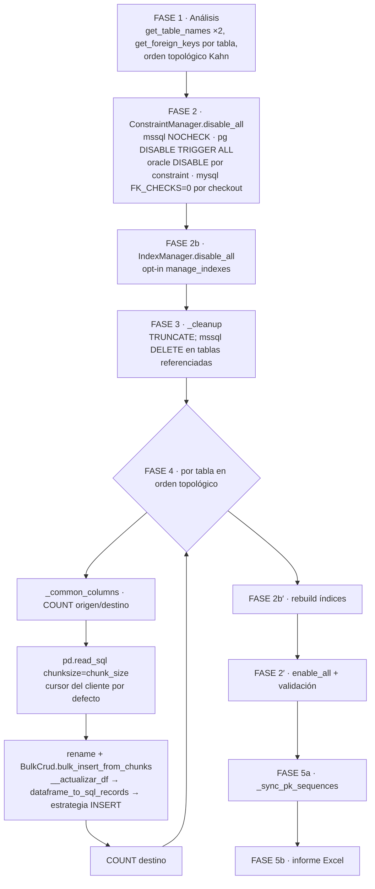

# Auditoría de rendimiento — módulo `dump`

- Fecha: 2026-09-25 · Rama: `develop` (sobre `v0.14.0`, `37cf690`) · Skill: `/performance-audit`
- Alcance: `src/util_bbdd/dump/` y la parte de `src/util_bbdd/bulk/` que `dump` usa (`bulk_insert_from_chunks`, `ParallelBulkLoader`, normalización de filas)
- Motores: PostgreSQL 17, MySQL 8.4, MariaDB 11.4, SQL Server 2022 (pyodbc + ODBC Driver 18), Oracle 23 Free, SQLite 3 (como destino, con PostgreSQL de origen)
- Volumen: `large` = 500K `customers` + 1M `orders` + 2M `order_items` = **3,5M filas**, 3 tablas encadenadas por FK, destino con PK de identidad e índice en cada FK
- Evidencia: `bench/bench_dump_real.py` (banco nuevo; ejecuta `DumpOrchestrator` real e instrumenta cada fase), `baseline/large/`, `variants/large/`, `validation/`. Detalle de mediciones en `validation_report_20260925.md`; roadmap en `improvement_roadmap_dump.md`.
- Solo análisis: no se ha modificado `src/`.

---

## 1. Resumen ejecutivo

1. **La línea base que proponía el framework no medía `dump`.** `scripts/bench_dump.py` simula la copia con `pd.to_sql` sin llamar a `DumpOrchestrator`, y con su configuración por defecto falla (`unknown database bench_source`). `/quick-bench`, `/perf-proposal` y `/perf-validate` no existen como comandos. La línea base de este informe sale de un banco nuevo contra servidores reales.
2. **Línea base real (3,5M filas, mediana de 3):** PostgreSQL 25,5 s · SQLite 25,6 s · MariaDB 57,2 s · MySQL 61,9 s · Oracle 67,0 s · SQL Server 69,0 s. El tiempo se va en **escribir (45–73 %)**, **leer (19–42 %)** y **preparar filas en Python (≈5 s fijos, 7–25 %)**. Constraints, conteos, introspección, PK sync e informe suman **menos del 2 %** en todos los motores.
3. **De los 8 cuellos hipotéticos (CB1–CB8), solo CB1 (lectura) y CB3 (escritura) pesan de verdad.** CB2 (preparación) es un coste fijo moderado. CB4 (constraints N+1), CB5 (COUNT), CB7 (PK sync en serie) y CB8 (índices) no son cuellos a esta escala. CB8 sí es una palanca útil en PostgreSQL y SQL Server.
4. **Las mayores ganancias no requieren cambios grandes** (validadas, mediana de 3):
   - PostgreSQL −45 % (cursor de servidor + lotes de 20K + solape lectura/escritura).
   - SQL Server −48 % (`parallel_pk_ranges=4` + cursor de servidor).
   - MySQL −31 % y MariaDB −25 % (cursor de servidor + solape).
   - Oracle −29 % (solo `arraysize=5000` en el engine de origen).
   - SQLite −16 %.
   - La memoria pico baja de 400–840 MB a 150–200 MB.
   - Las palancas **no siempre se suman**: en PostgreSQL, rangos + cursor de servidor anulan la mejora; en Oracle, `arraysize` + solape empeora. `parallel_pk_ranges` es contraproducente en MySQL/MariaDB y en SQLite pierde filas.
5. **Hay 9 fallos de corrección, más graves que cualquier cuello de rendimiento.** Deben corregirse antes que las optimizaciones:
   - El volcado a SQL Server falla al 100 % si las columnas del destino no están en mayúsculas.
   - La sincronización de PK **nunca** se ejecuta cuando hay `target_schema`, y en PostgreSQL y Oracle el siguiente INSERT choca por clave duplicada.
   - Repetir el volcado falla en PostgreSQL (TRUNCATE de tablas referenciadas) y en SQLite (no existe TRUNCATE).
   - La «validación» de FKs en PostgreSQL no comprueba nada.
   - La ruta pandas altera datos sin avisar: BIGINT con NULL por encima de 2^53, DECIMAL de más de 15 dígitos y espacios de los extremos de las cadenas.
   - La reflexión de `bulk` recorre recursivamente las tablas referenciadas por FK: el coste es cuadrático y **el volcado entero aborta** con `RecursionError` a partir de ~150 tablas encadenadas.

**Veredicto:** APROBADO CON CONDICIONES. El diseño por fases es sólido y los costes fijos son despreciables en tablas grandes (en esquemas de cientos de tablas pequeñas cuestan 26–155 ms por tabla, CB5/CB6). La condición es corregir primero PD-01 a PD-05 y PD-08 (Fase 0 del roadmap) y después aplicar los quick wins P1 (≈ −20 % a −55 % según motor, con memoria acotada).

---

## 2. PLAN — arquitectura actual y método

### 2.1 Flujo de `DumpOrchestrator.run()`



- La lectura y la escritura de cada tabla son **secuenciales en un solo hilo**: el chunk N+1 no se lee hasta haber escrito el N.
- Estrategia de escritura (resuelta por `bulk`): PostgreSQL `COPY` (psycopg 3), MySQL/MariaDB `executemany` de PyMySQL (multi-fila en el cliente), SQL Server `executemany` + `fast_executemany` (pyodbc), Oracle y SQLite `executemany`.
- Paralelismo opt-in: `max_parallel_tables` (tablas del mismo nivel topológico) y `parallel_pk_ranges` (rangos de PK entera por tabla, vía `ParallelBulkLoader`).

### 2.2 Método de medición

- Banco `bench/bench_dump_real.py`: origen y destino en el mismo servidor (`dump_src` → `dump_dst`); SQLite como destino desde PostgreSQL.
  - Datos generados en el servidor y destino recreado (drop + create) antes de cada medición, fuera del tiempo medido.
  - Un subproceso por medición, para medir la memoria pico.
- Instrumentación solo en el proceso del banco (envoltorios de tiempo): `read` (iterar `pd.read_sql`), `write` (`BatchStatementExecutor.execute`), `prep` (= carga − lectura − escritura − reflexión), `counts`, `constraints_*`, `indexes_*`, `cleanup`, `pk_sync`, `report`, `analysis`.
  - En variantes con hilos (`prefetch`, `ranges*`, `combo`), lectura y escritura se suman entre hilos: solo es válido el total.
- Verificación de cada medición:
  - COUNT y SUM(PK) de origen y destino por tabla;
  - sonda de identidad: un INSERT sin PK tras el volcado, con rollback.
- Límites:
  - Servidores Docker locales (latencia de red casi nula; contra un servidor remoto, CB1 y la ida y vuelta por lote pesan más).
  - Matriz de variantes con 1 repetición (ruido observado ±10 %). Las variantes clave y la línea base se repiten ×3 en la validación.

---

## 3. AUDIT_PLAN — viabilidad del plan

| Comprobación | Resultado |
|---|---|
| ¿Existe línea base reutilizable? | **No.** `scripts/bench_dump.py` no ejecuta `dump` y falla por defecto. Se sustituye por el banco real (supuesto declarado en `00_REQUEST.md`). |
| ¿Se pueden prototipar las mejoras sin tocar `src/`? | Sí para configuración (`stream_results`, `arraysize`, flags de `DumpConfig`) y para el solape de lectura y escritura (parche local de `_load_whole_table` en el banco). No para la ruta sin pandas: se estima con un microbanco de lectura (`bench/bench_read_path.py`). |
| ¿El esquema del banco ejercita todas las fases? | Sí: FKs (constraints y orden topológico), PK de identidad (PK sync), índices secundarios (`manage_indexes`), DECIMAL/TIMESTAMP/VARCHAR (normalización). Para el coste fijo por tabla (CB5/CB6) se añade `bench/bench_many_tables.py` (200 tablas). |
| Riesgo de conclusiones sesgadas | Una sola repetición en la matriz: toda mejora < 15 % se trata como ruido salvo confirmación en la validación. |

---

## 4. AUDIT_CODE — hallazgos

### 4.1 Fallos de corrección descubiertos al medir (bloqueantes, prioridad sobre el rendimiento)

#### PD-01 — Volcado a SQL Server con columnas no mayúsculas: falla al 100 %
- **Severidad**: CRÍTICA · **Archivo**: `bulk/crud.py:809-829` (`__actualizar_df`) + `bulk/_support/validation.py:56-69`
- **Descripción**: en mssql, `normalize_dataframe_columns` pasa a MAYÚSCULAS las columnas del DataFrame, y `get_insert_columns` las compara, distinguiendo mayúsculas, con las columnas reflejadas, que SQL Server devuelve tal como se crearon.
- **Efecto**: con `customer_id` en el destino, ninguna columna coincide y cada tabla falla con `No hay columnas válidas para INSERT en la tabla 'CUSTOMERS'`.
- **Evidencia**: medición `tiny` en `mssql` con columnas en minúsculas: las 3 tablas en `error`, 0 filas en el destino.
  - El banco de `bulk` (`scripts/bench_bulk.py::physical_name`) crea las columnas en mayúsculas para mssql, y por eso la auditoría de `bulk` no lo detectó.
  - Afecta también a `BulkCrud` usado directamente.
- **Remediación**: casar las columnas del DataFrame con las reflejadas sin distinguir mayúsculas (como ya hace `dump._common_columns`), en lugar de forzar un case por dialecto.

#### PD-02 — La Fase 5a (PK sync) no se ejecuta nunca cuando hay `target_schema`
- **Severidad**: ALTA · **Archivo**: `dump/orchestrator.py:752` (`_sync_pk_sequences`)
- **Descripción**: filtra `effective_dst_order` (nombres sin esquema, p. ej. `customers`) contra `crud._table_cache`, cuyas claves son el nombre lógico con esquema (`dump_dst.customers`, `orchestrator.py:374`). Con `target_schema` no hay ninguna coincidencia y la función devuelve `None` sin avisar.
- **Evidencia**: `pk_sync=[]` en las 60+ mediciones. Sonda de identidad tras el volcado:
  - PostgreSQL: `duplicate key value violates unique constraint "customers_pkey"`;
  - Oracle: `ORA-00001 unique constraint (DUMP_DST.SYS_C…)`;
  - MySQL/MariaDB/SQL Server/SQLite no se ven afectados porque ajustan la identidad solos al insertar valores explícitos.
- **Remediación**: filtrar con el mismo nombre lógico que usa la carga y añadir un test con `target_schema`.

#### PD-03 — PostgreSQL: `truncate_target=True` no vacía las tablas referenciadas por FK
- **Severidad**: ALTA · **Archivo**: `dump/orchestrator.py:237-287` (`_cleanup`)
- **Descripción**: PostgreSQL rechaza `TRUNCATE` de una tabla referenciada aunque la hija esté vacía y tenga los triggers desactivados:
  ```
  ERROR: cannot truncate a table referenced in a foreign key constraint
  HINT: Truncate table "c" at the same time, or use TRUNCATE ... CASCADE
  ```
  El error se degrada a warning y la carga posterior falla por clave duplicada.
- **Evidencia**:
  - variante `redump`: `customers` y `orders` en `error` (`UniqueViolation`);
  - reproducción aislada con psql en el esquema `zz_probe`.
- **Remediación**: un único `TRUNCATE t1, t2, …` con todas las tablas destino del volcado (PostgreSQL lo permite y resuelve las referencias mutuas).

#### PD-04 — PostgreSQL: la «validación» de FKs no valida nada
- **Severidad**: ALTA (integridad) · **Archivo**: `dump/_constraints.py:223-302`
- **Descripción**: `DISABLE TRIGGER ALL` no marca la FK como `NOT VALID`. `ALTER TABLE … VALIDATE CONSTRAINT` sobre una FK ya válida es un no-op, y el informe la da por `enabled`.
- **Evidencia**: reproducción con psql. Hija con 1 fila huérfana, `convalidated = t`, `VALIDATE CONSTRAINT` sin error y la fila huérfana sigue ahí.
- **Coste de rendimiento de corregirlo**: validar de verdad (`SELECT … WHERE NOT EXISTS` o `DROP`/`ADD CONSTRAINT … NOT VALID` + `VALIDATE`) cuesta del orden de SQL Server (`WITH CHECK`: 0,47 s a 3M filas hijas). Asumible.

#### PD-05 — La ruta pandas altera datos sin avisar
- **Severidad**: ALTA (fidelidad del volcado) · **Archivos**: `dump/orchestrator.py:425`, `bulk/normalize.py` (`normalize_sql_literal`)
- **Evidencia**: reproducción aislada con SQLite en memoria.

| Dato de origen | Llega al INSERT como | Causa |
|---|---|---|
| BIGINT `9007199254740993` en columna con algún NULL | `9007199254740992.0` | pandas convierte la columna a `float64` |
| `DECIMAL('12345678901234567.89')` | `1.2345678901234568e+16` | `pd.read_sql(coerce_float=True)` por defecto |
| `'  padded  '` | `'padded'` | `normalize_sql_literal` aplica `strip()` a toda cadena |

- **Remediación**:
  - corto plazo: `coerce_float=False` y `dtype_backend="pyarrow"` o dtypes nullable en `read_sql`, y no hacer `strip()` en la ruta de `dump`;
  - largo plazo: la ruta sin pandas (PF-09), que elimina el problema de raíz.

#### PD-06 — SQLite como destino: repetir el volcado falla y `parallel_pk_ranges` pierde filas
- **Severidad**: MEDIA · **Archivos**: `dump/orchestrator.py:267` (`TRUNCATE TABLE`, que SQLite no tiene), `dump/orchestrator.py:377` + `ParallelBulkLoader`
- **Evidencia**:
  - `redump` en SQLite: las 3 tablas en `error` (UNIQUE constraint failed);
  - `ranges4` en SQLite: `partición 2: database is locked` y `order_items` incompleta (verificación fallida).
- **Remediación**: `DELETE FROM` en SQLite; forzar `parallel_pk_ranges=1` y `max_parallel_tables=1` en SQLite, con aviso (un solo escritor).

#### PD-07 — SQLite como origen no está protegido
- **Severidad**: BAJA · **Archivo**: `dump/orchestrator.py:425`
- **Descripción**: SQLite solo está soportado como destino (`.ai/CURRENT_STATE.md`), pero `dump` acepta un origen SQLite. Las columnas TIMESTAMP llegan como texto y el destino SQLite las rechaza (`SQLite DateTime type only accepts Python datetime`).
- **Remediación**: validar el dialecto de origen en `DumpConfig`/`__init__`, o documentarlo.

#### PD-08 — La reflexión de `bulk` recorre recursivamente el grafo de FKs: coste cuadrático y caída del volcado
- **Severidad**: ALTA · **Archivo**: `bulk/crud.py:831-868` (`reflect_table`: `Table(..., autoload_with=engine)` sin `resolve_fks=False`)
- **Descripción**: SQLAlchemy refleja, para cada tabla, todas las referenciadas por FK y las referenciadas por esas. Como cada `reflect_table` usa un `MetaData()` nuevo, cada tabla vuelve a recorrer su cierre transitivo.
- **Evidencia** (`bench_many_tables.py`, cadena de FKs):
  - PostgreSQL: 50 tablas → reflexión 12,3 s (290 ms/tabla); 100 tablas → 45,6 s (502 ms/tabla); 150 tablas → `RecursionError`.
  - Con 200 tablas encadenadas, `RecursionError` en PostgreSQL, SQL Server, Oracle y SQLite.
  - `RecursionError` no es `SQLAlchemyError`: **aborta el volcado entero**, no solo la tabla (también ocurrió al volcar el esquema completo de Oracle con esas tablas presentes).
- **Remediación**: `Table(..., autoload_with=engine, resolve_fks=False)` en `reflect_table` (a `bulk` no le hacen falta las tablas referenciadas), o un `MetaData` compartido por instancia. Test con una cadena de 200 FKs.

#### PD-09 — MySQL/MariaDB: el listener `checkin` de `ConstraintManager` falla con conexiones invalidadas y tapa el error original
- **Severidad**: MEDIA · **Archivo**: `dump/_constraints.py:149-158` (`_fk_on`)
- **Descripción**: cuando una conexión se invalida (p. ej. tras una excepción), SQLAlchemy la devuelve al pool con `dbapi_conn=None`. `_fk_on` hace `dbapi_conn.cursor()` y lanza `AttributeError: 'NoneType' object has no attribute 'cursor'`, que sustituye a la excepción real.
- **Evidencia**: 200 tablas encadenadas en MariaDB (donde el error original era el de PD-08).
- **Remediación**: `if dbapi_conn is None: return` en `_fk_on` (y en `_fk_off` por simetría).

### 4.2 Validación de los cuellos hipotéticos CB1–CB8

Tiempos: línea base `large` (ver `validation_report_20260925.md` §1). «% total» = peso en el tiempo total.

| # | Cuello (hipótesis del prompt) | Veredicto | Evidencia |
|---|---|---|---|
| **CB1** | Lectura del origen lenta (`pd.read_sql`) | **CONFIRMADO** (Oracle, MySQL/MariaDB) | Lectura: Oracle 27,5 s (42 %), MySQL 21,3 s (34 %), MariaDB 20,9 s (38 %), SQL Server 12,0 s (17 %), PostgreSQL 6,8 s (27 %). Oracle lee con `arraysize=100` del driver: con 5000 baja a **8,3–9,8 s** (total −29 %, mediana de 3). En PyMySQL el coste es decodificar en Python (CPU): no cambia con `stream_results`. Memoria: psycopg y PyMySQL usan cursor del cliente y **descargan la tabla entera** antes del primer chunk (1,4 s de espera y 400 MB con 500K filas en PostgreSQL; 841 MB en MySQL/MariaDB con 2M filas). |
| **CB2** | Transformación (renombrado, tipos) | **CONFIRMADO, moderado** | `prep` ≈ 5,0–6,0 s por 3,5M filas en todos los motores (≈1,5 µs/fila): 7 % (SQL Server) a 25 % (SQLite). Se suma a la construcción del DataFrame, que va dentro de `read` (cuantificado en el microbanco de lectura). El renombrado por chunk es despreciable. |
| **CB3** | Overhead de inserción | **CONFIRMADO: fase dominante**, ya optimizada en `bulk` | Escritura: SQL Server 52,3 s (73 %), MySQL 34,8 s (56 %), Oracle 31,2 s (48 %), MariaDB 29,1 s (52 %), PostgreSQL 13,2 s (52 %), SQLite 11,7 s (48 %). Las vías rápidas ya existen (COPY, `executemany` de PyMySQL, `fast_executemany`). Palancas restantes: tamaño de lote por motor (PF-05), índices (CB8) y paralelismo (PF-04). |
| **CB4** | Disable de constraints N+1 | **REFUTADO** | Desactivar: ≤ 0,10 s. Rehabilitar con validación: SQL Server 0,47 s, Oracle 0,73 s (3M filas hijas validadas). Sin validar (`nocheck`) se ahorra < 1 s. El número de sentencias es O(tablas) y no pesa. **Se recomienda mantener la validación.** |
| **CB5** | `COUNT(*)` de `collect_row_counts` | **REFUTADO en tablas grandes; MENOR en tablas pequeñas** | 3,5M filas: `counts` 0,12–0,47 s (≤ 1 %). 200 tablas × 100 filas: 3,5–13 ms/tabla, un 6–18 % del total (validación §4). |
| **CB6** | Introspección repetida | **CONFIRMADO como coste fijo por tabla** (despreciable en tablas grandes) + **PD-08** | `analysis` + `reflect` < 0,65 s con 3 tablas. Con 200 tablas: SQL Server 95 ms/tabla, Oracle 54, PostgreSQL 42 (el 50–60 % del coste fijo), es decir ≈ 1,5 min por cada 1000 tablas en SQL Server solo en introspección. Con FKs encadenadas la reflexión es cuadrática (PD-08). Hay reflexión duplicada: `_common_columns` (Inspector) + `BulkCrud.reflect_table` (autoload) + `_get_dst_fk_referenced_tables` (todas las FKs del esquema, mssql) + un Inspector nuevo en `_enable_postgresql` y `_disable_oracle`. |
| **CB7** | PK sync en serie | **REFUTADO como cuello** (y roto, PD-02) | `pk_sync` = 0 s porque no se ejecuta. Corregido, cuesta un `MAX(pk)` indexado + un `setval`/`ALTER` por tabla (milisegundos). Paralelizarlo no aporta. |
| **CB8** | Rebuild de índices | **PALANCA, no cuello** (`manage_indexes=False` por defecto) | Con `manage_indexes=True`: PostgreSQL −23 % (escritura 13,2 → 7,2 s; recrear índices 0,55 s), SQL Server −16 % (52,3 → 40,9 s; rebuild 0,87 s), Oracle 0 % (rebuild 2,5 s se come la ganancia), MySQL/MariaDB no soportado. |

### 4.3 Hallazgos de rendimiento nuevos

#### PF-01 — Oracle lee con `arraysize=100` (idas y vueltas por cada 100 filas)
- **Severidad**: ALTA · **Archivo**: `dump/orchestrator.py:425,477` (sin `arraysize`); SQLAlchemy usa el valor del driver si el engine no lo fija
- **Evidencia**: `arraysize` 5000 en el engine de origen: lectura 27,5 → 8,3–9,8 s; total 67,0 → **47,7 s (−29 %, mediana de 3: 40,8 · 52,8 · 47,7)**. Microbanco de lectura: 16,3 → 3,2 s en 2M filas. Contra un servidor remoto la ganancia será mayor (hay 50 idas y vueltas por chunk de 5000).
- **Remediación**:
  - `cursor.arraysize = chunk_size` (o `prefetchrows`) en las lecturas de `dump` desde Oracle (execution option o `DBAPICursor` en un listener `before_cursor_execute` limitado a la conexión de lectura);
  - mientras tanto, documentar `create_engine(..., arraysize=chunk_size)`.

#### PF-02 — Cursor del cliente: memoria proporcional a la tabla más grande
- **Severidad**: ALTA (riesgo de OOM con 50M+ filas) · **Archivo**: `dump/orchestrator.py:424-425,476-477`
- **Descripción**: psycopg y PyMySQL materializan el resultado completo antes de devolver el primer `fetchmany`.
- **Evidencia**: memoria pico con 2M filas en la tabla mayor: PostgreSQL 400 MB, MySQL/MariaDB 841 MB. Con `stream_results=True`: **153 / 143 MB** (−62 % / −83 %) y tiempo neutro (±5 %). SQL Server y Oracle ya van en streaming (146–154 MB).
- **Remediación**: `conn.execution_options(stream_results=True, max_row_buffer=chunk_size)` en la conexión de lectura de `dump`. Es requisito de PF-03 en MySQL/MariaDB.

#### PF-03 — Lectura y escritura no se solapan
- **Severidad**: ALTA · **Archivo**: `dump/orchestrator.py:401-433`
- **Descripción**: prototipo `prefetch` = 1 hilo lector + cola acotada de 2 chunks (`bench/bench_dump_real.py::prefetch`).

| Motor | `prefetch` | con `stream_results` (`combo`) |
|---|---|---|
| SQL Server | −19 % | −22 % |
| Oracle | −29 % (1 repetición) | con `arraysize`: −19 %, **peor que `arraysize` solo** (validación §2) |
| PostgreSQL | −20 % | −36 %; −45 % con lotes de 20K (mediana de 3) |
| MySQL | −3 % | **−31 %** (mediana de 3) |
| MariaDB | −3 % | **−25 %** (mediana de 3) |
| SQLite | −1 % | −9 %; −16 % con lotes de 20K (mediana de 3) |

- **Por qué MySQL necesita streaming**: con cursor del cliente, toda la lectura ocurre en la llamada a `read_sql`, antes de que el hilo pueda solapar nada.
- **Por qué funciona pese al GIL**: la escritura espera al servidor (E/S, sin GIL) mientras el hilo lector decodifica.
- **Riesgos**:
  - la conexión de lectura se usa desde otro hilo (es exclusiva de esa lectura, así que es seguro);
  - hay que propagar los errores del hilo lector y cerrar el generador si falla la escritura (el prototipo ya lo hace).
- **Memoria**: +2 chunks.

#### PF-04 — `parallel_pk_ranges`: gran ganancia en 3 motores, perjudicial en 2 y roto en 1
- **Severidad**: MEDIA (configuración por defecto `1` segura, pero sin guía)
- **Evidencia** (`ranges4`):

| Motor | Cambio |
|---|---|
| SQL Server | **−55 %** |
| PostgreSQL | −35 % |
| Oracle | −23 % |
| MySQL | **+14 %** |
| MariaDB | **+27 %** |
| SQLite | pierde filas (PD-06) |

  En MySQL/MariaDB cada rango lee con cursor del cliente (el origen se materializa 4 veces) y los INSERT concurrentes en la misma tabla InnoDB compiten.
- **Validación**:
  - SQL Server `ranges4` + cursor de servidor: −48 % (mediana de 3); `ranges8`: −2 % (más rangos no ayudan).
  - PostgreSQL `ranges4` + cursor de servidor + lotes de 20K: +2 %. Las mejoras no se suman y la causa está sin aclarar: el plan de consulta es el mismo.
  - Oracle `arraysize` + `ranges4`: −23 %, peor que `arraysize` solo.
- **Remediación**: recomendación por dialecto en la documentación y aviso (o degradación a 1) en MySQL/MariaDB/SQLite.

#### PF-05 — Un único `chunk_size` para leer y escribir es subóptimo
- **Severidad**: MEDIA · **Archivo**: `dump/_models.py:130`
- **Evidencia** (`chunk20k`):

| Motor | Total | Escritura |
|---|---|---|
| PostgreSQL | −31 % | 13,2 → 6,5 s (menos sentencias `COPY`) |
| SQL Server | **+57 %** | 52 → 94 s (`fast_executemany` con lotes de 20K) |
| MySQL/MariaDB/Oracle/SQLite | neutro | — |

- **Remediación**: separar el tamaño de lectura del lote de escritura, o fijar un lote de escritura por motor (PostgreSQL COPY 20–50K; SQL Server ≤ 5K).

#### PF-06 — Coste fijo `prep` ≈ 1,5 µs/fila y doble conversión (tuplas → DataFrame → dicts)
- **Severidad**: MEDIA · ver CB2, PD-05 y el microbanco de lectura (validación §3). Base de la propuesta P3 «ruta sin pandas».

#### PF-07 — Documentación del framework de auditoría con hipótesis no verificadas
- **Severidad**: MEDIA (proceso) · **Archivos**: `scripts/bench_dump.py`, `.claude/performance-audit-guide.md`, `.github/prompts/performance_audit_dump*.prompt.md`, `docs/PERFORMANCE_AUDIT_GUIDE.md`
- **Descripción**:
  - `bench_dump.py` no mide `dump`, falla por defecto y su configuración `optimized` usa `chunk_size=None` (DumpConfig lo rechazaría).
  - Las cifras «benchmark típicos» y la tabla «Multi-Dialect Considerations» (p. ej. «PK sync parallelization +25 %») no tienen origen medido y chocan con lo medido aquí.
  - Se referencian comandos inexistentes (`/quick-bench`, `/perf-proposal`, `/perf-validate`).
  - Propuestas del prompt ya implementadas (PostgreSQL COPY, v0.10.0) o descartadas con medición (SQL Server bulk copy, P-17).
- **Remediación**: sustituir `bench_dump.py` por el banco de esta sesión y corregir las guías (roadmap, Fase 1).

### 4.4 Observaciones sin impacto medible (no requieren acción)
- `_warn_chunk_size` avisa en MySQL/MariaDB para `chunk_size > 1000`. Desde P-02, PyMySQL trocea por `max_allowed_packet` y con 5000 no hubo ningún error: el aviso es ruido para tablas sin LOB.
- `max_parallel_tables` no aporta nada con cadenas de FK (cada nivel topológico tiene una sola tabla); solo sirve para tablas independientes.
- El `DELETE` de SQL Server en tablas referenciadas (limpieza de un volcado repetido) cuesta 2,6 s con 1,5M filas: aceptable.

---

## 5. Priorización (Impacto 1–5 / (Esfuerzo 1–5 × Riesgo 1–5))

| ID | Mejora | Motores | Impacto | Esfuerzo | Riesgo | Prioridad | Fase |
|---|---|---|---|---|---|---|---|
| PD-01…PD-09 | Correcciones de fallos | todos | — | 1–3 | 1–2 | **bloqueante** | 0 |
| Q1 | `arraysize = chunk_size` en lecturas Oracle (PF-01) | Oracle | 5 | 1 | 1 | **5,00** | 1 |
| Q2 | `stream_results` en lecturas de `dump` (PF-02) | PG, MySQL, MariaDB | 3 (memoria) | 1 | 1 | **3,00** | 1 |
| Q3 | Solape lectura/escritura con cola acotada (PF-03) | todos salvo SQLite | 4 | 2 | 2 | **1,00** | 1 |
| Q4 | Guía y protección de `parallel_pk_ranges` por motor (PF-04) | todos | 4 | 1 | 2 | **2,00** | 1 |
| Q5 | Lote de escritura por motor (PF-05) | PG (+), mssql (protección) | 3 | 2 | 1 | 1,50 | 2 |
| Q6 | `manage_indexes` recomendado (o automático) en PG/mssql para volúmenes grandes (CB8) | PG, mssql | 3 | 1 | 2 | 1,50 | 2 |
| Q7 | Sustituir `bench_dump.py` y corregir guías (PF-07) | — | 2 | 2 | 1 | 1,00 | 1 |
| Q8 | Ruta sin pandas: tuplas del cursor directas a COPY/`executemany` (PF-06 + PD-05) | todos | 4 | 4 | 3 | 0,33 | 3 |
| Q9 | Introspección por lotes (`Inspector.get_multi_*`) y una sola reflexión por tabla (CB6) | todos | 2 (esquemas con cientos de tablas: 42–95 ms/tabla) | 3 | 2 | 0,33 | 3 |
| — | `collect_row_counts=False` por defecto (CB5) | — | 1 | 1 | 1 | 1,00 | no recomendado: coste < 1 % y el informe pierde volumetría |
| — | Saltarse la validación de constraints (CB4) | mssql, oracle | 1 | 1 | 4 | 0,25 | **descartado** (< 1 s de ahorro, riesgo de integridad) |
| — | Paralelizar PK sync (CB7) | — | 1 | 2 | 1 | 0,50 | **descartado** |

Detalle, fases y métricas de éxito: `improvement_roadmap_dump.md`.

## 6. Recomendaciones de configuración por motor (sin cambiar código, hoy)

Validadas con 3 repeticiones salvo que se indique otra cosa (`validation_report_20260925.md` §2). El solape lectura/escritura todavía no existe en `DumpConfig` (Q3). Las cifras con solape son las del prototipo del banco; sin él, las ganancias de hoy son las de las líneas sin «solape».

```python
# Oracle (origen): la mayor palanca individual. No combinar con parallel_pk_ranges ni con el solape.
src = create_engine(url_oracle, arraysize=5000)                      # −29 %

# PostgreSQL / MySQL / MariaDB (origen): memoria acotada (requisito del solape en MySQL/MariaDB)
src = create_engine(url).execution_options(stream_results=True)     # memoria −55 % a −83 %, tiempo ±5 %

# PostgreSQL (destino): lotes COPY más grandes. Sin rangos si el origen usa stream_results.
DumpConfig(..., chunk_size=20_000)             # −31 % (1 rep.); con stream + solape: −45 % (validado)

# SQL Server (destino): rangos de PK entera. Tope 4 rangos; pool_size ≥ 4.
DumpConfig(..., parallel_pk_ranges=4)          # −48 % con stream_results (validado); 8 rangos: −2 %
# SQL Server: NO subir chunk_size (20K: +57 %)

# MySQL / MariaDB / SQLite: dejar parallel_pk_ranges=1 (empeora o pierde filas)

# PostgreSQL / SQL Server (destino) con índices secundarios
DumpConfig(..., manage_indexes=True)           # pg −23 %, mssql −16 % (1 repetición)
```

**Hasta corregir PD-02**, tras un volcado a PostgreSQL u Oracle con `target_schema` hay que resincronizar a mano las secuencias e identidades con el nombre lógico. Verificado en el banco: 3/3 `synced` y la sonda de identidad pasa en ambos motores.

```python
BulkCrud(target_engine).sync_pk_sequences([f"{target_schema}.{t}" for t in tablas])
```

**Hasta corregir PD-01**, el volcado a SQL Server requiere columnas del destino en MAYÚSCULAS.
