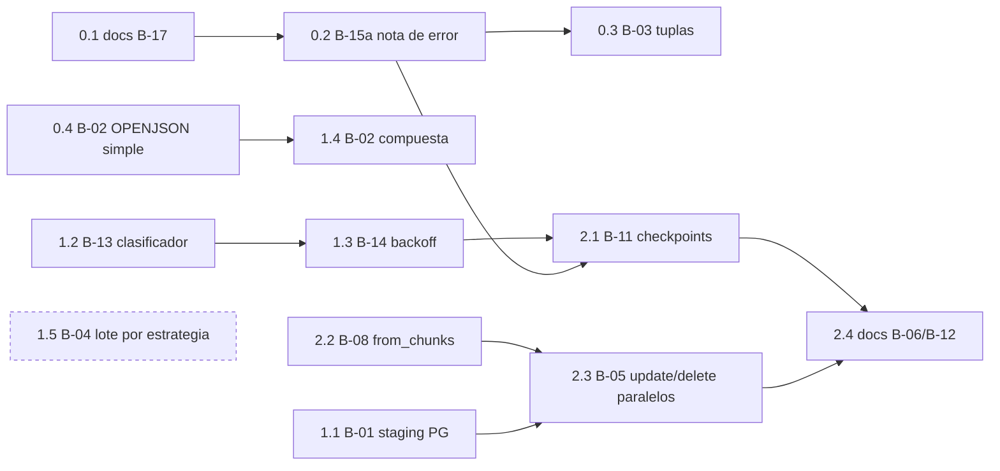

# PLAN — implementación del roadmap de `bulk/` (Fases 0–2)

- Origen: `audit_report_bulk_20261001.md` (veredicto SIGNIFICATIVO) e `improvement_roadmap_bulk.md`.
- Alcance: Fases 0, 1 y 2 del roadmap. La Fase 3 (spikes) queda fuera.
- Regla: **una mejora por sesión**, con su flujo (`/refactor`, `/new-feature`, `/hotfix`, `docs:`), sus tests y su
  medición antes/después con el banco. Nada se mezcla en un mismo commit.
- Validación común a cada punto: `ruff check` + `ruff format`, `mypy src tests/unit/test_protocol_conformance.py`,
  `pytest` (unit), `pytest tests/integration` con los 5 servidores del banco, `scripts/bench_bulk.py --sizes 1000000`
  en los motores afectados y, si cambia un import entre paquetes, `scripts/gen_arquitectura_capas.py`.
- SQL de catálogo nuevo: siempre en `metadata/<motor>/` como `fetch_*_sql()` (regla de acceso a metadatos), como
  `fetch_can_disable_triggers_sql`.

## Orden y dependencias

---

## Fase 0 — Quick wins

### 0.1 B-17 · Documentación contradictoria (`docs:`)
- `docs/functional/bulk_operations.md:26`: «Transaccionalidad implícita» → una operación es **una transacción** (atómica);
  con `commit_every_n_chunks` se confirma cada N lotes y un fallo deja los lotes anteriores (ver `rows_committed`).
- `docs/functional/bulk_parallel_loading.md:72`: sustituir «No incluye reintento automático» por `max_retries`
  (`OperationalError`/`TimeoutError`; incompatible con `commit_every_n_chunks` hasta 2.1).
- Aceptación: `zensical build --strict` sin avisos.

### 0.2 B-15a · Posición del lote en el error (`/new-feature`, `feat(bulk):`)
- `crud.py:632-638` (INSERT), `crud.py:745-772` (UPDATE), `DeleteBatchExecutor` (`executors.py:386-400`): al fallar un
  lote, `exc.add_note(f"bulk {op} en {tabla}: lote {n}, filas {desde}–{hasta} del DataFrame (rows_committed={…})")` y
  relanzar el mismo objeto. `BulkCrud` conoce el desplazamiento del bloque (`range(0, len(df), chunk_size)`); el
  ejecutor añade el sub-lote si trocea.
- `bulk_insert_from_chunks`: número de chunk y filas acumuladas.
- Tests (`tests/unit/bulk/test_error_position.py`): PK duplicada al principio, en medio y en el último lote (INSERT,
  UPDATE, DELETE); la nota existe, el tipo de excepción no cambia y `str(exc)` no cambia.
- Compatibilidad: ninguna (las notas solo se ven en el traceback).

### 0.3 B-03 · Columnas → tuplas en las estrategias crudas (`/refactor`, `perf(bulk):`)
- Nuevo método opcional en `_RawInsertStrategy` (`insert_strategies.py:46`): `execute_columns(*, connection, stmt, block:
  SqlColumns)` que obtiene filas con `zip(*columnas)` sin dicts. Lo implementan `PostgresCopyStrategy`,
  `PostgreSQLExecuteValuesStrategy` y `MySQLDriverExecutemanyStrategy`. Atributo de clase `supports_columns = True`.
- `crud.py` INSERT (`__prepare_insert_operation` y `bulk_insert_from_chunks`): si la estrategia resuelta lo admite **y**
  el `stmt` es `Insert` (no `override_identity`), preparar con `dataframe_to_sql_columns` → `SqlColumns` +
  `restore_binary_values` (ya admite `SqlColumns`) y llamar a un nuevo `BatchStatementExecutor.execute_columns`.
- El ejecutor **no debe trocear** un `SqlColumns` con `records[a:b]` (materializaría dicts, `sql_helpers.py:63`): el
  bloque ya mide `chunk_size`; si fuese mayor, trocear por columnas.
- `_pymssql_plain_decimals` y `_driver_decimal_context` no aplican (solo SQL Server).
- Tests: equivalencia estricta (valor y tipo) entre la vía dict y la vía columnas para todos los dtypes de
  `test_dataframe_to_sql_records.py`; COPY/PyMySQL/psycopg2 con mocks de cursor; integración PG (psycopg y psycopg2),
  MySQL, MariaDB (PyMySQL) con JSON, binarios y NULL.
- Aceptación: PG INSERT 1M ≤ 5,0 s (hoy 5,3–6,0 s); MySQL/MariaDB sin regresión.

### 0.4 B-02 · DELETE de SQL Server con OPENJSON, PK simple (`/refactor`, `perf(bulk):`)
- `metadata/sqlserver/`: `fetch_compatibility_level_sql()` (`SELECT compatibility_level FROM sys.databases WHERE name =
  DB_NAME()`).
- `delete_strategies.py`: `MSSQLOpenJsonDeleteStrategy`. PK simple: `DELETE FROM t WHERE pk IN (SELECT CAST(value AS
  <tipo compilado>) FROM OPENJSON(?))`, un parámetro por lote. Serialización JSON solo para tipos seguros (`int`,
  `str`, `Decimal` como texto, `uuid.UUID` como texto); cualquier otro tipo de PK → `SqlBasedDeleteStrategy` actual.
- Nivel de compatibilidad leído una vez por engine (caché por `id(engine)` como `EngineReadinessAdvisor.report_once`);
  < 130 → estrategia actual.
- `DeleteStrategyResolver.resolve` (`delete_strategies.py:351`) devuelve la nueva estrategia para `mssql`.
- Tests: unit con SQL generado y parámetro JSON; integración SQL Server con PK INT, BIGINT, VARCHAR (comillas, Unicode),
  UNIQUEIDENTIFIER y DECIMAL; nivel 120 simulado → fallback; dentro de `bulk_session` y con `commit_every_n_chunks`.
- Aceptación: DELETE 1M ≤ 3 s; 10K ≤ 0,1 s.

## Fase 1 — Rendimiento por motor y tolerancia a fallos

### 1.1 B-01 · UPDATE de PostgreSQL por staging (`/new-feature`, `perf(bulk):`)
- `staging_update.py`: `MySQLStagingUpdateStrategy` → `StagingUpdateStrategy` con un perfil por dialecto
  (`_StagingDialect`: prefijo `TEMPORARY`, si admite esquema, sentencia DROP, cómo detectar la denegación). Alias
  `MySQLStagingUpdateStrategy` conservado (lo importan `batch.py` y los tests).
  - MySQL/MariaDB: igual que hoy.
  - PostgreSQL: `CREATE TEMPORARY TABLE` **sin esquema**, carga con la estrategia INSERT del motor (COPY), `UPDATE t SET
    … FROM tmp WHERE …` (ya lo genera `update()` de SQLAlchemy), `DROP TABLE`.
- Privilegio en PG: **comprobación previa** con `metadata/postgresql`: `fetch_can_create_temp_sql()`
  (`SELECT has_database_privilege(current_database(), 'TEMP')`), una vez por instancia; sin privilegio → WARNING y
  UPDATE fila a fila (como MySQL). No se puede reaccionar al error como en MySQL: en PG un `CREATE` fallido aborta la
  transacción (ver AUDIT_PLAN R-1).
- `crud.py:228`: `update_via_staging` se aplica a `MYSQL_FAMILY | {"postgresql"}`; docstring y `docs/api/bulk_crud.md`.
- Tests: los de `test_staging_update.py` parametrizados por dialecto; equivalencia con el executemany (PK repetida en
  lote → gana la última, PK nula, JSON/JSONB — P-19 —, binarios — P-21 —, `bulk_session` con rollback,
  `commit_every_n_chunks`, `esquema.tabla`); sin privilegio TEMP → fallback.
- Aceptación: PG UPDATE 1M ≤ 12 s (hoy 24,9–26,4 s).

### 1.2 B-13 · Reintentos por código de error (`/hotfix`, `fix(bulk):`)
- Nuevo `bulk/_support/retry.py`: `is_retriable(exc: BaseException, dialect: Dialect | None) -> bool`:
  - `TimeoutError` → sí.
  - `DBAPIError` con `connection_invalidated` → sí.
  - Código del driver (reutilizando `_mysql_errno` de `staging_update.py:133`, movido aquí): PG `sqlstate` ∈
    {`40001`, `40P01`, `55P03`, `57P01`, `57P02`, `57P03`, `08*`}; MySQL/MariaDB errno ∈ {1205, 1213, 2006, 2013};
    SQL Server SQLSTATE `HYT00`/`08S01` o error nativo 1205 en el mensaje; Oracle `orig.args[0].code` ∈ {60, 3113,
    3114, 12541} o `full_code` `DPY-4011`.
  - Resto → no.
- `parallel_loader.py:425`: `except Exception as exc` + `if is_retriable(exc, dialect)` en lugar de la tupla de clases;
  conserva PL-2 (strict + COMMIT fallido no se reintenta).
- Tests: tabla de excepciones sintéticas por driver (sin servidor) con las clases reales de PyMySQL, psycopg, oracledb y
  pyodbc; integración: deadlock real en PG y MySQL (dos conexiones cruzadas) que se reintenta.
- Compatibilidad: cambia qué se reintenta → CHANGELOG «Changed».

### 1.3 B-14 · Backoff exponencial con jitter (`/new-feature`, `feat(bulk):`)
- `ParallelBulkLoader(…, retry_backoff: tuple[float, float] = (0.5, 30.0))`: espera `random.uniform(0, min(máx, base ·
  2**intento))` (jitter completo) entre intentos; `(0, 0)` = comportamiento actual.
- `PartitionResult.retry_wait_seconds` (aditivo).
- Función de espera inyectable (`_sleep`) para tests sin `sleep` real.
- Tests: secuencia de esperas con semilla fija, tope respetado, `(0, 0)` no espera.

### 1.4 B-02 · DELETE SQL Server con PK compuesta (`/refactor`, `perf(bulk):`)
- `DELETE t FROM t JOIN OPENJSON(?) WITH (a <tipo> '$[0]', b <tipo> '$[1]') k ON t.a = k.a AND t.b = k.b`, sustituye el
  executemany por fila de `GenericDeleteStrategy` (`delete_strategies.py:215`).
- Antes de implementar: medir 1M con PK compuesta (no medido en la auditoría).

### 1.5 B-04 · Tamaño de envío por estrategia (`/refactor`, `perf(bulk):`) — **condicionado**
- Requisito previo: repetir E6 con `--repeat 3` (ver AUDIT_PLAN R-6).
- Si se confirma: `write_batch_size` como en `dump` (agrupar bloques hasta el tamaño de envío; `chunk_size` sigue
  siendo la unidad de preparación y de `commit_every_n_chunks`) con 20.000 por defecto solo para COPY de PG, y tope de
  5.000 valores por `DELETE … IN` en MySQL/MariaDB (`_MAX_DELETE_PARAMS`, `delete_strategies.py:173`).

## Fase 2 — Checkpoints, backpressure y paralelización

### 2.1 B-11 · Checkpoint por operación y reanudación (`/new-feature`, `feat(bulk):`)
- `session.py`: `RowLedger` gana un sub-libro de **operación** (`op_pending`, `op_committed`, `start_operation()`);
  `confirm()` mueve también lo pendiente de la operación. Así el commit de una operación no atribuye a la siguiente
  filas pendientes de la anterior (AUDIT_PLAN R-3).
- `BulkCrud.last_operation_rows_committed` (property): filas de la última operación (o de la operación fallida)
  confirmadas por commits periódicos = prefijo de la entrada. La nota de 0.2 incluye ese valor.
- `ParallelBulkLoader`: en un reintento de la partición, saltar `crud.rows_committed` filas del lector (helper
  `_skip_rows(chunks, n)` que recorta el primer chunk parcial); se retira el `ValueError` de
  `parallel_loader.py:250-256` (cadencia + `max_retries` pasan a ser compatibles). Requisito documentado: el lector
  devuelve las filas en orden estable.
- Auditoría: la parte reanudada se audita como operación nueva; la confirmada del intento fallido queda en
  `unaudited_committed_rows`, y la conciliación `audited_rows + unaudited_committed_rows == total_rows` se mantiene.
- Tests: fallo a mitad con cadencia (INSERT, UPDATE, DELETE) → `last_operation_rows_committed` exacto; dos operaciones
  en una sesión con commit compartido; loader con cadencia + reintentos → 0 duplicados y 0 huecos (6 motores en
  integración); conciliación de auditoría.

### 2.2 B-08 · `bulk_update_from_chunks` y `bulk_delete_from_chunks` (`/new-feature`, `feat(bulk):`)
- Simétricos a `bulk_insert_from_chunks` (`crud.py:430`): una `bulk_session`, plan de UPDATE / columnas PK resueltos
  con el primer chunk no vacío, staging creado una vez por llamada, `closing_iterable` sobre el iterable.
- Tests: equivalencia con `*_from_df` (mismo estado final), chunks vacíos, esquema heterogéneo → `ValueError`,
  generador que falla a mitad (cierre y rollback).

### 2.3 B-05 · `ParallelBulkLoader.update()` y `.delete()` (`/new-feature`, `feat(bulk):`)
- Mismo modelo que `load()`: lector por partición, `BulkCrud` por hilo, `PartitionResult`/`ParallelLoadResult`,
  reintentos (1.2–1.3) y reanudación (2.1); los workers llaman a 2.2.
- `partition_ranges` igual que en `load()`; sin rangos, WARNING de que las particiones deben ser disjuntas por PK.
- PostgreSQL sin staging (sin privilegio TEMP): WARNING y `max_workers=1` para esa llamada (el executemany paralelo es
  0,45× el secuencial).
- Tests: unit con particiones disjuntas, partición fallida que no aborta el resto, contadores; integración 5 servidores.
- Aceptación (1M, 4 hilos): SQL Server ≤ 9 s, PG ≤ 8 s; MySQL/MariaDB según AUDIT_PLAN R-5.

### 2.4 B-06 / B-12 · Guía de configuración (`docs:`)
- `docs/guides/benchmarks.md`: saturación por motor (INSERT y UPDATE paralelos), coste de la cadencia por motor
  (100K filas por commit como punto de partida; SQLite sin cadencias cortas), reanudación, rollback por motor.

## Entregables por sesión
`PLAN.md`/`TRACEABILITY.md` propios, tests, CHANGELOG `[Unreleased]`, docs afectadas y medición antes/después. Cierre
de versión con `/version-closure` tras la Fase 1 (minor: hay cambios de comportamiento) y tras la Fase 2.
