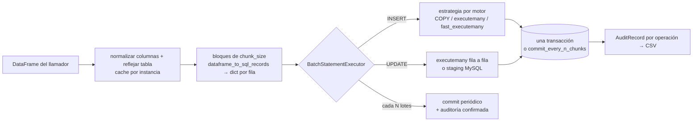

# Auditoría de rendimiento de `bulk/` — por objetivos (1M filas, 6 motores)

- Sesión: `2026-10-01h-performance-audit-bulk-todo` · Fecha: 2026-10-01 · Rama `develop` (`e80059e`, v0.23.1)
- Alcance: `src/util_bbdd/bulk/` (crud, `_execution/`, `_support/`, `_audit/`, normalize). Solo lectura: `src/` sin cambios.
- Entorno: Windows 11, 32 CPU lógicas, Python 3.14.2 (con GIL), pandas 3.0.3, SQLAlchemy 2.0.50. Servidores del banco
  en Docker local: SQLite 3.50.4 · PostgreSQL 17.11 (psycopg 3.3.3, binario) · MySQL 8.4.11 y MariaDB 11.4.13 (PyMySQL
  1.4.6) · SQL Server 2022 (pyodbc 5.3.0 + ODBC 18) · Oracle 23 Free (oracledb 4.0.1 thin).
- Tabla del banco: 10 columnas (PK entera, 3 INT, 2 FLOAT con NaN, 3 VARCHAR con espacios y NULL, DATETIME).
  `chunk_size=5000` salvo indicación. Auditoría CSV activa en la línea base.
- **Límite**: red local (latencia ~0) y Oracle Free limitado a 2 hilos de CPU. Contra un servidor remoto, las vías con
  más idas y vueltas (UPDATE por executemany, DELETE por fila) empeoran en proporción.
- Datos: `baseline/` (línea base), `bench/` (prototipos, logs y CSV), `validation_report_20261001.md`.

## Resumen por objetivo

| Objetivo | Estado | Hallazgo principal | Mejora medida |
|---|---|---|---|
| Rendimiento | SIGNIFICATIVO | UPDATE de PostgreSQL fila a fila (B-01); DELETE de SQL Server con IN de 2000 parámetros (B-02) | 2,35× (PG UPDATE 1M); 3,45× (MSSQL DELETE 1M), 20× a 10K |
| Batching | MODERADO | Un solo `chunk_size` para todo; 20.000 mejor en INSERT PG/SQL Server, 50.000 dañino en DELETE MySQL/MariaDB (B-04) | 5–19 % INSERT; evita +44/+74 % |
| Paralelización | SIGNIFICATIVO | Solo INSERT es paralelo (B-05); el UPDATE paralelo de PG **empeora** 2,2× sin staging | UPDATE 4 hilos: MSSQL 2,9×, MySQL 2,2×; PG con staging 4,1× |
| Backpressure | LIMPIO / MENOR | Sin UPDATE/DELETE en streaming (B-08); prefetch en la misma carga da poco (B-09) | 0–17 % |
| Checkpoints | SIGNIFICATIVO | No hay reanudación, pero `rows_committed` ya sirve de checkpoint (B-11) | fallo al 60 %: 1,6× → 1,0–1,08× del tiempo limpio |
| Errores y tolerancia | SIGNIFICATIVO | Reintentos clasificados por clase de excepción, incoherente entre drivers (B-13); sin backoff (B-14); sin aislamiento de filas erróneas (B-15) | fiabilidad (sin % de velocidad) |
| Auditoría | LIMPIO | Coste < 1 % (ruido) en 6 motores | — |

**Veredicto global: SIGNIFICATIVO** (ver § VERSION).

---

## Scope

| Operación | Ruta | Estrategia actual por motor |
|---|---|---|
| INSERT | `crud.py:615` → `__record_blocks` (`crud.py:674`) → `BatchStatementExecutor` (`_execution/executors.py:282`) | PG: COPY (`insert_strategies.py:133`); MySQL/MariaDB+PyMySQL: `exec_driver_sql` executemany (`:307`); SQL Server: executemany + `fast_executemany`; Oracle/SQLite: executemany de SQLAlchemy |
| UPDATE | `crud.py:709` → `__execute_update_blocks` (`crud.py:745`) | MySQL/MariaDB: tabla temporal + `UPDATE … JOIN` (`staging_update.py:38`); resto: executemany de `UPDATE … WHERE pk = ?` |
| DELETE | `crud.py:774` → `DeleteBatchExecutor` (`executors.py:343`) | PG: `= ANY(:ids)`; MySQL/MariaDB/SQL Server: `IN (…)` troceado; Oracle/SQLite: executemany |
| Paralelo | `ParallelBulkLoader.load` (`parallel_loader.py:294`) | Solo INSERT, una `BulkCrud` por hilo |
| Auditoría | `BulkPersistenceManager` (`_support/persistence.py:35`) | Un registro por operación, escrito al confirmarse |

---

## PLAN

### Flujo actual

### Cuellos de botella teóricos (antes de medir)
1. UPDATE fuera de MySQL/MariaDB: una sentencia por fila (PG, SQL Server, Oracle, SQLite).
2. DELETE de SQL Server: sentencias con 2000 parámetros (coste de compilación por forma de sentencia).
3. Preparación en Python (≈ 1,7 s/1M) en serie con la escritura, y doble conversión dict → tupla en las vías crudas.
4. Paralelismo con hilos bajo GIL; solo para INSERT.
5. Sin reanudación: un fallo atómico pierde todo el trabajo; `commit_every_n_chunks` y `max_retries` son excluyentes.
6. Reintentos sin espera y clasificados por clase de excepción.

### Estrategia de benchmark
- Línea base completa con `scripts/bench_bulk.py` (6 motores, 1K/10K/100K ×3 y 1M ×1, verificación SQL de cada
  operación).
- Prototipos A/B en `bench/` (parches de instancia o SQL propio, sin tocar `src/`), siempre verificados con SQL
  (recuento o suma) y en serie, para que no compitan por CPU.

## AUDIT_PLAN

| Mejora candidata | Viabilidad | Riesgo / compatibilidad | Prueba que la valida |
|---|---|---|---|
| UPDATE por staging en PG | Reutiliza `MySQLStagingUpdateStrategy` cambiando DDL (`CREATE TEMP TABLE`, sin esquema; `DROP TABLE`) y cargador (COPY) | Privilegio `TEMP`; en PG el DDL es transaccional (atomicidad intacta) | E4: 1M, suma de `a` verificada |
| UPDATE por staging en SQL Server / Oracle | `#temp` / tabla temporal privada | Oracle: ¿confirma la transacción? | E4b/E4c + sonda de rollback |
| DELETE MSSQL con OPENJSON | Un parámetro por lote; nivel de compatibilidad ≥ 130 | Fallback al IN actual | E5: 1K–1M, recuento 0 |
| Columnas → tuplas para vías crudas | Ya existe `dataframe_to_sql_columns` (P-34) | Mismos valores; solo cambia el contenedor | E2 (CPU) |
| Prefetch dentro de una carga | Reutiliza `dump._source_reader._prefetch` | Ninguno funcional | E3 |
| UPDATE paralelo | Una `BulkCrud` por hilo, rangos disjuntos | Deadlocks si los rangos se solapan | E7 |
| Reanudación por `rows_committed` | Contador ya existe y es exacto | Requiere orden estable de la entrada | E8c: fallo al 60 %, 1M exactas |

Orden: rendimiento por motor (B-01, B-02, B-03) → paralelización (B-05, depende de B-01 en PG) → checkpoints (B-11) →
tolerancia a fallos (B-13, B-14, B-15). Se descartan antes de implementar las mejoras que no superen el ruido.

---

## Línea base (verificada, `baseline/`)

1M filas (1 repetición; segundos y filas/s):

| Motor | INSERT | UPDATE | DELETE | Ciclo total |
|---|---|---|---|---|
| SQLite | 7,1 (140.605) | 10,3 (97.540) | 3,0 (329.088) | 20,4 |
| PostgreSQL | 6,0 (166.611) | **26,4 (37.838)** | 2,1 (476.872) | 34,5 |
| MySQL | 17,6 (56.826) | 23,1 (43.271) | 6,9 (144.774) | 47,6 |
| MariaDB | 16,7 (59.900) | 21,9 (45.754) | 6,9 (145.497) | 45,4 |
| SQL Server (pyodbc) | 15,3 (65.400) | 23,0 (43.423) | 9,3 (107.845) | 47,6 |
| Oracle | 11,2 (89.586) | 17,6 (56.958) | **17,6 (56.891)** | 46,3 |

18/18 mediciones a 1M y 54/54 a 1K–100K correctas. A 1K–10K destaca el DELETE de SQL Server: 4.677 y 12.347 filas/s
frente a 85.984 a 100K (B-02). Frente a la línea base del 2026-09-24 (P-01…P-35 ya aplicados): PG INSERT 20,1 → 6,0 s,
MySQL UPDATE 378 → 23 s, SQL Server INSERT 245 → 15 s.

---

## AUDIT_CODE — hallazgos por objetivo

### Objetivo 1 · Rendimiento

### Hallazgo B-01: UPDATE de PostgreSQL fila a fila (4,4× más lento que su INSERT)
**Severidad**: ALTA
**Área**: 7 (generación SQL) / 8 (específico de motor)
**Archivo/Función**: `crud.py:228` (`self._update_via_staging = update_via_staging and self.engine.dialect.name in MYSQL_FAMILY`), `crud.py:745-772` (`__execute_update_blocks`), `_execution/staging_update.py:93-130`
**Descripción**: fuera de MySQL/MariaDB el UPDATE es un executemany de `UPDATE … WHERE pk = :pk`: una sentencia por fila.
En PG es la operación más lenta del ciclo (26,4 s de 34,5 s). La estrategia de staging ya existe para MySQL, pero está
atada a ese motor por dos detalles: `DROP TEMPORARY TABLE` (sintaxis de MySQL) y `schema=self._table.schema` (PG no
admite esquema en una tabla temporal).
**Impacto estimado**: −57 % en el UPDATE de PG (2,35×); −45 % en el ciclo completo de PG (34,5 → ~18,8 s).
**Confirmación**: CONFIRMADA

#### Evidencia
- Código actual: `self._update_via_staging = update_via_staging and self.engine.dialect.name in MYSQL_FAMILY`
- Prototipo E4 (`bench/proto_bulk_todo.py pgupdate`): `CREATE TEMPORARY TABLE` + COPY + `UPDATE t SET … FROM tmp WHERE …`
  (el `update()` de SQLAlchemy ya genera `UPDATE … FROM` en PG), por lote de 5000.

| 1M filas, PG 17 | rep 1 | rep 2 | Mediana |
|---|---|---|---|
| executemany (actual) | 25,03 s | 24,78 s | 24,9 s |
| staging COPY | 10,73 s | 10,44 s | **10,6 s (2,35×)** |
| staging con lotes de 50.000 | 12,29 s | — | peor que 5000 |

  Suma de `a` verificada en los 4 casos.
- Referencia: [PostgreSQL — Populating a Database](https://www.postgresql.org/docs/current/populate.html) (COPY frente a
  sentencias individuales); [psycopg 3 — COPY](https://www.psycopg.org/psycopg3/docs/basic/copy.html).

#### Remediación propuesta
- Cambios: generalizar `MySQLStagingUpdateStrategy` a `StagingUpdateStrategy` con un pequeño perfil por dialecto (prefijo
  y esquema de la temporal, sentencia de DROP, privilegios denegados por motor: PG `42501`); activar `update_via_staging`
  también en `postgresql`. El cargador ya es la estrategia INSERT del motor (COPY).
- Tests: equivalencia con el executemany (PK repetida en lote → gana la última, PK nula, JSON/JSONB sin doble
  serialización — P-19 —, binarios — P-21 —, rollback de sesión, `commit_every_n_chunks`), y fallback sin privilegio TEMP.
- Compatibilidad: sin cambio de API; mismo estado final. Cambio de comportamiento: PG pasa a necesitar `TEMP` (con
  fallback y WARNING, como MySQL).
- Overhead: bajo-medio (la estrategia existe; se parametriza).

### Hallazgo B-02: DELETE de SQL Server con `IN` de 2000 parámetros
**Severidad**: ALTA
**Área**: 7 / 8
**Archivo/Función**: `_execution/delete_strategies.py:194-270` (`SqlBasedDeleteStrategy`), `_execution/_driver_quirks.py:386` (`_MSSQL_MAX_DELETE_PARAMS = 2000`)
**Descripción**: cada sentencia lleva hasta 2000 marcadores. SQL Server compila un plan por forma de sentencia y la
compilación de listas `IN` largas domina en cargas pequeñas: 1K filas tardan 0,15–0,25 s. Con OPENJSON el lote viaja
en **un** parámetro y el plan es siempre el mismo.
**Impacto estimado**: −71 % a 1M (3,45×); −95 % a 10K (20×); −88 % a 1K (8×).
**Confirmación**: CONFIRMADA

#### Evidencia
- Prototipo E5 (`msdelete`, mediana de 3, recuento 0 verificado):

| Filas | IN de 2000 (actual) | OPENJSON (1 parámetro/lote de 5000) | Mejora |
|---|---|---|---|
| 1.000 | 0,156 s | 0,019 s | 8,2× |
| 10.000 | 0,816 s | 0,040 s | 20× |
| 100.000 | 1,107 s | 0,320 s | 3,5× |
| 1.000.000 | 8,448 s | 2,448 s | 3,45× |

- SQL del prototipo: `DELETE FROM t WHERE id IN (SELECT CAST(value AS INT) FROM OPENJSON(?))`.
- Referencia: [OPENJSON (Transact-SQL)](https://learn.microsoft.com/en-us/sql/t-sql/functions/openjson-transact-sql) —
  requiere nivel de compatibilidad ≥ 130 (SQL Server 2016). Alternativa: TVP
  ([Table-Valued Parameters](https://learn.microsoft.com/en-us/sql/relational-databases/tables/use-table-valued-parameters-database-engine)),
  que pyodbc admite pero exige un tipo de tabla creado en la BD.

#### Remediación propuesta
- Cambios: `MSSQLOpenJsonDeleteStrategy` (PK simple: `IN (SELECT CAST(value AS <tipo>) …)`; PK compuesta:
  `… JOIN OPENJSON(?) WITH (a <tipo> '$[0]', b <tipo> '$[1]')`, que además sustituiría el executemany fila a fila de
  `GenericDeleteStrategy` — sin medir: HIPÓTESIS). Comprobar `compatibility_level` una vez por engine y conservar el `IN`
  troceado como fallback.
- Tests: PK INT/BIGINT/VARCHAR/UNIQUEIDENTIFIER/DATETIME2, compuesta, valores con comillas y Unicode, nivel 120 → fallback.
- Compatibilidad: sin cambio de API.
- Overhead: bajo.

### Hallazgo B-03: doble conversión dict → tupla en las vías crudas de INSERT
**Severidad**: MEDIA
**Área**: 3 (normalización) / 6 (memoria)
**Archivo/Función**: `crud.py:674-685` (`__record_blocks` construye un `dict` por fila), `_execution/insert_strategies.py:124` (execute_values), `:165-166` (COPY), `:341` (PyMySQL)
**Descripción**: `dataframe_to_sql_records` hace `dict(zip(keys, row))` por fila y las estrategias crudas lo vuelven a
deshacer con `tuple(r[c] for c in cols)`. `dataframe_to_sql_columns` (P-34) ya da las columnas: `zip(*columns)` produce
las tuplas directamente.
**Impacto estimado**: −1,0 a −1,4 s de CPU por millón: PG INSERT ~−18–25 % (5,6 s), MySQL/MariaDB ~−6–8 %. Extremo a
extremo: HIPÓTESIS (estimado desde la CPU).
**Confirmación**: CONFIRMADA (CPU) · HIPÓTESIS (extremo a extremo)

#### Evidencia
- E2 (`prep`, 1M filas, mediana de 3, dos tandas):

| Vía | Tanda 1 | Tanda 2 |
|---|---|---|
| registros dict + tuplas (actual en COPY/PyMySQL) | 2,37 s | 2,84 s |
| solo registros dict | 1,69 s | 2,17 s |
| columnas → tuplas (`zip(*columns)`) | — | **1,39 s** |

#### Remediación propuesta
- Cambios: protocolo opcional en las estrategias crudas (`execute_rows(cols, rows)`) alimentado con
  `zip(*dataframe_to_sql_columns(...))`; `restore_binary_values` ya admite `SqlColumns`. Las vías de SQLAlchemy
  (executemany con procesadores de tipo) siguen con dicts.
- Tests: equivalencia de valores y tipos con la vía actual (como P-03: 31 tests de equivalencia estricta).
- Compatibilidad: interna; `InsertExecutionStrategyProtocol` público conserva su firma.
- Overhead: bajo.

### Descartados tras medir (no implementar)

| Idea | Resultado | Motivo |
|---|---|---|
| UPDATE SQL Server por `#temp` + `UPDATE … FROM` | 21,7 → 28,9 s (lotes 5000), 21,5 → 22,8 s (50.000) | Más lento: fast_executemany ya hace el UPDATE en bloque |
| UPDATE Oracle por tabla temporal privada + MERGE | 15,1 → 20,9 s | Más lento y **`CREATE PRIVATE TEMPORARY TABLE` confirma la transacción en curso** (sonda: la fila insertada sobrevivió al rollback) → rompe la atomicidad |
| DELETE Oracle con `SYS.ODCINUMBERLIST` | 19,2 → 17,8 s (1M), 1,6 → 1,36 s (100K) | ≤ 8–15 % con mucho ruido; el coste es del servidor (índice, undo/redo) |

### Objetivo 2 · Batching

### Hallazgo B-04: un único `chunk_size` para todas las operaciones y motores
**Severidad**: MEDIA
**Área**: 1 (batching)
**Archivo/Función**: `crud.py:142` (`chunk_size=5000`), `crud.py:680` y `executors.py:330` (mismo tamaño para preparar,
ejecutar y contar la cadencia), `delete_strategies.py:222` (el DELETE solo trocea por límite de parámetros)
**Descripción**: el mismo tamaño de lote rige INSERT, UPDATE y DELETE en todos los motores, y además es la unidad de
`commit_every_n_chunks`. El óptimo medido es distinto por motor y operación: las vías por bloque (COPY, fast_executemany)
ganan con lotes mayores; el `DELETE … IN` de MySQL/MariaDB pierde.
**Impacto estimado**: 5–19 % en INSERT de PG y SQL Server; evitar −44/−74 % en DELETE MySQL/MariaDB si alguien sube el
lote a 50.000.
**Confirmación**: CONFIRMADA con una repetición por punto (diferencias < 10 % = ruido)

#### Evidencia
E6 (`scripts/bench_bulk.py --sizes 1000000 --chunk-size N`, `bench/chunks/`), segundos; en negrita los cambios ≥ 10 %
frente a 5000:

| Motor · operación | 1.000 | 5.000 (actual) | 20.000 | 50.000 |
|---|---|---|---|---|
| PG INSERT (COPY) | **8,03** | 6,00 | **4,84** | **4,85** |
| PG UPDATE | 26,6 | 26,4 | 26,0 | 25,0 |
| PG DELETE | **2,94** | 2,10 | **1,77** | 1,86 |
| SQL Server INSERT | **17,1** | 15,3 | **13,7** | **13,4** |
| SQL Server UPDATE | **25,6** | 23,0 | 21,9 | 21,4 |
| SQL Server DELETE | 9,9 | 9,3 | 8,6 | 8,6 |
| MySQL INSERT | 17,5 | 17,6 | 17,7 | 18,8 |
| MySQL UPDATE (staging) | **26,7** | 23,1 | 22,0 | 21,4 |
| MySQL DELETE | **8,23** | 6,91 | 7,16 | **12,0** |
| MariaDB INSERT | **19,0** | 16,7 | **20,1** | 16,6 |
| MariaDB UPDATE (staging) | **24,9** | 21,9 | 20,0 | 22,9 |
| MariaDB DELETE | **7,79** | 6,87 | 7,07 | **9,91** |
| Oracle INSERT | 10,9 | 11,2 | **9,74** | **9,56** |
| Oracle UPDATE | 16,9 | 17,6 | 15,1 | 15,4 |
| Oracle DELETE | 18,1 | 17,6 | 17,9 | **16,0** |
| SQLite INSERT | 7,20 | 7,11 | 6,70 | 6,74 |
| SQLite UPDATE | 10,6 | 10,3 | 10,96 | **12,2** |
| SQLite DELETE | **3,83** | 3,04 | 2,86 | 3,50 |

Lecturas: (1) 1.000 es peor en casi todo; (2) 20.000 es el mejor o empata en 15 de 18 casos; (3) 50.000 penaliza el
DELETE de MySQL/MariaDB (sentencias `IN` de 50.000 valores) y el UPDATE de SQLite. Oracle y MariaDB INSERT oscilan
±15 % entre ejecuciones con el mismo lote (comparar 11,2 s aquí con 9,6–10,0 s en E1/E8): no concluyente.

#### Remediación propuesta
- Cambios: mantener `chunk_size` como unidad de commit y preparación, y añadir un **tamaño de envío por estrategia**
  (`rows_per_statement` ya existe en MySQL multi-fila; extenderlo a COPY/fast_executemany con 20.000 y limitar el
  `DELETE … IN` de MySQL/MariaDB a ~5.000 valores por sentencia aunque el lote sea mayor). Alternativa mínima: subir el
  valor por defecto a 20.000 **y** fijar el tope del `IN` de MySQL/MariaDB.
- Tests: tamaños de envío por estrategia; memoria de pico con lotes de 20.000 (P-07 midió 4–7 MB con 5000 a 200K filas).
- Compatibilidad: sin cambio de API si se hace por estrategia; cambiar el valor por defecto altera la granularidad de
  `commit_every_n_chunks` (documentar).
- Overhead: bajo. Repetir el barrido con `--repeat 3` antes de fijar valores.

### Objetivo 3 · Paralelización

### Hallazgo B-05: solo el INSERT es paralelo; el UPDATE paralelo ingenuo empeora en PostgreSQL
**Severidad**: ALTA
**Área**: 2 (paralelización)
**Archivo/Función**: `_execution/parallel_loader.py:294-368` (`load` → `bulk_insert_from_chunks`); `crud.py:991` (`BulkCrud` no es thread-safe)
**Descripción**: `ParallelBulkLoader` solo carga INSERT. Para UPDATE/DELETE el usuario debe montar hilos y particiones a
mano. Medido con una `BulkCrud` por hilo y rangos de PK disjuntos (E7), el UPDATE escala bien en SQL Server y
MySQL/MariaDB, pero en PostgreSQL **empeora** con cada hilo porque el executemany queda limitado por el cliente; con el
staging de B-01 sí escala.
**Impacto estimado**: UPDATE 1M con 4 hilos: SQL Server −65 %, MySQL −55 %, MariaDB −44 %; PG −75 % (con B-01).
**Confirmación**: CONFIRMADA

#### Evidencia
- E7 (`parallel`, 1M, una medición por punto, resultados verificados):

| UPDATE 1M | 1 hilo | 2 | 4 | 8 | Mejor |
|---|---|---|---|---|---|
| PostgreSQL (executemany) | 25,7 s | 47,3 s | 56,8 s | 62,8 s | **0,45× (peor)** |
| PostgreSQL (staging B-01, 4 hilos, E7b) | — | — | **6,3 s** | — | 4,1× sobre el actual |
| MySQL | 27,7 s | 15,6 s | 12,6 s | 12,2 s | 2,3× |
| MariaDB | 21,6 s | 13,5 s | 12,2 s | 12,2 s | 1,8× |
| SQL Server | 22,7 s | 11,4 s | 7,9 s | 8,0 s | 2,9× |
| Oracle | 16,1 s | 15,6 s | 16,8 s | 18,0 s | 1,0× (Oracle Free: 2 hilos de CPU) |

- Diagnóstico de PG (E7b): bajar `sys.setswitchinterval` de 5 a 0,2 ms no cambia nada (55,8 vs 54,8 s), así que no es el
  convoy clásico del GIL. Muestreo de `pg_stat_activity` durante el UPDATE con 4 hilos: **82 % `ClientRead`**, 14 %
  activo, 4 % `idle in transaction`: el servidor espera al cliente. Causa exacta en el cliente (psycopg en modo pipeline
  con varios hilos): HIPÓTESIS.

#### Remediación propuesta
- Cambios: `ParallelBulkLoader.update(...)`/`delete(...)` con el mismo modelo (lector por partición, `BulkCrud` por hilo,
  `PartitionResult`), exigiendo particiones disjuntas por PK (validación como `partition_ranges`). En PG, solo con B-01.
- Tests: rangos disjuntos, partición fallida que no aborta el resto, contadores de auditoría, staging denegado en un
  worker.
- Compatibilidad: aditivo.
- Overhead: medio.

### Hallazgo B-06: el INSERT paralelo escala poco y se satura en 2–4 hilos
**Severidad**: MEDIA
**Área**: 2
**Archivo/Función**: `_execution/parallel_loader.py:198-271` (`max_workers=4` por defecto, `ThreadPoolExecutor`)
**Descripción**: con hilos, la preparación en Python (≈ 1,7 s/1M) y la conversión del driver compiten por el GIL. PG
(COPY) ya está limitado por el cliente con 1 hilo; MySQL/MariaDB se saturan en 2 hilos; SQL Server en 4.
**Impacto estimado**: informativo para la guía; el paralelismo por procesos podría desbloquear PG (HIPÓTESIS).
**Confirmación**: CONFIRMADA (escalado) · HIPÓTESIS (procesos)

#### Evidencia
| INSERT 1M | 1 hilo | 2 | 4 | 8 | Mejor |
|---|---|---|---|---|---|
| PostgreSQL | 5,5 s | 4,6 s | 4,8 s | 4,8 s | 1,19× |
| MySQL | 22,4 s | 11,6 s | 11,4 s | 10,9 s | 2,06× |
| MariaDB | 20,1 s | 10,8 s | 10,7 s | 10,7 s | 1,88× |
| SQL Server | 14,5 s | 7,4 s | 5,7 s | 6,0 s | 2,52× |
| Oracle | 10,7 s | 10,6 s | 9,8 s | 11,2 s | 1,10× |

- Antecedente coherente: P-08 (2026-09-24) midió 1,6–3,9× con 4 hilos.
- Referencia: [concurrent.futures](https://docs.python.org/3/library/concurrent.futures.html) (`ThreadPoolExecutor` frente
  a `ProcessPoolExecutor`).

#### Remediación propuesta
- Documentar en `docs/guides/benchmarks.md` el punto de saturación por motor (2 en MySQL/MariaDB, 4 en SQL Server) y que
  en PG el paralelismo por hilos apenas aporta.
- Investigar (spike, no implementar aún) `ParallelBulkLoader(executor="process")` para PG: cada proceso con su engine;
  requiere lectores serializables.

### Objetivo 4 · Backpressure

### Hallazgo B-08: UPDATE y DELETE sin vía en streaming
**Severidad**: MEDIA
**Área**: 6 (memoria)
**Archivo/Función**: `crud.py:365-427` (`bulk_update_from_df`, `bulk_delete_from_df`); solo existe `bulk_insert_from_chunks` (`crud.py:430`)
**Descripción**: el INSERT puede consumir un iterable perezoso (contrapresión natural: no se lee el chunk N+1 hasta
escribir el N). UPDATE y DELETE exigen el DataFrame entero en memoria; para cargas > 1M el llamador tiene que trocear y
abrir su propia `bulk_session`.
**Impacto estimado**: memoria acotada a `chunk_size` en UPDATE/DELETE de cualquier tamaño (sin % de velocidad).
**Confirmación**: CONFIRMADA (API)

#### Remediación propuesta
- `bulk_update_from_chunks` y `bulk_delete_from_chunks`, simétricos a `bulk_insert_from_chunks` (plan de UPDATE
  resuelto una vez; una sesión).
- Tests: equivalencia con la vía `from_df`; generador que falla a mitad (cierre del lector, `closing_iterable`).

### Hallazgo B-09: prefetch de bloques dentro de una carga — ganancia pequeña e irregular
**Severidad**: BAJA
**Área**: 1 / 2
**Archivo/Función**: `crud.py:632-638` (preparación y ejecución en serie); mecanismo reutilizable en `dump/_source_reader.py:93` (`_prefetch`, cola acotada de 2)
**Descripción**: preparar el bloque N+1 mientras se escribe el N (cola de 2 elementos = contrapresión) solapa poco por el
GIL.
**Impacto estimado**: 0–17 % según motor; negativo en Oracle.
**Confirmación**: CONFIRMADA

#### Evidencia
- E3 (`pipeline`, 1M, una medición): INSERT SQL Server 14,9 → 12,4 s (+17 %), MySQL 18,0 → 16,4 (+9 %), PG 5,26 → 4,91
  (+6 %), MariaDB 16,6 → 15,8 (+5 %), SQLite 6,86 → 6,84 (0 %), **Oracle 10,0 → 11,8 (−18 %)**. UPDATE: −5 % a +8 %.
- La preparación pesa 10–31 % del INSERT (E1: SQLite 25,6 %, PG 31,2 %, Oracle 17,7 %, SQL Server 12,2 %, MariaDB
  11,4 %, MySQL 9,9 %): es la cota superior del solape.

#### Remediación propuesta
- No activar por defecto. Como mucho, opción `prefetch_blocks` para SQL Server/MySQL, tras repetir la medición 3 veces.

Otros aspectos de backpressure, verificados sin hallazgo: bloques de `chunk_size` en INSERT/UPDATE/DELETE (P-07), lectores
perezosos en `ParallelBulkLoader` (memoria ≈ hilos × chunk) y auditoría acumulada por tandas de 64 registros o 1 s.

### Objetivo 5 · Checkpoints

### Hallazgo B-11: sin reanudación; `rows_committed` ya es un checkpoint exacto pero no se usa como tal
**Severidad**: ALTA
**Área**: 10 (errores) / 4 (transacciones)
**Archivo/Función**: `crud.py:960-975` (`rows_committed`), `_execution/session.py:93-160` (`RowLedger`, `CommitCadence`), `_execution/parallel_loader.py:250-256` (`commit_every_n_chunks` y `max_retries` incompatibles)
**Descripción**: con `commit_every_n_chunks` los lotes se confirman en orden, así que `rows_committed` es el prefijo
confirmado de la entrada. Nada lo expone como punto de reanudación: el contador es acumulado por instancia (todas las
operaciones de la vida de la `BulkCrud`), no por llamada, y `ParallelBulkLoader` prohíbe combinar cadencia y reintentos
porque un reintento recargaría la partición desde el principio.
**Impacto estimado**: ante un fallo en la fracción *f* de la carga, reintentar en modo atómico cuesta (1 + *f*)× el
tiempo limpio; reanudar, ~1×. Con *f* = 0,6: −37 %; con *f* = 0,9: −47 %.
**Confirmación**: CONFIRMADA

#### Evidencia
- E8c (`cadence`, 1M, `commit_every_n_chunks=20`, PK duplicada en la fila 600.000): en los 6 motores `rows_committed`
  = 600.000 y la reanudación con `df.iloc[rows_committed:]` deja exactamente 1M filas.

| Motor | Carga limpia (cadencia 20) | Intento fallido | Reanudación | Total | vs limpia |
|---|---|---|---|---|---|
| SQLite | 7,86 s | 4,45 s | 2,92 s | 7,37 s | 0,94× |
| PostgreSQL | 5,09 s | 3,08 s | 2,05 s | 5,13 s | 1,01× |
| MySQL | 17,21 s | 11,28 s | 7,19 s | 18,47 s | 1,07× |
| MariaDB | 18,35 s | 12,00 s | 7,03 s | 19,03 s | 1,04× |
| SQL Server | 14,25 s | 8,60 s | 5,80 s | 14,40 s | 1,01× |
| Oracle | 9,77 s | 6,15 s | 3,75 s | 9,90 s | 1,01× |

#### Remediación propuesta
- Cambios: (1) `BulkCrud.last_operation_rows_committed` (o un `LoadCheckpoint(table, op, rows_committed)` devuelto por
  la excepción con `add_note`/atributo) por llamada; (2) parámetro `start_offset`/`resume=True` en
  `bulk_insert_from_chunks`/`from_df`; (3) en `ParallelBulkLoader`, reintento que **reanuda** la partición saltando
  `rows_committed` filas del lector, con lo que `commit_every_n_chunks` + `max_retries` dejan de ser incompatibles.
- Tests: fallo a mitad con cadencia → reanudación sin duplicados ni huecos (los 6 motores); entrada no determinista →
  documentar el requisito de orden estable.
- Compatibilidad: aditivo; se retira el `ValueError` de la combinación (cambio de comportamiento documentable).
- Overhead: medio.

### Hallazgo B-12: coste de la cadencia de commit (el precio del checkpoint)
**Severidad**: BAJA
**Área**: 4
**Archivo/Función**: `_execution/executors.py:330-340`
**Descripción**: commit cada 20 lotes (100K filas) es gratis en PG, MySQL, SQL Server y Oracle (dentro del ruido), pero
cuesta en SQLite (fsync por commit) y algo en MariaDB.
**Impacto estimado**: guía de configuración.
**Confirmación**: CONFIRMADA

| INSERT 1M | atómico | cada 20 lotes | cada 5 lotes |
|---|---|---|---|
| SQLite | 6,88 s | 7,86 s (+14 %) | 9,00 s (+31 %) |
| PostgreSQL | 5,40 s | 5,09 s (−6 %) | 5,19 s (−4 %) |
| MySQL | 17,42 s | 17,21 s (−1 %) | 18,62 s (+7 %) |
| MariaDB | 16,32 s | 18,35 s (+12 %) | 19,99 s (+22 %) |
| SQL Server | 14,28 s | 14,25 s (0 %) | 14,71 s (+3 %) |
| Oracle | 10,04 s | 9,77 s (−3 %) | 10,49 s (+4 %) |

#### Remediación propuesta
- Documentar 100K filas por commit como punto de partida para cargas reanudables y desaconsejar cadencias cortas en
  SQLite.

### Objetivo 6 · Manejo de errores y tolerancia a fallos

### Hallazgo B-13: qué se reintenta depende del driver, no del error
**Severidad**: ALTA
**Área**: 10
**Archivo/Función**: `_execution/parallel_loader.py:425` (`except (SQLAOperationalError, TimeoutError)`)
**Descripción**: `ParallelBulkLoader` reintenta `OperationalError`. Cada driver mapea a esa clase cosas distintas: con
PyMySQL entran errores permanentes (se reintentan para nada) y con Oracle el deadlock no entra (no se reintenta lo que
sí es transitorio).
**Impacto estimado**: fiabilidad; con `max_retries=3` un error permanente de PyMySQL multiplica por 4 el tiempo hasta
fallar.
**Confirmación**: CONFIRMADA (PyMySQL, psycopg, Oracle) · DEPENDE_DE_BBDD (SQL Server)

#### Evidencia (mapeo real de los drivers instalados)

| Driver | Error | Clase | ¿Se reintenta? | ¿Debería? |
|---|---|---|---|---|
| PyMySQL | 1045 acceso denegado / 1142 tabla denegada | `OperationalError` | sí | no |
| PyMySQL | 1054 columna desconocida | `OperationalError` | sí | no |
| PyMySQL | 1292 valor incorrecto (dato) | `OperationalError` | sí | no |
| PyMySQL | 1213 deadlock / 1205 lock wait timeout | `OperationalError` | sí | sí |
| psycopg | 40P01 deadlock / 40001 serialización | `OperationalError` | sí | sí |
| psycopg | 53100 disco lleno | `OperationalError` | sí | no |
| oracledb | ORA-00060 deadlock | `DatabaseError` | **no** | sí |
| oracledb | ORA-01013 cancelación | `OperationalError` | sí | depende |
| pyodbc | HYT00 timeout | `OperationalError` | sí | sí |
| pyodbc | 1205 víctima de deadlock (SQLSTATE 40001) | sin mapear en pyodbc → `DBAPIError` | no | sí (HIPÓTESIS: según el mapeo de SQLSTATE de pyodbc; no reproducido) |

#### Remediación propuesta
- Cambios: `is_retriable(exc, dialect)` por código: `dialect.is_disconnect(...)` + tabla por motor (PG `40001`,
  `40P01`, `57P01`…; MySQL `1205`, `1213`, `2006`, `2013`; SQL Server `1205`, `-2`, HYT00; Oracle `60`, `3113`,
  `3114`, `12541`, DPY-4011). Mantener `TimeoutError`.
- Tests: tabla de errores sintéticos por driver (sin servidor) + un deadlock real en integración.
- Compatibilidad: cambia qué se reintenta (documentar en CHANGELOG).
- Overhead: bajo.

### Hallazgo B-14: reintentos inmediatos, sin backoff ni jitter
**Severidad**: MEDIA
**Área**: 10
**Archivo/Función**: `_execution/parallel_loader.py:418-456`
**Descripción**: el bucle vuelve a intentar en cuanto falla. Ante un failover, un pico de bloqueos o un reinicio, todas las
particiones reintentan a la vez y agotan los reintentos en milisegundos. La propia guía del proyecto
(`docs/examples/exception_handling.md:21`) recomienda esperas crecientes.
**Impacto estimado**: fiabilidad.
**Confirmación**: CONFIRMADA (código)

#### Remediación propuesta
- Backoff exponencial con jitter completo y tope (`retry_backoff=(base, máx)`), registrado en `PartitionResult`.
  Referencia: [Exponential Backoff and Jitter (AWS Architecture Blog)](https://aws.amazon.com/blogs/architecture/exponential-backoff-and-jitter/).
- Tests: espera inyectable (sin `sleep` real) y tope respetado.

### Hallazgo B-15: una fila errónea aborta toda la carga y el error no dice dónde
**Severidad**: MEDIA
**Área**: 10
**Archivo/Función**: `_execution/executors.py:330-340` (el lote falla sin envolver su posición), `crud.py:605-613` (solo se registra y relanza)
**Descripción**: en modo atómico (por defecto) una fila mala en la posición 999.999 deshace el millón. El error del driver
no lleva el número de lote ni el desplazamiento de filas, así que localizar la fila exige reintentar a ciegas. No hay
modo de aislar las filas erróneas.
**Impacto estimado**: trabajo perdido = carga completa + rollback (medido abajo).
**Confirmación**: CONFIRMADA

#### Evidencia
- Coste del rollback tras insertar 1M (E8b, buffer pool caliente): PG 0,001 s · SQLite 0,06 s · Oracle 0,48 s · SQL
  Server 1,58 s · MySQL 2,35 s · MariaDB 2,41 s. MySQL advierte que, bajo presión, un rollback grande puede tardar
  «varias veces» lo que la operación original
  ([Optimizing InnoDB Transaction Management](https://dev.mysql.com/doc/refman/8.4/en/optimizing-innodb-transaction-management.html)).
- Apoyos nativos: Oracle `executemany(..., batcherrors=True)` + `getbatcherrors()` con el desplazamiento de cada fila
  ([python-oracledb, batch statements](https://python-oracledb.readthedocs.io/en/latest/user_guide/batch_statement.html));
  PostgreSQL 17 `COPY … ON_ERROR ignore`, solo para errores de conversión de tipo
  ([COPY](https://www.postgresql.org/docs/17/sql-copy.html)).

#### Remediación propuesta
- Quick win: añadir al error, con `exc.add_note(...)`, tabla, operación, número de lote y rango de filas del DataFrame.
- Opción (con cadencia): `on_error="isolate"` que bisecta el lote fallido, confirma las filas buenas y escribe las malas
  en un CSV de rechazos (coste solo en el lote con error: HIPÓTESIS hasta medir). En Oracle, `batcherrors`.
- Tests: fila mala al principio, en medio y al final; varios errores en un lote; rechazos auditados.

### Hallazgo B-17: documentación funcional que contradice el comportamiento
**Severidad**: MEDIA (induce a uso incorrecto)
**Área**: 10
**Archivo/Función**: `docs/functional/bulk_operations.md:26`, `docs/functional/bulk_parallel_loading.md:72`
**Descripción**: `bulk_operations.md` dice que «cada lote se ejecuta en su propia transacción; un fallo a mitad deja datos
parcialmente insertados», pero desde P-07 la operación es una sola transacción (atómica salvo `commit_every_n_chunks`).
`bulk_parallel_loading.md` dice que «no incluye reintento automático», pero `max_retries` existe
(`docs/api/bulk_parallel.md:95` lo documenta bien).
**Confirmación**: CONFIRMADA
**Remediación**: corregir ambas filas (sesión `docs:`).

### Objetivo 7 · Auditoría

### Hallazgo B-18: coste de la auditoría CSV no medible a 1M
**Severidad**: INFO
**Área**: 5
**Archivo/Función**: `_support/persistence.py:120-160` (`register_operation`), `audit.py`
**Descripción**: un registro por operación, escrito al confirmarse. A 1M filas el coste queda dentro del ruido. La
auditoría no sirve de diario de checkpoints: con cadencia, una operación que falla a medias no se audita y sus filas
confirmadas se cuentan aparte (`unaudited_committed_rows`), lo cual es coherente con su diseño.
**Confirmación**: CONFIRMADA

| INSERT 1M (E9, 2 pares) | sin auditoría | con auditoría | Diferencia |
|---|---|---|---|
| SQLite | 6,54 / 6,50 s | 6,49 / 6,67 s | +0,9 % |
| PostgreSQL | 5,06 / 5,04 s | 4,99 / 5,04 s | −0,7 % |
| MySQL | 17,23 / 17,23 s | 17,29 / 17,79 s | +1,8 % |
| MariaDB | 15,83 / 17,11 s | 16,68 / 16,49 s | +0,7 % |
| SQL Server | 14,12 / 13,86 s | 13,97 / 13,96 s | −0,1 % |
| Oracle | 9,73 / 10,04 s | 10,42 / 9,84 s | +2,5 % (una medición con auditoría es más rápida que una sin ella: ruido) |

- Antecedentes coherentes: `from_df` 0,02 % y streaming chunk 500 0,42 % (sesiones 2026-09-25).
- Mejora opcional (HIPÓTESIS, sin prioridad): registro por commit periódico con `rows_committed` como diario de
  reanudación para B-11.

---

## VERSION

**Veredicto: SIGNIFICATIVO**

Justificación: ningún hallazgo frena todas las operaciones (> 50 % en INSERT/UPDATE/DELETE de todos los motores), pero
hay mejoras de 2–20× confirmadas en operaciones concretas (UPDATE de PG, DELETE de SQL Server), el paralelismo no cubre
UPDATE/DELETE y la tolerancia a fallos tiene huecos (reintentos mal clasificados y sin espera, sin reanudación).

### Top 5 por impacto
1. **B-01** UPDATE de PG por staging: 2,35× (24,9 → 10,6 s/1M); ciclo PG −45 %.
2. **B-05** UPDATE/DELETE paralelos en `ParallelBulkLoader`: UPDATE 1M con 4 hilos 2,3–2,9× (MySQL, SQL Server); PG
   4,1× con B-01.
3. **B-02** DELETE de SQL Server con OPENJSON: 3,45× a 1M, 20× a 10K.
4. **B-11** Reanudación desde `rows_committed`: −37 % ante un fallo al 60 %, y permite cadencia + reintentos.
5. **B-13** + **B-14** Reintentos por código de error con backoff: no reintentar lo permanente ni dejar de reintentar
   deadlocks.

### Quick wins (< 1 h, ≥ 5 %, sin breaking changes)
- **B-03** columnas → tuplas en COPY/PyMySQL/execute_values (PG INSERT ~−20 %, a validar extremo a extremo).
- **B-02** (PK simple) OPENJSON con fallback al IN actual.
- Sin % de velocidad pero < 1 h: **B-15** (nota con lote y filas en el error), **B-14** (backoff), **B-17** (docs).

### Fases recomendadas
Ver `improvement_roadmap_bulk.md`.

### Métricas de éxito (banco `scripts/bench_bulk.py`, 1M)

| Métrica | Antes | Objetivo |
|---|---|---|
| PG UPDATE 1M | 26,4 s | ≤ 12 s |
| SQL Server DELETE 1M / 10K | 9,3 s / 0,81 s | ≤ 3 s / ≤ 0,1 s |
| PG INSERT 1M | 6,0 s | ≤ 5,0 s |
| UPDATE paralelo 1M, 4 hilos (SQL Server / MySQL / PG) | no existe | ≤ 9 / ≤ 13 / ≤ 8 s |
| Fallo al 60 % con cadencia → reanudación | reinicio completo | ≤ 1,1× la carga limpia, 0 duplicados |
| Error permanente de PyMySQL con `max_retries=3` | 4 intentos | 1 intento |
