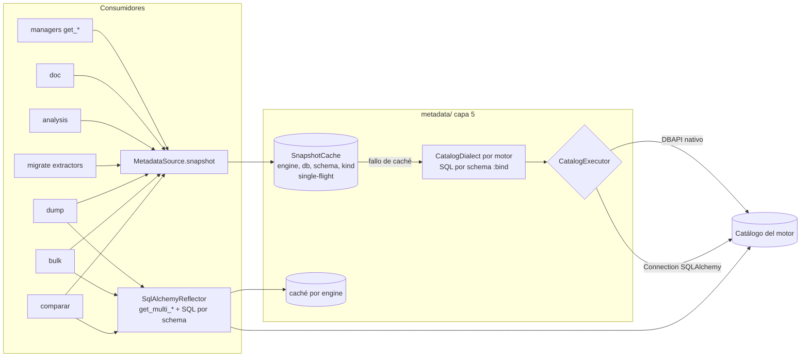

# 03 · DISEÑO — `metadata/` como punto único y por lotes de la extracción de metadatos

Sesión `2026-10-03-metadata-centralization` · Plan Architect + Performance Auditor · borrador de ADR en
`ADR-003-borrador.md`

Entradas: `01_INVENTARIO.md` (cuatro mecanismos, tres estilos de parámetros, 174 constructores de SQL, 34 llamadas a
`Inspector`, contrato por tabla) y `02_BASELINE_RENDIMIENTO.md` (coste O(tablas) en todos los flujos salvo `migrate`
y parte de `comparar`).

---

## 1. Problema en una frase

Cada consumidor elige cómo leer el catálogo (JSON del registry, `fetch_*_sql` de un motor concreto o `Inspector`) y
casi siempre lo hace **tabla a tabla**; el resultado es SQL repetido de 2 a 5 veces por dato, ramas por motor en
`bulk`/`dump`/`comparar`/`migrate` y flujos cuyo coste crece con el número de tablas (y, en PostgreSQL, con el tamaño
del catálogo de toda la base).

## 2. Decisiones

### D1 · Ubicación: ampliar `metadata/` (capa 5)

- `metadata/` pasa a contener **todo** el SQL de catálogo de la librería y **toda** la reflexión `Inspector`.
- **Alternativa descartada**: paquete nuevo (`catalog/`). Mismo nivel que `metadata/`, obligaría a mover también la
  caché y los contratos y dejaría dos paquetes con la misma razón de cambio.
- `data/sql_queries.json`: sus 123 consultas son de catálogo. Se **retiran** del JSON y pasan a `metadata/<motor>/catalog.py`.
  `query/` (capa 4) se queda como motor genérico de consultas con nombre del usuario (`queries_file`), sin consultas
  de la librería. Ruptura: `get_available_queries()` deja de listar las de catálogo y `execute_query_many("obtener_tablas")`
  deja de existir (CHANGELOG).
- `connection/mariadb/update_auto_increment.py` (capa 4, usa `Inspector`): `UpdateAutoIncrement` es una operación de
  mantenimiento, no de conexión. Se **mueve a `bulk/_support/`** (capa 6, junto a `pk_sync.py`, que hace lo mismo para
  todos los motores) y lee del snapshot. Ruptura: cambia el import público.
- **Excepción registrada** (no es diccionario de datos): `connection/*/_variables.py` y los `PRAGMA` de sesión
  (`EngineReadinessAdvisor`, configuración del servidor y de la conexión) se quedan en `connection/`. La guarda G las
  lista por ruta.
- SQL **emitido** (`comparar/reporters/sql_reporter.py:1088`, `migrate/emitters/sqlserver.py:407`) queda fuera: es
  salida, no lectura.

### D2 · Dos vistas, un solo dueño

| Vista | Para quién | Backend | Por qué |
|---|---|---|---|
| **Catálogo** (`SchemaSnapshot`, modelo neutro) | managers (`get_*`), `doc`, `analysis`, `migrate`, planificación de `dump`, `bulk/pk_sync` | SQL propio **por schema y tipo de objeto** (`metadata/<motor>/catalog.py`) | Una consulta por tipo; incluye lo que `Inspector` no da (definiciones de routines, parámetros, charset, almacenamiento, comentarios de routines) |
| **Reflexión** (`SqlAlchemyReflector`) | `bulk` (objetos `Table`), `dump` (carga), `comparar` (tipos SQLAlchemy) | `Inspector.get_multi_*` + SQL por schema donde el dialect va tabla a tabla (SQL Server FKs/PK/índices, ya medido en `comparar/_prefetch.py`) | Quien necesita **tipos SQLAlchemy** o `Table` reflejadas no debe reimplementar el parseo de tipos de cada dialect |

- Criterio único: **si el consumidor necesita tipos u objetos SQLAlchemy → Reflexión; en cualquier otro caso →
  Catálogo**. Ningún consumidor llama a `inspect()`: ambas vistas viven en `metadata/`.
- **Alternativa descartada**: derivar tipos SQLAlchemy del snapshot neutro (reimplementar el parseo de tipos de 7
  dialects; riesgo alto de regresiones en `bulk`).
- **Alternativa descartada**: solo `Inspector` para todo. SQLAlchemy 2.0 solo agrupa en una consulta por schema en
  PostgreSQL y Oracle (whatsnew 2.0, ver fuentes); MySQL/MariaDB/SQLite/SQL Server van tabla a tabla, y no cubre
  routines, parámetros, charset ni almacenamiento.

### D3 · API orientada a lotes

```python
# metadata/contracts.py (esqueleto; nombres a confirmar en IMPLEMENT)
class Kind(StrEnum):
    TABLES = "tables"; VIEWS = "views"; COLUMNS = "columns"; PRIMARY_KEYS = "pk"; FOREIGN_KEYS = "fk"
    UNIQUES = "uk"; CHECKS = "ck"; INDEXES = "ix"; ROUTINES = "routines"; ROUTINE_PARAMETERS = "params"
    DEFINITIONS = "ddl"; IDENTITY = "identity"; COMMENTS = "comments"; CHARSET = "charset"; STORAGE = "storage"

class MetadataSource(Protocol):                       # sync; AsyncMetadataSource con los mismos métodos async
    def snapshot(self, schema: str | None = None, *, kinds: Collection[Kind] = ALL_KINDS,
                 tables: Collection[str] | None = None) -> SchemaSnapshot: ...
    def invalidate(self, schema: str | None = None, *, kinds: Collection[Kind] | None = None) -> None: ...

@dataclass(frozen=True, slots=True)
class SchemaSnapshot:
    engine: str; database: str | None; schema: str
    tables: Mapping[str, TableMeta]; views: Mapping[str, ViewMeta]; routines: Mapping[RoutineKey, RoutineMeta]
    loaded: frozenset[Kind]                           # qué tipos están cargados (carga perezosa por tipo)
```

- **Carga perezosa por tipo y schema**: la primera petición de columnas de cualquier tabla carga las columnas de
  **todo** el schema con una consulta; las siguientes salen de la caché. Así los consumidores que hoy preguntan tabla a
  tabla (`doc`, `analysis`) pasan de O(tablas) a O(tipos) consultas sin reescribir su bucle.
- `tables=` limita la lectura cuando el consumidor solo necesita unas pocas tablas de un catálogo enorme (`bulk` con
  una tabla, `dump` con `DumpConfig.tables`). Umbral a fijar con el baseline (p. ej. ≤ 20 tablas → filtro `IN`).
- Los métodos por tabla de los managers (`get_columns(t)`…) se conservan como fachada de lectura sobre el snapshot.

### D4 · Modelo normalizado

- `TableMeta(name, comment, columns, primary_key, foreign_keys, uniques, checks, indexes, identity, charset, storage)`,
  `ColumnMeta(name, ordinal, data_type, length, precision, scale, nullable, default, is_identity, comment, charset,
  collation)`, `ForeignKeyMeta(name, columns, ref_schema, ref_table, ref_columns, on_delete, on_update)`, etc.
  `frozen=True, slots=True` (memoria; ver baseline de memoria).
- **Ruptura**: los managers devuelven modelos en lugar de tuplas con forma distinta por motor. Hoy cada consulta del
  JSON devuelve columnas distintas por motor y `doc` las lee por posición; es la fuente principal de riesgo (§5).
- Nombres normalizados como los devuelve el motor (sin plegar mayúsculas) + búsqueda insensible a mayúsculas en el
  snapshot (lección de v0.30.0 en `comparar`).

### D5 · Caché

| Aspecto | Decisión |
|---|---|
| Ámbito | Por `MetadataSource` (instancia de manager o engine). `dump` y `comparar` crean uno por ejecución (datos frescos). |
| Clave | `(engine, database, schema, kind)`; un único almacén (se retiran `DatabaseMetadataCache`, `RelationshipMetadataCache`, la caché duplicada de `MetadataManager` y `TableMetadata` de `comparar/_prefetch.py`). |
| Invalidación | `invalidate(schema, kinds)`. La llaman `migrate` (tras `execute`), `dump` (tras recrear índices/constraints), `bulk` (tras `maintenance_scope`) y el manager al ejecutar DDL propio. |
| Concurrencia | *Single-flight* por clave: `threading.Lock` (sync) / `asyncio.Lock` (async); los hilos de `bulk`/`dump` no repiten lecturas. |
| Memoria | Límite por nº de schemas (LRU, por defecto 8) y medición de tamaño en el baseline a 5000 tablas. |
| Encapsulación | Nadie fuera de `metadata/` toca dicts privados (hoy `managers/sync_mgr.py:714-715` usa `db_cache._tables_cache`). |

### D6 · Contrato por motor y ejecución

```python
class CatalogDialect(Protocol):                      # metadata/<motor>/catalog.py, uno por motor
    name: str                                         # db_type de la librería
    sqlalchemy_names: frozenset[str]                  # dialect.name que resuelve (p. ej. {"mssql"})
    def query(self, kind: Kind, *, filtered: bool) -> CatalogQuery | None: ...   # None = no aplica al motor
    def parse(self, kind: Kind, rows: Sequence[Sequence[Any]]) -> Iterable[Any]: ...

class CatalogExecutor(Protocol):                     # cómo se ejecuta, separado de qué se ejecuta
    def fetch_all(self, sql: str, params: Mapping[str, Any]) -> list[tuple[Any, ...]]: ...
```

- Dos ejecutores: sobre el `SyncQueryExecutor` de los managers (DBAPI nativo) y sobre una `Connection` de SQLAlchemy.
  Unifica managers (capa 6) y consumidores con `Engine` (`dump`, `bulk`, `comparar`).
- **Un único estilo de parámetros** en el SQL de catálogo: `:nombre`. El ejecutor DBAPI lo traduce al `paramstyle`
  del driver (`pyformat` psycopg/pymssql/pymysql, `named` oracledb, `qmark` pyodbc/sqlite/mariadb), ignorando `::`
  (casts de PostgreSQL). Elimina H-12 y H-13: bind parameters siempre, nunca `str.format` sobre literales.
- Registro: `metadata/registry.py` resuelve por `db_type` y por `dialect.name`. Añadir un motor = un módulo
  `catalog.py` + registro (OCP); ningún consumidor cambia.
- Se retiran los adaptadores M3 (`SourceAdapterSync`/`RoutineAdapterSync` y `fetch_*_sync`/`fetch_*_async` de
  módulo): 0 usos en producción. Sus tests de paridad se convierten en tests de `CatalogDialect` por motor.

### D7 · Consumidores

| Consumidor | Hoy | Objetivo |
|---|---|---|
| `managers/` | JSON por tabla; adaptador solo MariaDB/MySQL; 2 cachés | Fachada sobre `MetadataSource` (snapshot); `get_schema_metadata()` público |
| `doc/` | 4–7 consultas por tabla vía manager; lectura posicional de tuplas por motor | Recibe `MetadataSource`; itera el snapshot |
| `analysis/` | FKs de todas las tablas, una a una, para el índice de relaciones entrantes | Índice desde `snapshot(kinds={FOREIGN_KEYS})`: una consulta |
| `migrate/extractors/` | `*_for_schema_sql` + parseo propio por extractor | Mapeo `SchemaSnapshot` → IR; el parseo de filas pasa a `metadata/<motor>/catalog.py` |
| `comparar/` | `get_multi_*` + SQL por schema SQL Server en `_prefetch.py`; routines vía `metadata` | `SqlAlchemyReflector` (generaliza `_prefetch.py`) + snapshot para routines. **Se retira la excepción de la Regla #2** |
| `dump/` | `Inspector` por tabla (PK y columnas ×3); FKs por tabla salvo SQL Server | Un snapshot por ejecución para orden FK, constraints e índices; `Table` reflejadas una vez vía `SqlAlchemyReflector` |
| `bulk/` | `inspect(conn).reflect_table` por operación; `fetch_*_sql` por motor; `pg_get_serial_sequence` inline | `SqlAlchemyReflector.table()` cacheado por engine; identidad/secuencias desde `Kind.IDENTITY` |
| `connection/mariadb/update_auto_increment.py` | `Inspector` en capa 4 | Movido a `bulk/_support/`, lee el snapshot |
| Redshift / Snowflake | 3418 líneas inalcanzables | **Decisión del usuario** (D9) |

### D8 · Reglas IA

- Regla #1: SQL de catálogo y `Inspector` solo en `metadata/`; destino canónico `metadata/<motor>/catalog.py`; patrón
  canónico `SchemaSnapshot` (sustituye a «`migrate/extractors/oracle.py`»).
- Regla #2: los consumidores reciben `MetadataSource`/`AsyncMetadataSource`; sin excepciones.
- Regla #3: un camino por objeto y motor; prohibido el SQL de catálogo por tabla si existe la versión por schema.

### D9 · Decisiones que necesitan al usuario

1. **Redshift y Snowflake**: (a) retirar los subpaquetes (recomendado: inalcanzables, sin `db_type`, sin banco) o
   (b) darlos de alta como motores en `database_types.json` + conexión + banco.
2. **Forma pública de `get_*` de los managers**: (a) modelos tipados (recomendado; ruptura) o (b) mantener tuplas una
   versión con aviso de deprecación (más trabajo: reconstruir la forma por motor de 123 consultas).
3. **HSQLDB**: sin banco en `docker-compose.bench.yml`; su `catalog.py` se escribe desde el JSON actual y queda
   `PENDIENTE DE VERIFICACIÓN` hasta tener contenedor.

## 3. Flujo objetivo



## 4. Optimizaciones por motor (grupo F; cada una con medición antes/después)

| Motor | Acción | Evidencia |
|---|---|---|
| PostgreSQL | Constraints y columnas desde `pg_catalog` por schema; nada de `information_schema.table_constraints`/`constraint_column_usage` por tabla | Micro-benchmark: FK por tabla 94–95 ms tanto en schema de 50 como de 5000 tablas (catálogo de 5624 tablas); FK de todo el schema de 5000 tablas: 89 ms |
| Oracle | `ALL_*` filtrado por `OWNER` en una consulta por tipo, **con bind variables**; `ALL_SOURCE` por owner en vez de `DBMS_METADATA` por objeto. `USER_*` no aporta (H-ORA1 descartada) | Bind vs literal, mismas consultas por tabla: 749 → 113 ms/tabla (FK 540 → 21 ms). Por schema (500 tablas): 0,27 s frente a 365 s |
| SQL Server | `sys.*` por schema (ya existe en `metadata/sqlserver`), **incluidas las columnas** para la vista de reflexión (el dialecto `mssql` resuelve `get_multi_columns` tabla a tabla) | `comparar` 5000 tablas: 224 de 229 s de catálogo en 10 000 `get_columns`; `dump` v0.17.0 (FKs 33,9 → 14,3 s en 200 tablas) |
| MySQL / MariaDB | `information_schema` con `TABLE_SCHEMA` constante (evita recorrer el directorio de datos); sin columnas dinámicas (`TABLE_ROWS`, `DATA_LENGTH`) salvo en almacenamiento; **sin joins entre vistas de `information_schema`** (FK en dos consultas unidas en Python, H-16) | Docs MySQL 8.4 y MariaDB (fuentes); FK 5000 tablas: MySQL 15,7 s → 52 ms, MariaDB 4,5 s → 183 ms |
| SQLite | Funciones tabla `pragma_table_info`, `pragma_foreign_key_list`, `pragma_index_list` unidas a `sqlite_schema`: una consulta por tipo | Docs SQLite ≥ 3.16 (fuentes) |
| Todos | Bind parameters (reutilización de plan, sin hard parse por tabla en Oracle) | H-12 |

## 5. Riesgos de diseño (se detallan en `05_AUDIT_PLAN.md`)

1. `doc` lee tuplas por posición distinta por motor: la migración a modelos exige **tests de caracterización** (HTML/Excel
   generados por motor, comparados antes/después) antes de tocar `doc`.
2. Diferencias de normalización entre el JSON, `*_for_schema_sql` e `Inspector` (mayúsculas de Oracle, defaults,
   identity, vistas sin definición por permisos).
3. Snapshot de schemas enormes: memoria y latencia de la primera lectura (medir a 5000 tablas; `tables=` como válvula).
4. Caché obsoleta tras DDL propio: invalidación explícita en `migrate`, `dump`, `bulk`.
5. Capas: `metadata/` (5) no puede importar `managers/` (6); el ejecutor DBAPI se inyecta desde los managers.
