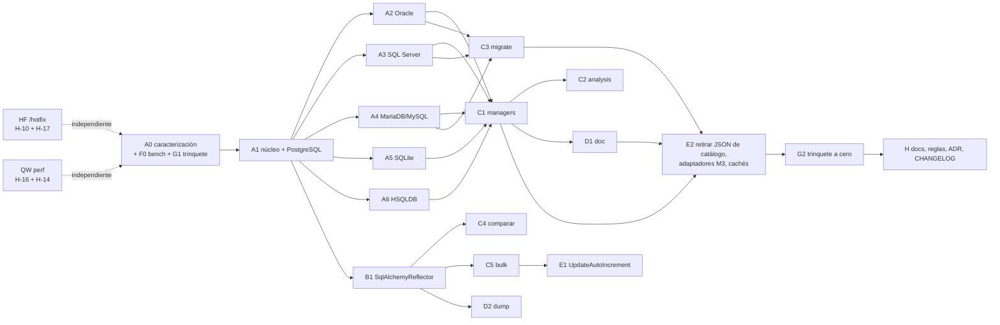

# 04 · PLAN incremental — centralización y rendimiento de metadatos

Sesión `2026-10-03-metadata-centralization` · Plan Architect · depende de `03_DISENO.md` y de las decisiones D9

Reglas de ejecución: un PR por grupo (o subgrupo), suite en verde al cerrar cada uno (`ruff check`, `ruff format`,
`mypy src tests/unit/test_protocol_conformance.py`, `pytest`, `gen_arquitectura_capas.py`) y medición con el mismo
procedimiento del baseline (`scripts/bench_metadata.py`, ver F0). Las cifras «objetivo» son `ESTIMADO` hasta medirse.

---

## Orden y dependencias

---

## Grupos

### HF · `/hotfix` H-10 + H-17 (independiente, antes de todo)

- H-10 · `get_routine_ddl()` en PostgreSQL: añadir `esquema` a los parámetros de contexto de PostgreSQL
  (`managers/_metadata_context.py` `add_context_params`) o usar `{database}` en `create_rutina` (postgresql).
- H-17 · `get_routine_parameters()` en SQL Server: quitar `PARAMETER_DEFAULT` de `parametros_rutina` (sqlserver) o
  leer el default de `sys.parameters` (`has_default_value`/`default_value`).
- Tests de regresión unitarios (resolver por motor) + integración contra el banco (routines `f0000`/`p0000`).
- Rollback: `git revert`.

### QW · Mejoras rápidas de rendimiento (independientes, `perf:`; cada una con medición)

| ID | Cambio | Medido hoy | Objetivo |
|---|---|---|---|
| H-16 | FK por schema de MariaDB/MySQL (`metadata/mariadb/tables.py:147-168`) en dos consultas sin join, unidas en Python | MySQL 5000 tablas: 15,7 s; MariaDB: 4,5 s | MySQL ≈ 52 ms, MariaDB ≈ 183 ms (`bench/micro_mysql_fk.py`) |
| H-14 | `migrate/views/transpiler.py`: `_schema_for_sqlglot` una vez por `transpile_views` (no por vista) | PostgreSQL 500 tablas / 50 vistas: 17,7 de 20,4 s | `migrate` 500 tablas < 1 s (`ESTIMADO`) |

Ambas cambian el baseline de `migrate`: se miden antes/después con `bench/md_bench.py` y se re-capturan los dorados de
A0 después de aplicarlas.

### A0 · Red de seguridad (sin cambios funcionales)

| Entregable | Contenido |
|---|---|
| Tests de caracterización | `tests/integration/metadata/characterization/`: por motor del banco, volcado JSON normalizado de `get_tables/views/routines/columns/indices/pk/fk/uk/ddl` de un schema fijo, del `MigrationPlan` (`emit_ddl`), del `SchemaDiff` de `comparar` y del HTML de `doc` (texto sin estilos). Ficheros dorados en `tests/fixtures/metadata_golden/`. Marca `integration`. |
| F0 · `scripts/bench_metadata.py` | Promoción de `bench/md_bench.py` de esta sesión con las convenciones de `bench_compare.py`/`bench_dump.py`. |
| G1 · guarda con trinquete | `tests/unit/test_architecture_metadata_rules.py`: escaneo `ast` (prototipo `bench/scan_catalog.py`) que falla si aparece SQL de catálogo o `inspect()`/`Inspector` fuera de `metadata/` **en un fichero que no esté en la lista de pendientes**, y si un consumidor importa `metadata.<motor>.*`. Las listas arrancan con lo medido hoy (17 ficheros con SQL de catálogo o `Inspector`, 18 con imports `metadata.<motor>`) y cada grupo las reduce. |
| Conteo de consultas | `tests/unit/metadata/test_query_counts.py` (SQLite en memoria, 1/10/100 tablas): registra el número de consultas por flujo; se marca `xfail(strict=True)` mientras el flujo sea O(tablas) y se vuelve verde al migrarlo. |

Rollback: solo tests y scripts.

### A1 · Núcleo + PostgreSQL

- `metadata/contracts.py`: `Kind`, `MetadataSource`, `AsyncMetadataSource`, `CatalogDialect`, `CatalogExecutor`.
- `metadata/model.py`: `SchemaSnapshot`, `TableMeta`, `ColumnMeta`, `ForeignKeyMeta`, `IndexMeta`, `RoutineMeta`…
- `metadata/snapshot_cache.py`: caché única, *single-flight* sync/async, LRU, `invalidate`.
- `metadata/_paramstyle.py`: `:nombre` → `pyformat`/`named`/`qmark` (ignora `::`).
- `metadata/registry.py`: resolución por `db_type` y `dialect.name`.
- `metadata/source.py`: `CatalogSource` (sync/async) sobre un `CatalogExecutor`; ejecutor SQLAlchemy incluido;
  el ejecutor DBAPI se inyecta desde `managers/` (capa 6).
- `metadata/postgresql/catalog.py`: una consulta `pg_catalog` por tipo (tablas, vistas, columnas, PK/UK/CK, FK,
  índices, routines + parámetros + definición, identidad/secuencias —absorbe S-1—, comentarios, charset, almacenamiento).
- Tests: unitarios del traductor de parámetros, de la caché (concurrencia con hilos y `asyncio`), del parseo con filas
  fijas; integración PostgreSQL contra el banco comparando con los dorados de A0.
- Objetivo: snapshot completo de un schema = nº de tipos pedidos en consultas, independiente del nº de tablas.
- API pública: añade, no rompe.

### A2–A6 · Un `catalog.py` por motor

| Grupo | Motor | Base de partida | Notas |
|---|---|---|---|
| A2 | Oracle | `*_for_schema_sql` de `metadata/oracle/tables.py`, `ALL_SOURCE` por owner | `ALL_*` con bind variables (`USER_*` descartado: sin ganancia medida); absorbe S-2 (`user_users`) |
| A3 | SQL Server | `sys.*` por schema ya existentes (`tables.py`, `constraints.py`) | `OBJECT_DEFINITION` / `sys.sql_modules` por schema |
| A4 | MariaDB + MySQL | `*_for_schema_sql` de `metadata/mariadb/tables.py`, `metadata/mysql/` | `TABLE_SCHEMA` constante; MySQL hereda de MariaDB con diferencias de routines |
| A5 | SQLite | nuevo | `pragma_*` como funciones tabla unidas a `sqlite_schema` |
| A6 | HSQLDB | consultas del JSON | `PENDIENTE DE VERIFICACIÓN` (sin banco) |

Cada uno: tests de parseo con filas fijas + integración contra los dorados de A0.

### B1 · `SqlAlchemyReflector` en `metadata/`

- Generaliza `comparar/_prefetch.py` (`get_multi_*` + consultas por schema de SQL Server) y expone `table(name)` /
  `tables(names)` para `bulk`/`dump` (reflexión sin FKs cuando no se piden, lección Q9 de v0.17.0), cacheado por
  engine y schema.
- `comparar/_prefetch.py` pasa a ser un uso del reflector (se borra su lógica).
- Prioridad: columnas de SQL Server por schema (`comparar` 5000 tablas: 224 de 229 s de catálogo son `get_columns` tabla
  a tabla) y reflexión de `dump` sin repetir PK/columnas ni recargar `pg_type` por tabla (PostgreSQL 5000 tablas:
  68 130 consultas, 105 s).

### C1 · Managers (sync y async)

- `get_*` → fachada sobre `MetadataSource`; nuevo `get_schema_metadata(kinds=…, tables=…)`.
- Ruptura según D9-2 (modelos tipados recomendado). Se retiran `MetadataManager`, `get_metadata_manager()`,
  `DatabaseMetadataCache`, `RelationshipMetadataCache` y las estrategias `_manager_metadata_runtime.py` (mapeo en
  CHANGELOG).
- Objetivo `manager_scan` (500 tablas, PostgreSQL): de 2503 consultas / 70 s a ≈ 8 consultas (`ESTIMADO`).

### C2 · `analysis/`

- Índice de relaciones entrantes (`analysis/base.py:530-545`) desde `snapshot(kinds={TABLES, FOREIGN_KEYS})`.
- `RelationshipMetadataCache` se sustituye por el snapshot.

### C3 · `migrate/`

- Extractores: `SchemaSnapshot` → IR; el parseo de filas que hoy hace cada extractor pasa a `catalog.py`.
  `MigrationPlanner.plan(connection, schema)` acepta un `MetadataSource` (ruptura de firma si D9-2 = a).
- Debe mantener el número de consultas actual (ya por schema) y los dorados de `emit_ddl`.

### C4 · `comparar/`

- Lee con `SqlAlchemyReflector` + snapshot (routines). `SchemaComparator.compare()` acepta `MetadataSource` o
  `Engine`; desaparecen los `Inspector` como parámetro (ruptura) y la excepción de la Regla #2.

### C5 · `bulk/`

- `reflect_table` vía reflector cacheado; `pk_sync` lee `Kind.IDENTITY`; constraints de Oracle (`crud.py:1847-1857`)
  y orphan-check (`crud.py:1787`) desde el snapshot; desaparecen los imports `metadata.<motor>.*` de `bulk/` (7).

### D1 · `doc/`

- Recibe `MetadataSource`; renderers iteran el snapshot (adiós a lecturas posicionales por motor).
- Requisito: dorados HTML/Excel de A0 idénticos (salvo diferencias justificadas y listadas).
- Objetivo `doc_html` (500 tablas, PostgreSQL): de O(tablas) consultas a O(tipos) (`ESTIMADO`).

### D2 · `dump/`

- Un snapshot por ejecución: orden FK (`_fk_graph.py`), constraints (`_constraints.py`), índices (`_indexes.py`),
  columnas comunes y PK de rango (`orchestrator.py:676-684,1044-1057,1142`) sin `Inspector` propio.
- Se borran los caminos especiales de SQL Server (Q9) porque el caso general ya es por schema.
- Objetivo `dump` (500 tablas vacías): de ≈ 12 consultas de catálogo por tabla a O(tipos) + las de DDL de constraints.

### E1 · `UpdateAutoIncrement`

- `connection/mariadb/update_auto_increment.py` → `bulk/_support/auto_increment.py`, leyendo el snapshot. Ruptura de
  import público.

### E2 · Retirada

- Consultas de catálogo de `data/sql_queries.json` (las 19 claves por motor) y su validación en `validators/`.
- Adaptadores M3 (`metadata/<motor>/sync_adapter.py`, `async_adapter.py`, `fetch_*_sync`) y sus tests de paridad
  (convertidos en tests de `CatalogDialect`).
- `metadata/redshift/`, `metadata/snowflake/` según D9-1.
- `metadata/manager.py`, `metadata/async_manager.py`, `metadata/fetcher.py`, `metadata/builder.py` si quedan sin uso.

### G2 · Trinquete a cero

- Lista de pendientes de G1 vacía salvo excepciones registradas en el ADR (`connection/*/_variables.py`, SQL emitido).
- Tests de conteo de consultas en verde (sin `xfail`).

### H · Documentación y cierre

- `docs/adr/ADR-003-*.md` (desde `ADR-003-borrador.md`), `docs/api/metadata_manager.md`,
  `docs/api/managers_metadata_factory.md`, `docs/functional/metadata_extraction.md`, guía de migración en `CHANGELOG.md`.
- `.github/instructions/architecture.instructions.md` (Reglas #1–#3, D8), `SHARED_INSTRUCTIONS.md` (tabla de
  responsabilidades), `.ai/architecture.md`, diagrama de capas regenerado.
- `zensical build --strict`.

---

## Cortes de versión sugeridos

| Versión | Grupos | API |
|---|---|---|
| v0.30.1 | HF, QW | Sin cambios (corrección de fallos y rendimiento) |
| v0.31.0 | A0, A1–A6, B1, F0, G1 | Solo añade (`MetadataSource`, `SchemaSnapshot`) |
| v0.32.0 | C1–C5, D1–D2, E1 | **Rupturas** (managers, `comparar`, `migrate`, `UpdateAutoIncrement`) con guía de migración |
| v0.33.0 | E2, G2, H | Retiradas finales |

## Estrategia de pruebas

| Nivel | Qué | Dónde |
|---|---|---|
| Unitario | Traductor de parámetros, caché (hilos/asyncio), parseo por motor con filas fijas, modelo | `tests/unit/metadata/` (nuevo) |
| Contrato | `Protocol` de `MetadataSource`/`CatalogDialect` (conformidad con mypy) | `tests/unit/test_protocol_conformance.py` |
| Conteo | Nº de consultas por flujo con 1/10/100 tablas (SQLite) | `tests/unit/metadata/test_query_counts.py` |
| Caracterización | Dorados por motor de managers, `migrate`, `comparar`, `doc` | `tests/integration/metadata/characterization/` |
| Arquitectura | Guarda de catálogo (G1/G2) + capas | `tests/unit/test_architecture_metadata_rules.py`, `test_architecture_import_rules.py` |
| Rendimiento | Baseline antes/después por grupo | `scripts/bench_metadata.py` → `bench_results/metadata/` |

## Rollback

Cada grupo es un PR revertible con `git revert`. Ninguno toca datos ni esquemas del usuario; los únicos efectos
externos son los schemas `zz_*` del banco (los crea y borra `bench_metadata.py`). Entre v0.31.0 y v0.32.0 conviven
los caminos viejos y nuevos, así que revertir C/D no exige revertir A.
