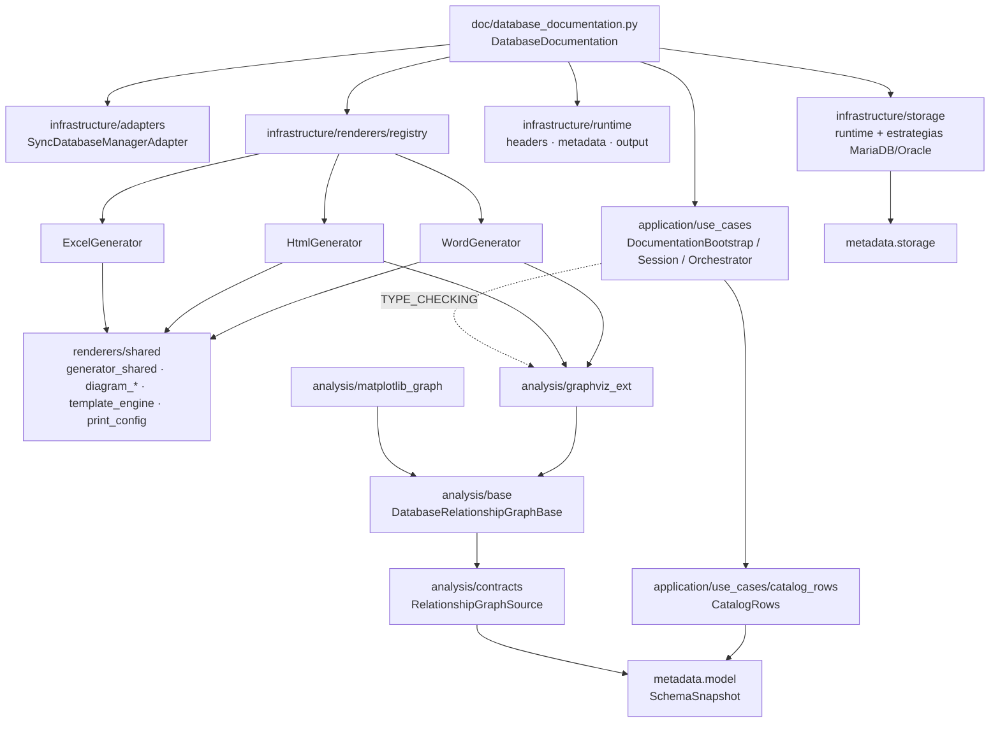

# PLAN — Auditoría de arquitectura de `doc/` + `analysis/`

- Fecha: 2026-10-09 · Rama: `develop` · Versión de partida: `0.40.3` (HEAD `4d3aede8`)
- Skill: `documentation-architecture-audit` (`.github/prompts/doc_architecture_audit.prompt.md`)
- Inputs: motores PostgreSQL, MySQL, MariaDB, Oracle, SQL Server, SQLite, Snowflake · ruptura de API permitida ·
  validación con docker-compose · benchmark condicional

## 1. Correcciones de contexto (el skill es genérico; esto es lo que hay en el repo)

| Supuesto del skill | Realidad verificada | Consecuencia |
|---|---|---|
| Paquetes por motor (`doc/pg/`, `doc/mysql/`…) | No existen. `doc/` ya es hexagonal: `domain/`, `application/` (puertos + casos de uso), `infrastructure/` (adaptador, runtime, renderers, storage) | Se descarta la reestructuración `doc/motors/<motor>/`: crearía ficheros sin reducir acoplamiento |
| Extracción de metadatos por motor dentro de `doc/` | Desde D1/E2 (ADR-003) `doc/` y `analysis/` leen solo `get_schema_metadata()` → `CatalogRows` produce filas neutras iguales en todos los motores. El SQL de catálogo vive en `metadata/` | Las «duplicidades de consultas por motor» no existen en `doc/`; el código por motor que queda está en `storage/` (inventario de almacenamiento) |
| Snowflake | No está soportado por la librería: sin dialecto en `metadata/`, sin driver y sin `db_type`. Solo aparece en un comentario de `dump/_models.py:89` | Fuera de alcance (N/A). HSQLDB sí está soportado y se incluye en el inventario |
| Pooling en `doc/` | `doc/` no gestiona conexiones; usa el manager recibido | Pooling fuera de alcance de esta auditoría (cubierto por `drivers-connections-audit`) |
| Tests `--docker=live`, `--verify-doc-output` | Esas opciones no existen. Integración real: `tests/integration/...` con `UTIL_BBDD_TEST_<MOTOR>_URL` + `scripts/bench_env.example.sh` | Validación con los contenedores `util_bbdd_bench_*` (5 servidores + HSQLDB) |
| Informes en `docs/audits/` | `docs/` es la web publicada (`zensical build --strict`, `nav` obligatorio) | Informes en esta carpeta de sesión; JSON en `build/logs/doc_audit_20261009_*.json` |

## 2. Mapa de módulos y dependencias

- Sin ciclos de import (`scripts/gen_arquitectura_capas.py` ya lo verifica a nivel de paquete).
- `analysis/` no conoce `doc/`; `doc/` depende de `analysis/` solo para construir el generador de grafos.

## 3. Inventario de funcionalidad por motor (lo que es específico de motor en `doc/` + `analysis/`)

| Motor | Render (Word/Excel/HTML) | Metadatos | Almacenamiento (`storage/`) | Nombre de salida / contexto | Grafo |
|---|---|---|---|---|---|
| PostgreSQL | neutro | snapshot (neutro) | estrategia genérica, tablespace `pg_default` | contexto = schema | neutro |
| MySQL | neutro | snapshot | estrategia propia (copia de MariaDB) + parser `innodb_temp_data_file_path` | database | neutro |
| MariaDB | neutro | snapshot | estrategia propia `mariadb_strategy.py` | database | neutro |
| Oracle | neutro | snapshot | estrategia propia `oracle_strategy.py` (tablespaces del usuario) | usuario | neutro |
| SQL Server | neutro | snapshot | **sin entrada en el registro** → aviso de «fallback genérico» aunque tiene consultas y cabeceras (bug B-01) | schema/`dbo` | neutro |
| SQLite | neutro | snapshot | estrategia + `sqlite_file_summary` | nombre de fichero | neutro |
| HSQLDB | neutro | snapshot | sin consultas → aviso + 2 secciones «no disponible» | schema/`PUBLIC` | neutro |
| Snowflake | N/A | N/A | N/A | N/A | N/A |

Código específico de motor: ~1.150 LOC de ~14.300 (8 %), todo en `infrastructure/storage/` más 2 tablas pequeñas
(`output_runtime.resolve_output_filename_identifier`, `domain/services.resolve_database_context`).

## 4. Candidatos de consolidación (por impacto)

1. **Inventario de almacenamiento** (`storage/runtime.py` 694 + estrategias 441 LOC): tabla declarativa por motor (consultas, títulos, cabeceras, post-procesadores) derivada de `metadata.storage`; eliminar 15 delegadores muertos y la dependencia circular estrategia ↔ runtime privado.
2. **Construcción del generador de grafos** (3 copias con opciones distintas) → una fábrica.
3. **Inyección de enlaces en SVG** (2 copias, disco y memoria) → una función.
4. **Tolerancia heredada pre-D1** (lectura de UNIQUE por mapping/heurística, cabeceras por motor vacías) → eliminar.
5. **Normalización de parámetros de rutina** (3 copias) y envoltorios de una línea.
6. **Código muerto** en sesión/orquestador/adaptador/puertos.

## 5. Alcance de ruptura de API (candidata a 0.41.0; en 0.x el minor es la versión de ruptura, como en 0.40.0)

- `util_bbdd.doc`: reducir exportaciones a `DatabaseDocumentation` (los generadores necesitan la sesión interna como `data_provider`; no son usables sueltos).
- `DatabaseDocumentation`: sin E/S en `__init__`; atributos de estado (`tablas`, `vistas`, `rutinas`, `catalog`, `headers`…) dejan de ser públicos.
- Excepciones: `DocumentationConfigError` (también `ValueError`) y `DocumentationRenderError` en lugar de `ValueError`/`TypeError`/excepción cruda.
- `headers_config.json`: se elimina el bloque por motor y `labels` (sin uso desde D1).

## 6. Quality gate

| Criterio | Evidencia |
|---|---|
| Sin regresión funcional | `test_doc_matches_golden` (HTML, 5 motores reales + SQLite) y `test_analysis_relations` en verde contra el banco |
| Calidad | `ruff check`, `ruff format`, `mypy src tests/unit/test_protocol_conformance.py`, `pytest` completo en verde |
| Rendimiento | ≥ 2× en generación HTML/Word con grafos (120 tablas), sin empeorar sin grafos |
| Cobertura | no baja en `doc/`+`analysis/` (61 % de partida); los ficheros tocados tienen tests nuevos |
| Seguridad | sin regresión de DOC-01 (autoescape), DOC-03 (saneado de rutas), `SafeWorkbook` |
| Trazabilidad | commits Conventional con ID de hallazgo, CHANGELOG con guía de migración |

Objetivo de cobertura del skill (≥ 80 % por motor): **no aplica tal cual**, porque `doc/` no tiene código por motor.
Se fija «no bajar y cubrir lo tocado».
