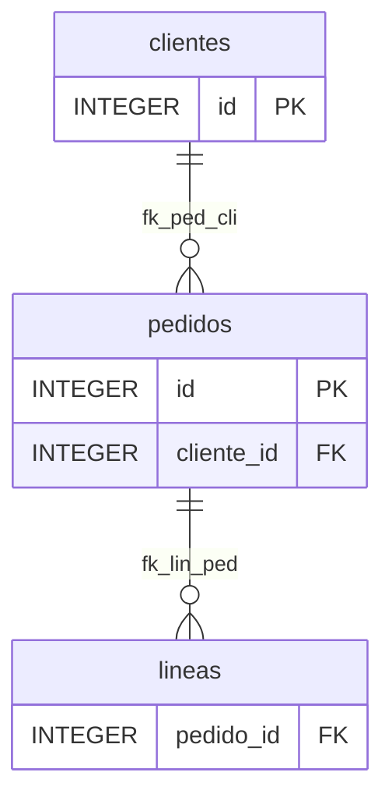

# PLAN — Documentación Markdown con ER Mermaid (`DatabaseDocumentation`, formato `"markdown"`)

Sesión `2026-11-05-doc-markdown` · prompt `.github/prompts/doc_markdown_feature.prompt.md` · rama `develop` ·
base v5.2.0 → objetivo **v5.3.0 (MINOR)**.

## 1. Objetivo

Nuevo formato `"markdown"` en `DatabaseDocumentation(formatos=[...])`, con las mismas secciones y opciones de
`imprimir` que Word. Genera:

- un fichero `.md` por tabla, vista y rutina, con índices paginados;
- diagramas ER `erDiagram` de Mermaid sin Graphviz;
- metadatos para IA: front matter, anclas, `catalog.json`, `llms.txt` y `llms-full.txt`;
- trazabilidad desde un mapa de entrada opcional;
- versionado: `manifest.json`, salida determinista y `CHANGES.md` respecto de una generación anterior.

La salida se publica tal cual con Zensical/MkDocs y se descarga desde util_bbdd_web.

## 2. Decisiones

| Id | Decisión | Estado |
|---|---|---|
| D1 | Paridad con Word + alternativas Markdown (§2.1), incluido el orden alfabético | **Usuario (2026-11-06)** |
| D2 | Front matter + anclas, `catalog.json`, `llms.txt`/`llms-full.txt`, mapa de trazabilidad | **Usuario: todo en el MVP** |
| D3 | `grafo.max_depth`/`direction` con tope Markdown (por defecto 2), aviso y resumen de niveles ocultos | **Usuario** |
| D4 | Un fichero por objeto, índices paginados, sin modo `bundled`, sin ERD global | **Usuario** |
| D5 | Carpeta autocontenida `docs/` + `mkdocs.yml` mínimo opcional, sin `nav` explícita | Propuesta |
| D6 | Descarga: la resuelve la web (artefactos + ZIP de la ejecución); ZIP en la librería, fase posterior | **Usuario (2026-11-06)** |
| D7 | `manifest.json` + determinismo + `CHANGES.md` en el MVP | **Usuario** |

### 2.1 D1 — Reglas de formato

Se mantiene de Word:

- secciones y flags de `imprimir`: `tablas.{ddl,columnas,pk,fk,unicas,indices,charset_collation}`,
  `vistas.{ddl,columnas}`, `rutinas.{imprimir_procedures,imprimir_function}`, `info_database`, `almacenamiento`,
  `condiciones_motor` y `grafo`;
- cabeceras de `headers_config.json` (incluido un `headers_file` propio);
- orden por tabla: comentario → charset → DDL → columnas → PK → FK → únicas → índices → diagrama
  (`word_generator.py:494`);
- orden global: leyenda → inventario → tablas → vistas → rutinas → info BD → almacenamiento → condiciones
  (`word_generator.py:227`).

Alternativas de Markdown:

| Regla de Word | En Markdown | Motivo |
|---|---|---|
| DDL en tabla/párrafo | Bloque `sql` con *fence* más larga que cualquier racha de backticks del DDL | Legible, resaltado, no se rompe |
| `tablas_por_documento`, `table_style`, `plantilla_word`, orientación | No aplican | D4 los sustituye |
| Leyenda de diagramas en cada documento | Una vez, en `index.md` | 1 fichero por objeto |
| Orden del catálogo | Orden por `casefold()` y, a igualdad, por nombre exacto | Determinismo (D7) entre motores y ejecuciones |
| Fecha de generación en el documento | Solo en `manifest.json` | Diffs limpios en git |
| Emojis de estado | Texto (`Sí`/`No`) | IA y diffs |
| Avisos | Admonición `!!! warning` (se ve como texto en visores sin extensión) | Zensical/MkDocs |

## 3. Arquitectura y rutas

### 3.1 Librería (`util_bbdd`)

| Ruta | Cambio | Capa |
|---|---|---|
| `src/util_bbdd/_core/mermaid.py` **(nuevo)** | `escape_mermaid_label` (se mueve desde `comparar/reporters/_base.py:111`) y `mermaid_node_id` (desde `markdown_reporter.py:29`); `comparar` los reimporta, sin cambio de comportamiento. Nuevos: `escape_mermaid_er_text` (entidades `#35;`/`#37;`/`#92;`/`#quot;`/`#91;`/`#93;`) y `normalize_er_attribute` (tipos y nombres, reservados `PK`/`FK`/`UK`), validados en SPIKE_C3 | 1 |
| `src/util_bbdd/analysis/base.py` | Mover `_determine_cardinality`, `_build_cardinality_markers` y `_is_primary_key` / `_is_unique_column` desde `graphviz_ext.py:166-203` (comportamiento idéntico para Graphviz). Hacer deterministas `_traverse_levels`/`_build_level_data` (`base.py:293,331`: recorrer `sorted(frontier)`, como G47) | 6 |
| `src/util_bbdd/analysis/mermaid_er.py` **(nuevo)** | `MermaidRelationshipGraph(DatabaseRelationshipGraphBase)`: `render_er(table, max_depth, direction, max_subnodes, columns) -> MermaidErResult` (bloques `erDiagram`, resumen de niveles, recortes). No requiere `graphviz`. Hermano de `matplotlib_graph.py` | 6 |
| `src/util_bbdd/doc/infrastructure/renderers/markdown/` **(nuevo paquete)** | Ver 3.2 | 7 |
| `doc/infrastructure/renderers/registry.py:41` | Registro `markdown`: `output_extension=None` (carpeta, como HTML), `include_graph_generator=False`, `accepts_graph_generator=False` (crea su propio `MermaidRelationshipGraph`) | 7 |
| `doc/infrastructure/runtime/output_runtime.py:21-25` | `"markdown"` en formatos soportados y carpeta `MARKDOWN`; alias `"md"` → `"markdown"` | 7 |
| `doc/infrastructure/renderers/shared/print_config_manager.py` | `DEFAULT_MARKDOWN`, normalización del bloque `imprimir["markdown"]`, `resolve_for_markdown()` | 7 |
| `doc/database_documentation.py` | Docstring (`formatos`, bloque `markdown`) y registro en `build_default_renderer_registry(...)` | 7 |
| `scripts/gen_arquitectura_capas.py` | `DRAWN`: añadir `("doc", "comparar")` (CHANGES.md) y regenerar figura | — |

`DocumentationGraphDomainService.GRAPH_FORMATS` (`doc/domain/services.py:43`) **no cambia**. El Markdown no comparte
el generador Graphviz: así funciona sin el extra `analysis`, y el índice de relaciones se construye una vez más
desde el snapshot ya cargado, con coste despreciable.

### 3.2 Paquete `doc/infrastructure/renderers/markdown/`

| Módulo | Responsabilidad |
|---|---|
| `markdown_generator.py` | `MarkdownGenerator` (`DocumentRendererPort`): resuelve config, recorre objetos con `TableProgress` (fase `"markdown"`, cancelación entre tablas) y delega en los demás |
| `_text.py` | Escape de texto en línea (`<`, `>`, `&` → entidades; `\|`, `*`, `_`, `` ` ``, `[`, `]`), celdas GFM (saltos → `<br>` controlado), *fences* seguras, anclas y escalares del front matter (`json.dumps`, YAML ⊃ JSON: sin PyYAML) |
| `_slugs.py` | Política de nombres de fichero (§4.3) |
| `_pages.py` | Constructores de página: `index.md`, índices por letra, tabla, vista, rutina, info BD, almacenamiento, condiciones. Constructores Python como `comparar/reporters/markdown_reporter.py`, no Jinja2 (Jinja no escapa Markdown; ver AUDIT_PLAN) |
| `_catalog.py` | `catalog.json`, `llms.txt`, `llms-full.txt` (este en *streaming*) |
| `_manifest.py` | `manifest.json`, hashes, escritura en *staging* y limpieza de huérfanos (§4.5) |
| `_trace.py` | Carga y validación del mapa de trazabilidad (JSON o TOML, `tomllib`), sección por objeto y `traceability.md` |
| `_changes.py` | Catálogo anterior vs. actual → `SchemaDiff` (`comparar/models.py`) → `CHANGES.md` con `MarkdownDiffReporter` |
| `_site.py` | `mkdocs.yml` mínimo |

### 3.3 Opciones `imprimir["markdown"]` (tipos)

```python
DEFAULT_MARKDOWN: dict[str, Any] = {
    "max_diagram_depth": 2,       # tope D3; profundidad efectiva = min(grafo.max_depth, este)
    "index_page_size": 200,       # entradas por página de índice (dentro de cada letra)
    "front_matter": True,
    "column_anchors": True,
    "catalog_json": True,
    "llms_txt": True,
    "llms_full_txt": True,
    "mkdocs_yml": True,
    "site_name": None,            # None → "Documentación de <bd>"
    "trace_map": None,            # ruta a .json o .toml (§4.7)
    "previous": None,             # carpeta de una generación anterior o su catalog.json (§4.8)
}
```

API: sin parámetros nuevos en `DatabaseDocumentation`. Todo va por `imprimir`, que es lo que la web ya serializa.
`DocumentationResult.outputs["markdown"]` es la carpeta raíz.

## 4. Diseño de la salida

### 4.1 Estructura

```text
MARKDOWN/<nombre>/
  mkdocs.yml                      # opcional (D5)
  manifest.json                   # fuera de docs/: describe la generación, no se publica
  docs/
    index.md                      # portada: inventario, leyenda, enlaces, avisos
    tables/index.md               # letras → tables/index-a.md, index-a-2.md…
    tables/<slug>.md
    views/index.md, views/<slug>.md
    routines/index.md, routines/<tipo>-<slug>.md
    database/info.md | storage.md | engine-conditions.md
    traceability.md               # si hay trace_map
    CHANGES.md                    # si hay previous
    catalog.json  llms.txt  llms-full.txt
```

`docs/` va separado de `mkdocs.yml` porque MkDocs no admite `docs_dir` igual al directorio del fichero de
configuración. Está pendiente de verificar si Zensical aplica la misma regla.

### 4.2 Página de tabla (ejemplo para SQLite: `clientes`, `pedidos` → `clientes`, `lineas` → `pedidos`)

````markdown
---
{"title": "pedidos", "id": "table:main.pedidos", "kind": "table", "engine": "sqlite", "schema": "main",
 "name": "pedidos", "pk": ["id"], "fk_out": [{"name": "fk_ped_cli", "columns": ["cliente_id"],
 "ref": "table:main.clientes", "ref_columns": ["id"]}], "fk_in": ["table:main.lineas"],
 "hash": "sha256:…", "trace": {"code": ["src/ventas/pedidos.py"]}}
---

# Tabla: pedidos

**Comentario:** Pedidos de venta

## Columnas

| Campo | Tipo | Nulo | Por defecto | Generación | Comentario |
|---|---|---|---|---|---|
| <a id="col-id"></a>id | INTEGER | No | | | |
| <a id="col-cliente-id"></a>cliente_id | INTEGER | No | | | |

## Clave primaria
…
## Claves foráneas
| Nombre Restricción | Columna | Tabla Referenciada | Columna Referenciada | ON DELETE | ON UPDATE |
|---|---|---|---|---|---|
| fk_ped_cli | cliente_id | [clientes](clientes.md) | id | CASCADE | NO ACTION |

## DDL
```sql
CREATE TABLE pedidos (…)
```

## Diagrama de relaciones



Profundidad 1 de 1 · salientes: 1 nivel visible, 0 ocultos · entrantes: 1 visible, 0 ocultos.

## Trazabilidad
| Tipo | Referencia |
|---|---|
| Código | `src/ventas/pedidos.py` |
````

El front matter va en una sola línea JSON. Aquí se parte en varias solo para leerlo; el renderer emitirá
`json.dumps(..., ensure_ascii=False, sort_keys=True)`.

### 4.3 Nombres de fichero (slugs)

- Base: `safe_file_stem(nombre)` (`_core/filenames.py:6`), truncada a 80 caracteres.
- Colisión dentro del mismo tipo de objeto (p. ej. `Foo`/`FOO` en Oracle o PostgreSQL entrecomillados, o
  sobrecargas de rutinas): **todos** los nombres del grupo llevan `-<8 hex de sha256(nombre exacto)>`. Así el slug
  no depende del orden de entrada, a diferencia del sufijo `-2` del HTML (`html_generator.py:1095`).
- Nombres reservados en Windows (`con`, `prn`, `aux`, `nul`, `com1-9`, `lpt1-9`) e `index` llevan sufijo hash.
- Rutinas: prefijo de tipo (`procedure-`, `function-`); las sobrecargas, por la regla de colisión.

### 4.4 Diagramas ER (D3)

- Profundidad efectiva = `min(grafo.max_depth, markdown.max_diagram_depth)`. Si se recorta, se añade
  `!!! warning "Profundidad limitada a N (configurada M)"`.
- Debajo de cada diagrama va siempre el resumen de niveles visibles y ocultos, con los mismos textos que Word
  (`diagram_summary.py`).
- Reparto en varios diagramas («Diagrama de relaciones (2/3)») cuando hay más de `grafo.max_subnodes` relaciones,
  con `_split_relations_for_visualization` (`base.py:556`).
- Entidades: id `e<n>`, asignado tras ordenar las tablas, con alias `["nombre"]` escapado por
  `_core.mermaid.escape_mermaid_er_text` (**SPIKE_C3**): códigos de entidad de Mermaid, que son fieles y seguros.
  Primero `#` → `#35;`, luego `%` → `#37;`, `\` → `#92;`, `"` → `#quot;`, `[`/`]` → `#91;`/`#93;`, y saltos o
  caracteres de control → espacio. `escape_mermaid_label` (G46) no sirve aquí: un solo `%` o `\` rompe el alias. Se
  aplica también a comentarios de atributo y etiquetas de relación.
- Atributos según `grafo.columns.mode` / `max_items`. Tipo normalizado (**SPIKE_C3**):
  - espacios, comas y caracteres fuera de `[\w\-()\[\]]` → `_`, con Unicode permitido (`decimal(10,2)` →
    `decimal(10_2)`, `double precision` → `double_precision`);
  - si empieza por algo que no es letra, prefijo `t_`;
  - `PK`, `FK` y `UK`, sin distinguir mayúsculas, llevan sufijo `_` (rompen el parser como tipo o nombre).

  Nombre de columna con la misma regla y prefijo `c_`. Si se altera el nombre, el real va al comentario del
  atributo.
- Cardinalidad: lógica de Graphviz trasladada a `base.py`: `1:N` → `||--o{`, `1:1` → `||--o|`, `M:N` → `}o--o{`.
  Línea identificante (`--`) si las columnas FK forman parte de la PK hija; si no, `..`. Lado padre opcional
  (`|o`) cuando alguna columna de la FK admite nulos (**decidido por el usuario, 2026-11-06**), aunque Graphviz hoy
  no lo dibuje: es información real del catálogo. Ejemplo: `1:N` con FK nullable → `|o--o{`.
- Tope de profundidad por defecto: `max_diagram_depth = 2` (**decidido por el usuario, 2026-11-06**).
- Etiqueta: nombre de la restricción si `grafo.cardinality.show_constraint_name`; si no, `""`.
- Orden total de entidades y relaciones (origen, destino, restricción, columnas): independiente de
  `PYTHONHASHSEED`.
- Guarda de tamaño (**SPIKE_C3**): como máximo **40 entidades y 50 000 caracteres** por bloque (`maxTextSize`
  verificado en 11.17.2 y 12.2.0; `maxEdges` no limita `erDiagram`). Con 300 entidades el dibujo tarda entre 12,6 y
  27,9 s. Si se supera, se repite sin columnas y, si aún excede, se parte en más bloques. Cada caso se avisa.
- Sin `%%{init}` ni front matter de Mermaid. No se fija versión: Zensical 0.0.71 carga `mermaid@11` (11.17.2, con
  dagre) y la web la 12.2.0 (con ELK). La sintaxis es válida en ambas.
- Mermaid sin Internet (**riesgo T15**): Zensical carga Mermaid de unpkg. El `mkdocs.yml` generado admitirá un
  `mermaid_js` local opcional (como `mermaid_src` en `comparar`). Hay que verificar en IMPLEMENT que Zensical no
  vuelve a cargar unpkg si ya existe `window.mermaid`.
- Solo tablas, como Word. Las vistas y rutinas no tienen diagrama.

### 4.5 Determinismo y escritura

- Todos los ficheros en UTF-8 con LF explícito (`newline="\n"`, imprescindible en Windows).
- JSON con `sort_keys=True`, `indent=2` y `ensure_ascii=False`.
- `generated_at` es el único dato variable y solo está en `manifest.json`. Criterio de aceptación: dos
  generaciones del mismo schema dan `docs/` idéntico byte a byte.
- Escritura en *staging* (`.<nombre>.tmp/`). Si la carpeta destino ya existe y tiene `manifest.json`, se borran solo
  los ficheros que ese manifiesto lista y no se vuelven a producir, y luego se mueve lo nuevo. Los ficheros ajenos
  (documentación del usuario junto a la generada) no se tocan nunca. Sin manifiesto previo, la carpeta debe estar
  vacía o no existir.

### 4.6 Ficheros para IA (D2)

- **Front matter**:
  - `id` estable con forma `<kind>:<schema>.<nombre>`;
  - `kind`, `engine`, `schema`, `name`, `title`;
  - `pk`, `fk_out`, `fk_in`;
  - `hash` de los metadatos del objeto, para detectar cambios sin leer el contenido;
  - `trace`.
- **Anclas** `col-<slug columna>` por columna, con `<a id>` en la primera celda. Es HTML generado con un id
  saneado, no texto del catálogo. Alternativa: `attr_list` solo funciona en encabezados.
- **`catalog.json`**: formato `{"format": "util_bbdd.doc.catalog", "format_version": 1, ...}` con objetos,
  columnas (claves estables, no las etiquetas de `headers_config.json`), PK, FK, únicas, índices, hash del DDL de
  vistas y rutinas, ruta de cada `.md` y trazas. Es **contrato público versionado**: requiere ADR nuevo
  (ADR-006, siguiente libre).
- **`llms.txt`** con el formato de llmstxt.org: `# título`, `> resumen` y secciones con `- [nombre](ruta): comentario`.
- **`llms-full.txt`**: concatena las páginas sin front matter, escrito en *streaming*.

### 4.7 Mapa de trazabilidad (entrada opcional)

```toml
[tables."PEDIDOS"]
code = ["src/ventas/pedidos.py", "src/ventas/service.py#PedidoService"]
functional = ["docs/functional/ventas.md#alta-de-pedido"]
technical = ["docs/api/ventas.md"]
requirements = ["REQ-012"]
tags = ["ventas"]

[routines."PROCEDURE:P_ALTA_PEDIDO"]
code = ["src/ventas/alta.py"]
```

- Formato (**decidido por el usuario, 2026-11-06**): TOML como formato recomendado para mantenerlo a mano
  (comentarios, diffs limpios, mismo formato que la configuración `imprimir`) y JSON aceptado con el mismo esquema
  (lo generan la web, los scripts o una IA). Se elige por extensión: `.toml` (`tomllib`) o `.json` (`json`); otra
  extensión da `DocumentationConfigError` al construir. Ambos dan el mismo `dict` y una sola validación. YAML no,
  porque PyYAML no es dependencia. La documentación pone los ejemplos en TOML y menciona el equivalente en JSON.
- Claves: nombre exacto del objeto; para las rutinas, `TIPO:nombre` (como `_build_routine_key` del HTML).
- Las referencias son **texto**: no se leen ni se resuelven contra el disco. Solo las URL `http(s)` se convierten en
  enlace; el resto se muestra como `code`, para evitar enlaces rotos en `--strict` y esquemas `javascript:`.
- Las entradas que no corresponden a ningún objeto y los objetos sin trazar se listan en `traceability.md`, que
  incluye la matriz objeto × tipo y el porcentaje de cobertura.
- Si el mapa no se puede leer o está mal formado, se lanza `DocumentationConfigError` al construir (no en
  `generate()`).

### 4.8 `CHANGES.md` (D7)

- `SchemaComparator.compare` exige dos `Inspector` vivos (`comparator.py:95`) y `SchemaSnapshot` no se serializa
  (`metadata/model.py:260`). Por eso **no se puede comparar con una generación pasada usando `SchemaComparator`**.
- Propuesta: comparar el `catalog.json` anterior (`previous`) con el actual y construir un `SchemaDiff` con los
  modelos puros de `comparar/models.py`:
  - tablas añadidas o eliminadas;
  - columnas: tipo, nulo, PK, valor por defecto, existencia;
  - índices, FK y comentarios;
  - vistas y rutinas: por hash del DDL.
- Se reutiliza `MarkdownDiffReporter` (incluye su diagrama), que escribe `CHANGES.md`.
- Validación: mismo `format` y `format_version` compatible. Si cambian `engine` o `schema`, se lanza
  `DocumentationConfigError`, porque los tipos no son comparables entre motores sin el normalizador del comparador.
- `manifest.json` guarda `previous: {snapshot_hash, generated_at}`.
- Fase posterior: serializar `SchemaSnapshot` en `metadata/` y comparar snapshots en `comparar/`, reutilizable por
  la web.

### 4.9 Zensical / MkDocs (D5)

`mkdocs.yml` mínimo con:

- `site_name` y `docs_dir: docs`;
- `markdown_extensions`: `tables`, `admonition`, `attr_list`, `toc` (`permalink`) y `pymdownx.superfences` con la
  `custom_fences` de Mermaid (Zensical la soporta oficialmente para `erDiagram`);
- sin `nav`: navegación automática por carpetas.

Verificado en SPIKE_C3 con Zensical 0.0.71: `theme: material`, `docs_dir: docs` y `zensical build --strict` sin
incidencias; también el front matter JSON en una línea, las anclas `<a id>`, las admoniciones y los estáticos.
`catalog.json` y `llms*.txt` se publican como estáticos.

### 4.10 Descarga (D6)

- Librería: la carpeta. Sin ZIP en el MVP (**decidido por el usuario, 2026-11-06**); un ZIP opcional con SHA256
  queda como fase posterior y requeriría un campo nuevo en `DocumentationResult` (p. ej. `artifacts`), porque
  `outputs` es por formato.
- Web: la descarga por artefacto y el ZIP de la ejecución (`runs.py:505`) ya cubren la necesidad (§6).

## 5. Tests y documentación

**Tests** (`tests/unit/`, SQLite en memoria, sin BD externas):

| Fichero | Cubre |
|---|---|
| `test_core_mermaid.py` | Escape movido: mismos casos G46 y reimportación desde `comparar` |
| `test_analysis_mermaid_er.py` | Tipos (`decimal(10,2)`, `double precision`, unicode, comillas), cardinalidades, identificante/no, reparto por `max_subnodes`, tope de profundidad y aviso, guarda de tamaño, orden estable con distinto `PYTHONHASHSEED` (subproceso, como G47) |
| `test_analysis_cardinality_moved.py` | Graphviz conserva su salida tras mover la cardinalidad (regresión) |
| `test_doc_markdown_text.py` | `\|`, saltos de línea, `<script>`, backticks y *fences*, front matter con comillas, `:`, `---` y unicode |
| `test_doc_markdown_slugs.py` | Colisiones por mayúsculas (estables al reordenar), reservados de Windows, `index`, nombres largos, sobrecargas |
| `test_doc_markdown_e2e.py` | 3 tablas con FK + vista + rutina simulada: estructura, paridad de secciones con flags, determinismo byte a byte en dos ejecuciones, limpieza de huérfanos sin tocar ficheros ajenos, progreso y cancelación, sin `graphviz` instalado (monkeypatch de `GRAPHVIZ_AVAILABLE`) |
| `test_doc_markdown_trace.py` | JSON y TOML, entradas sin objeto, cobertura, solo `http(s)` como enlace, error de configuración temprano |
| `test_doc_markdown_changes.py` | Generar → alterar SQLite (añadir columna, borrar tabla, cambiar FK) → generar con `previous` → contenido de `CHANGES.md`; rechazo por motor o versión de formato |
| `test_doc_markdown_zensical.py` | `pytest.mark.integration`: `zensical build --strict` sobre la salida |
| Rendimiento (`slow`) | 600 tablas sintéticas en SQLite: tiempo y número de ficheros |

**Documentación:**

- `docs/api/database_documentation.md`: formato `markdown`, bloque `imprimir["markdown"]` y estructura de salida;
- `docs/guides/markdown_documentation.md`: guía funcional (IA, Zensical, trazabilidad, versionado con git);
- ejemplo en `docs/examples/`, `mkdocs.yml` (`nav`), ADR-006 (`catalog.json`), `CHANGELOG.md`;
- figura de capas regenerada.

## 6. util_bbdd_web (se planifica aquí, se ejecuta en ese proyecto)

No es un hueco de API (`UTIL_BBDD_GAPS.md`): es capacidad nueva, así que va a su `ROADMAP.md`.

- Pasar a util_bbdd 5.3.0 y añadir `"markdown": "MARKDOWN"` a `_FORMAT_DIRS` (`documentation.py:42`).
- Formulario: casilla «Markdown», tope de profundidad, `llms`, `mkdocs.yml`.
- Mapa de trazabilidad: fichero subido por proyecto, reutilizando la validación de subidas.
- «Comparar con la ejecución…»: elegir una ejecución anterior con la misma conexión y el mismo schema; la web pasa
  su `catalog.json` como `previous`.
- Vista previa del Markdown en el frontend, reutilizando la del informe de comparación y `stripMermaidConfig`
  (G46). Construir el sitio Zensical en el job queda fuera del MVP.
- Descarga: artefactos individuales y ZIP de la ejecución, que ya existen.

## 7. Fases de entrega (todo en v5.3.0, por grupos)

| Grupo | Contenido | Depende de |
|---|---|---|
| A | `_core/mermaid.py`, cardinalidad a `base.py`, recorrido determinista, `MermaidRelationshipGraph` + tests | — |
| B | Paquete `markdown/`: páginas, slugs, escape, ER, front matter, anclas, índices, staging y limpieza, `manifest.json`, registro, config | A |
| C | `catalog.json` (+ ADR), `llms.txt`, `llms-full.txt`, `mkdocs.yml` y prueba con Zensical | B |
| D | Mapa de trazabilidad y `traceability.md` | C |
| E | `CHANGES.md` desde `previous` | C |
| F | Documentación, CHANGELOG, figura de capas, VERSION | A–E |

Fase posterior: ZIP en la librería, serialización de `SchemaSnapshot` y comparación por snapshots, diagramas por
componente conexo, patrones en el mapa de trazabilidad (`VTA_*`) y la web (§6).

## 8. Riesgos (resumen; detalle en AUDIT_PLAN)

1. Límites y gramática de `erDiagram` en Mermaid 12 y la versión que trae Zensical (sin confirmar).
2. HTML crudo del catálogo en un sitio publicado (XSS) si falla el escape.
3. Salida no determinista por `set` en el recorrido de grafos.
4. Huérfanos al regenerar en una ruta fija, o borrado de ficheros del usuario.
5. `catalog.json` como contrato público: hay que versionarlo desde el principio.
6. `CHANGES.md` con semántica propia, distinta de `SchemaComparator`: riesgo de divergencia.
7. Tamaño del paquete `markdown/`: no debe reproducir las 1 800 líneas del HTML.
