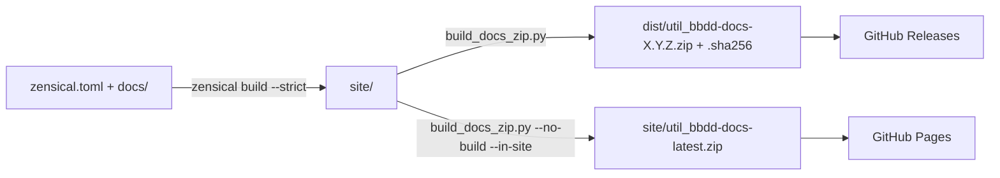

# 📦 ZIP offline de la documentación — guía de mantenimiento

Cómo se genera y publica el ZIP offline del sitio de util_bbdd y qué tocar al cambiarlo. El uso (comandos y opciones)
está en [`docs/guides/docs_offline_zip_guide.md`](../docs/guides/docs_offline_zip_guide.md).

---

## Piezas

| Pieza | Papel |
|---|---|
| `zensical.toml` | Configuración del sitio. **Zensical es el único generador** |
| `scripts/build_docs_zip.py` | Build (`zensical build --strict`) + ZIP con SHA256. Único punto que empaqueta |
| `scripts/start-server.py` | Servidor local que va dentro del ZIP (el buscador necesita HTTP) |
| `scripts/OFFLINE_README.txt` | Instrucciones que van dentro del ZIP como `README_OFFLINE.txt` |
| `docs/assets/js/vendor/mermaid-12.3.0.min.js` | Mermaid local (MIT, licencia al lado): el ZIP dibuja los diagramas sin Internet |
| `.github/workflows/docs.yml` | Valida el sitio (`--strict`) y, en `main`, lo publica en GitHub Pages con `site/util_bbdd-docs-latest.zip` (`--no-build --in-site`) |
| `.github/workflows/docs-zip-release.yml` | En `main`/`develop`: build + ZIP versionado en la release `docs-v<versión>` |
| `.github/workflows/docs-release.yml` | En cada tag `v*`: ZIP versionado adjunto a la release |
| `tests/unit/test_build_docs_zip_script.py` | Contenido del ZIP, que no se incluya a sí mismo (DOC-02) ni el de un build anterior |

Zensical **no ejecuta plugins de MkDocs**: el ZIP no se genera durante el build sino con el script. El antiguo plugin
`documentation_zip` (`util_bbdd.docs_build_plugin`) se retiró al pasar a Zensical como único generador y la lógica
quedó en el script; el paquete publicado ya no depende de MkDocs.

---

## Flujo

---

## Al cambiar algo

- [ ] Nuevo fichero que deba ir en el ZIP → añadirlo en `build_offline_zip()` y en el test del script.
- [ ] Cambio de rutas o del nombre del ZIP → revisar `docs/downloads.md`, la guía de uso y los tres workflows.
- [ ] Subir Zensical (`.[docs]`, hoy `>=0.1.1,<0.2`) → `zensical build --strict` limpio, el ZIP abierto con
      `start-server.py` y el Mermaid local igualado a la versión que cargaría Zensical (`ZENSICAL.md` §6).
- [ ] Ejecutar `python -m pytest tests/unit/test_build_docs_zip_script.py`.

---

## Mermaid sin conexión

Zensical carga Mermaid de `unpkg.com` solo si `window.mermaid` no existe. El sitio declara en `extra_javascript`
un `mermaid.min.js` local con la misma versión (12.3.0, idéntico byte a byte al de unpkg), así que el ZIP dibuja los
diagramas sin Internet (verificado en Chromium sin red, sesión `2026-11-13-zensical-only`). Coste: 5,5 MB que se
cargan en todas las páginas (y quedan en la caché del navegador).

Se descartó el plugin `privacy` de Zensical 0.1.1: reescribe las URL con la ruta de `site_url`
(`/util_bbdd/assets/external/…`), que el servidor local del ZIP no sirve, y añade unos 8 MB de terceros.

---

*Actualizado: 2026-11-13*
