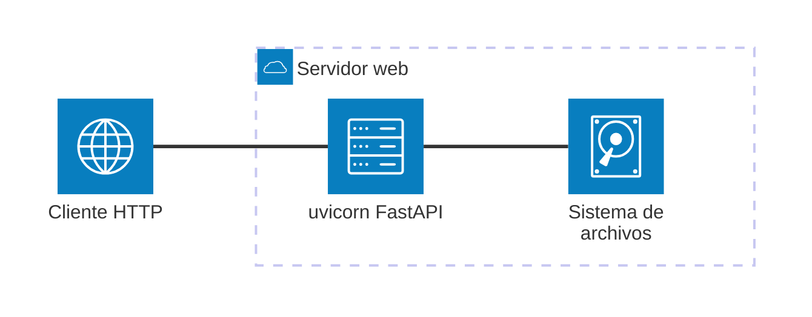

# Documentación

> **TL;DR** — Seis arquetipos fijos (funcional, técnica, guía, ejemplo, arquitectura, páginas de navegación). Secciones numeradas 1–5 obligatorias. Mermaid.js para diagramas. MkDocs Material como generador estático. No inventar nada. Si una sección queda vacía, escribe `*No aplica para este módulo.*` — nunca la omitas. Enlace bidireccional obligatorio entre Arquetipo 2 §5 y Arquetipo 4 §5.

---

## Principios generales

- Escribe documentación clara y concisa orientada al lector objetivo de cada arquetipo.
- **NO inventes** módulos, clases, funciones, parámetros, comportamientos ni ejemplos que no estén en el código real. Si no puedes verificar un dato leyendo el código, indícalo como "pendiente de verificación".
- Mantén la documentación actualizada con los cambios de código; no dejes secciones obsoletas.
- **Unifica creación y actualización**: si el documento ya existe, actualiza sus secciones en lugar de crearlo de nuevo. El flujo de creación y el de actualización son idénticos.
- Los ejemplos de uso deben ser reproducibles con el código actual, sin credenciales reales.
- **Sección vacía → `*No aplica para este módulo.*`**: nunca omitas una sección del arquetipo aunque no tenga contenido.

---

## Arquetipo 1 — Documentación Funcional (`docs/functional/`)

**Audiencia**: jefes de proyecto, responsables de calidad, equipos de negocio.

### Estructura obligatoria (en este orden)

```
# [Título del Módulo/Funcionalidad]

## 1. Descripción General
Contexto de negocio y objetivo (2-3 párrafos, sin jerga técnica).
Incluir: quién usa esto y por qué aporta valor.

## 2. Reglas de Negocio
Tabla: | Regla | Descripción | Impacto si se viola |

## 3. Casos de Uso
### Flujo principal
Diagrama Mermaid sequenceDiagram (actor → módulo → salida).
### Flujos alternativos y de error
Variantes, condiciones de contorno y casos de error verificables.
Si no hay: "No aplica para este módulo."

## 4. Criterios de Aceptación      ← PENDIENTE QA — No añadir hasta validación
[Esta sección se completará cuando el equipo QA valide los criterios.
Estructura prevista: Tabla | ID | Criterio | Verificable con |
Redacción: "Dado X, cuando Y, entonces Z."]

## 5. Glosario y Términos
Tabla: | Término | Definición |
Solo si hay términos de dominio específicos; si no, "No aplica para este módulo."
```

**Nota FASE 5 (pendiente):** La sección `## 4. Criterios de Aceptación` está definida
en el estándar pero su contenido se completará tras validación QA. Hasta entonces
incluir únicamente el placeholder indicado.

### Reglas de lenguaje

- Terminología de negocio, no técnica.
- No menciones nombres de clases internas, variables ni rutas de implementación.
- Legible por un responsable de proyecto sin conocimientos del lenguaje de implementación.
- No uses jerga técnica sin explicación.

---

## Arquetipo 2 — Documentación Técnica (`docs/api/`)

**Audiencia**: desarrolladores y equipo de mantenimiento.

Los archivos generados automáticamente por mkdocstrings/autodoc están excluidos de este
arquetipo y se documentan mediante directivas automáticas.

### Estructura obligatoria (en este orden)

```
# [Nombre del Componente/Módulo]

[Párrafo introductorio de una frase: qué hace exactamente este módulo.]

## 1. Arquitectura y Diseño
Diagrama Mermaid (flowchart TD, classDiagram, sequenceDiagram o architecture-beta
según criterio de la sección Mermaid.js de este fichero). Máximo 12 nodos.
Para proyectos con Web API, BD o contenedores: incluir diagrama C4 nivel 2 si aplica.

## 2. API Reference
### Autodoc
Directiva de generación automática según el lenguaje del proyecto:
  Python:     ::: module.submodule.ClassName
  Java:       ::: com.ejemplo.paquete.ClassName
  TypeScript: ::: ModuleName.ClassName
Solo exportados en __all__, public o export. Nunca implementación interna.
### Contratos
Tabla API pública: | Función/Clase | Firma simplificada | Descripción | Retorna |
Tabla entrada:     | Parámetro | Tipo | Descripción | Restricciones |
Contrato de salida: tipos, estructura y casos especiales.
Errores y casos especiales: excepciones propias del módulo.

## 3. Componentes y Clases
Responsabilidad de cada clase o función principal exportada.
Para módulos con una sola clase/función: "No aplica para este módulo."

## 4. Dependencias y Requisitos
Tabla: | Dependencia | Propósito | Requerida | Comportamiento sin ella |

## 5. Ejemplos Relacionados                ← OBLIGATORIO (enlace bidireccional)
Lista de enlaces a docs/examples/ con descripción de lo que ilustra cada uno.
Si no existe ningún ejemplo del módulo:
  "Pendiente — crear ejemplo en docs/examples/[nombre].md"
```

### Reglas de lenguaje

- Preciso, con tipos del lenguaje del proyecto explícitos.
- Solo incluye lo exportado públicamente; no documentar implementación interna.
- Sin comentarios triviales sobre el código.

---

## Arquetipo 3 — Guías (`docs/` raíz)

**Audiencia**: usuarios finales que instalan, configuran o aprenden a usar el sistema.
Alineado con el marco Diátaxis: orientado a tareas (How-To) o aprendizaje (Tutorial).

### Estructura obligatoria (en este orden)

```
# [Guía de X / Tutorial de Y]

## 1. Objetivo                             ← NUEVO
Qué conseguirás al seguir esta guía (1 párrafo).
Distingue: "instalar X" (how-to) vs "entender cómo funciona X" (explicación).

## 2. Requisitos Previos
Lista: herramientas, versiones, accesos o estado inicial requerido.

## 3. Pasos
Procedimiento secuencial numerado con bloques de código.
Cada paso debe ser atómico y verificable.

## 4. Verificación
Cómo comprobar que la configuración o aprendizaje fue exitoso
(comando + output esperado).

## 5. Variantes y Solución de Problemas    ← AMPLIADO
Tabla: | Escenario/Error | Causa probable | Solución |
Incluye: alternativas al flujo principal, configuraciones opcionales y errores conocidos.
Si no hay casos: "No aplica para este módulo."
```

### Reglas de lenguaje

- Orientado a la acción: usa verbos imperativos ("instala", "ejecuta", "verifica").
- `## 1. Objetivo` en 1 párrafo; nunca omitirlo.
- Incluir siempre un comando de verificación real en `## 4.`.
- En `## 5.` solo errores/variantes conocidos y documentados.

---

## Arquetipo 4 — Ejemplos de Código (`docs/examples/`)

**Audiencia**: desarrolladores que quieren implementar un patrón concreto.

### Estructura obligatoria (en este orden)

```
# Ejemplo: [Nombre del Patrón/Funcionalidad]

## 1. Contexto del Ejemplo
Qué problema concreto resuelve este código (1-2 párrafos).

## 2. Implementación de Referencia
Exclusivamente snippet con --8<-- "examples/[ruta].[ext]"
Para fragmentos <10 líneas ilustrativos: código inline.

## 3. Explicación del Código
Análisis de puntos críticos: concurrencia, rendimiento, contratos, decisiones no obvias.
Para ejemplos triviales: "No aplica para este módulo."

## 4. Ejecución y Pruebas
Comando exacto + output esperado si es determinista.
Incluir validación sintáctica según lenguaje:
  Python:     python -m py_compile docs/examples/[nombre].py
  Java:       javac -cp [classpath] [NombreClase].java
  TypeScript: npx tsc --noEmit docs/examples/[nombre].ts

## 5. Referencias Relacionadas             ← OBLIGATORIO (enlace bidireccional)
- Documentación funcional: [enlace a docs/functional/...]
- Referencia técnica: [enlace a docs/api/...]
- Ejemplos relacionados: [otros ejemplos del mismo área si existen]
```

### Reglas de lenguaje

- En `## 2.` usar `--8<--` para ficheros ejecutables ≥30 líneas; código inline para ilustraciones.
- Si el fichero de código no existe, crearlo antes de referenciar.
- `## 5.` siempre presente; enlaza al menos a la referencia técnica correspondiente.

---

## Arquetipo 5 — Arquitectura (`docs/adr/`)

**Audiencia**: arquitectos de software, tech leads, responsables de plataforma.
Para documentar decisiones arquitectónicas (ADR) y evolución del sistema.

### Estructura obligatoria (en este orden)

```
# [ADR-NNN: Título de la Decisión]

## 1. Contexto y Problema
Qué situación motivó la decisión. Estado del sistema antes de la decisión.

## 2. Decisión
Qué se decidió hacer y por qué se eligió sobre las alternativas.

## 3. Consecuencias
Ventajas, compromisos (trade-offs) y deuda técnica aceptada.

## 4. Alternativas Consideradas
Tabla: | Alternativa | Pros | Contras | Motivo de rechazo |

## 5. Estado y Revisión
Estado: PROPUESTO | ACEPTADO | OBSOLETO | REEMPLAZADO POR [ADR-NNN]
Fecha de última revisión.
```

**Documentos de planificación** (roadmap, release plans): marcar con
`<!-- arquetipo: informativo-libre -->` — no aplica estructura de Arquetipo 5.

---

## Arquetipo 6 — Páginas de Navegación Principal (`docs/` raíz)

**Audiencia**: cualquier visitante que llega a la documentación por primera vez.
Para las páginas de entrada de nivel raíz del `nav:` — **Inicio**, **Instalación** y **Arquitectura del sistema**.

**Prompt**: `.github/prompts/landing_doc.prompt.md` (tres variantes A/B/C, 5 secciones cada una).

### Estructura obligatoria (según variante)

```
# Variante A — Inicio (docs/index.md)
## 1. Identidad y Propósito
## 2. Capacidades Principales
## 3. Quick Start
## 4. Mapa de la Documentación
## 5. Compatibilidad y Soporte

# Variante B — Instalación (docs/INSTALLATION.md)
## 1. Requisitos Previos
## 2. Instalación del Paquete
## 3. Drivers por Motor
## 4. Verificación
## 5. Solución de Problemas

# Variante C — Arquitectura del sistema (docs/ARCHITECTURE.md) — modelo arc42-lite + C4
## 1. Visión General y Objetivos de Calidad   (arc42 1+3; incluye diagrama C4 nivel 1)
## 2. Mapa de Módulos (Building Blocks)        (arc42 5; C4 nivel 3)
## 3. Flujo en Ejecución (Runtime)             (arc42 6)
## 4. Conceptos Transversales y Estándares No Funcionales  (arc42 8+10; checklist NFR)
## 5. Decisiones, Extensión y Límites          (arc42 9+11; enlace a docs/adr/)
```

La Variante C es la **vista panorámica** (arc42-lite + C4); las decisiones puntuales se registran
como ADR (Arquetipo 5, `docs/adr/`). El checklist no funcional de §4 cubre, como mínimo:
Seguridad, Observabilidad, Rendimiento, Compatibilidad, Robustez/Errores y Tipado/Calidad,
anclando cada ítem a un mecanismo real del código.

**Distinción con el Arquetipo 5**: el Arquetipo 5 documenta **un ADR concreto** (`docs/adr/`); la
Variante C documenta la **visión global del sistema** (`docs/ARCHITECTURE.md`). Ambas conviven bajo la
sección `Arquitectura` del nav.

**Distinción con el Arquetipo 3**: el Arquetipo 3 cubre guías genéricas (async, drivers, troubleshooting);
la Variante B es específica de instalación del paquete y drivers.

`docs/legacy-versions.md` permanece exento de arquetipo.

---

## Generador estático: MkDocs con Material for MkDocs

El proyecto usa **MkDocs** con el tema **Material for MkDocs** como generador estático.

- Toda documentación generada debe tener su entrada en `mkdocs.yml` bajo `nav:`.
- La navegación tiene **exactamente 7 secciones top-level**:
  `Inicio`, `Instalación`, `Documentación Funcional`, `Referencia Técnica`, `Guías`, `Ejemplos`, `Arquitectura`.
- No añadir secciones top-level adicionales.
- No añadir plugins sin justificación documentada.

```yaml
nav:
  - Inicio: index.md
  - Instalación: INSTALLATION.md
  - Documentación Funcional:
      - [Nombre módulo]: functional/[nombre-modulo].md
  - Referencia Técnica:
      - Índice de Referencia: api/intro.md
      - [Nombre módulo]: api/[nombre-modulo].md
  - Guías:
      - [Nombre guía]: [nombre-guia].md
  - Ejemplos:
      - [Nombre ejemplo]: examples/[nombre-ejemplo].md
  - Arquitectura:
      - [ADR-NNN]: adr/[adr-nombre].md
```

## Detección de lenguaje y autodoc

Antes de generar documentación técnica, identificar el lenguaje primario del proyecto:

| Indicador | Lenguaje | Handler mkdocstrings | Convención docstring |
|---|---|---|---|
| Archivos `*.py` | Python | `python` | Google Style o NumPy |
| Archivos `*.java` | Java | `java` (mkdocs-javadoc) | Javadoc `/** */` |
| Archivos `*.ts` / `*.tsx` | TypeScript | `typescript` | TSDoc `/** */` |
| Archivos `*.js` | JavaScript | — | JSDoc `/** */` |

Para este proyecto: **Python** (handler `python`, Google Style docstrings, ya configurado).

### Reglas críticas para directivas autodoc (`::: ruta.Clase`)

**NUNCA usar aliases de variable como destino de directiva.**

Los aliases de variable (`alias = ClaseReal`) son tratados por `mkdocstrings` como
escalares, no como clases. El resultado es que los métodos no se expanden y el API
queda sin documentar.

```python
# crud.py — línea al final del archivo
bulk_crud = BulkCrud   # ← ALIAS de variable, NO la clase real
```

```markdown
# ❌ INCORRECTO — no expande los miembros de la clase
::: util_bbdd.bulk.crud.bulk_crud

# ✅ CORRECTO — usa siempre el nombre real de la clase
::: util_bbdd.bulk.crud.BulkCrud
```

**Checklist antes de escribir una directiva autodoc:**

1. Abrir el archivo fuente e identificar la **definición real** de la clase (`class NombreClase:`).
2. Usar la ruta completa hasta esa definición: `modulo.submodulo.NombreClase`.
3. Verificar que no es un alias (`NombreAlias = NombreClase`); si lo es, usar `NombreClase`.
4. Si la clase vive en un subpaquete privado (`_execution/`), usar su ruta completa incluyendo el guión bajo — `mkdocstrings` lo resuelve correctamente.
5. Ejecutar `mkdocs build --strict` y confirmar que la sección muestra los métodos expandidos.

**Señales de alias incorrecto en el build:**
- La sección autodoc aparece en el sitio pero sin métodos
- Solo muestra el docstring de clase pero no los métodos
- La sección parece "vacía" o truncada

**Cuándo actualizar un archivo autodoc existente:**
Al añadir una clase nueva a `__all__` de un módulo, añadir también su directiva
`:::` en el archivo `.md` de autodoc correspondiente. No basta con exportarla
en `__init__.py`; el archivo `.md` de la sección Autodoc debe referenciarla explícitamente.

### Regla de cobertura: cada módulo público necesita un archivo autodoc

**Síntoma del gap:** existe documentación manual en `docs/api/[modulo].md` pero
NO hay ninguna entrada `:::` en la sección Autodoc de `mkdocs.yml` para ese módulo.
Resultado: los docstrings del código fuente nunca se renderizan en el sitio.

**Patrón correcto** (un módulo bien cubierto tiene ambos tipos):

```
docs/api/
├── bulk.md            ← autodoc  (sección Autodoc, directivas :::)
├── bulk-crud.md       ← manual   (sección Referencia Técnica, Arquetipo 2)
├── dump-autodoc.md    ← autodoc  (sección Autodoc, directivas :::)
└── dump.md            ← manual   (sección Referencia Técnica, Arquetipo 2)
```

**Cómo detectar el gap antes de crearlo:**

Antes de añadir un módulo nuevo al proyecto, verificar que su `__init__.py` tiene
`__all__` y que TODAS las clases de `__all__` tienen:
1. Una directiva `:::` en un archivo `.md` bajo `docs/api/`
2. Ese archivo `.md` está registrado en la sección `Autodoc (mkdocstrings)` de `mkdocs.yml`

```bash
# Detectar módulos en __all__ sin cobertura autodoc:
# 1. Listar clases exportadas por el módulo
python -c "import util_bbdd.[modulo]; print(util_bbdd.[modulo].__all__)"

# 2. Buscar si alguna tiene directiva en docs/api/
grep -r ":::" docs/api/ | grep "[NombreClase]"

# 3. Si no aparece → falta el archivo autodoc
```

**Nomenclatura de archivos autodoc:**
- Si ya existe un `api/[modulo].md` manual, el autodoc se llama `api/[modulo]-autodoc.md`
- Si el módulo no tiene archivo manual previo, el autodoc puede llamarse `api/[modulo].md`
- Registrar siempre en `mkdocs.yml` bajo `Autodoc (mkdocstrings):`

**Clases excluidas del autodoc:**
- Clases re-exportadas de otro módulo ya cubierto (e.g., `PKSyncResult` se exporta en
  `dump.__all__` pero su origen es `bulk._models`, ya cubierto por `bulk.md`)
- Clases cuya documentación ya está en el archivo autodoc del módulo origen

---

## Visualización: Mermaid.js

Usa **Mermaid.js** para diagramas: texto plano que el renderer convierte en cajas y flechas.

### Criterios de selección de diagrama

| Tipo | Úsalo cuando |
|---|---|
| `sequenceDiagram` | El módulo procesa requests/responses o tiene flujo I/O claro con pasos ordenados |
| `flowchart TD` | El módulo tiene lógica de decisión o pipeline de transformación con ramificaciones |
| `classDiagram` | El módulo expone una jerarquía de clases relevante para el consumidor |
| `architecture-beta` | El módulo o proyecto incluye infraestructura física: Web API, servidor web, base de datos o contenedores Docker — muestra la topología de servicios y sus conexiones |

### Reglas de diagramas

#### Límites y legibilidad
- Máximo 12 nodos para legibilidad sin zoom.
- **Nunca uses diagramas ASCII** (cajas con `┌─┐│└─┘` o flechas con `──>`). Son
  frágiles en proporcional fonts, no escalan y no se renderizan en MkDocs ni GitHub.
  Sustituye cualquier diagrama ASCII existente por un bloque Mermaid equivalente.

#### Etiquetas y lenguaje
- Etiquetas en español para actores y acciones.
- Sin nombres de variables internas, rutas de implementación, puertos ni nombres de base de datos.

#### Sintaxis y formato
- Valida que el Mermaid generado sea sintácticamente correcto antes de guardar.
- Usa bloques fenced ` ```mermaid ` (compatible con MkDocs Material y GitHub).
- **`flowchart TD` para arquitecturas en capas o pipelines con bifurcación**: cuando
  el diagrama muestra capas verticales (browser → API → servicios → filesystem) y
  tiene al menos un nodo de decisión o dos ramas paralelas, `flowchart TD` es siempre
  preferible a `sequenceDiagram`. Incluye el ciclo de respuesta (flecha de vuelta) para
  que el flujo completo quede visible.

#### Contenido basado en código real
- Solo genera diagramas basados en el código real; no inventes flujos ni interacciones.

#### Estructura del documento (headings y listas)
- **Nunca uses texto en negrita como pseudo-subheading antes de listas** (`**Componente:**\n- item`).
  En MkDocs y VSCode preview los bloques se mezclan visualmente y la separación no queda clara.
  Usa `####` para subsecciones reales, o un diagrama Mermaid si los componentes tienen relación
  entre sí. Cuando hay tres o más componentes con responsabilidades distintas y flujo entre ellos,
  un `flowchart TD` con subgraphs es siempre más claro que listas de bullets independientes.
- **Para listas de características o features, usa `####` + lista** (nunca `**Label:**\n- item`).
  Si todos los ítems son del mismo tipo (características, limitaciones, requisitos), una lista
  bajo un `####` es suficiente. No añadas ✅/❌ inline si ya el contexto deja claro que son
  características activas — reserva los emojis para tablas comparativas.
- **Para listas de validaciones o parámetros, usa siempre una tabla**, no una lista de bullets.
  Las listas tipo `- campo: requerido, regla` mezclan campos requeridos y opcionales sin distinción
  visual. Una tabla con columnas `Campo | Requerido | Regla` separa cada dimensión y se renderiza
  correctamente. El subheading debe ser `####` (no negrita) y debe ir seguido de una línea en blanco
  antes de la tabla.

### Reglas de `architecture-beta`

- **Labels `[]`**: solo alfanuméricos, espacios y guiones. Nunca `+`, `#`, `&`, `(`, `)` ni símbolos especiales.
  `[uvicorn + FastAPI]` ❌ — `[uvicorn FastAPI]` ✅
- **IDs de servicio**: el ID nunca puede ser igual al nombre del icono.
  `service server(server)` ❌ — `service webserver(server)` ✅
- **Conectores**: usa `A:R -- L:B` (doble guión). El conector `-->` es de `flowchart`, no de `architecture-beta`.
  `httpclient:R --> L:webserver` ❌ — `httpclient:R -- L:webserver` ✅
- **Iconos integrados en Mermaid 11**: `cloud`, `database`, `disk`, `internet`, `server`. No uses otros sin verificar que existen.
- **Compatibilidad**: renderiza en MkDocs Material con CDN `mermaid@11`. No renderiza en VS Code preview ni en GitHub Markdown preview.

### Sección de Arquitectura física (condicional)

Añade `## Arquitectura física` **inmediatamente después del diagrama principal** cuando el módulo o proyecto incluya cualquiera de:

| Indicador | Señales en el código o repositorio |
|---|---|
| Web API | `src/**/web/`, `FastAPI`, `Flask`, `Django`, `APIRouter` |
| Servidor web / proxy | `nginx.conf`, `uvicorn`, `gunicorn`, `Caddy`, `traefik` |
| Base de datos | `SQLAlchemy`, `psycopg2`, `pymongo`, `redis`, `sqlite3`, `alembic` |
| Contenedores | `Dockerfile`, `docker-compose.yml`, `.dockerignore` |

La sección contiene:

1. Un párrafo breve con los componentes de infraestructura detectados (no inventes).
2. Un diagrama `architecture-beta` para representar la topología física de servicios.

Ejemplo:



Usa `group` para agrupar servicios en el mismo contenedor o red.
Etiquetas en español. Solo incluye componentes presentes en el código real.

---

## Documentación de todo el proyecto

Para generar o actualizar la documentación completa del proyecto:

1. **Inventario**: lista todos los módulos en `src/` y clasifica qué arquetipo necesita cada documento (`docs/functional/` → Arquetipo 1, `docs/api/` → Arquetipo 2, guías raíz `docs/` → Arquetipo 3, `docs/examples/` → Arquetipo 4, ADR `docs/adr/` → Arquetipo 5, páginas raíz `index.md`/`INSTALLATION.md`/`ARCHITECTURE.md` → Arquetipo 6).
2. **Orden de generación**: empieza por módulos base (`_base.py`, contratos) antes que servicios; los servicios antes que las CLIs y la capa web.
3. **Generación por arquetipo**: aplica el prompt correspondiente (`functional_doc`, `technical_doc`, `guide_doc`, `example_doc`, `architecture_doc` o `landing_doc`) a cada archivo.
4. **mkdocs.yml**: actualiza la sección `nav:` con todas las entradas nuevas o modificadas.
5. **Consistencia**: usa el mismo tono, nivel de detalle y estructura en todos los archivos del mismo arquetipo.

---

## Reglas Markdown (CRÍTICAS)

- Genera Markdown portable y legible.
- Prioriza CommonMark; usa extensiones solo si el renderer ya las soporta (ver `mkdocs.yml`).
- No uses macros, directivas ni shortcodes propietarios.
- Evita HTML embebido salvo que no exista alternativa razonable y quede justificado.
- Usa preferentemente:
  - `#`–`####` para títulos
  - listas `-` o `*`
  - tablas Markdown estándar
  - bloques de código ` ``` `
  - enlaces relativos `[texto](ruta.md)`
- No incluyas TOC automáticos.
- Usa tablas para comparar opciones o mostrar configuraciones.
- **Deja siempre una línea en blanco antes de cada tabla.** Sin ella, VSCode preview,
  GitHub y otros renderers Markdown tratan el bloque como texto plano y la tabla
  no se visualiza. Esto aplica aunque el párrafo anterior sea un label en negrita
  como `**Parameters:**` o `**Fields:**`.
- **Deja siempre una línea en blanco antes de cada lista**, aunque el párrafo anterior
  termine en dos puntos (`:`). Sin ella, la frase introductoria y la lista se fusionan
  visualmente en MkDocs y VS Code preview. Ejemplo correcto:
  ```markdown
  Todos heredan de `ProjectCopyError`:

  - `ValidationError`: entradas inválidas
  - `DuplicationError`: fallos en copia
  ```
- **Mantén las celdas de tabla cortas** (máx. ~80 caracteres de contenido por celda).
  Si necesitas aclarar una excepción o nota, añádela como párrafo o lista debajo de
  la tabla, no dentro de la celda. Evita notaciones de pie de página inline (`No¹`,
  `*`, etc.) dentro de celdas: rompen el ancho visual y no se renderizan de forma
  consistente.
- **Bloques de código anidados: usa 4 backticks en el fence exterior.** Cuando un bloque
  ` ```markdown ` (o cualquier tipo) contiene a su vez bloques ` ```bash `, ` ```python `
  u otros, el fence exterior debe abrirse y cerrarse con 4 backticks (``````) para que
  los 3 internos no lo cierren prematuramente. Nunca uses `\`` para escapar backticks
  dentro de un bloque fenced — no funciona: los backslashes se muestran literalmente.

  ```markdown
  <!-- ❌ INCORRECTO: \`\`\`bash se muestra con backslashes -->
  ```markdown
  ### Desarrollo
  \`\`\`bash
  pip install -e ".[dev]"
  \`\`\`
  ```

  <!-- ✅ CORRECTO: fence exterior con 4 backticks -->
  ````markdown
  ### Desarrollo
  ```bash
  pip install -e ".[dev]"
  ```
  ````
  ```

## Inclusión de código en documentación (CRÍTICO)

### Estándar de Snippets MkDocs (`--8<--`)

**NUEVO (desde v0.10.0):** Usa la sintaxis de snippets de MkDocs (`--8<--`) para todas las referencias a archivos `.py` ejecutables en `docs/examples/`.

**Regla principal:** La directiva `--8<--` debe ser el **ÚNICO contenido** dentro del bloque fenced ` ```python ` (u otro lenguaje).

✅ **CORRECTO:**
```markdown
```python
--8<-- "examples/database/pool_setup.py"
```
```

❌ **INCORRECTO:** Mezclar código inline con directiva:
```markdown
```python
from sqlalchemy import create_engine
--8<-- "examples/database/pool_setup.py"
```
```

### Cuándo usar snippets vs. código inline

| Caso | Usar | Motivo |
|---|---|---|
| Fragmento ≥30 líneas | Snippet (`--8<--`) | Evita bloat en `.md`; permite testeo `.py` |
| Fragmento <10 líneas trivial | Código inline | Rápida referencia, no reutilizable |
| Patrón usado en 2+ documentos | Snippet | SSOT: cambios sincronizados automáticamente |
| Código ejecutable completo | Snippet en `examples/` | Permite pytest automatizado |
| Pseudo-código o ilustración | Código inline | Legibilidad; no intended para ejecutar |

### Convención de archivos de ejemplo

Cada archivo `.py` en `docs/examples/` debe:

1. **Tener nombre descriptivo:** `partition_ranges.py`, `pool_setup.py`, NO `example.py` o `snippet.py`
2. **Incluir docstring de módulo (1-2 líneas):**
   ```python
   """Ejemplo: Cálculo automático de rangos de partición para ParallelBulkLoader."""
   ```
3. **Ser sintácticamente válido** (testeable con `python -m py_compile`)
4. **No contener credenciales reales** (usar placeholders como `"user://"` o comentarios `# replace with`)
5. **Poder ejecutarse de forma standalone** si es posible

### Organización de ejemplos

```
docs/examples/
├── database/            # Conexión, introspección, volcado, carga
│   ├── partition_ranges.py
│   ├── pool_setup.py
│   └── ...
├── bulk/                # CRUD masivo, auditoría
│   ├── bulk_insert_from_df.py
│   └── ...
├── migration/           # Migración de esquemas
├── async/               # Operaciones asincrónicas
└── reporting/           # Reportes y análisis
```

### Validación antes de documentar

Antes de referenciar `--8<-- "examples/..."` en un `.md`:

- [ ] ¿El archivo `.py` existe?
- [ ] ¿Es sintácticamente válido? (`python -m py_compile`)
- [ ] ¿No contiene hardcoded credentials/secrets?
- [ ] ¿Se actualiza `mkdocs.yml` si es un archivo nuevo?

Ejecuta `mkdocs build` para validar que la referencia se resuelve sin ERROR.

---

*Estándar actualizado: 2026-06-03 — Estándar v2.1: 6 Arquetipos × 5 secciones (Arquetipo 6: páginas de navegación), enlace bidireccional, multi-lenguaje*
