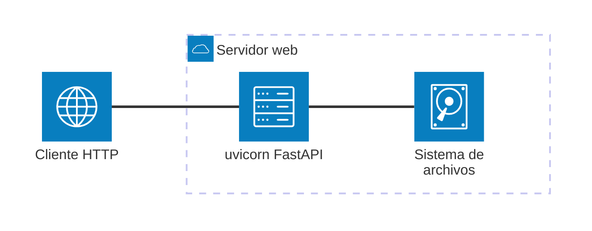

# Documentación

> **TL;DR** — Ocho arquetipos definidos en `.github/DOCUMENTATION_STANDARD.md` §3 (canónico). Mermaid.js para diagramas. Zensical (por defecto) o MkDocs Material sobre el mismo `mkdocs.yml`. No inventar nada. Si una sección queda vacía, escribe `*No aplica para este módulo.*` — nunca la omitas. Enlace bidireccional obligatorio entre Arquetipo 2 §5 y Arquetipo 4 §5.

---

## Principios generales

- Escribe documentación clara y concisa orientada al lector objetivo de cada arquetipo.
- **NO inventes** módulos, clases, funciones, parámetros, comportamientos ni ejemplos que no estén en el código real. Si no puedes verificar un dato leyendo el código, indícalo como "pendiente de verificación".
- Mantén la documentación actualizada con los cambios de código; no dejes secciones obsoletas.
- **Unifica creación y actualización**: si el documento ya existe, actualiza sus secciones en lugar de crearlo de nuevo. El flujo de creación y el de actualización son idénticos.
- Los ejemplos de uso deben ser reproducibles con el código actual, sin credenciales reales.
- **Sección vacía → `*No aplica para este módulo.*`**: nunca omitas una sección del arquetipo aunque no tenga contenido.

---

## Arquetipos

La estructura obligatoria, la audiencia, la ubicación, el prompt y las reglas de lenguaje de cada
arquetipo están **solo** en `.github/DOCUMENTATION_STANDARD.md` §3:

| Arquetipo | Carpeta | Prompt |
|---|---|---|
| 1 — Funcional | `docs/functional/` | `functional_doc` |
| 2 — Técnica | `docs/api/` | `technical_doc` |
| 3 — Guías | `docs/guides/` | `guide_doc` |
| 4 — Ejemplos de código | `docs/examples/` | `example_doc` |
| 5 — ADR | `docs/adr/` | `architecture_doc` |
| 6 — Navegación principal | `docs/` raíz (`index.md`, `installation.md`, `architecture.md`) | `landing_doc` |
| 7 — Incorporación | `docs/guides/onboarding_dev.md` | `onboarding_dev` |
| 8 — Normativa (condicional) | `docs/normativa/` | `normative_traceability` |

---

## Generador estático: Zensical / MkDocs Material

El proyecto genera la documentación con **Zensical** (por defecto, CI) o **MkDocs Material**, ambos sobre el mismo `mkdocs.yml`.

- Toda documentación generada debe tener su entrada en `mkdocs.yml` bajo `nav:`.
- Las secciones de primer nivel son las de `mkdocs.yml` (hoy: `Inicio`, `Instalación`, `📥 Descargas`,
  `Documentación Funcional`, `Referencia Técnica`, `Guías`, `Ejemplos`, `Config IA`, `Arquitectura`,
  `Historia y Planes`).
- No añadas secciones de primer nivel sin una decisión explícita (PLAN aprobado).
- No añadir plugins sin justificación documentada.

### Agrupación en subsecciones por área

`Documentación Funcional`, `Referencia Técnica`, `Ejemplos` y `Guías` **agrupan sus entradas en
subsecciones** (no listas planas).

- En `Documentación Funcional`, `Referencia Técnica` y `Ejemplos` los grupos son **áreas de dominio**
  con nombres **consistentes entre las tres secciones**, de modo que un mismo dominio aparece bajo el
  mismo rótulo en funcional, técnica y ejemplos:

  `Managers` · `Metadatos e Introspección` · `Conexiones` · `Operaciones Bulk` · `Sistema de Queries` ·
  `Comparación de Esquemas` · `Volcado de Datos` · `Migración de Esquemas` · `Análisis de Relaciones` ·
  `Documentación de BD`

- En `Guías` los grupos son **temáticos** (how-tos transversales). Pueden reusar nombres de área de
  dominio cuando la guía trata de un módulo concreto (`Comparación de Esquemas`, `Volcado de Datos`,
  `Migración de Esquemas`) o usar rótulos propios para temas transversales (`Conexión y Drivers` ·
  `Errores y Diagnóstico` · `Rendimiento` · `Migración de Versión` · `Herramientas IA`).

- Una subsección con **un solo documento es válida** (igual que en `Referencia Técnica`).
- Un documento que no encaje en ningún grupo puede agruparse bajo un rótulo propio
  (p. ej. `Manejo de Excepciones`).
- La agrupación es **solo de navegación**: los ficheros `.md` siguen planos en sus carpetas
  (`docs/guides/`, `docs/examples/`, `docs/functional/`, `docs/api/`); ver Arquetipo 4 y §6 de
  `DOCUMENTATION_STANDARD.md`.

```yaml
nav:
  - Inicio: index.md
  - Instalación: installation.md
  - Documentación Funcional:
      - [Área]:
          - [Nombre módulo]: functional/[nombre-modulo].md
  - Referencia Técnica:
      - Índice de Referencia: api/intro.md
      - [Área]:
          - [Nombre módulo]: api/[nombre-modulo].md
  - Guías:
      - [Tema]:
          - [Nombre guía]: guides/[nombre_guia].md
  - Ejemplos:
      - [Área]:
          - [Nombre ejemplo]: examples/[nombre-ejemplo].md
  - Arquitectura:
      - [ADR-NNN]: adr/[adr-nombre].md
  - Historia y Planes:
      - Roadmap: roadmap.md
```

## Detección de lenguaje y autodoc

Antes de generar documentación técnica, identificar el lenguaje primario del proyecto:

| Indicador | Lenguaje | Handler mkdocstrings | Convención docstring |
|---|---|---|---|
| Archivos `*.py` | Python | `python` | Google Style o NumPy |
| Archivos `*.java` | Java | `java` (mkdocs-javadoc) | Javadoc `/** */` |
| Archivos `*.ts` / `*.tsx` | TypeScript | `typescript` | TSDoc `/** */` |
| Archivos `*.js` | JavaScript | — | JSDoc `/** */` |

Para este proyecto: **Python** (handler `python`, Google Style docstrings, ya configurado).

### Reglas críticas para directivas autodoc (`::: ruta.Clase`)

**NUNCA usar aliases de variable como destino de directiva.**

Los aliases de variable (`alias = ClaseReal`) son tratados por `mkdocstrings` como
escalares, no como clases. El resultado es que los métodos no se expanden y el API
queda sin documentar.

```python
# crud.py — línea al final del archivo
bulk_crud = BulkCrud   # ← ALIAS de variable, NO la clase real
```

```markdown
# ❌ INCORRECTO — no expande los miembros de la clase
::: util_bbdd.bulk.crud.bulk_crud

# ✅ CORRECTO — usa siempre el nombre real de la clase
::: util_bbdd.bulk.crud.BulkCrud
```

**Checklist antes de escribir una directiva autodoc:**

1. Abrir el archivo fuente e identificar la **definición real** de la clase (`class NombreClase:`).
2. Usar la ruta completa hasta esa definición: `modulo.submodulo.NombreClase`.
3. Verificar que no es un alias (`NombreAlias = NombreClase`); si lo es, usar `NombreClase`.
4. Si la clase vive en un subpaquete privado (`_execution/`), usar su ruta completa incluyendo el guión bajo — `mkdocstrings` lo resuelve correctamente.
5. Ejecutar `mkdocs build --strict` y confirmar que la sección muestra los métodos expandidos.

**Señales de alias incorrecto en el build:**
- La sección autodoc aparece en el sitio pero sin métodos
- Solo muestra el docstring de clase pero no los métodos
- La sección parece "vacía" o truncada

**Cuándo actualizar un archivo autodoc existente:**
Al añadir una clase nueva a `__all__` de un módulo, añadir también su directiva
`:::` en el archivo `.md` de autodoc correspondiente. No basta con exportarla
en `__init__.py`; el archivo `.md` de la sección Autodoc debe referenciarla explícitamente.

### Regla de cobertura: cada módulo público necesita un archivo autodoc

**Síntoma del gap:** existe documentación manual en `docs/api/[modulo].md` pero
NO hay ninguna entrada `:::` en la sección Autodoc de `mkdocs.yml` para ese módulo.
Resultado: los docstrings del código fuente nunca se renderizan en el sitio.

**Patrón correcto** (un módulo bien cubierto tiene ambos tipos):

```
docs/api/
├── bulk.md            ← autodoc  (sección Autodoc, directivas :::)
├── bulk_crud.md       ← manual   (sección Referencia Técnica, Arquetipo 2)
├── dump_autodoc.md    ← autodoc  (sección Autodoc, directivas :::)
└── dump.md            ← manual   (sección Referencia Técnica, Arquetipo 2)
```

**Cómo detectar el gap antes de crearlo:**

Antes de añadir un módulo nuevo al proyecto, verificar que su `__init__.py` tiene
`__all__` y que TODAS las clases de `__all__` tienen:
1. Una directiva `:::` en un archivo `.md` bajo `docs/api/`
2. Ese archivo `.md` está registrado en la sección `Autodoc (mkdocstrings)` de `mkdocs.yml`

```bash
# Detectar módulos en __all__ sin cobertura autodoc:
# 1. Listar clases exportadas por el módulo
python -c "import util_bbdd.[modulo]; print(util_bbdd.[modulo].__all__)"

# 2. Buscar si alguna tiene directiva en docs/api/
grep -r ":::" docs/api/ | grep "[NombreClase]"

# 3. Si no aparece → falta el archivo autodoc
```

**Nomenclatura de archivos autodoc:**
- Si ya existe un `api/[modulo].md` manual, el autodoc se llama `api/[modulo]-autodoc.md`
- Si el módulo no tiene archivo manual previo, el autodoc puede llamarse `api/[modulo].md`
- Registrar siempre en `mkdocs.yml` bajo `Autodoc (mkdocstrings):`

**Clases excluidas del autodoc:**
- Clases re-exportadas de otro módulo ya cubierto (e.g., `PKSyncResult` se exporta en
  `dump.__all__` pero su origen es `bulk._models`, ya cubierto por `bulk.md`)
- Clases cuya documentación ya está en el archivo autodoc del módulo origen

---

## Visualización: Mermaid.js

Usa **Mermaid.js** para diagramas: texto plano que el renderer convierte en cajas y flechas.

### Criterios de selección de diagrama

| Tipo | Úsalo cuando |
|---|---|
| `sequenceDiagram` | El módulo procesa requests/responses o tiene flujo I/O claro con pasos ordenados |
| `flowchart TD` | El módulo tiene lógica de decisión o pipeline de transformación con ramificaciones |
| `classDiagram` | El módulo expone una jerarquía de clases relevante para el consumidor |
| `architecture-beta` | El módulo o proyecto incluye infraestructura física: Web API, servidor web, base de datos o contenedores Docker — muestra la topología de servicios y sus conexiones |

### Reglas de diagramas

#### Límites y legibilidad
- Máximo 12 nodos para legibilidad sin zoom.
- **Nunca uses diagramas ASCII** (cajas con `┌─┐│└─┘` o flechas con `──>`). Son
  frágiles en proporcional fonts, no escalan y no se renderizan en MkDocs ni GitHub.
  Sustituye cualquier diagrama ASCII existente por un bloque Mermaid equivalente.

#### Etiquetas y lenguaje
- Etiquetas en español para actores y acciones.
- Sin nombres de variables internas, rutas de implementación, puertos ni nombres de base de datos.

#### Sintaxis y formato
- Valida que el Mermaid generado sea sintácticamente correcto antes de guardar.
- Usa bloques fenced ` ```mermaid ` (compatible con MkDocs Material y GitHub).
- **`flowchart TD` para arquitecturas en capas o pipelines con bifurcación**: cuando
  el diagrama muestra capas verticales (browser → API → servicios → filesystem) y
  tiene al menos un nodo de decisión o dos ramas paralelas, `flowchart TD` es siempre
  preferible a `sequenceDiagram`. Incluye el ciclo de respuesta (flecha de vuelta) para
  que el flujo completo quede visible.

#### Contenido basado en código real
- Solo genera diagramas basados en el código real; no inventes flujos ni interacciones.

#### Estructura del documento (headings y listas)
- **Nunca uses texto en negrita como pseudo-subheading antes de listas** (`**Componente:**\n- item`).
  En MkDocs y VSCode preview los bloques se mezclan visualmente y la separación no queda clara.
  Usa `####` para subsecciones reales, o un diagrama Mermaid si los componentes tienen relación
  entre sí. Cuando hay tres o más componentes con responsabilidades distintas y flujo entre ellos,
  un `flowchart TD` con subgraphs es siempre más claro que listas de bullets independientes.
- **Para listas de características o features, usa `####` + lista** (nunca `**Label:**\n- item`).
  Si todos los ítems son del mismo tipo (características, limitaciones, requisitos), una lista
  bajo un `####` es suficiente. No añadas ✅/❌ inline si ya el contexto deja claro que son
  características activas — reserva los emojis para tablas comparativas.
- **Para listas de validaciones o parámetros, usa siempre una tabla**, no una lista de bullets.
  Las listas tipo `- campo: requerido, regla` mezclan campos requeridos y opcionales sin distinción
  visual. Una tabla con columnas `Campo | Requerido | Regla` separa cada dimensión y se renderiza
  correctamente. El subheading debe ser `####` (no negrita) y debe ir seguido de una línea en blanco
  antes de la tabla.

### Reglas de `architecture-beta`

- **Labels `[]`**: solo alfanuméricos, espacios y guiones. Nunca `+`, `#`, `&`, `(`, `)` ni símbolos especiales.
  `[uvicorn + FastAPI]` ❌ — `[uvicorn FastAPI]` ✅
- **IDs de servicio**: el ID nunca puede ser igual al nombre del icono.
  `service server(server)` ❌ — `service webserver(server)` ✅
- **Conectores**: usa `A:R -- L:B` (doble guión). El conector `-->` es de `flowchart`, no de `architecture-beta`.
  `httpclient:R --> L:webserver` ❌ — `httpclient:R -- L:webserver` ✅
- **Iconos integrados en Mermaid 11**: `cloud`, `database`, `disk`, `internet`, `server`. No uses otros sin verificar que existen.
- **Compatibilidad**: renderiza en MkDocs Material con CDN `mermaid@11`. No renderiza en VS Code preview ni en GitHub Markdown preview.

### Sección de Arquitectura física (condicional)

Añade `## Arquitectura física` **inmediatamente después del diagrama principal** cuando el módulo o proyecto incluya cualquiera de:

| Indicador | Señales en el código o repositorio |
|---|---|
| Web API | `src/**/web/`, `FastAPI`, `Flask`, `Django`, `APIRouter` |
| Servidor web / proxy | `nginx.conf`, `uvicorn`, `gunicorn`, `Caddy`, `traefik` |
| Base de datos | `SQLAlchemy`, `psycopg2`, `pymongo`, `redis`, `sqlite3`, `alembic` |
| Contenedores | `Dockerfile`, `docker-compose.yml`, `.dockerignore` |

La sección contiene:

1. Un párrafo breve con los componentes de infraestructura detectados (no inventes).
2. Un diagrama `architecture-beta` para representar la topología física de servicios.

Ejemplo:



Usa `group` para agrupar servicios en el mismo contenedor o red.
Etiquetas en español. Solo incluye componentes presentes en el código real.

---

## Documentación de todo el proyecto

Para generar o actualizar la documentación completa del proyecto:

1. **Inventario**: lista todos los módulos en `src/` y clasifica qué arquetipo necesita cada documento (`docs/functional/` → Arquetipo 1, `docs/api/` → Arquetipo 2, `docs/guides/` → Arquetipo 3, `docs/examples/` → Arquetipo 4, ADR `docs/adr/` → Arquetipo 5, páginas raíz `index.md`/`installation.md`/`architecture.md` → Arquetipo 6).
2. **Orden de generación**: empieza por módulos base (`_base.py`, contratos) antes que servicios; los servicios antes que las CLIs y la capa web.
3. **Generación por arquetipo**: aplica el prompt correspondiente (`functional_doc`, `technical_doc`, `guide_doc`, `example_doc`, `architecture_doc` o `landing_doc`) a cada archivo.
4. **mkdocs.yml**: actualiza la sección `nav:` con todas las entradas nuevas o modificadas.
5. **Consistencia**: usa el mismo tono, nivel de detalle y estructura en todos los archivos del mismo arquetipo.

---

## Verificación en tiempo real (opciones `--verify-tools` y `--verify-build`)

Dos opciones independientes y complementarias. Ambas son opt-in; ninguna se activa automáticamente.

---

### `--verify-tools` — Verificar configuración contra documentación oficial

Activar cuando el usuario solicite comprobar compatibilidad de versiones o plugins con las webs de referencia oficial.

#### Fuentes oficiales

| Herramienta | URL de referencia |
|---|---|
| MkDocs | `https://www.mkdocs.org/about/release-notes/` |
| Material for MkDocs | `https://squidfunk.github.io/mkdocs-material/plugins/` |
| Zensical | `https://zensical.org/` |

#### Procedimiento

1. Fetch la documentación oficial según el generador activo (`mkdocs.yml` → `theme.name`, o `zensical.toml`).
2. Contrasta las directivas del fichero de configuración con la documentación oficial.
3. Reporta discrepancias con severidad:
   - **Nivel 1** — plugin o directiva inexistente en la versión instalada (build roto).
   - **Nivel 2** — directiva deprecada con alternativa disponible.
   - **Nivel 3** — configuración subóptima o con comportamiento no documentado.
4. No modifica ningún fichero de configuración sin confirmación explícita del usuario.

---

### `--verify-build` — Verificar el HTML generado tras el build

Activar tras la generación de documentación para detectar errores solo visibles en el output renderizado (alias bug, snippets sin resolver, autodoc vacío).

#### Modo A — build (por defecto)

```bash
zensical build --strict   # o: mkdocs build --strict
```

Leer páginas clave de `site/` con el tool `Read`. Priorizar páginas con directivas `:::`, bloques Mermaid o snippets `--8<--`.

| Verificación | Señal buscada | Fallo si |
|---|---|---|
| Autodoc expandido | `doc-function` o `doc-class` con métodos en el HTML | Solo aparece docstring de clase |
| Alias bug | Métodos presentes bajo el nombre real de la clase | Sección autodoc vacía |
| Snippet `--8<--` resuelto | Ausencia de `--8<--` literal en el HTML | La cadena aparece como texto |
| Mermaid presente | `<code class="language-mermaid">` o SVG | Bloque no encontrado |
| Nav sin huérfanos | Cada página del `nav:` existe en `site/` | Fichero `.html` ausente |
| Build limpio | `--strict` termina con código 0 | Cualquier warning con `--strict` |

#### Modo B — serve (activar con `--verify-build --serve`)

```bash
zensical serve   # o: mkdocs serve  — confirmar con el usuario antes de arrancar
```

Usar `WebFetch` sobre `http://localhost:8000/` para las mismas verificaciones que el Modo A.
El servidor ejecuta JavaScript: los diagramas Mermaid aparecen como SVG (verificación más completa).
Indicar al usuario que detenga el servidor tras la verificación.

#### Restricción común a ambos modos

No modifica ningún fichero basándose solo en hallazgos del HTML. Propone correcciones y espera confirmación.

---

## Reglas Markdown (CRÍTICAS)

- Genera Markdown portable y legible.
- Prioriza CommonMark; usa extensiones solo si el renderer ya las soporta (ver `mkdocs.yml`).
- No uses macros, directivas ni shortcodes propietarios.
- Evita HTML embebido salvo que no exista alternativa razonable y quede justificado.
- Usa preferentemente:
  - `#`–`####` para títulos
  - listas `-` o `*`
  - tablas Markdown estándar
  - bloques de código ` ``` `
  - enlaces relativos `[texto](ruta.md)`
- No incluyas TOC automáticos.
- Usa tablas para comparar opciones o mostrar configuraciones.
- **Deja siempre una línea en blanco antes de cada tabla.** Sin ella, VSCode preview,
  GitHub y otros renderers Markdown tratan el bloque como texto plano y la tabla
  no se visualiza. Esto aplica aunque el párrafo anterior sea un label en negrita
  como `**Parameters:**` o `**Fields:**`.
- **Deja siempre una línea en blanco antes de cada lista**, aunque el párrafo anterior
  termine en dos puntos (`:`). Sin ella, la frase introductoria y la lista se fusionan
  visualmente en MkDocs y VS Code preview. Ejemplo correcto:
  ```markdown
  Todas heredan de `DatabaseException`:

  - `ConnectionError`: fallos de conexión
  - `QueryError`: fallos al ejecutar consultas
  ```
- **Mantén las celdas de tabla cortas** (máx. ~80 caracteres de contenido por celda).
  Si necesitas aclarar una excepción o nota, añádela como párrafo o lista debajo de
  la tabla, no dentro de la celda. Evita notaciones de pie de página inline (`No¹`,
  `*`, etc.) dentro de celdas: rompen el ancho visual y no se renderizan de forma
  consistente.
- **Bloques de código anidados: usa 4 backticks (o `~~~`) en el fence exterior.** Cuando un
  bloque contiene a su vez bloques de 3 backticks, el fence exterior debe tener 4 backticks o usar
  tildes para que los internos no lo cierren prematuramente. Nunca escapes backticks con `\` dentro
  de un bloque fenced: los backslashes se muestran literalmente.

  ~~~~markdown
  ````markdown
  ### Desarrollo
  ```bash
  pip install -e ".[dev]"
  ```
  ````
  ~~~~

- **Listas con viñeta real, no con saltos de línea.** Una secuencia `✅ **Item 1**␣␣` +
  `✅ **Item 2**` se renderiza como un párrafo con `<br />`; escribe `- ✅ **Item 1**` y
  `- ✅ **Item 2**` para obtener `<ul><li>`.
- **Enlaces a artefactos generados con ruta relativa real**, nunca `#`: el ZIP offline lo crea
  `src/util_bbdd/docs_build_plugin.py` en `site/util_bbdd.zip`; desde `docs/downloads.md` se
  enlaza como `../util_bbdd.zip`.
- **Validación**: `zensical build --strict` (o `python -m mkdocs build --strict`) y revisión visual de
  las páginas con listas (deben verse `<ul><li>`, no `<p><br /></p>`).

## Inclusión de código en documentación (CRÍTICO)

### Estándar de Snippets MkDocs (`--8<--`)

**NUEVO (desde v0.10.0):** Usa la sintaxis de snippets de MkDocs (`--8<--`) para todas las referencias a archivos `.py` ejecutables en `docs/examples/`.

**Regla principal:** La directiva `--8<--` debe ser el **ÚNICO contenido** dentro del bloque fenced ` ```python ` (u otro lenguaje).

✅ **CORRECTO:**
```markdown
```python
--8<-- "examples/database/pool_setup.py"
```
```

❌ **INCORRECTO:** Mezclar código inline con directiva:
```markdown
```python
from sqlalchemy import create_engine
--8<-- "examples/database/pool_setup.py"
```
```

### Cuándo usar snippets vs. código inline

| Caso | Usar | Motivo |
|---|---|---|
| Fragmento ≥30 líneas | Snippet (`--8<--`) | Evita bloat en `.md`; permite testeo `.py` |
| Fragmento <10 líneas trivial | Código inline | Rápida referencia, no reutilizable |
| Patrón usado en 2+ documentos | Snippet | SSOT: cambios sincronizados automáticamente |
| Código ejecutable completo | Snippet en `examples/` | Permite pytest automatizado |
| Pseudo-código o ilustración | Código inline | Legibilidad; no intended para ejecutar |

### Convención de archivos de ejemplo

Cada archivo `.py` en `docs/examples/` debe:

1. **Tener nombre descriptivo:** `partition_ranges.py`, `pool_setup.py`, NO `example.py` o `snippet.py`
2. **Incluir docstring de módulo (1-2 líneas):**
   ```python
   """Ejemplo: Cálculo automático de rangos de partición para ParallelBulkLoader."""
   ```
3. **Ser sintácticamente válido** (testeable con `python -m py_compile`)
4. **No contener credenciales reales** (usar placeholders como `"user://"` o comentarios `# replace with`)
5. **Poder ejecutarse de forma standalone** si es posible

### Organización de ejemplos

Pares planos `<tema>.md` + `<tema>.py` en `docs/examples/`; los fragmentos reutilizables que varios
`.md` incluyen por partes viven en `docs/examples/database/`. La agrupación temática se hace en el
`nav` (sección `Ejemplos:`), no con subcarpetas. Detalle y ejemplos: `.cursorrules` §2.

```
docs/examples/
├── bulk_insert_csv.md
├── bulk_insert_csv.py
├── parallel_bulk_insert.md
├── parallel_bulk_insert.py
└── database/            # fragmentos compartidos
    ├── partition_ranges.py
    ├── pool_setup.py
    └── ...
```

### Validación antes de documentar

Antes de referenciar `--8<-- "examples/..."` en un `.md`:

- [ ] ¿El archivo `.py` existe?
- [ ] ¿Es sintácticamente válido? (`python -m py_compile`)
- [ ] ¿No contiene hardcoded credentials/secrets?
- [ ] ¿Se actualiza `mkdocs.yml` si es un archivo nuevo?

Ejecuta `zensical build` (o `mkdocs build`) para validar que la referencia se resuelve sin ERROR.

---

*Actualizado: 2026-09-28 — arquetipos centralizados en `DOCUMENTATION_STANDARD.md` §3 (config-review)*
