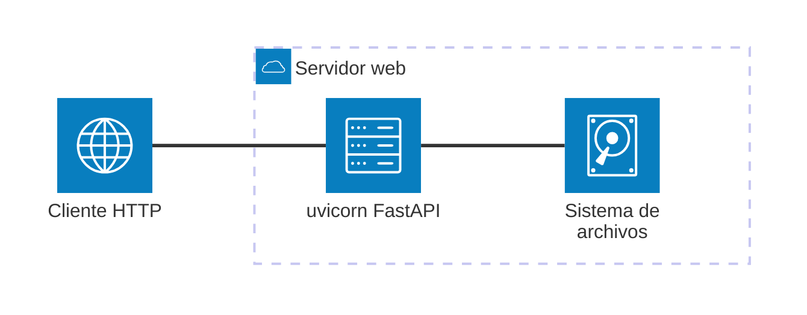

# Documentación

> **TL;DR** — Dos tipos diferenciados (funcional para negocio, técnica para desarrollo). Mermaid.js para diagramas. MkDocs Material como generador estático. No inventar nada. Crear y actualizar por el mismo flujo.

---

## Principios generales

- Escribe documentación clara y concisa orientada al lector objetivo de cada tipo.
- **NO inventes** módulos, clases, funciones, parámetros, comportamientos ni ejemplos que no estén en el código real. Si no puedes verificar un dato leyendo el código, indícalo como "pendiente de verificación".
- Mantén la documentación actualizada con los cambios de código; no dejes secciones obsoletas.
- **Unifica creación y actualización**: si el documento ya existe, actualiza sus secciones en lugar de crearlo de nuevo. El flujo de creación y el de actualización son idénticos.
- Los ejemplos de uso deben ser reproducibles con el código actual, sin credenciales reales.

---

## Tipo 1 — Documentación funcional (`docs/functional/`)

**Audiencia**: jefes de proyecto, responsables de calidad, equipos de negocio.

### Estructura obligatoria (en este orden)

1. **Objetivo de negocio** — qué problema resuelve este módulo (1-2 párrafos, sin jerga técnica)
2. **Precondiciones** — lista de lo que debe existir antes de usar el módulo
3. **Flujo principal del usuario** — diagrama Mermaid `sequenceDiagram` (actor → módulo → salida)
4. **Reglas de negocio críticas** — tabla: `Regla | Descripción | Impacto si se viola`
5. **Límites y exclusiones** — qué NO hace este módulo (máx. 5 ítems en lista)

### Reglas de lenguaje

- Terminología de negocio, no técnica.
- No menciones nombres de clases internas, variables ni rutas de implementación.
- Legible por un responsable de proyecto sin conocimientos de Python.
- No uses jerga técnica sin explicación.

---

## Tipo 2 — Documentación técnica (`docs/api/`)

**Audiencia**: desarrolladores y equipo de mantenimiento.

### Estructura obligatoria (en este orden)

1. **Responsabilidad del módulo** — una frase que diga qué hace exactamente
2. **Diagrama** — Mermaid elegido según el tipo de módulo (ver criterios más abajo)
3. **API pública** — tabla: `Función/Clase | Firma simplificada | Descripción | Retorna`
4. **Contrato de entrada** — tabla: `Parámetro | Tipo | Descripción | Restricciones`
5. **Contrato de salida** — tipos, estructura de datos y casos especiales
6. **Errores y casos especiales** — qué ocurre con entradas inválidas o fuera de rango

### Reglas de lenguaje

- Preciso, con tipos Python explícitos.
- Solo incluye lo exportado en `__all__` o `__init__.py`; no documentar implementación interna.
- Sin comentarios triviales sobre el código.

---

## Generador estático: MkDocs con Material for MkDocs

El proyecto usa **MkDocs** con el tema **Material for MkDocs** como generador estático de documentación.

- Toda documentación generada o actualizada debe tener su entrada correspondiente en `mkdocs.yml` bajo `nav:`.
- Al crear o actualizar un documento, incluye explícitamente qué línea añadir o modificar en `mkdocs.yml`.
- Estructura de referencia para la navegación:

```yaml
nav:
  - Funcional:
      - [Nombre módulo]: functional/[nombre-modulo].md
  - API & Referencias:
      - Técnica:
          - [Nombre módulo]: api/[nombre-modulo].md
```

- No añadas plugins ni extensiones no presentes en el `mkdocs.yml` actual sin incluir una justificación en el archivo de documentación correspondiente.
- Usa los plugins `search` y `mkdocstrings` ya configurados.

---

## Visualización: Mermaid.js

Usa **Mermaid.js** para diagramas: texto plano que el renderer convierte en cajas y flechas.

### Criterios de selección de diagrama

| Tipo | Úsalo cuando |
|---|---|
| `sequenceDiagram` | El módulo procesa requests/responses o tiene flujo I/O claro con pasos ordenados |
| `flowchart TD` | El módulo tiene lógica de decisión o pipeline de transformación con ramificaciones |
| `classDiagram` | El módulo expone una jerarquía de clases relevante para el consumidor |
| `architecture-beta` | El módulo o proyecto incluye infraestructura física: Web API, servidor web, base de datos o contenedores Docker — muestra la topología de servicios y sus conexiones |

### Reglas de diagramas

#### Límites y legibilidad
- Máximo 12 nodos para legibilidad sin zoom.
- **Nunca uses diagramas ASCII** (cajas con `┌─┐│└─┘` o flechas con `──>`). Son
  frágiles en proporcional fonts, no escalan y no se renderizan en MkDocs ni GitHub.
  Sustituye cualquier diagrama ASCII existente por un bloque Mermaid equivalente.

#### Etiquetas y lenguaje
- Etiquetas en español para actores y acciones.
- Sin nombres de variables internas, rutas de implementación, puertos ni nombres de base de datos.

#### Sintaxis y formato
- Valida que el Mermaid generado sea sintácticamente correcto antes de guardar.
- Usa bloques fenced ` ```mermaid ` (compatible con MkDocs Material y GitHub).
- **`flowchart TD` para arquitecturas en capas o pipelines con bifurcación**: cuando
  el diagrama muestra capas verticales (browser → API → servicios → filesystem) y
  tiene al menos un nodo de decisión o dos ramas paralelas, `flowchart TD` es siempre
  preferible a `sequenceDiagram`. Incluye el ciclo de respuesta (flecha de vuelta) para
  que el flujo completo quede visible.

#### Contenido basado en código real
- Solo genera diagramas basados en el código real; no inventes flujos ni interacciones.

#### Estructura del documento (headings y listas)
- **Nunca uses texto en negrita como pseudo-subheading antes de listas** (`**Componente:**\n- item`).
  En MkDocs y VSCode preview los bloques se mezclan visualmente y la separación no queda clara.
  Usa `####` para subsecciones reales, o un diagrama Mermaid si los componentes tienen relación
  entre sí. Cuando hay tres o más componentes con responsabilidades distintas y flujo entre ellos,
  un `flowchart TD` con subgraphs es siempre más claro que listas de bullets independientes.
- **Para listas de características o features, usa `####` + lista** (nunca `**Label:**\n- item`).
  Si todos los ítems son del mismo tipo (características, limitaciones, requisitos), una lista
  bajo un `####` es suficiente. No añadas ✅/❌ inline si ya el contexto deja claro que son
  características activas — reserva los emojis para tablas comparativas.
- **Para listas de validaciones o parámetros, usa siempre una tabla**, no una lista de bullets.
  Las listas tipo `- campo: requerido, regla` mezclan campos requeridos y opcionales sin distinción
  visual. Una tabla con columnas `Campo | Requerido | Regla` separa cada dimensión y se renderiza
  correctamente. El subheading debe ser `####` (no negrita) y debe ir seguido de una línea en blanco
  antes de la tabla.

### Reglas de `architecture-beta`

- **Labels `[]`**: solo alfanuméricos, espacios y guiones. Nunca `+`, `#`, `&`, `(`, `)` ni símbolos especiales.
  `[uvicorn + FastAPI]` ❌ — `[uvicorn FastAPI]` ✅
- **IDs de servicio**: el ID nunca puede ser igual al nombre del icono.
  `service server(server)` ❌ — `service webserver(server)` ✅
- **Conectores**: usa `A:R -- L:B` (doble guión). El conector `-->` es de `flowchart`, no de `architecture-beta`.
  `httpclient:R --> L:webserver` ❌ — `httpclient:R -- L:webserver` ✅
- **Iconos integrados en Mermaid 11**: `cloud`, `database`, `disk`, `internet`, `server`. No uses otros sin verificar que existen.
- **Compatibilidad**: renderiza en MkDocs Material con CDN `mermaid@11`. No renderiza en VS Code preview ni en GitHub Markdown preview.

### Sección de Arquitectura física (condicional)

Añade `## Arquitectura física` **inmediatamente después del diagrama principal** cuando el módulo o proyecto incluya cualquiera de:

| Indicador | Señales en el código o repositorio |
|---|---|
| Web API | `src/**/web/`, `FastAPI`, `Flask`, `Django`, `APIRouter` |
| Servidor web / proxy | `nginx.conf`, `uvicorn`, `gunicorn`, `Caddy`, `traefik` |
| Base de datos | `SQLAlchemy`, `psycopg2`, `pymongo`, `redis`, `sqlite3`, `alembic` |
| Contenedores | `Dockerfile`, `docker-compose.yml`, `.dockerignore` |

La sección contiene:

1. Un párrafo breve con los componentes de infraestructura detectados (no inventes).
2. Un diagrama `architecture-beta` para representar la topología física de servicios.

Ejemplo:



Usa `group` para agrupar servicios en el mismo contenedor o red.
Etiquetas en español. Solo incluye componentes presentes en el código real.

---

## Documentación de todo el proyecto

Para generar o actualizar la documentación completa del proyecto:

1. **Inventario**: lista todos los módulos en `src/` y clasifica qué tipo de documentación necesita cada uno (funcional, técnica o ambas).
2. **Orden de generación**: empieza por módulos base (`_base.py`, contratos) antes que servicios; los servicios antes que las CLIs y la capa web.
3. **Generación por módulo**: aplica el prompt correspondiente (funcional o técnico) a cada módulo.
4. **mkdocs.yml**: actualiza la sección `nav:` con todas las entradas nuevas o modificadas.
5. **Consistencia**: usa el mismo tono, nivel de detalle y estructura en todos los módulos del mismo tipo.

---

## Reglas Markdown (CRÍTICAS)

- Genera Markdown portable y legible.
- Prioriza CommonMark; usa extensiones solo si el renderer ya las soporta (ver `mkdocs.yml`).
- No uses macros, directivas ni shortcodes propietarios.
- Evita HTML embebido salvo que no exista alternativa razonable y quede justificado.
- Usa preferentemente:
  - `#`–`####` para títulos
  - listas `-` o `*`
  - tablas Markdown estándar
  - bloques de código ` ``` `
  - enlaces relativos `[texto](ruta.md)`
- No incluyas TOC automáticos.
- Usa tablas para comparar opciones o mostrar configuraciones.
- **Deja siempre una línea en blanco antes de cada tabla.** Sin ella, VSCode preview,
  GitHub y otros renderers Markdown tratan el bloque como texto plano y la tabla
  no se visualiza. Esto aplica aunque el párrafo anterior sea un label en negrita
  como `**Parameters:**` o `**Fields:**`.
- **Deja siempre una línea en blanco antes de cada lista**, aunque el párrafo anterior
  termine en dos puntos (`:`). Sin ella, la frase introductoria y la lista se fusionan
  visualmente en MkDocs y VS Code preview. Ejemplo correcto:
  ```markdown
  Todos heredan de `ProjectCopyError`:

  - `ValidationError`: entradas inválidas
  - `DuplicationError`: fallos en copia
  ```
- **Mantén las celdas de tabla cortas** (máx. ~80 caracteres de contenido por celda).
  Si necesitas aclarar una excepción o nota, añádela como párrafo o lista debajo de
  la tabla, no dentro de la celda. Evita notaciones de pie de página inline (`No¹`,
  `*`, etc.) dentro de celdas: rompen el ancho visual y no se renderizan de forma
  consistente.
- **Bloques de código anidados: usa 4 backticks en el fence exterior.** Cuando un bloque
  ` ```markdown ` (o cualquier tipo) contiene a su vez bloques ` ```bash `, ` ```python `
  u otros, el fence exterior debe abrirse y cerrarse con 4 backticks (``````) para que
  los 3 internos no lo cierren prematuramente. Nunca uses `\`` para escapar backticks
  dentro de un bloque fenced — no funciona: los backslashes se muestran literalmente.

  ```markdown
  <!-- ❌ INCORRECTO: \`\`\`bash se muestra con backslashes -->
  ```markdown
  ### Desarrollo
  \`\`\`bash
  pip install -e ".[dev]"
  \`\`\`
  ```

  <!-- ✅ CORRECTO: fence exterior con 4 backticks -->
  ````markdown
  ### Desarrollo
  ```bash
  pip install -e ".[dev]"
  ```
  ````
  ```

## Inclusión de código en documentación (CRÍTICO)

**NO uses snippets de MkDocs (`--8<--`)** para incluir código en bloques fenced.
La directiva `--8<--` dentro de un bloque ` ```python ` no se procesa de forma
fiable en todos los contextos (MkDocs build, GitHub preview, IDEs).

**Regla**: embebe el código directamente en el bloque fenced del documento `.md`.

```markdown
<!-- ✅ CORRECTO: código embebido directamente -->
```python
from util_bbdd.services import GenerateProjectManager
manager = GenerateProjectManager()
```

<!-- ❌ INCORRECTO: snippet que no renderiza en bloques fenced -->
```python
--8<-- "example_generate_api.py"
```
```

Si el ejemplo es muy largo (>80 líneas), divide en fragmentos con título entre
bloques o crea una sección "Código completo" con el bloque único.
