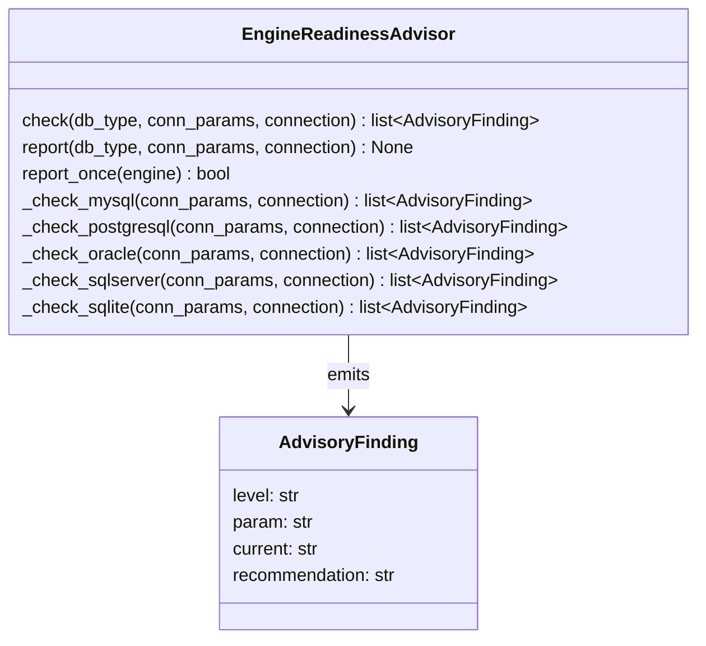

# Prompt: Integración de EngineReadinessAdvisor en Auditorías y Documentación

**Propósito**: Integrar información de `src/util_bbdd/connection/performance_advisor.py` (`EngineReadinessAdvisor`)
en tres contextos **obligatorios**:

1. **Auditoría de rendimiento del módulo `bulk`** ✅
2. **Auditoría de rendimiento del módulo `dump`** ✅
3. **Documentación técnica del módulo `doc`** ✅

**Ubicación de referencia**: `src/util_bbdd/connection/performance_advisor.py`

---

## 📋 Inputs requeridos

- ✅ **Contexto**: `bulk` | `dump` | `bulk+dump` (obligatorio)
- ✅ **Dialects**: `PostgreSQL` | `MySQL` | `MariaDB` | `Oracle` | `SQL Server` | `SQLite` | `Snowflake` | `todas` (obligatorio)
- ✅ **Timeline**: `ASAP` | `próxima semana` | `flexible` (obligatorio)
- ✅ **Generar documentación técnica**: Siempre (incluido en el flujo)

**Ejemplo de invocación**:
```markdown
Contexto: bulk + dump
Dialects: PostgreSQL + MySQL
Timeline: ASAP

Entregables esperados:
- Auditoría de rendimiento bulk
- Auditoría de rendimiento dump
- Documentación técnica: docs/api/engine_readiness_advisor.md (NUEVA)
```
## 📚 Contexto: EngineReadinessAdvisor

### Qué es
Verificador unificado de condiciones de ejecución por motor de base de datos. Valida que el engine SQLAlchemy
y su pool estén correctamente configurados **antes** de ejecutar operaciones críticas (bulk, dump).

### Características principales
- **Multimotor**: PostgreSQL, MySQL, MariaDB, Oracle, SQL Server, SQLite, Snowflake
- **Checks estáticos**: Sin conexión activa (pool_size, driver, timeouts en conexión params)
- **Checks dinámicos**: Con conexión activa (validación de variables del motor, estado del pool)
- **Niveles de hallazgo**: `OK` | `INFO` | `WARNING` | `CRITICAL`
- **Thread-safe**: `report_once()` registra engines verificados una sola vez en el proceso
- **No destructivo**: Solo reporta; no modifica configuración

### API pública
```python
class EngineReadinessAdvisor:
    def check(db_type: str, conn_params: dict, *, connection=None) -> list[AdvisoryFinding]
    def report(db_type: str, conn_params: dict, *, connection=None) -> None
    def report_once(engine: Engine) -> bool
```

---

## 🔍 Checks disponibles por motor

### MySQL / MariaDB (checks estáticos + dinámicos)

**Estáticos** (desde engine.url + pool):
| Parámetro | Mínimo | Unidad | Descripción |
|---|---|---|---|
| `pool_size` | 5 | — | Mínimo para cargas concurrentes |
| `write_timeout` | 30 | s | Recomendado ≥60 s en cargas masivas (evita "Lost connection") |
| `read_timeout` | 30 | s | Recomendado ≥30 s |
| `autocommit` | bool | — | WARNING si True (confirma cada INSERT individualmente) |
| `pool_timeout` | 30 | s | Timeout de espera en pool exhausto |

**Dinámicos** (delega en `MySQLVariableValidator`, requiere conexión):
- `max_allowed_packet`: Tamaño máximo de packet (afecta batch size)
- `sql_mode`: Modo SQL (ej. `STRICT_TRANS_TABLES`)
- Otras variables del motor consultadas vía `SHOW VARIABLES`

### PostgreSQL

**Estáticos**:
- `pool_size`: Número de conexiones en el pool

**Dinámicos** (con conexión):
- `max_connections`: Límite del servidor
- `work_mem`: Memoria de trabajo por operación
- `shared_buffers`: Buffers compartidos (afecta rendimiento de bulk)

### Oracle

**Estáticos**:
- `pool_size`
- Driver de SQLAlchemy (cx_Oracle)

**Dinámicos**:
- `db_block_size`: Tamaño de bloque (afecta I/O)
- `processes`: Límite de procesos
- Hints y parallel DML disponibles

### SQL Server / MSSQL

**Estáticos**:
- `pool_size`
- Driver (`pyodbc` vs. `pymssql`; pyodbc recomendado para bulk)
- Connection pooling (Connectionpooling=True)

**Dinámicos**:
- `max_server_memory`: Límite de memoria
- State de IDENTITY: Para override en insert

### SQLite

**Estáticos**:
- WAL mode: `journal_mode=WAL` (recomendado para concurrencia)
- PRAGMA synchronous: Nivel de sincronización

**Dinámicos**:
- `busy_timeout`: Reintento en locked database

### Snowflake

**Estáticos**:
- Pool size (simulado vía conexión warehouse)

**Dinámicos**:
- Warehouse activo y size
- Statement timeout
- Resultados max por query

---

## 💡 Integración 1: Auditoría de rendimiento — Módulo `bulk`

### Dónde integrar
Archivo: `.github/prompts/performance_audit_bulk.prompt.md`
Sección: **Nueva sección 0 "Validación de Readiness del Engine"** (antes de "Estrategia de batching")

### Contenido a agregar

```markdown
## 0. Validación de Readiness del Engine (Pre-requisito)

Antes de auditar estrategias de batching, paralelización y normalización SQL,
**verificar que el engine y su pool están correctamente configurados** para soportar
la carga masiva. Esto evita incidentes en producción (pool exhaustion, lost connections, timeouts).

### Herramienta
`EngineReadinessAdvisor` en `src/util_bbdd/connection/performance_advisor.py`:
- Checks estáticos y dinámicos por motor
- Reporta en una única llamada al logger (niveles OK, INFO, WARNING, CRITICAL)
- Integrado en `BulkCrud.__init__()` vía `report_once(engine)`

### Checks a validar por motor (de la auditoría actual)

**MySQL / MariaDB**:
- ✅ `pool_size` ≥ 5 (cargas concurrentes)
- ✅ `write_timeout` ≥ 60 s (cargas masivas)
- ✅ `autocommit` = False (usar transacciones)
- ✅ `max_allowed_packet` ≥ batch_size calculado
- ✅ `sql_mode`: No debe tener STRICT_TRANS_TABLES si se permite inserción parcial

**PostgreSQL**:
- ✅ `pool_size` ≥ 4 (concurrencia mínima)
- ✅ `shared_buffers` ≥ 256 MB (default 25%, recomendar ≥ 1 GB en hardware moderno)
- ✅ `work_mem` ≥ 4 MB por worker (para sorts y hash joins internos)

**Oracle**:
- ✅ `pool_size` ≥ 5
- ✅ Parallel DML habilitado: `alter session enable parallel dml`
- ✅ APPEND hint disponible: `INSERT /*+ APPEND */ ...` (evita undo logging)

**SQL Server**:
- ✅ Driver = `pyodbc` (mejor rendimiento que pymssql)
- ✅ `pool_size` ≥ 5
- ✅ `max_server_memory` con espacio libre (no al límite)
- ✅ Batch mode en tempdb: Columnar storage para big-data

**SQLite**:
- ✅ WAL mode activo (`journal_mode=WAL`)
- ✅ `synchronous = NORMAL` (no FULL, no EXTRA)
- ✅ `temp_store = MEMORY` si hay temp tables

**Snowflake**:
- ✅ Warehouse size apropiado (no XSMALL para bulk)
- ✅ `statement_timeout` ≥ duración estimada
- ✅ Auto-suspend desactivado durante bulk

### Reportería esperada

El log de `BulkCrud.__init__()` debe mostrar:
```
╔════════════════════════════════════════════╗
║  ENGINE READINESS REPORT  ·  mariadb  ·  localhost:3306║
╚════════════════════════════════════════════╝
  [✅  OK  ]  pool_size=10
  [⚠️  WARN]  write_timeout=30  → Recomendado ≥60 s en cargas masivas
  [ℹ️  INFO]  autocommit=False
  [🔴  CRIT]  max_allowed_packet=4194304  → Insuficiente para batch_size=10000
  ─────────────────────────────────────────
  Resumen: 1 CRÍTICO · 1 AVISO · 2 INFO · 4 OK
```

Si hay WARNING o CRITICAL, **la auditoría de bulk debe señalar estos hallazgos como bloqueadores**
para la implementación de mejoras (ej. "Paralelización imposible si pool_size < 5").

### Acción en la auditoría

**PLAN**:
- Solicitar al usuario: ¿Se ejecuta `BulkCrud.report_once()` en el código auditado?
- Si NO → Recomendación: "Integrar EngineReadinessAdvisor antes de auditoría de rendimiento"
- Si SÍ → Continuar con auditoría, referenciando los checks como pre-requisitos

**AUDIT_CODE**:
- Verificar que `performance_advisor.py` está importado y usado en `bulk/crud.py`
- Comprobar que `report_once(engine)` se invoca en `BulkCrud.__init__()` **antes** de operaciones
- Validar que los findings se propagan al log sin excepciones

**IMPROVEMENT_PLAN**:
- Si hay WARNING o CRITICAL → Listarlos como items de configuración previos
- Ej: "Aumentar `pool_size` a 10 + `write_timeout` a 60 antes de activar ParallelBulkLoader"
```

### Código ejemplo a incluir en el prompt

```python
# En src/util_bbdd/bulk/crud.py (BulkCrud.__init__)

from util_bbdd.connection import EngineReadinessAdvisor

class BulkCrud:
    def __init__(self, engine: Engine, ...):
        # Verificar readiness del engine una sola vez en el proceso
        advisor = EngineReadinessAdvisor()
        advisor.report_once(engine)  # Emite log con hallazgos

        # Continuar con inicialización...
        self.engine = engine
        ...
```

---

## 💡 Integración 2: Documentación técnica — Módulo `doc` ✅ (OBLIGATORIO)

> 📌 **Esta sección es OBLIGATORIA en todos los flujos de auditoría.**
> La documentación técnica se genera siempre como parte del deliverable final.

### Dónde integrar
**Documentación técnica de `connection/performance_advisor.py`:**
- Archivo destino: `docs/api/engine_readiness_advisor.md` (nuevo)
- Actualizar: `mkdocs.yml` → Agregar bajo `Técnica > API > Connection`

### Contenido esperado (esquema `technical_doc.prompt.md`)

**Secciones obligatorias**:
1. **Descripción**: Verificador unificado de conditions de ejecución por motor
2. **Arquitectura**: Diagrama `classDiagram` (AdvisoryFinding + EngineReadinessAdvisor)
3. **API Reference**: Tabla de métodos públicos `check()`, `report()`, `report_once()`
4. **Checks por motor**: Tabla con rows por motor (PostgreSQL, MySQL, MariaDB, Oracle, SQL Server, SQLite, Snowflake)
5. **Dependencias**: SQLAlchemy, logging (internas/externas)
6. **Ejemplos**:
   - Ejemplo 1: Llamada básica desde código de usuario
   - Ejemplo 2: Integración en `BulkCrud` (patrón de uso)
   - Ejemplo 3: Uso con conexión explícita para checks dinámicos

**Diagrama recomendado** (Mermaid classDiagram):


### Invocación (obligatoria)

```markdown
# En Claude Code

Lee .github/prompts/engine_readiness_integration.prompt.md
Sección: "Integración 2: Documentación técnica — Módulo `doc`"

Genera documentación técnica de `src/util_bbdd/connection/performance_advisor.py`
usando `.github/prompts/technical_doc.prompt.md`

Detalles obligatorios:
- Tipo de diagrama: `classDiagram` (verificador + hallazgos)
- Ubicación: `docs/api/engine_readiness_advisor.md` (NUEVA)
- Actualizar: `mkdocs.yml` → Agregar entrada bajo "Técnica > API > Connection"
- Ejemplos: 3 ejemplos verificables (básico, integración bulk, con conexión)
- Validación: Diagrama Mermaid válido (zensical build --strict)

Secciones obligatorias (ver prompt technical_doc.prompt.md):
- Qué es EngineReadinessAdvisor y cuándo usarlo
- Tabla de checks disponibles por motor (7 motors)
- Tabla de API pública (3 métodos)
- Contratos de entrada/salida
- 3 ejemplos prácticos
- Dependencias (SQLAlchemy, logging)

Marcar como pendiente si no es verificable contra código real.
```

### Deliverables (obligatorios)

- ✅ Fichero nuevo: `docs/api/engine_readiness_advisor.md` (OBLIGATORIO)
- ✅ Entrada en `mkdocs.yml` bajo `Técnica > API > Connection` (OBLIGATORIO)
- ✅ Diagrama Mermaid válido (sin errores de sintaxis) (OBLIGATORIO)
- ✅ 3 ejemplos con código real verificable (OBLIGATORIO)
- ✅ Tabla de checks por motor (PostgreSQL, MySQL, MariaDB, Oracle, SQL Server, SQLite, Snowflake) (OBLIGATORIO)

---

## 💡 Integración 2b: Sección «Condiciones del motor» en DatabaseDocumentation (OPCIONAL)

> 📌 **Esta sección es OPCIONAL.** Se activa con una clave de `imprimir`; desactivada por defecto.

### Propósito

Incluir los hallazgos de `EngineReadinessAdvisor` como una sección más de la documentación que genera
`DatabaseDocumentation` (Word, Excel y HTML), con los mismos estilos y plantillas que el resto del documento. No hay un
generador aparte: la sección sale al final, como el inventario de almacenamiento.

### Cuándo incluir

**Activar si**:
- Necesitas dejar constancia de la configuración del motor junto a la documentación del esquema
- Quieres comparar entornos (dev, staging, prod) con la misma documentación
- Requieres trazabilidad (motor, momento de la verificación en UTC, checks dinámicos sí/no)

**Omitir si**:
- Los logs de `EngineReadinessAdvisor.report_once()` son suficientes

### Uso

```python
from pathlib import Path

from util_bbdd import SyncDatabaseManager
from util_bbdd.doc import DatabaseDocumentation

with SyncDatabaseManager("postgresql", conn_params) as manager:
    result = DatabaseDocumentation(
        manager,
        Path("docs_bd"),
        imprimir={"condiciones_motor": {"imprimir_condiciones_motor": True}},
        formatos=["word", "excel", "html"],
    ).generate()
```

Los hallazgos salen de `SyncDatabaseManager.get_engine_readiness()` (`EngineReadinessAdvisor.assess()`): checks
estáticos con los `conn_params` del manager y dinámicos con una conexión de `get_sqlalchemy_engine()`. Se verifica una
sola vez por generación, aunque se pidan varios formatos.

### Contenido en cada formato

| Formato | Ubicación | Contenido |
|---|---|---|
| Word | Al final del último documento (tras «Almacenamiento») | Avisos, tabla «Verificación», «Resumen por severidad» y «Hallazgos» |
| Excel | Hoja «Condiciones del motor» | Los mismos bloques como tablas con estilo |
| HTML | `condiciones/condiciones-motor.html`, enlazada desde el índice («Condiciones del motor» en «Buscar en») | Los mismos bloques; la tabla de hallazgos lleva el nivel más grave como distintivo |

La sección distingue: sin hallazgos, motor sin checks (p. ej. HSQLDB), solo checks estáticos (sin conexión: el motivo
lleva solo el tipo de la excepción, nunca su mensaje) y origen que no ofrece la verificación
(`EngineReadinessSourcePort` en `doc/application/ports.py`).

### Deliverables (si se activa)

- ✅ `imprimir["condiciones_motor"]["imprimir_condiciones_motor"] = True` en la configuración de la documentación
- ✅ Cabeceras de la tabla de hallazgos ajustables con `CONDICIONES_MOTOR` en `headers_file`
- ✅ Referencia: `docs/api/database_documentation.md` § «Sección Condiciones del motor»

---

## 💡 Integración 3: Auditoría de rendimiento — Módulo `dump`

### Dónde integrar
Archivo: `.github/prompts/performance_audit_dump.prompt.md`
Sección: **Nueva sección en Fase 2 "Deshabilitar constraints en destino"**
(después de "ConstraintManager: disable_all()...")

### Contenido a agregar

```markdown
### 2b. Validación de Readiness del Engine Destino (pre-deshabilitar constraints)

Antes de desactivar constraints e iniciar la carga masiva, **validar que el engine destino
está correctamente configurado** mediante `EngineReadinessAdvisor`.

**Flujo**:
1. Crear engine destino (ya en `DumpOrchestrator`)
2. Llamar `EngineReadinessAdvisor().report_once(engine_destino)`
3. Revisar log para WARNING o CRITICAL
4. Si hay bloqueadores, abortar volcado y reportar al usuario

**Checks críticos por motor destino**:
- **MySQL/MariaDB**:
  - `pool_size` ≥ número de threads de `ParallelBulkLoader`
  - `max_allowed_packet` ≥ tamaño de lote estimado (chunk_size * row_width)
  - `autocommit=False` para transacciones bulk
- **PostgreSQL**:
  - `pool_size` ≥ threads
  - `work_mem` suficiente para sort/hash join de constraints
  - `synchronous_commit=OFF` recomendado si volcado de dump no es crítico
- **Oracle**:
  - `pool_size` ≥ threads
  - Parallel DML habilitado para volcados masivos
  - UNDO tablespace con espacio libre
- **SQL Server**:
  - Driver `pyodbc` (mejor que `pymssql`)
  - `pool_size` ≥ threads
  - Recovery model = BULK_LOGGED durante volcado (acelera)
- **SQLite**:
  - WAL mode (si concurrencia)
  - PRAGMA optimize ejecutado post-carga

**Código ejemplo**:
```python
# En orchestrator.py
from util_bbdd.connection import EngineReadinessAdvisor

class DumpOrchestrator:
    def run(self, ...):
        engine_src, engine_dst = ...

        # Validar readiness ambos engines
        advisor = EngineReadinessAdvisor()
        if advisor.report_once(engine_src):
            logger.info("Source engine validated")
        if advisor.report_once(engine_dst):
            logger.info("Target engine validated")

        # Continuar con deshabilitar constraints, truncate, etc.
        ...
```

**Reportería esperada en logs**:
```
[INFO] Source engine validated
[WARNING] Target engine validated
╔═══════════════════════════════════════════════╗
║  ENGINE READINESS REPORT  ·  postgres  ·  destination:5432║
╚═══════════════════════════════════════════════╝
  [✅  OK  ]  pool_size=20
  [⚠️  WARN]  synchronous_commit=ON  → Considerar OFF en volcado no-crítico
  [ℹ️  INFO]  work_mem=4194304
  ─────────────────────────────────────────────
  Resumen: 1 AVISO · 2 INFO · 1 OK
```

**Acción en auditoría**:
- Verificar que `DumpOrchestrator.run()` invoca `report_once()` en ambos engines
- Señalar CRITICAL como bloqueador para dump
- Incluir checks de readiness en "Validación pre-volcado" section de deliverables
```

### Acción en la auditoría

**PLAN**:
- Verificar que `DumpOrchestrator` tiene acceso a `EngineReadinessAdvisor`
- Identificar punto de inserción: antes de `disable_all()` en Fase 2

**AUDIT_CODE**:
- Verificar integración de `report_once()` en `orchestrator.py`
- Validar que se ejecuta antes de operaciones críticas
- Comprobar captura de excepciones (no debe fallar el volcado si advisor falla)

**IMPROVEMENT_PLAN**:
- Si no está integrado → Recomendación: "Agregar validación de readiness en Fase 2"
- Si está integrado → Verificar que los findings se propagan y se respetan

---

## 📋 Checklist de Integración

### Para Auditoría de Bulk

## 📋 Checklist de Integración

### Para Auditoría de Bulk ✅ (OBLIGATORIO)

- [ ] Solicitar a usuario: ¿Se ejecuta `report_once()` en BulkCrud?
- [ ] Revisar logs de ejecución: ¿hay findings WARNING o CRITICAL?
- [ ] Relacionar findings con recomendaciones de optimización bulk
- [ ] Documentar pre-requisitos de configuración en deliverables

### Para Auditoría de Dump ✅ (OBLIGATORIO)

- [ ] Verificar que `DumpOrchestrator` invoca `report_once()` para ambos engines
- [ ] Revisar logs: findings destino y acciones correctivas
- [ ] Incluir validación de readiness en plan de mejoras (Fase 2)

### Para Documentación de Doc ✅ (OBLIGATORIO)

- [ ] Generar `docs/api/engine_readiness_advisor.md` con diagrama y ejemplos
- [ ] Actualizar `mkdocs.yml` con entrada nueva bajo "Técnica > API > Connection"
- [ ] Validar que diagrama Mermaid es válido (zensical build --strict)
- [ ] Verificar 3 ejemplos contra código real
- [ ] Tabla de checks por motor completa (7 motors)
- [ ] Validar con `zensical build --strict` antes de entregar

---

## 🔗 Referencias

- **Módulo**: `src/util_bbdd/connection/performance_advisor.py`
- **Clase principal**: `EngineReadinessAdvisor`
- **Prompts relacionados**:
  - Auditoría bulk: `.github/prompts/performance_audit_bulk.prompt.md`
  - Auditoría dump: `.github/prompts/performance_audit_dump.prompt.md`
  - Documentación técnica: `.github/prompts/technical_doc.prompt.md`
- **Integración en código**:
  - `BulkCrud.__init__()`: Invoca `report_once()` (verificar en audit)
  - `DumpOrchestrator.run()`: Podría invocar `report_once()` (verificar/agregar en audit)

---

*Actualizado: 2026-10-14*
