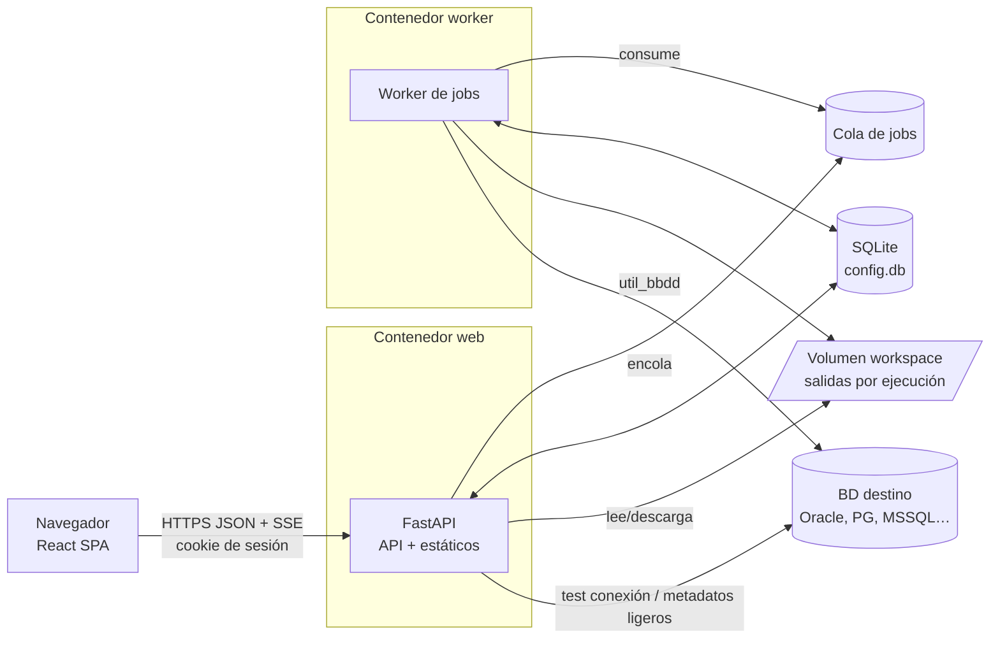

# Prompt: web_project_bootstrap — Crear `util_bbdd_web`, la aplicación web multiusuario de util_bbdd

## Rol

Actúas como **ingeniero de software senior especializado en entorno web**: arquitectura de SPAs con React y
TypeScript, APIs HTTP con FastAPI, seguridad de aplicaciones web (OWASP ASVS / Top 10), contenedores Docker,
CI/CD y diseño de sistemas multiusuario. Conoces `util_bbdd` como **librería consumida**, no como código que
vayas a modificar.

## Objetivo

Crear desde cero, en un **proyecto aparte**, una aplicación web que exponga **toda la funcionalidad actual de
`util_bbdd`** a varios usuarios:

1. Estructura completa del repositorio (backend, frontend, Docker, CI, documentación).
2. Configuración IA para **GitHub Copilot** y **Claude Code**, derivada de la de `util_bbdd`.
3. Un **roadmap por fases** (`docs/plan/ROADMAP.md`) que permita implementar la funcionalidad de forma
   incremental, cada fase con su propio ciclo PLAN → AUDIT_PLAN → IMPLEMENT → AUDIT_CODE → VERSION.
4. Implementación **solo de la Fase 0** (fundaciones) si se autoriza. El resto de fases se ejecutan
   después, desde el proyecto nuevo, con `/new-feature`.

Requisitos funcionales de alto nivel:

- **Multiusuario** con autenticación y roles.
- **Catálogo de conexiones** por motor, mostrando **todas las capacidades** de cada motor (las que ya expone
  `util_bbdd`).
- **Proyectos por usuario** desde los que se lanzan las funcionalidades de `util_bbdd`.
- **Salidas en estructura de carpetas** y **resultados agrupados por ejecución**.

---

## Inputs (confirmar antes de empezar)

| Input | Valor por defecto | Notas |
|---|---|---|
| Ruta destino | `C:\Desarrollo\python\libs\util_bbdd_web` | Debe no existir o estar vacía; si no, detente |
| Origen (solo lectura) | `C:\Desarrollo\python\libs\util_bbdd` | Nunca se modifica desde este prompt |
| Versión de util_bbdd | Tag `v4.0.0` (leer `pyproject.toml` del origen) | Se fija por tag git, no por ruta local |
| Motores incluidos en la imagen | MariaDB, MySQL, Oracle, PostgreSQL, SQLite, SQL Server | HSQLDB (requiere JDK) en imagen variante |
| Idioma de la UI | Español, con i18n preparado | |
| Plataformas IA | Claude Code + GitHub Copilot | |
| Fase a ejecutar | `PLAN y AUDIT_PLAN únicamente` | o `Fase 0 completa` |

Si falta alguno o es ambiguo, **detente y pregunta** antes de emitir el PLAN.

### Invocación

```text
# Sesión con acceso de lectura a util_bbdd y de escritura en C:\Desarrollo\python\libs

Lee y aplica C:\Desarrollo\python\libs\util_bbdd\.github\prompts\web_project_bootstrap.prompt.md
Ruta destino: C:\Desarrollo\python\libs\util_bbdd_web
Versión de util_bbdd: v4.0.0
Motores en la imagen: todos salvo HSQLDB (imagen variante)
Fase: PLAN y AUDIT_PLAN únicamente
```

---

## Reglas no negociables

1. **No modificar `util_bbdd`.** Si falta algo en su API, se anota como petición en
   `docs/plan/UTIL_BBDD_GAPS.md` del proyecto nuevo, con la ruta y la firma esperada.
2. **No inventar APIs.** Antes de mapear una funcionalidad, lee su firma real en el origen (`src/util_bbdd/…`,
   docstrings y `docs/`). Si no se puede verificar, márcalo como `PENDIENTE DE VERIFICAR`.
3. **Capa anticorrupción única.** Solo `backend/app/integrations/util_bbdd/` importa `util_bbdd`. El resto del
   backend depende de interfaces propias (DIP), de modo que una versión MAJOR de la librería solo toque esa capa.
4. **Operaciones pesadas fuera del ciclo HTTP.** Documentar, comparar, migrar, volcar y cargas bulk se ejecutan
   como **jobs** en un worker; la API solo encola y consulta.
5. **Secretos nunca en claro.** Ni en SQLite, ni en logs, ni en `run.json`, ni en respuestas de la API, ni en
   mensajes de error (los errores de driver pueden contener la URL con la contraseña).
6. **Sin `git add -A`, sin push.** Commits locales en Conventional Commits solo si se pide.
7. Documentación en español; nombres de ficheros en `docs/` en minúsculas con guiones bajos.

---

## Arquitectura objetivo



### Stack (con justificación en ADR)

| Capa | Elección | Motivo |
|---|---|---|
| Frontend | **Vite + React + TypeScript** (`strict`) | SPA interna detrás de login; sin SEO ni SSR. Vite es la opción por defecto tras la retirada de CRA |
| Rutas | React Router | |
| Estado del servidor | TanStack Query | Caché, reintentos, invalidación, polling |
| Tablas | TanStack Table + virtualización | Metadatos con miles de columnas |
| Formularios | React Hook Form + Zod | Formularios de conexión **generados dinámicamente** (ver Fase 2) |
| UI | Mantine (o shadcn/ui; decidir en ADR-001) | Componentes de tabla, formularios, modo oscuro |
| Visor de código | Monaco Editor (solo lectura al inicio) | DDL, scripts de migración, SQL de diffs |
| Cliente API | Tipos generados desde OpenAPI (`openapi-typescript` u `orval`) | Elimina la deriva de tipos front/back |
| Backend | **FastAPI + Pydantic v2**, Python 3.12 | Asíncrono, OpenAPI automático, mismo lenguaje que util_bbdd |
| Persistencia | **SQLite** con SQLAlchemy 2 + Alembic | WAL, `synchronous=NORMAL`, `busy_timeout`, `foreign_keys=ON` |
| Jobs | Huey con almacenamiento SQLite (verificar en ADR-002) o cola propia sobre tabla `jobs` | Sin Redis; el worker es un proceso aparte |
| Progreso | SSE (Server-Sent Events) con fallback a polling | |
| Autenticación | Sesión de servidor en cookie `HttpOnly; Secure; SameSite=Lax` + token CSRF | Revocable; nada sensible en `localStorage` |
| Contraseñas | Argon2id con `pwdlib` | Recomendación actual de la documentación de FastAPI |
| Cifrado de secretos | Fernet (`cryptography`) con clave por *Docker secret*; soporte de rotación (MultiFernet) | |
| Dependencias Python | `uv` + `uv.lock`, `uv sync --frozen` en la imagen | |
| Dependencias JS | `pnpm` (o npm) con lockfile | |
| Calidad | ruff, mypy; ESLint (flat config) + Prettier, `tsc --noEmit` | |
| Tests | pytest + httpx (API), Vitest + Testing Library + MSW (front), Playwright (E2E) | |
| Contenedores | Dockerfile multi-stage: build de Node → build con uv → `python:3.12-slim` | Usuario no root, `HEALTHCHECK`, sistema de ficheros de solo lectura salvo volúmenes |

### Estructura del repositorio a crear

```text
util_bbdd_web/
  backend/
    app/
      main.py                 # FastAPI app factory; monta /api y los estáticos del front
      core/                   # config (pydantic-settings), seguridad, logging, errores
      db/                     # engine SQLite, sesiones, modelos SQLAlchemy
      domain/                 # entidades y servicios de dominio (usuarios, conexiones, proyectos, runs)
      api/v1/                 # routers: auth, users, engines, connections, projects, runs, artifacts
      jobs/                   # definición de jobs, worker, reporte de progreso
      integrations/util_bbdd/ # ÚNICO punto que importa util_bbdd (capa anticorrupción)
      workspace/              # gestión de carpetas de salida, manifiestos, ZIP, retención
    alembic/
    tests/{unit,api,integration}/
    pyproject.toml            # dependencia: util_bbdd[extras] @ git+…@v4.0.0
    uv.lock
  frontend/
    src/
      app/                    # router, providers, layout
      api/                    # cliente generado desde OpenAPI + hooks de TanStack Query
      features/               # auth, engines, connections, projects, runs, explorer, docs, compare, migrate, dump, bulk
      components/             # UI compartida
      i18n/
    tests/ e2e/
    package.json, vite.config.ts, tsconfig.json
  docker/
    Dockerfile                # multi-stage; target "web" y "worker"; build-arg WITH_HSQLDB=false
    entrypoint.sh             # alembic upgrade head + arranque
  docker-compose.yml          # web, worker, volúmenes con nombre data + workspace, secrets
  docker-compose.dev.yml      # recarga en caliente y bases de datos de prueba
  docs/
    plan/ROADMAP.md           # fases (ver más abajo)
    plan/UTIL_BBDD_GAPS.md    # huecos de la API de util_bbdd detectados
    adr/ADR-001…              # decisiones (ver más abajo)
    architecture.md, guides/onboarding_dev.md, guides/troubleshooting.md
  .github/ (configuración IA + workflows de CI)
  .claude/ (commands + settings.json)
  .ai/     (contexto persistente + sessions/TEMPLATE)
  CLAUDE.md, README.md, CHANGELOG.md, .dockerignore, .gitignore, .editorconfig
```

---

## Modelo de dominio (SQLite `config.db`)

| Entidad | Campos clave | Notas |
|---|---|---|
| `users` | id, username, email, password_hash, role (`admin` \| `user`), active, created_at, last_login_at | El primer admin se crea con un comando CLI, nunca con credenciales por defecto |
| `sessions` | id (aleatorio), user_id, created_at, expires_at, ip, user_agent | Revocables desde el panel de admin |
| `connections` | id, owner_id, name, db_type, params (JSON sin secretos), secret_enc, visibility (`private` \| `shared`), read_only, last_test_at, last_test_ok, readiness (JSON) | Una conexión `shared` la crea un admin: otros la usan sin ver el secreto |
| `projects` | id, owner_id, name, slug, description, created_at, archived | |
| `project_members` | project_id, user_id, role (`owner` \| `editor` \| `viewer`) | Mejora: colaboración entre usuarios |
| `project_connections` | project_id, connection_id, alias (p. ej. `origen`, `destino`) | |
| `runs` | id (ULID), project_id, user_id, operation, params (JSON saneado), status (`queued` \| `running` \| `succeeded` \| `failed` \| `cancelled`), progress, created_at, started_at, finished_at, output_dir, summary (JSON), error_code, util_bbdd_version | |
| `artifacts` | id, run_id, rel_path, kind (`docx`, `xlsx`, `html`, `sql`, `md`, `svg`, `log`…), mime, size, sha256 | |
| `audit_log` | id, at, user_id, action, target_type, target_id, details (JSON saneado) | Login, CRUD de conexiones, lanzamiento y cancelación de runs |

### Estructura de carpetas de salida (volumen `workspace`)

```text
/workspace/
  users/{user_id}/projects/{project_id}/runs/{YYYYMMDD-HHMMSS}_{operation}_{run_id}/
    run.json          # manifiesto: operación, params saneados, conexiones (por id/alias), versiones, tiempos, estado
    logs/run.log      # log estructurado de la ejecución (sin secretos)
    outputs/
      word/ excel/ html/ sql/ markdown/ graphs/   # según la operación
    inputs/           # ficheros subidos (bulk), si aplica
```

- Las rutas se construyen **solo con IDs**, nunca con nombres introducidos por el usuario.
- Toda ruta servida se resuelve y se comprueba que queda dentro de la carpeta del run (protección frente a
  *path traversal*). La descarga exige permiso sobre el proyecto.
- Descarga del run completo en ZIP generado al vuelo.
- Política de retención configurable (días o número de runs por proyecto) y cuota por usuario.

---

## Inventario funcional de util_bbdd a cubrir (verificar firmas en el origen)

| Área | Punto de entrada (origen) | Uso en la web |
|---|---|---|
| Catálogo de motores | `SyncDatabaseManager.get_supported_db_types()`, `get_db_type_info_static()`, `data/database_types.json` (nombre, descripción, rango de versiones, puerto, drivers, `supported_features`, `connection_params` requeridos y opcionales con tipo, valor por defecto y descripción), `core/capabilities.py` (soporte async), `_drivers` (driver instalado) | Ficha de capacidades por motor y **formulario de conexión generado desde `connection_params`** |
| Conexión | `connection.build_conn_params`, `SyncDatabaseManager` / `AsyncDatabaseManager`, `get_database_info()` | Probar conexión, versión del servidor |
| Readiness | `get_engine_readiness()` → `EngineReadinessReport` (findings por severidad, `dynamic`, `supported`) | Diagnóstico del servidor por conexión |
| Metadatos | `get_schema_metadata()`, `metadata_source`, `metadata/ddl.py` | Explorador: schemas, tablas, columnas, índices, FK, vistas, rutinas, DDL |
| Queries nombradas | `get_available_queries()`, `execute_query_many/one()`, `resolve_query()` | Ejecutor de consultas del registry (solo lectura) |
| SQL libre | `execute_custom_many/one()` | Solo rol autorizado; conexión `read_only`, timeout y límite de filas |
| Documentación de BD | `DatabaseDocumentation(manager, dir, fichero_salida=…, formatos=["word","excel","html"], batch_window_seconds=0).generate()` | Run de tipo `documentation`. Pasar **siempre** `fichero_salida` explícito y `batch_window_seconds=0`: la clase guarda en un atributo de clase el último nombre de carpeta y lo reutiliza durante 90 s, lo que mezclaría salidas de usuarios distintos |
| Grafos de relaciones | `analysis` (`GraphvizRelationshipGraphExt`, Matplotlib opcional) | Run `relationship_graph`; SVG visible en el navegador |
| Comparación | `SchemaComparator().compare(source: Inspector, target: Inspector, *, source_schema, target_schema, include_*)` → `SchemaDiff`; `SchemaDiffReporter(...).render(diff, output_dir, format)` (SQL / HTML / Word / Excel / Markdown) | Run `compare`. Recibe **`Inspector` de SQLAlchemy**, no un manager: el adaptador lo obtiene con `inspect(manager.get_sqlalchemy_engine())` |
| Migración DDL | `MigrationPlanner(source_engine, target_engine, …, view_strategy).plan(connection, schema)` → `MigrationPlan` (`emit_ddl()`, `emit_statements()`, `execute(target_connection, *, audit_sink)`); reporters markdown / texto | Run `migrate_plan` (genera scripts) y, aparte, `migrate_apply` con confirmación. Origen y destino: **oracle, mariadb, mysql, sqlserver, postgresql** (ni SQLite ni HSQLDB); origen ≠ destino. La UI solo ofrece esas combinaciones |
| Volcado | `DumpOrchestrator`, `DumpConfig`, `DumpResult`, informe Excel | Run `dump` (destructivo: confirmación y vista previa) |
| Bulk | `BulkCrud`, `ParallelBulkLoader`, `AuditManager`, opciones (`disable_indexes`…) | Run `bulk` desde CSV/Excel subido |
| Auditoría | `util_bbdd.audit` (`AuditEvent`, `AuditSink`) | Sink propio que vuelca los eventos al `run.log` y al resumen del run |
| Excepciones | `util_bbdd.exceptions` | Mapeo a códigos de error de la API (sin filtrar mensajes con secretos) |

---

## Roadmap por fases (contenido de `docs/plan/ROADMAP.md`)

Cada fase tiene: objetivo, historias de usuario, API de util_bbdd usada (verificada), endpoints, pantallas,
tests y **Definición de Hecho** (DoD). Común a todas: lint y tipos sin errores, tests verdes, OpenAPI
regenerado, CHANGELOG, docs actualizadas e imagen Docker construida.

| Fase | Alcance | Entregable visible |
|---|---|---|
| **0. Fundaciones** | Estructura, configuración IA, Docker (web + worker), CI, `/api/health`, Alembic, layout del front, cliente OpenAPI generado, ADRs 001–006 | `docker compose up` sirve la SPA vacía y la API sana |
| **1. Identidad y multiusuario** | Login/logout, sesiones, CSRF, roles, alta de usuarios por admin, cambio de contraseña, bloqueo por intentos, `audit_log` | Panel de admin de usuarios |
| **2. Catálogo de motores y conexiones** | Ficha por motor con todas sus capacidades; CRUD de conexiones con formulario dinámico; cifrado de secretos; probar conexión; readiness; conexiones compartidas; flag `read_only`; **allowlist de hosts/redes** configurable por admin | Pantalla «Motores» y «Conexiones» |
| **3. Proyectos y motor de ejecuciones** | Proyectos y miembros; asociación de conexiones; cola de jobs, worker, SSE de progreso, cancelación; workspace y manifiesto; historial de runs **agrupado por ejecución** con filtros; navegador de artefactos con vista previa (HTML, Markdown, SVG, SQL) y descarga ZIP; relanzar con los mismos parámetros; retención | Pantalla «Proyecto → Ejecuciones» |
| **4. Explorador de metadatos** | Árbol de schemas y objetos, detalle de tabla, DDL, queries nombradas, SQL libre restringido; caché del snapshot | Explorador navegable |
| **5. Documentación y grafos** | Runs `documentation` (Word/Excel/HTML) y `relationship_graph` | Documentos descargables y grafo en pantalla |
| **6. Comparación de esquemas** | Run `compare` entre dos conexiones o schemas; visor del diff; reporters | Diff navegable y SQL de sincronización |
| **7. Migración DDL** | Run `migrate_plan` con opciones del planner; visor del plan; `migrate_apply` en fase separada con doble confirmación | Scripts por motor destino |
| **8. Volcado de datos** | Run `dump` con `DumpConfig`; vista previa del orden por FK; informe Excel | Volcado auditado |
| **9. Carga bulk** | Subida CSV/Excel con validación (tamaño, tipo, columnas), mapeo de columnas, insert/update/delete, paralelo, auditoría | Carga con informe |
| **10. Endurecimiento y release 1.0** | Revisión OWASP ASVS nivel 2, cabeceras de seguridad (CSP estricta, HSTS detrás de proxy), rate limiting, métricas Prometheus, logs JSON, backup de SQLite (`.backup`), E2E completos, guía de despliegue | `v1.0.0` |

Orden justificado: las fases 4 a 9 van de **solo lectura** a **escritura en BD**, para que los controles de
seguridad (roles, `read_only`, confirmaciones, auditoría) estén probados antes de las operaciones destructivas.

### Mejoras propuestas (incluir en el roadmap como opcionales y marcadas como tal)

- **Formularios de conexión dirigidos por metadatos**: se generan desde `connection_params` de
  `database_types.json`, así un motor nuevo en util_bbdd aparece en la web sin tocar el front.
- **Plantillas de ejecución** («presets») por proyecto y **relanzar** un run con sus parámetros.
- **Comparar dos ejecuciones** del mismo tipo (p. ej. dos comparaciones de esquema en fechas distintas).
- **Ejecuciones programadas** (cron por proyecto), después de la 1.0.
- **Tokens de API personales** para lanzar runs desde CI.
- **Allowlist de destinos** para evitar que la web se use como pivote SSRF contra la red interna.
- **Modo seco** obligatorio antes de cualquier operación destructiva, con vista previa del SQL.
- **Ruta de escalado**: si SQLite se queda corto (muchos usuarios concurrentes), cambiar a PostgreSQL solo con
  la URL de SQLAlchemy y Alembic, sin tocar el dominio.

---

## Configuración IA del proyecto nuevo (Claude Code + Copilot)

Toma como plantilla `util_bbdd` aplicando las capas de `.github/prompts/bootstrap_ai_config.prompt.md` del
origen (A: verbatim, B: copiar y reescribir dominio, C: regenerar, D: excluir), adaptadas a una **aplicación
web**, no a una librería:

| Fichero destino | Capa | Contenido |
|---|---|---|
| `.github/SHARED_INSTRUCTIONS.md` | B | Fuente canónica: rol (ingeniero web senior), arquitectura de esta web, reglas no negociables, comandos de desarrollo (backend y frontend), estrategia de tests, Conventional Commits, flujo PLAN → … → VERSION |
| `CLAUDE.md` | B | Importa SHARED con `@.github/SHARED_INSTRUCTIONS.md`; tabla de slash commands; hooks |
| `.github/copilot-instructions.md` | B | Remite a SHARED; especialización de Copilot Chat |
| `.github/AGENTS.md` | B | Registro de agentes, prompts y slash commands |
| `.github/instructions/backend.instructions.md` | C | `applyTo: "backend/**/*.py"` — FastAPI, Pydantic, capa anticorrupción, jobs |
| `.github/instructions/frontend.instructions.md` | C | `applyTo: "frontend/**/*.{ts,tsx}"` — React, TanStack Query, accesibilidad, i18n |
| `.github/instructions/api_contract.instructions.md` | C | Versionado `/api/v1`, errores RFC 9457 (*problem details*), paginación, regeneración del cliente |
| `.github/instructions/security.instructions.md` | C | Secretos, sesiones, CSRF, path traversal, SSRF, saneado de logs |
| `.github/instructions/docker.instructions.md` | C | `applyTo: "docker/**,docker-compose*.yml"` |
| `.github/instructions/tests.instructions.md` | C | pytest, Vitest, Playwright; sin BD externas en unit tests |
| `.github/agents/*.agent.md` | A/B | `plan-architect`, `feature-implementer`, `code-auditor`, `security-reviewer`, `hotfix-responder`, `version-closer`, `workflow-director`, `config-reviewer`, `documentation-generator`; añadir **`frontend-reviewer`** (accesibilidad WCAG 2.2 AA, rendimiento, UX) |
| `.github/prompts/*.prompt.md` | A/B | `new_feature`, `hotfix`, `refactor`, `audit_code`, `security_review`, `tech_debt`, `version_closure`, `config_review`; añadir **`phase_implementation`** (implementa una fase del ROADMAP con su DoD) |
| `.claude/commands/*.md` | A | Envoltorios finos de los prompts anteriores; añadir `/phase <n>` |
| `.claude/settings.json` | B | Hooks PostToolUse: `ruff check backend`, `mypy backend`, `pnpm -C frontend lint`, `pnpm -C frontend typecheck` |
| `.ai/{product,architecture,runtime,glossary,standards}.md` | C | Regenerar para la web |
| `.ai/sessions/TEMPLATE/` | A | Verbatim |
| Excluir | D | Prompts de rendimiento de bulk/dump/constraints, `metadata_centralization`, cualquier referencia a `src/util_bbdd/` como código propio |

Validación final: checklist de sincronización de SHARED y revisión con el agente Config Reviewer.

---

## ADRs a crear en Fase 0

| ADR | Decisión |
|---|---|
| ADR-001 | Stack front y back, librería de UI y proyecto aparte frente a monorepo con util_bbdd |
| ADR-002 | Ejecución de jobs (Huey sobre SQLite frente a cola propia), reintentos y **un subproceso hijo por job**: util_bbdd no ofrece progreso ni cancelación, así que cancelar es terminar el subproceso, que además aísla memoria y estado de clase entre ejecuciones; el progreso se informa por fases |
| ADR-003 | Autenticación por sesión en cookie + CSRF frente a JWT |
| ADR-004 | Cifrado de secretos de conexión y rotación de la clave |
| ADR-005 | Estructura del workspace, manifiesto `run.json` y retención |
| ADR-006 | Capa anticorrupción con util_bbdd y política de actualización de versión |

---

## Docker: requisitos mínimos

- Etapa `frontend-build` (`node:<LTS>-alpine`, lockfile, `pnpm build`) → etapa `backend-build` (uv,
  `uv sync --frozen --no-dev`) → etapa `runtime` (`python:3.12-slim`, solo `.venv`, código y `dist/` del front).
- Librerías nativas según los drivers (`docs/guides/drivers.md` del origen): `libmariadb` para MariaDB; SQL
  Server usa **`pymssql` por defecto, sin ODBC** (el Microsoft ODBC Driver solo con `build-arg WITH_ODBC=true`,
  para quien elija `sql_server_driver="pyodbc"`); Oracle `oracledb` en modo thin no requiere nada nativo.
- util_bbdd no tiene extras para SQL Server, HSQLDB ni SQLite async: la web declara `pymssql`, `aiosqlite` y
  (imagen variante) `jaydebeapi` en su propio `pyproject.toml`.
- `WITH_HSQLDB=true` añade un JRE y el JAR de HSQLDB en una imagen variante.
- Usuario no root, puerto > 1024, `CMD` en forma exec, `HEALTHCHECK` contra `/api/health`, `read_only: true`
  con `tmpfs` para `/tmp`, y volúmenes con nombre `data` (SQLite) y `workspace` (nunca sobre NFS/CIFS).
- Secrets de Docker: `app_secret_key` (sesiones/CSRF) y `fernet_keys` (cifrado de conexiones).
- Imágenes base con versión fijada; `.dockerignore` excluye `node_modules`, `.venv`, `.git`, `build`, `site`.
- El puerto se publica por defecto en `127.0.0.1`; se documenta cómo ponerlo detrás de un proxy inverso con TLS.

---

## Devuelve en este orden

### PLAN
- Inputs confirmados.
- Árbol de ficheros a crear en Fase 0 (completo).
- Inventario funcional de util_bbdd **verificado** contra el origen (tabla anterior con la firma real de cada
  punto de entrada o `PENDIENTE DE VERIFICAR`).
- Riesgos (mínimo: SSRF, secretos en mensajes de error, concurrencia de SQLite, tamaño de la imagen,
  operaciones destructivas, compatibilidad con la versión MAJOR de util_bbdd).

### AUDIT_PLAN
- Contraste del plan con este prompt y con el código del origen.
- Huecos de API detectados (contenido inicial de `UTIL_BBDD_GAPS.md`).
- Veredicto: `GO | GO_CONDICIONAL | NO_GO`. **Detente aquí** salvo que la fase pedida sea `Fase 0 completa`.

### IMPLEMENT (solo Fase 0)
- Crear la estructura, la configuración IA, los ADRs, el ROADMAP, Docker, CI y el esqueleto ejecutable
  (`/api/health`, layout del front, cliente OpenAPI generado, primera migración de Alembic vacía).
- Ninguna funcionalidad de fases posteriores.

### AUDIT_CODE
- `uv run ruff check`, `uv run mypy`, `uv run pytest`, `pnpm lint`, `pnpm typecheck`, `pnpm test`,
  `docker compose build` y `docker compose up` con `/api/health` respondiendo 200. Salidas en `build/logs/`.
- Revisión con Config Reviewer de la configuración IA.

### VERSION
- `CHANGELOG.md` con `0.1.0`, `TRACEABILITY.md` de la sesión con **Directrices para Futuras IAs** y siguiente
  paso: `/phase 1` desde el proyecto nuevo.
