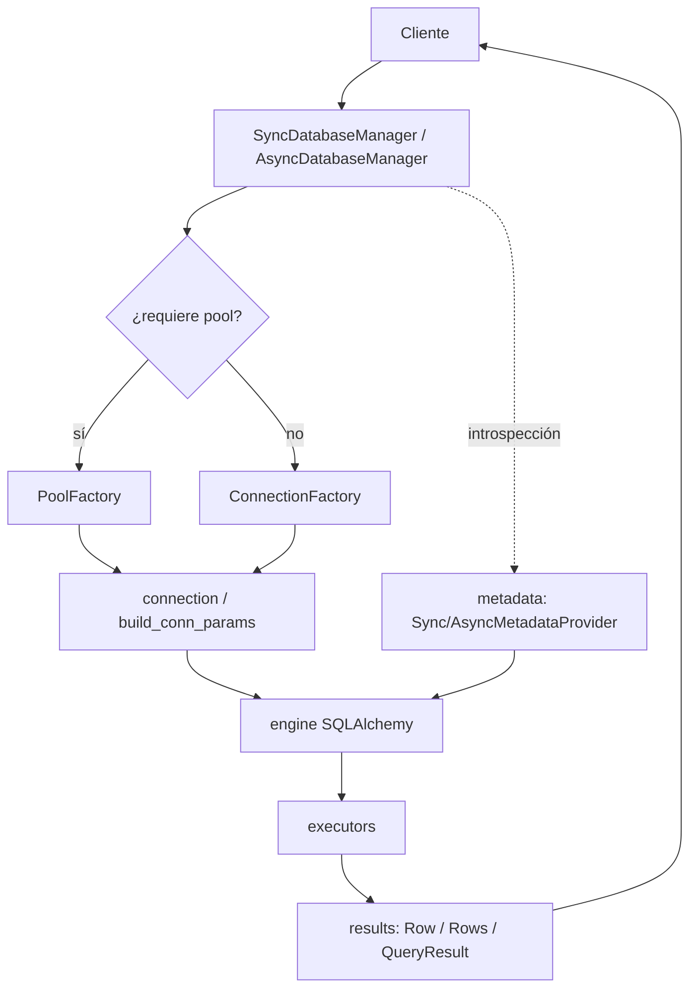

# Arquitectura del Sistema — util_bbdd

Visión global de cómo está organizado `util_bbdd`: una librería en capas que abstrae conexión, introspección y operaciones de alto nivel sobre `sqlalchemy`. Esta página describe el sistema completo; para decisiones puntuales con trade-offs consulta los [ADR](adr/ADR-001-STRUCTURE-REFACTORING.md).

## 1. Visión General

`util_bbdd` se organiza en **capas con responsabilidad única**:

- **Capa de orquestación** (`managers/`): punto de entrada público; gestiona ciclo de vida de conexión y expone operaciones.
- **Capa de infraestructura** (`factory/`, `connection/`, `executors/`): construye conexiones/pools y ejecuta SQL contra el engine de `sqlalchemy`.
- **Capa de operaciones** (`bulk/`, `comparar/`, `dump/`, `migrate/`, `metadata/`, `query/`, `analysis/`, `doc/`): capacidades de alto nivel construidas sobre las dos anteriores.
- **Capa de soporte** (`results/`, `validators/`, `_core/`, `core/`, `_drivers/`, `models.py`): tipos de retorno, validación, excepciones canónicas y detección de capacidades por motor.

**Frontera de la librería**: `util_bbdd` no construye SQL raw en la capa de managers (usa `sqlalchemy` como abstracción) y no expone introspección directa fuera de `metadata/`. Queda fuera de su alcance la gestión de credenciales/secretos y la orquestación de procesos externos.

## 2. Mapa de Módulos

```text
src/util_bbdd/
  managers/      # SyncDatabaseManager, AsyncDatabaseManager (API pública)
  factory/       # ConnectionFactory, PoolFactory
  connection/    # build_conn_params, configuración por motor
  executors/     # ejecutores de queries (sync/async)
  metadata/      # SyncMetadataProvider, AsyncMetadataProvider, caché de sesión
  bulk/          # CRUD masivo desde DataFrame + auditoría + ParallelBulkLoader
  comparar/      # SchemaComparator, SchemaDiff, reporters (SQL/HTML/Word/Excel/MD)
  dump/          # DumpOrchestrator, DumpConfig (volcado entre esquemas/motores)
  migrate/       # MigrationPlanner, MigrationPlan (migración DDL)
  query/         # QueryRegistry, QueryResolver, ejecución de queries nombradas
  validators/    # validación de parámetros de queries
  analysis/      # grafos de relaciones entre tablas (Graphviz)
  doc/           # documentación de BD (Word, Excel, HTML/Jinja2)
  results/       # Row, Rows, RowOrNone, QueryResult
  core/          # capabilities.py (capacidades por motor)
  _core/         # exceptions.py (jerarquía canónica de excepciones)
  _drivers/      # detección de drivers, get_supported_db_types
  models.py      # modelos de datos compartidos
  async_utils.py # maybe_await
  __init__.py    # API pública
```

| Módulo | Responsabilidad |
|---|---|
| `managers/` | Ciclo de vida de conexión (init, pool, cierre) y operaciones de BD |
| `factory/` | Factory de conexiones y pools; abstracción del engine SQLAlchemy |
| `connection/` | Construcción de parámetros y configuración de conexión por motor |
| `executors/` | Ejecución de queries síncrona/asíncrona |
| `metadata/` | Introspección de esquemas; caché de sesión; **único punto autorizado** para SQL de introspección |
| `bulk/` | CRUD masivo desde DataFrame con auditoría y carga paralela |
| `comparar/` | Comparación de dos esquemas; diff estructurado; reporters por formato |
| `dump/` | Volcado de datos entre esquemas/motores |
| `migrate/` | Planificación de migración DDL entre motores |
| `query/` | Registry de queries nombradas, resolver y parámetros |
| `validators/` | Validación de parámetros de queries antes de ejecutar |
| `analysis/` | Grafos de relaciones entre tablas (Graphviz) |
| `doc/` | Documentación de BD en Word, Excel y HTML vía Jinja2 |
| `results/` | Tipos de retorno: `Row`, `Rows`, `RowOrNone`, `QueryResult` |
| `_core/` | Jerarquía de excepciones canónica |

## 3. Flujo de una Operación

Flujo típico de una operación de lectura/escritura a través de las capas:



Las operaciones de alto nivel (`bulk/`, `comparar/`, `dump/`, `migrate/`) se apoyan en el mismo camino: obtienen conexión vía factory, consultan estructura vía `metadata/` y ejecutan vía `executors/`, devolviendo tipos de `results/`.

## 4. Contratos y Reglas Transversales

Principios de diseño aplicados en todas las capas (ver [`.github/SHARED_INSTRUCTIONS.md`](https://github.com/fmanza/util_bbdd/blob/main/.github/SHARED_INSTRUCTIONS.md)):

- **SOLID operativo**: cada servicio tiene una sola razón de cambio (SRP); la orquestación depende de servicios, no de detalles de IO (DIP).
- **Acceso a metadatos**: `metadata/` es el **único punto autorizado** para SQL de introspección; los managers no ejecutan introspección raw.
- **Abstracción de motor**: se usa `sqlalchemy` como capa común; `db_type` se valida al inicio y lanza `InvalidDatabaseType` antes de conectar.
- **Cierres explícitos**: usar el manager como context manager o llamar a `close()`.
- **Tipos de retorno uniformes**: `Row`, `Rows`, `RowOrNone`, `QueryResult` desde `results/`.
- **Excepciones canónicas**: jerarquía centralizada en `_core/exceptions.py`, reexportada en la API pública.

Decisión estructural formal: [ADR-001 — Structure Refactoring](adr/ADR-001-STRUCTURE-REFACTORING.md).

## 5. Extensión y Límites

Formas soportadas de extender el sistema:

- **Nuevo reporter de comparación**: añadir un reporter en `comparar/reporters/` respetando el contrato de salida de `SchemaDiff`.
- **Nueva query nombrada**: registrarla en `query/` (QueryRegistry) y, si lleva parámetros, su validador en `validators/`.
- **Soporte/capacidades por motor**: declarar capacidades en `core/capabilities.py` y la detección de driver en `_drivers/`.

Anti-patrones a evitar:

- Construir SQL raw en `managers/` en lugar de delegar en `sqlalchemy`/`executors/`.
- Ejecutar SQL de introspección fuera de `metadata/`.
- Introducir estado global mutable o `print()` dentro de la librería (usar `self.logger`).

### Pendiente de verificación

- El procedimiento exacto para registrar un **motor nuevo** de extremo a extremo (factory + connection + capabilities + drivers) no está documentado de forma consolidada; conviene confirmarlo con el equipo antes de publicarlo como contrato estable.
