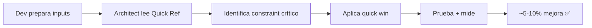
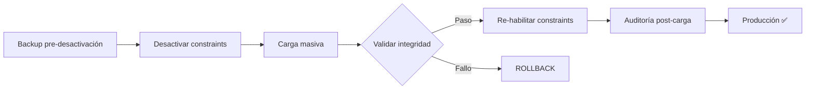

# 🎯 Guía de Lectura — Auditoría de Rendimiento: Constraints

**Selecciona tu rol para saber qué leer:**

---

## 👤 Eres un Developer (Implementador)

```
⏱️ Tiempo disponible: 30 minutos

1. Lee: CONSTRAINTS_QUICK_REFERENCE.md (5 min)
   ↓
2. Identifica tu caso de uso (PostgreSQL INSERT, MySQL UPDATE, etc.)
   ↓
3. Busca "Quick Wins" en el documento
   ↓
4. Implementa batch size tuning + logging async (< 30 min)
   ↓
5. Prueba con benchmark opcional
```

**Archivos que necesitas**:
- ✅ `docs/CONSTRAINTS_QUICK_REFERENCE.md`
- ✅ `docs/PERFORMANCE_AUDIT_CONSTRAINTS_GUIDE.md` (si tienes 30 min más)

**Salida**: Mejora de 5-10% sin riesgo en < 1 hora

---

## 🏛️ Eres un Architect (Diseñador de Soluciones)

```
⏱️ Tiempo disponible: 4 horas

1. Lee: CONSTRAINTS_QUICK_REFERENCE.md (5 min)
   ↓
2. Lee: PERFORMANCE_AUDIT_CONSTRAINTS_GUIDE.md (30 min)
   ↓
3. Lee: .github/prompts/performance_audit_constraints.prompt.md (2 horas)
   ↓
4. Diseña tu estrategia (30 min)
   - Identifica constraints críticos
   - Calcula impacto teórico
   - Propón alternativas
   ↓
5. Crea plan de validación
```

**Archivos que necesitas**:
- ✅ `docs/CONSTRAINTS_QUICK_REFERENCE.md`
- ✅ `docs/PERFORMANCE_AUDIT_CONSTRAINTS_GUIDE.md`
- ✅ `.github/prompts/performance_audit_constraints.prompt.md`

**Salida**: Plan técnico de 2-3 fases de optimización

---

## 🤖 Eres un LLM / Agente (Executor)

```
⏱️ Tiempo requerido: 6-10 horas

1. Recibe inputs del usuario:
   - Tabla objetivo
   - Operación (INSERT/UPDATE/DELETE)
   - Volumen (1K-1M filas)
   - BBDD (PostgreSQL/MySQL/Oracle/SQL Server/SQLite)
   
2. Carga tu prompt: .github/prompts/performance_audit_constraints_agent.prompt.md
   
3. Ejecuta 5 fases automáticamente:
   FASE 1: PLAN (inventario + matriz de impacto)
   FASE 2: AUDIT_PLAN (viabilidad + riesgos)
   FASE 3: AUDIT_CODE (hallazgos técnicos)
   FASE 4: IMPROVEMENT_PLAN (roadmap + quick wins)
   FASE 5: VERSION (veredicto + checklists)
   
4. Genera 5 documentos de salida
   
5. Proporciona benchmark (opcional)
```

**Tu prompt principal**:
- 📘 `.github/prompts/performance_audit_constraints_agent.prompt.md`

**Tu referencia técnica** (si necesitas profundizar):
- 📗 `.github/prompts/performance_audit_constraints.prompt.md`

**Salida**: 5 documentos markdown + benchmark JSON (opcional)

---

## 🔬 Eres un DBA / Performance Engineer

```
⏱️ Tiempo disponible: 4-8 horas

1. Lee: CONSTRAINTS_QUICK_REFERENCE.md (5 min)
   ↓
2. Lee: PERFORMANCE_AUDIT_CONSTRAINTS_GUIDE.md (30 min)
   ↓
3. Lee: .github/prompts/performance_audit_constraints.prompt.md (2 horas)
   ↓
4. Configura benchmark:
   - Crea tabla de test con constraints
   - Ejecuta scripts/bench_bulk.py
   - Captura baseline (con constraints)
   - Corre escenarios (sin FK, sin UK, sin todos)
   ↓
5. Analiza resultados:
   - Compara tiempos
   - Identifica cuellos de botella
   - Propone optimizaciones DB-specific
   ↓
6. Valida post-implementación:
   - Integridad de datos
   - Índices consistentes
   - Auditoría completa
```

**Archivos clave**:
- ✅ `docs/CONSTRAINTS_QUICK_REFERENCE.md` (referencia rápida)
- ✅ `docs/PERFORMANCE_AUDIT_CONSTRAINTS_GUIDE.md` (casos de uso)
- ✅ `.github/prompts/performance_audit_constraints.prompt.md` (técnico detallado)
- ✅ `.github/prompts/performance_audit_constraints_agent.prompt.md` (workflow para agentes)
- 🧪 `scripts/bench_bulk.py` (si existe)
- 🧪 `tests/bulk/test_constraints_performance.py` (si existe)

**Salida**: Benchmark reproducible + recomendaciones BBDD-specific

---

## 📊 Matriz de Documentos por Rol

| Rol | Quick Ref | User Guide | Reference | Agent Prompt | Benchmark |
|-----|-----------|-----------|-----------|--------------|-----------|
| **Developer** | ✅ | ✅ | - | - | ⚠️ |
| **Architect** | ✅ | ✅ | ✅ | - | ⚠️ |
| **LLM/Agent** | - | - | ⚠️ | ✅ | ✅ |
| **DBA** | ✅ | ✅ | ✅ | ⚠️ | ✅ |
| **Manager** | ✅ | - | - | - | - |

**Leyenda**: ✅ Necesario | ⚠️ Recomendado | - Opcional

---

## 🎯 Flujos de Ejecución

### Flujo 1: Auditoría Rápida (Dev + Architect, 1 hora)



---

### Flujo 2: Auditoría Completa (Team, 1-2 días)


---

### Flujo 3: Implementación Segura (Con Validación)



---

## 📁 Estructura de Lectura Recomendada

### Para Leer Primero (Todos)
1. `docs/CONSTRAINTS_QUICK_REFERENCE.md` — 5 min
   - Resumen ejecutivo
   - Qué esperar
   - Quick wins

### Para Leer Segundo (Según Tu Rol)
- **Dev**: `docs/PERFORMANCE_AUDIT_CONSTRAINTS_GUIDE.md` (casos de uso)
- **Architect**: `.github/prompts/performance_audit_constraints.prompt.md` (técnico)
- **LLM**: `.github/prompts/performance_audit_constraints_agent.prompt.md` (workflow)
- **DBA**: `.github/prompts/performance_audit_constraints.prompt.md` + casos de uso

### Para Referencia (Como Necesites)
- `docs/PERFORMANCE_AUDIT_CONSTRAINTS_GUIDE.md` — User guide completa
- `docs/CONSTRAINTS_AUDIT_INDEX.md` — Índice de navegación
- `.github/prompts/performance_audit_constraints.prompt.md` — Referencia técnica
- `.github/prompts/performance_audit_constraints_agent.prompt.md` — Workflow agente

---

## ⏱️ Timeline Recomendado

### Día 1 (30 min)
- [ ] Quick wins (batch size, logging async)
- [ ] ~5-10% mejora sin riesgo
- [ ] Metrics línea base

### Día 2-3 (2-4 horas)
- [ ] Auditoría completa (LLM o manual)
- [ ] Identificar constraints críticos
- [ ] Diseñar validación post-carga

### Día 4-7 (1-2 semanas)
- [ ] Implementar Fase 1-2 (quick + medium)
- [ ] Ejecutar benchmark
- [ ] Validación intensiva

### Semana 2+ (Opcional)
- [ ] Implementar Fase 3 (complex optimizations)
- [ ] Desactivación segura de constraints
- [ ] Validación exhaustiva

---

## 💬 Preguntas Frecuentes por Rol

### 👤 Developer
**P: Tengo 30 min, ¿qué implemento?**  
A: Batch size 5000 + logging async. Ver `CONSTRAINTS_QUICK_REFERENCE.md` "Quick Wins".

**P: ¿Es seguro desactivar constraints?**  
A: Bajo riesgo si validaciones post-carga. Ver `PERFORMANCE_AUDIT_CONSTRAINTS_GUIDE.md`.

---

### 🏛️ Architect
**P: ¿Cómo priorizo mejoras?**  
A: Usa matriz riesgo/beneficio en `.github/prompts/performance_audit_constraints.prompt.md`.

**P: ¿Qué BBDD tiene mejor impacto?**  
A: PostgreSQL COPY (60% mejora). Ver tabla de impactos por BBDD.

---

### 🤖 LLM/Agent
**P: ¿Cuál es mi prompt?**  
A: `.github/prompts/performance_audit_constraints_agent.prompt.md`

**P: ¿Cuánto tiempo toma?**  
A: 6-10 horas. Ejecuta 5 fases secuencialmente.

---

### 🔬 DBA
**P: ¿Cómo valido integridad post-carga?**  
A: Usa checklist en `PERFORMANCE_AUDIT_CONSTRAINTS_GUIDE.md` sección "Validación".

**P: ¿Qué hay para cada BBDD?**  
A: Reference prompt tiene sección 3 (Estrategias por BBDD).

---

## 🚀 Próximo Paso

**Selecciona tu rol arriba ↑ y comienza a leer.**

Si no tienes claro tu rol, empieza siempre por:
→ [`docs/CONSTRAINTS_QUICK_REFERENCE.md`](./CONSTRAINTS_QUICK_REFERENCE.md)

---

*Guía de lectura v1.0.0 | Actualizado 2026-09-26 | Índice completo en `CONSTRAINTS_AUDIT_INDEX.md`*
