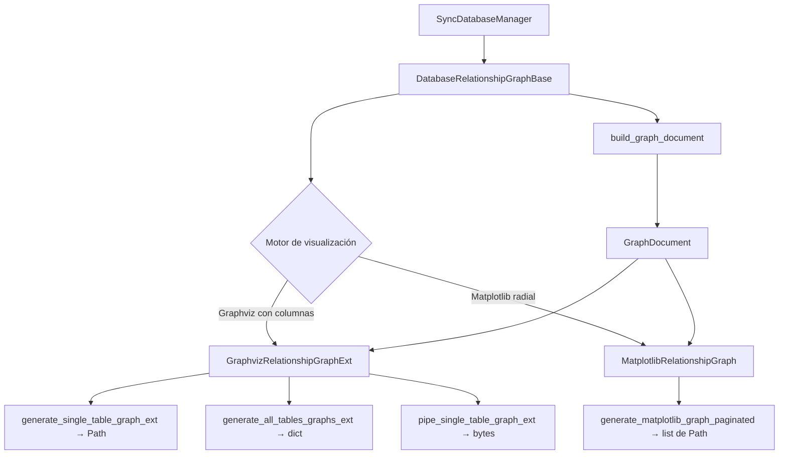

# Referencia Técnica: Análisis de Relaciones (analysis)

## Responsabilidad del módulo

Proporciona clases para extraer relaciones FK de un esquema de base de datos y renderizarlas
como grafos visuales (SVG/PNG) usando Graphviz o Matplotlib, con soporte para recorrido
multinivel, paginación automática y modo solo-memoria sin I/O de disco.

## Diagrama



## API pública

### DatabaseRelationshipGraphBase

| Método | Firma simplificada | Descripción | Retorna |
|---|---|---|---|
| `analyze_table_relations` | `(table_name: str)` | Relaciones FK directas del primer nivel | `list[TableRelation]` |
| `build_graph_document` | `(table_name, max_depth, direction)` | Modelo de grafo multinivel agnóstico al renderer | `GraphDocument` |
| `generate_relationship_report` | `(table_name: str)` | Informe detallado de relaciones de una tabla | `dict[str, Any]` |

### GraphvizRelationshipGraphExt

| Método | Firma simplificada | Descripción | Retorna |
|---|---|---|---|
| `generate_single_table_graph_ext` | `(table_name, output_file, format, ...)` | Grafo de una tabla → archivo en disco | `Path` |
| `generate_graphviz_graph_paginated_ext` | `(table_name, output_dir, max_subnodes, ...)` | Grafos paginados → archivos en disco | `list[Path]` |
| `generate_graphviz_level_graphs_ext` | `(table_name, output_dir, format, ...)` | Grafos por nivel y sentido → archivos | `dict[str, Any]` |
| `generate_all_tables_graphs_ext` | `(output_dir, format, skip_without_relations, ...)` | Grafos de todas las tablas → batch | `dict[str, dict]` |
| `pipe_single_table_graph_ext` | `(table_name, format, ...)` | Grafo en memoria → bytes (sin I/O) | `bytes` |
| `pipe_paginated_graph_ext` | `(table_name, format, max_subnodes, ...)` | Grafos paginados en memoria | `list[bytes]` |
| `pipe_level_graphs_ext` | `(table_name, format, ...)` | Grafos por nivel en memoria | `dict[str, Any]` |

### MatplotlibRelationshipGraph

| Método | Firma simplificada | Descripción | Retorna |
|---|---|---|---|
| `generate_matplotlib_graph_paginated` | `(table_name, output_dir, format, max_subnodes, ...)` | Grafos paginados Matplotlib → archivos | `list[Path]` |
| `generate_all_tables_graphs` | `(output_dir, format, skip_without_relations, ...)` | Grafos de todas las tablas Matplotlib | `dict[str, dict]` |

### Tipos y modelos de datos

| Tipo / Clase | Descripción |
|---|---|
| `TableRelation` | Relación FK entre dos tablas (dataclass frozen) |
| `GraphDocument` | Modelo completo de grafo: nodos, aristas, niveles, metadatos |
| `GraphNode` | Nodo con nombre de tabla, tipo visual y profundidad mínima visible |
| `GraphEdge` | Arista con relación FK, profundidad y dirección de recorrido |
| `LevelDirection` | Enum: `INCOMING`, `OUTGOING`, `BOTH` |
| `ColumnVisualizationMode` | Enum: `COMPACT`, `RELATIONS`, `ALL` |
| `ColumnDisplayConfig` | Configuración de columnas visibles en nodos |
| `CardinalityEndMarker` | Marcadores de cardinalidad por extremo de arista |

## Contrato de entrada

### GraphvizRelationshipGraphExt — constructor

| Parámetro | Tipo | Por defecto | Descripción |
|---|---|---|---|
| `db_manager` | `SyncDatabaseManager` | requerido | Gestor de BD conectado |
| `max_depth` | `int` | `1` | Niveles de profundidad del grafo |
| `direction` | `LevelDirection \| str` | `BOTH` | Sentido: `INCOMING`, `OUTGOING` o `BOTH` |
| `column_mode` | `ColumnVisualizationMode \| str` | `RELATIONS` | Qué columnas mostrar en nodos |
| `max_columns` | `int` | `8` | Máximo de columnas por nodo |
| `show_data_types` | `bool` | `False` | Mostrar tipo de dato junto a la columna |
| `show_constraint_name` | `bool` | `False` | Mostrar nombre de FK en la arista |
| `render_dpi` | `int` | `300` | DPI para formatos raster (PNG, JPG) |

### build_graph_document

| Parámetro | Tipo | Por defecto | Descripción |
|---|---|---|---|
| `table_name` | `str` | requerido | Tabla raíz del recorrido |
| `max_depth` | `int` | `1` | Número de niveles a explorar |
| `direction` | `LevelDirection \| str` | `BOTH` | Sentido del recorrido |

## Contrato de salida

- `generate_single_table_graph_ext`: devuelve el `Path` del archivo generado; lanza excepción si Graphviz no está disponible.
- `generate_all_tables_graphs_ext`: devuelve `dict` con clave por nombre de tabla y valor `{"files": list[Path], "error": str | None}`.
- `pipe_*`: devuelve `bytes` del archivo sin escribir a disco; útil para integración en apps web o generación de documentación embebida.
- `analyze_table_relations`: devuelve `list[TableRelation]`; lista vacía si la tabla no tiene FKs.

## Errores y casos especiales

| Error | Cuándo ocurre |
|---|---|
| `DocumentationRenderError` | Graphviz no está instalado o `dot` no está en PATH |
| `DatabaseOperationError` | Error al introspeccionar las FK (BD no conectada o sin permisos) |
| Lista vacía en `analyze_table_relations` | La tabla no tiene claves foráneas definidas |
| Múltiples archivos en `generate_all_tables_graphs_ext` | Tablas con más de `max_subnodes` relaciones generan páginas adicionales automáticamente |

## Ejemplo técnico mínimo

```python
from pathlib import Path
from util_bbdd import SyncDatabaseManager
from util_bbdd.analysis import GraphvizRelationshipGraphExt, LevelDirection

manager = SyncDatabaseManager(...)

grafo = GraphvizRelationshipGraphExt(
    db_manager=manager,
    max_depth=2,
    direction=LevelDirection.BOTH,
    column_mode="relations",
    show_data_types=False,
)

# A disco — una tabla
path = grafo.generate_single_table_graph_ext(
    table_name="pedidos",
    output_file=Path("out/pedidos.svg"),
    format="svg",
)
# path → Path("out/pedidos.svg")

# En memoria — sin I/O de disco
bytes_png = grafo.pipe_single_table_graph_ext("pedidos", format="png")
# bytes_png → b'\x89PNG\r\n...'

# Batch — todas las tablas con relaciones
resultados = grafo.generate_all_tables_graphs_ext(
    output_dir=Path("out/grafos/"),
    format="png",
    skip_tables_without_relations=True,
)
# resultados → {"pedidos": {"files": [Path("out/grafos/pedidos.png")], "error": None}, ...}

# Solo análisis — sin renderizar
relaciones = grafo.analyze_table_relations("pedidos")
# relaciones → [TableRelation(source_table="pedidos", target_table="clientes", ...)]
```
