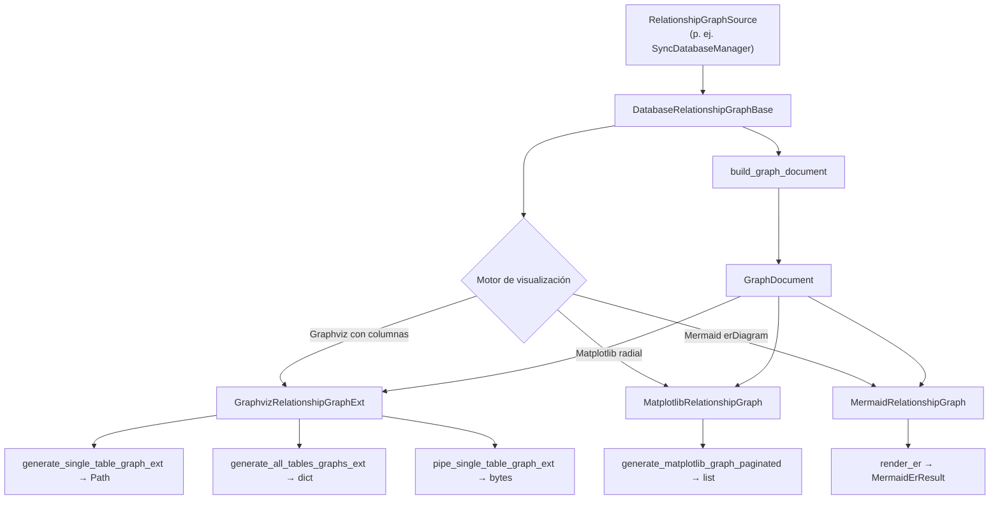

# Grafos de Relaciones (analysis)

Proporciona clases para extraer relaciones FK de un esquema y renderizarlas como grafos visuales (SVG/PNG) usando Graphviz o Matplotlib, o como diagramas entidad-relación de Mermaid en texto (desde 5.3.0, sin Graphviz), con soporte para recorrido multinivel, paginación y modo solo-memoria.

## 1. Arquitectura y Diseño



## 2. Modelo de Datos / Contratos

### API pública

#### Clase `DatabaseRelationshipGraphBase`

| Método | Firma simplificada | Descripción | Retorna |
|---|---|---|---|
| `analyze_table_relations` | `(table_name: str)` | Relaciones FK directas del primer nivel | `list[TableRelation]` |
| `build_graph_document` | `(table_name, max_depth, direction)` | Modelo de grafo multinivel agnóstico al renderer | `GraphDocument` |
| `generate_relationship_report` | `(table_name: str)` | Informe detallado de relaciones | `dict[str, Any]` |

Desde 5.3.0, el recorrido por niveles sigue un orden estable: las aristas de `GraphDocument` salen igual en cualquier
proceso (antes dependían de `PYTHONHASHSEED`). La cardinalidad, común a todos los renderers, considera **todas** las
columnas de la FK:

- el lado de la tabla referenciada es siempre «1»;
- el de la tabla con la FK es «1» si esas columnas son toda su PK o una restricción `UNIQUE` (`1:1`); si no, «N»
  (`1:N`).

Antes, una FK identificante (por ejemplo, cabecera-detalle) salía `M:N`.

#### Clase `GraphvizRelationshipGraphExt`

| Método | Firma simplificada | Descripción | Retorna |
|---|---|---|---|
| `generate_single_table_graph_ext` | `(table_name, output_file, format, ...)` | Grafo de una tabla → archivo en disco | `Path` |
| `generate_all_tables_graphs_ext` | `(output_dir=None, format="png", skip_tables_without_relations=True, max_subnodes=10, ...)` | Grafos de todas las tablas → batch | `dict[str, dict]` |
| `pipe_single_table_graph_ext` | `(table_name, format, ...)` | Grafo en memoria → bytes (sin I/O) | `bytes` |
| `generate_graphviz_graph_paginated_ext` | `(table_name, output_dir, max_subnodes, ...)` | Grafos paginados → archivos | `list[Path]` |
| `pipe_level_graphs_ext` / `pipe_paginated_graph_ext` | `(table_name, format, ...)` | Grafos por nivel (`summary`, `outgoing`, `incoming`) / paginados en memoria | `dict[str, Any]` / `list[bytes]` |
| `prefetch` | `(render, table_names)` | Construye los grafos que `render(tabla)` va a pedir y los renderiza por lotes (`dot -O`, `render_workers` procesos a la vez); las llamadas `pipe_*` posteriores con los mismos argumentos recogen el resultado | `int` (grafos renderizados) |

Constructor: además de las opciones de dibujo, `render_workers` (por defecto los núcleos, hasta 8) fija cuántos procesos
`dot` lanza `prefetch` a la vez. Casi todo el coste de `dot` es arrancar (~0,25 s por proceso frente a ~0,01 s por
grafo): con 120 tablas, la documentación HTML con diagramas pasó de 75,7 s a 6,2 s al renderizar por lotes (medido en
la sesión `2026-10-09k-doc-architecture-audit`; CHANGELOG 0.41.0).

`schema` (desde 4.1.0) dibuja otro schema con la misma fuente (owner en Oracle, base de datos en MySQL/MariaDB); por
defecto, el contexto de metadatos del manager.

`generate_all_tables_graphs_ext(..., on_progress=..., cancel_token=...)` (desde 4.1.0) avisa del avance tabla a tabla
(operación `"graph"`, fase `"tables"`) y se puede parar entre tablas con `OperationCancelledError`: ver
[Progreso y cancelación](progress_autodoc.md).

```python
gen = GraphvizRelationshipGraphExt(manager, max_depth=2, render_workers=4)
render = lambda tabla: gen.pipe_level_graphs_ext(table_name=tabla, format="svg")
gen.prefetch(render, ["clientes", "pedidos", "lineas"])  # 1 lote por proceso dot
grafos = gen.pipe_level_graphs_ext(table_name="pedidos", format="svg")  # ya renderizado: dict por nivel
```

#### Clase `MatplotlibRelationshipGraph`

| Método | Firma simplificada | Descripción | Retorna |
|---|---|---|---|
| `generate_matplotlib_graph_paginated` | `(table_name, output_dir, format, max_subnodes, ...)` | Grafos paginados → archivos | `list[Path]` |
| `generate_all_tables_graphs` | `(output_dir=None, format="png", skip_tables_without_relations=True, max_subnodes=10, ...)` | Grafos de todas las tablas | `dict[str, dict]` |

#### Clase `MermaidRelationshipGraph`

Desde 5.3.0. Genera diagramas `erDiagram` de Mermaid en texto, listos para un bloque ```` ```mermaid ```` de Markdown
(Zensical, MkDocs, GitHub). **No necesita Graphviz** ni el extra `analysis`. Es el generador de los diagramas de la
documentación Markdown.

| Método | Firma simplificada | Descripción | Retorna |
|---|---|---|---|
| `MermaidRelationshipGraph` | `(db_manager, *, show_columns=True, column_mode="relations", max_columns=8, show_constraint_name=False, max_entities=40, max_chars=50_000, schema=None)` | Configura el generador. `column_mode` sigue la política de Graphviz: `relations` (columnas de las relaciones dibujadas), `compact` (esas primero y después las demás hasta `max_columns`) o `all` | `MermaidRelationshipGraph` |
| `render_er` | `(table_name, *, max_depth=1, direction="both", max_subnodes=10)` | Diagramas de la tabla y sus relaciones | `MermaidErResult` (`blocks`, `document`, `warnings`) |

Reglas de dibujo:

- **Relaciones**: una línea por FK, aunque sea compuesta; las FK sin nombre (SQLite) no se funden. La cardinalidad es
  la de la base: `1:N` → `||--o{` y `1:1` → `||--o|`.
- **Opcionalidad**: el lado de la tabla referenciada es `|o` si alguna columna de la FK admite nulos.
- **Tipo de línea**: continua (`--`) si la FK forma parte de la PK de la tabla hija; si no, discontinua (`..`).
- **Reparto**: varios bloques cuando hay más de `max_subnodes` relaciones; la tabla central se repite en cada uno.
- **Guardas de tamaño**: más de `max_entities` entidades o de `max_chars` caracteres (el `maxTextSize` de Mermaid).
  Primero se quitan las columnas y después se parte el diagrama, con un aviso en `warnings`. En el navegador, un
  diagrama de 300 entidades tarda entre 12 y 28 s.
- **Escape**: los nombres y comentarios del catálogo usan códigos de entidad de Mermaid (`#37;`, `#quot;`…); una
  directiva `%%{init}` queda como texto. Los tipos y nombres de columna se normalizan a la gramática de `erDiagram`
  (`double precision` → `double_precision`; `PK`, `FK` y `UK` llevan sufijo `_`). Si el nombre cambia, el real va al
  comentario del atributo.
- **Determinismo**: la salida es la misma en cualquier proceso. Sintaxis validada con Mermaid 11.17.2 y 12.2.0.

```python
from util_bbdd.analysis import MermaidRelationshipGraph

result = MermaidRelationshipGraph(manager, show_constraint_name=True).render_er("pedidos", max_depth=2)
for block in result.blocks:
    print(f"```mermaid\n{block}\n```")
print(result.warnings)  # recortes o repartos por tamaño
```

### Contrato de entrada

| Parámetro | Tipo | Descripción | Restricciones |
|---|---|---|---|
| `db_manager` | `RelationshipGraphSource` | Fuente de metadatos, normalmente un `SyncDatabaseManager` con conexión activa | Debe cumplir el contrato de abajo; no soporta `AsyncDatabaseManager` |
| `max_depth` | `int` | Profundidad máxima de relaciones FK | Default `1`; valores > 3 pueden generar grafos ilegibles |
| `direction` | `LevelDirection` | `OUTGOING`, `INCOMING` o `BOTH` | Filtra el sentido de las relaciones |
| `output_file` | `Path` | Fichero de salida SVG o PNG | La extensión determina el formato |
| `format` | `str` | Formato de imagen | `"svg"`, `"png"`, u otros formatos Graphviz/Matplotlib |

#### Protocol `RelationshipGraphSource`

Lo que `analysis/` exige de `db_manager`; se importa de `util_bbdd.analysis`. `analysis/` no importa `managers/` (Regla #6): `SyncDatabaseManager` y el adaptador de `doc/` lo cumplen de forma estructural. En `get_schema_metadata`, `kinds` va solo por nombre.

| Miembro | Firma | Descripción |
|---|---|---|
| `db_type` | `str` (propiedad) | Motor de la conexión |
| `get_query_context_database` | `() -> str` | Base de datos de contexto de las consultas |
| `get_schema_metadata` | `(schema=None, *, kinds=ALL_KINDS) -> SchemaSnapshot` | Tablas, columnas, claves e índices del schema, por lotes (ADR-003); las relaciones, la cardinalidad y el tipo visual de cada tabla salen de aquí |

### Contrato de salida

- Métodos `generate_*` → `Path` o `list[Path]` de archivos creados en disco (`pipe_*` + escritura). Los nombres
  `graphviz_ext_<tabla>…` usan el nombre de tabla saneado (minúsculas, alfanuméricos y guiones): un nombre con `/` o
  `..` no escribe fuera de `output_dir`.
- Métodos `pipe_*` → `bytes` del formato solicitado, sin escribir en disco.
- `build_graph_document` → `GraphDocument` agnóstico al renderer (modelo intermedio reutilizable).
- `render_er` → `MermaidErResult`: texto `erDiagram` por bloque, sin escribir en disco; sin relaciones, `blocks=()`.
- `analyze_table_relations` → `list[TableRelation]` (dataclasses frozen).

### Errores y casos especiales

| Error | Cuándo ocurre |
|---|---|
| `ImportError` | Al crear `GraphvizRelationshipGraphExt` sin el paquete `graphviz`, o al usar `MatplotlibRelationshipGraph` sin `matplotlib`/`networkx` |
| `graphviz.ExecutableNotFound` (`RuntimeError`) | Al renderizar sin el binario `dot` en el PATH |

## 3. Componentes y Clases

| Clase | Responsabilidad |
|---|---|
| `DatabaseRelationshipGraphBase` | Lógica común de extracción FK y construcción del modelo de grafo |
| `GraphvizRelationshipGraphExt` | Renderización con Graphviz: nodos con columnas, cardinalidad, alta resolución |
| `MatplotlibRelationshipGraph` | Renderización con Matplotlib: layout radial, dependencias más ligeras |
| `MermaidRelationshipGraph` | Diagramas `erDiagram` de Mermaid en texto, sin dependencias externas (5.3.0) |
| `_core/mermaid.py` | Escape y normalización para Mermaid, comunes a `analysis` y `comparar` |

## 4. Dependencias y Requisitos

| Dependencia | Propósito | Requerida | Comportamiento sin ella |
|---|---|---|---|
| `graphviz` (Python) + binarios `dot` | Renderización Graphviz | Solo para `GraphvizRelationshipGraphExt` | `ImportError` al instanciar (sin el paquete); `graphviz.ExecutableNotFound` al renderizar (sin `dot`) |
| `matplotlib` + `networkx` | Renderización Matplotlib | Solo para `MatplotlibRelationshipGraph` | `ImportError` al instanciar la clase (el módulo se importa igual) |
| Extra `util_bbdd[analysis]` | Instala `graphviz` (Python) | Sí para `GraphvizRelationshipGraphExt` | Dependencias no disponibles |
| Extra `util_bbdd[analysis-matplotlib]` | Instala `matplotlib` y `networkx` | Solo para `MatplotlibRelationshipGraph` | Dependencias no disponibles |

## 5. Ejemplos Relacionados

- [Ejemplo: Generación de Grafos de Relaciones](../examples/graph_generation.md) — Uso de `GraphvizRelationshipGraphExt` con distintos niveles de profundidad
- [Ejemplo: Documentación Markdown](../examples/markdown_documentation.md) — Diagramas `erDiagram` de `MermaidRelationshipGraph` en la documentación Markdown
