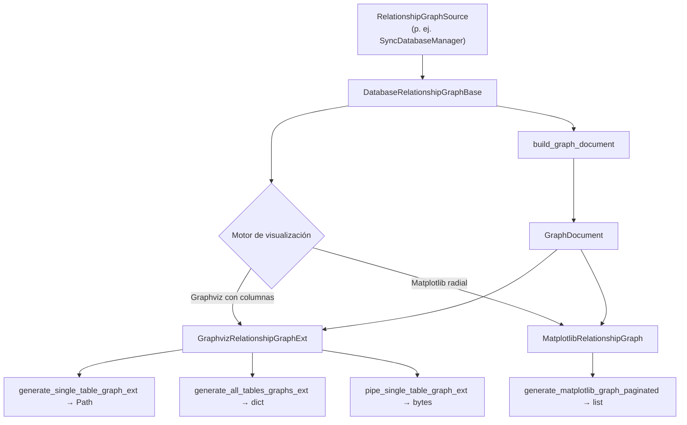

# Grafos de Relaciones (analysis)

Proporciona clases para extraer relaciones FK de un esquema y renderizarlas como grafos visuales (SVG/PNG) usando Graphviz o Matplotlib, con soporte para recorrido multinivel, paginación y modo solo-memoria.

## 1. Arquitectura y Diseño



## 2. Modelo de Datos / Contratos

### API pública

#### Clase `DatabaseRelationshipGraphBase`

| Método | Firma simplificada | Descripción | Retorna |
|---|---|---|---|
| `analyze_table_relations` | `(table_name: str)` | Relaciones FK directas del primer nivel | `list[TableRelation]` |
| `build_graph_document` | `(table_name, max_depth, direction)` | Modelo de grafo multinivel agnóstico al renderer | `GraphDocument` |
| `generate_relationship_report` | `(table_name: str)` | Informe detallado de relaciones | `dict[str, Any]` |

#### Clase `GraphvizRelationshipGraphExt`

| Método | Firma simplificada | Descripción | Retorna |
|---|---|---|---|
| `generate_single_table_graph_ext` | `(table_name, output_file, format, ...)` | Grafo de una tabla → archivo en disco | `Path` |
| `generate_all_tables_graphs_ext` | `(output_dir, format, skip_without_relations, ...)` | Grafos de todas las tablas → batch | `dict[str, dict]` |
| `pipe_single_table_graph_ext` | `(table_name, format, ...)` | Grafo en memoria → bytes (sin I/O) | `bytes` |
| `generate_graphviz_graph_paginated_ext` | `(table_name, output_dir, max_subnodes, ...)` | Grafos paginados → archivos | `list[Path]` |
| `pipe_level_graphs_ext` / `pipe_paginated_graph_ext` | `(table_name, format, ...)` | Grafos por nivel / paginados en memoria | `dict` / `list[bytes]` |
| `prefetch` | `(render, table_names)` | Construye los grafos que `render(tabla)` va a pedir y los renderiza por lotes (`dot -O`, `render_workers` procesos a la vez); las llamadas `pipe_*` posteriores con los mismos argumentos recogen el resultado | `int` (grafos renderizados) |

Constructor: además de las opciones de dibujo, `render_workers` (por defecto los núcleos, hasta 8) fija cuántos procesos
`dot` lanza `prefetch` a la vez. Casi todo el coste de `dot` es arrancar (~0,25 s por proceso frente a ~0,01 s por
grafo): con 120 tablas, la documentación HTML con diagramas pasó de 75,7 s a 6,2 s al renderizar por lotes.

```python
gen = GraphvizRelationshipGraphExt(manager, max_depth=2, render_workers=4)
render = lambda tabla: gen.pipe_level_graphs_ext(table_name=tabla, format="svg")
gen.prefetch(render, ["clientes", "pedidos", "lineas"])  # 1 lote por proceso dot
svg = gen.pipe_level_graphs_ext(table_name="pedidos", format="svg")  # ya renderizado
```

#### Clase `MatplotlibRelationshipGraph`

| Método | Firma simplificada | Descripción | Retorna |
|---|---|---|---|
| `generate_matplotlib_graph_paginated` | `(table_name, output_dir, format, max_subnodes, ...)` | Grafos paginados → archivos | `list[Path]` |
| `generate_all_tables_graphs` | `(output_dir, format, skip_without_relations, ...)` | Grafos de todas las tablas | `dict[str, dict]` |

### Contrato de entrada

| Parámetro | Tipo | Descripción | Restricciones |
|---|---|---|---|
| `db_manager` | `RelationshipGraphSource` | Fuente de metadatos, normalmente un `SyncDatabaseManager` con conexión activa | Debe cumplir el contrato de abajo; no soporta `AsyncDatabaseManager` |
| `max_depth` | `int` | Profundidad máxima de relaciones FK | Valores > 3 pueden generar grafos ilegibles |
| `direction` | `LevelDirection` | `OUTGOING`, `INCOMING` o `BOTH` | Filtra el sentido de las relaciones |
| `output_file` | `Path` | Fichero de salida SVG o PNG | La extensión determina el formato |
| `format` | `str` | Formato de imagen | `"svg"`, `"png"`, u otros formatos Graphviz/Matplotlib |

#### Protocol `RelationshipGraphSource`

Lo que `analysis/` exige de `db_manager`; se importa de `util_bbdd.analysis`. `analysis/` no importa `managers/` (Regla #6): `SyncDatabaseManager` y el adaptador de `doc/` lo cumplen de forma estructural. Los parámetros son posicionales.

| Miembro | Firma | Descripción |
|---|---|---|
| `db_type` | `str` (propiedad) | Motor de la conexión |
| `get_query_context_database` | `() -> str` | Base de datos de contexto de las consultas |
| `get_schema_metadata` | `(schema=None, *, kinds=ALL_KINDS) -> SchemaSnapshot` | Tablas, columnas, claves e índices del schema, por lotes (ADR-003); las relaciones, la cardinalidad y el tipo visual de cada tabla salen de aquí |

### Contrato de salida

- Métodos `generate_*` → `Path` o `list[Path]` de archivos creados en disco (`pipe_*` + escritura). Los nombres
  `graphviz_ext_<tabla>…` usan el nombre de tabla saneado (minúsculas, alfanuméricos y guiones): un nombre con `/` o
  `..` no escribe fuera de `output_dir`.
- Métodos `pipe_*` → `bytes` del formato solicitado, sin escribir en disco.
- `build_graph_document` → `GraphDocument` agnóstico al renderer (modelo intermedio reutilizable).
- `analyze_table_relations` → `list[TableRelation]` (dataclasses frozen).

### Errores y casos especiales

| Error | Cuándo ocurre |
|---|---|
| `ImportError` | Al crear `GraphvizRelationshipGraphExt` sin el paquete `graphviz`, o al usar `MatplotlibRelationshipGraph` sin `matplotlib`/`networkx` |
| `graphviz.ExecutableNotFound` (`RuntimeError`) | Al renderizar sin el binario `dot` en el PATH |

## 3. Componentes y Clases

| Clase | Responsabilidad |
|---|---|
| `DatabaseRelationshipGraphBase` | Lógica común de extracción FK y construcción del modelo de grafo |
| `GraphvizRelationshipGraphExt` | Renderización con Graphviz: nodos con columnas, cardinalidad, alta resolución |
| `MatplotlibRelationshipGraph` | Renderización con Matplotlib: layout radial, dependencias más ligeras |

## 4. Dependencias y Requisitos

| Dependencia | Propósito | Requerida | Comportamiento sin ella |
|---|---|---|---|
| `graphviz` (Python) + binarios `dot` | Renderización Graphviz | Solo para `GraphvizRelationshipGraphExt` | `DocumentationRenderError` al generar |
| `matplotlib` + `networkx` | Renderización Matplotlib | Solo para `MatplotlibRelationshipGraph` | `ImportError` al instanciar la clase (el módulo se importa igual) |
| Extra `util_bbdd[analysis]` | Instala `graphviz` (Python) | Sí para `GraphvizRelationshipGraphExt` | Dependencias no disponibles |
| Extra `util_bbdd[analysis-matplotlib]` | Instala `matplotlib` y `networkx` | Solo para `MatplotlibRelationshipGraph` | Dependencias no disponibles |

## 5. Ejemplos Relacionados

- [Ejemplo: Generación de Grafos de Relaciones](../examples/graph_generation.md) — Uso de `GraphvizRelationshipGraphExt` con distintos niveles de profundidad
