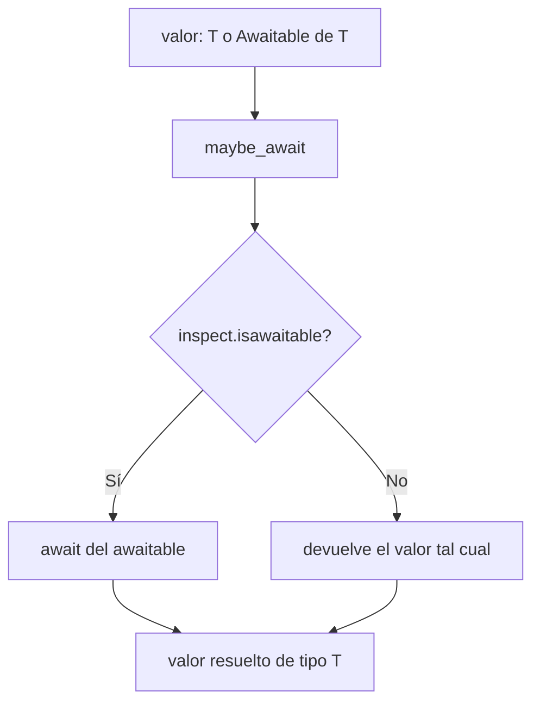

# Utilidades Async (async_utils)

Utilidad compartida que unifica el consumo de valores que pueden ser **awaitables o directos** bajo una única API. Permite que el código asíncrono de la librería trate de forma homogénea las respuestas de drivers que a veces devuelven una corrutina y a veces un valor ya resuelto.

## 1. Arquitectura y Diseño



El helper resuelve la heterogeneidad de los drivers sync/async sin obligar al llamante a ramificar con `if inspect.isawaitable(...)`. Está tipado con `@overload` para preservar el tipo `T` tanto si la entrada es `Awaitable[T]` como si es `T`.

## 2. Modelo de Datos / Contratos

### API pública

| Función | Firma simplificada | Descripción | Retorna |
|---|---|---|---|
| `maybe_await` | `async (value: T \| Awaitable[T]) -> T` | Resuelve `value` con `await` si es awaitable; en caso contrario lo devuelve tal cual | `T` |

### Contrato de entrada

| Parámetro | Tipo | Descripción | Restricciones |
|---|---|---|---|
| `value` | `T \| Awaitable[T]` | Valor directo o awaitable a resolver | Cualquier objeto; si es awaitable se consume una vez |

### Contrato de salida

| Función | Retorna | Detalles |
|---|---|---|
| `maybe_await` | `T` | El valor resuelto. El tipo `T` se preserva gracias a las sobrecargas (`@overload`) |

### Errores y casos especiales

| Situación | Comportamiento |
|---|---|
| `value` es awaitable | Se evalúa con `await`; cualquier excepción del awaitable se propaga al llamante |
| `value` no es awaitable | Se devuelve sin modificar (incluido `None`) |
| El awaitable ya fue consumido | Comportamiento del objeto subyacente (típicamente `RuntimeError`); `maybe_await` no reintenta |

## 3. Componentes y Clases

*No aplica para este módulo.* Expone únicamente la corrutina `maybe_await`; no define clases.

## 4. Dependencias y Requisitos

| Dependencia | Propósito | Requerida | Comportamiento sin ella |
|---|---|---|---|
| `inspect` (stdlib) | `inspect.isawaitable` para detectar awaitables | Sí | Módulo no funciona |
| `typing` / `collections.abc` (stdlib) | `Awaitable`, `cast`, `overload` para el tipado | Sí | Solo afecta a la verificación de tipos |

## 5. Uso interno en la librería

`maybe_await` se emplea en las capas asíncronas que consumen drivers cuyo retorno puede ser
síncrono o awaitable según el motor y la operación:

- `managers/async_mgr.py`, `managers/_manager_lifecycle.py` y `managers/_catalog_executor.py`
- `executors/async_query_executor.py`
- `metadata/_charset_detection.py`
- Pools async por motor: `connection/{mariadb,postgresql,oracle,sqlserver}/async_pool_connection_*.py`

```python
from util_bbdd.async_utils import maybe_await


async def resolver(valor):
    # Funciona tanto si 'valor' es una corrutina como si es un valor directo.
    return await maybe_await(valor)
```

Para ver consumo async de alto nivel, consulta [Queries Concurrentes (Async)](../examples/async_concurrent_queries.md).
