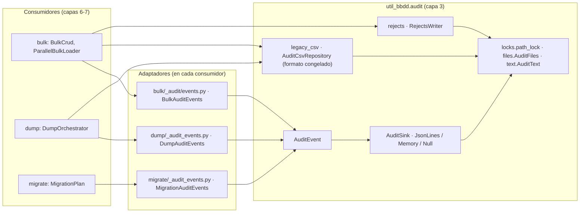

# Auditoría centralizada (util_bbdd.audit)

Paquete de la capa 3 (Servicios) que centraliza la auditoría de `bulk`, `dump` y `migrate`: el modelo de evento común, sus destinos, el CSV de auditoría heredado y el CSV de rechazos. Solo importa de `_core`; **no conoce a sus consumidores**: cada módulo convierte sus propios tipos en eventos con un adaptador propio. Decisión y alternativas: [ADR-002](../adr/ADR-002-modulo-auditoria.md).

## 1. Arquitectura y Diseño



## 2. Modelo de Datos / Contratos

### `AuditEvent` (inmutable, `slots`)

| Campo | Tipo | Equivalente OpenTelemetry | Notas |
|---|---|---|---|
| `source` | `"bulk" \| "dump" \| "migrate"` | — | Módulo emisor |
| `kind` | `AuditKind` | — | `operation`, `partition`, `run`, `table`, `constraint`, `index`, `pk_sync`, `plan_warning`, `statement`, `view_validation` |
| `status` | `AuditStatus` | — | `ok`, `failed`, `skipped`, `info`, `warning`, `error` |
| `timestamp` | `datetime` con zona | — | `__post_init__` rechaza uno sin zona; `AuditEvent.now()` usa UTC |
| `engine` | `str \| None` | `db.system.name` | `engine.dialect.name` |
| `namespace` | `str \| None` | `db.namespace` | Esquema |
| `target` | `str \| None` | `db.collection.name` | Tabla u objeto (`tabla.constraint`, `tabla.columna`) |
| `operation` | `str \| None` | `db.operation.name` | `INSERT`, `CREATE`, `ENABLE`, `LOAD`, `DUMP`… |
| `rows` | `int \| None` | — (no es `db.response.returned_rows`) | En `bulk`, filas **enviadas** (como el CSV) |
| `elapsed_s` | `float \| None` | — | Segundos |
| `error_type` | `str \| None` | `error.type` | Nombre de la clase del error |
| `message` | `str \| None` | — | Una línea, máximo 500 caracteres (`MAX_MESSAGE`) |
| `run_id`, `parent_id` | `str \| None` | — | Correlación; la librería solo rellena `run_id` |
| `attributes` | `tuple[tuple[str, valor], ...]` | p. ej. `db.operation.batch.size` | Ordenados por nombre; `attribute(nombre)` para leer uno |

`as_dict()` devuelve los campos serializables (`timestamp` en ISO 8601). No se registra el texto SQL (`db.query.text`).

### Contratos

| Protocol | Métodos | Contrato |
|---|---|---|
| `AuditSink` | `write(events, /)`, `close()` | `write` atómico por llamada y seguro con hilos; `write([])` no hace nada; `close` idempotente; `write` tras `close` → `ValueError`; un fallo de escritura se propaga (quien llama aplica su política) |
| `AuditEventSource` | `events()` | Copia de los eventos escritos, en orden (lo implementa `MemoryAuditSink`) |

`tests/unit/audit/test_sinks_contract.py` ejecuta el contrato con todas las implementaciones; `tests/unit/test_protocol_conformance.py` comprueba las firmas con mypy.

### Parámetros nuevos en los consumidores (todos opcionales)

| Dónde | Parámetro | Resultado |
|---|---|---|
| `BulkCrud(...)` | `audit_sink`, `audit_run_id` | Propiedad `BulkCrud.audit_run_id` |
| `ParallelBulkLoader(...)` | `audit_sink`, `audit_run_id` | `ParallelLoadResult.audit_run_id` |
| `DumpConfig(...)` | `audit_sink` | `DumpResult.audit_run_id` |
| `MigrationPlan.execute(target, *, audit_sink=None)` | `audit_sink` | — |
| `MigrationPlan.validate_views(..., audit_sink=None)` | `audit_sink` | — |
| `MigrationPlan.audit_events()` | — | Avisos del plan como `list[AuditEvent]` |

### Errores y casos especiales

| Situación | Comportamiento |
|---|---|
| Destino que falla en una operación de `bulk` | `audit_strict=False`: ERROR en el log y `+N` en `audit_failures` (un registro que falla en el CSV y en el destino cuenta dos veces); `audit_strict=True`: se propaga y la sesión se deshace. Un `OSError` o `AuditError` del destino llega tal cual; cualquier otra excepción (p. ej. de un destino propio) llega como `AuditError` con la original en `__cause__`, para que `dump` la trate como error de la tabla |
| Destino que falla en eventos de cierre (`partition`/`run` de carga, `dump`, `migrate`) | ERROR en el log; el resultado y la excepción original no cambian |
| Fichero JSON Lines cuya primera línea no es un evento | Se aparta como `<nombre>.invalid-<fecha><ext>` con un WARNING |
| `AuditEvent` con `timestamp` sin zona, `rows` o `elapsed_s` negativos, atributos repetidos | `ValueError` al construirlo |

## 3. Componentes y Clases

| Módulo | Clase / función | Responsabilidad |
|---|---|---|
| `events.py` | `AuditEvent` | Modelo de evento |
| `contracts.py` | `AuditSink`, `AuditEventSource` | Contratos de escritura y lectura |
| `sinks.py` | `NullAuditSink`, `MemoryAuditSink`, `JsonLinesAuditSink` | Destinos |
| `locks.py` | `path_lock` | Registro **único** en el proceso de locks por ruta (`bulk._audit.repository._get_file_lock` es el mismo objeto) |
| `files.py` | `AuditFiles` | Apartar ficheros ajenos, primera línea, tamaño, identidad |
| `text.py` | `AuditText` | `safe_csv_cell` (fórmulas en CSV) y `error_summary` |
| `legacy_csv.py` | `AuditRecord`, `AuditRecordValidator`, `AuditCsvRepository` | CSV de auditoría (formato congelado); `read_since` para el resumen de `dump` |
| `analytics.py` | `AuditAnalyticsService` | Estadísticas y filtros del CSV |
| `exporters.py` | `AuditExporters` | Excel (vía `_core/export_safety.py`), JSON y HTML |
| `counters.py` | `AuditCounters`, `SupportsAuditCounters` | Los cuatro contadores de auditoría como valor sumable |
| `rejects.py` | `RejectsWriter`, `REJECT_COLUMNS` | CSV de filas rechazadas (formato congelado) |

`AuditManager` sigue en `bulk/audit.py` como fachada (su logger es `util_bbdd.bulk.audit`). Los módulos `bulk/_audit/*.py` y `RejectsWriter` en `bulk/_support/rejects.py` re-exportan desde aquí; los imports existentes siguen funcionando.

## 4. Dependencias y Requisitos

| Dependencia | Propósito | Requerida | Comportamiento sin ella |
|---|---|---|---|
| `pandas` | Lectura y analítica del CSV heredado | Sí (dependencia de la librería) | No aplica |
| `openpyxl` | Exportación a Excel | Sí (dependencia de la librería) | No aplica |

Sin dependencias nuevas: el destino JSON Lines usa `json` de la biblioteca estándar.

## 5. Ejemplos Relacionados

```python
from pathlib import Path

from util_bbdd import BulkCrud, JsonLinesAuditSink
from util_bbdd.dump import DumpConfig, DumpOrchestrator

sink = JsonLinesAuditSink(Path("logs/auditoria.jsonl"))

crud = BulkCrud(engine, audit_csv_path=Path("logs/auditoria.csv"), audit_sink=sink)
crud.bulk_insert_from_df(df, "clientes", generar_sql=False)

result = DumpOrchestrator(DumpConfig(src_engine, dst_engine, output_dir=Path("reports"), audit_sink=sink)).run()
print(result.audit_run_id)  # filtra el JSON Lines por este run_id

plan.execute(target_manager, audit_sink=sink)  # MigrationPlan de MigrationPlanner.plan(...)
```

- [Auditoría Bulk (AuditManager)](bulk_audit.md) — el CSV de auditoría heredado
