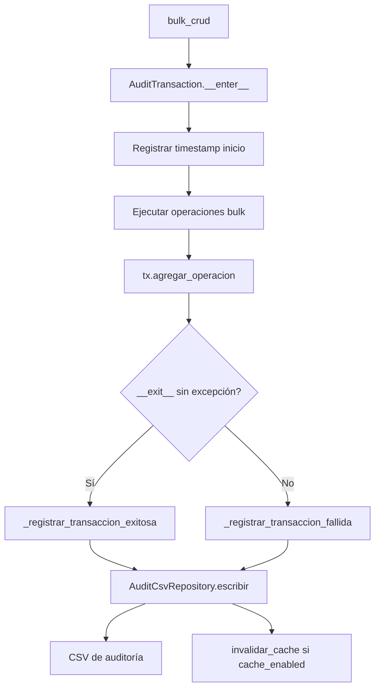

## Responsabilidad del módulo

`AuditManager` es la fachada pública del subsistema de auditoría de operaciones bulk. Coordina tres componentes internos: `AuditCsvRepository` (persistencia en CSV con caché TTL), `AuditAnalyticsService` (estadísticas y filtros) y `AuditExporters` (Excel, JSON, HTML). `AuditTransaction` es el context manager que agrupa y registra operaciones atómicamente.

## Diagrama

## API pública

### Clase `AuditTransaction`

| Método / Propiedad | Firma simplificada | Descripción | Retorna |
|---|---|---|---|
| `AuditTransaction` | `(manager, nombre)` | Context manager de transacción | `AuditTransaction` |
| `agregar_operacion` | `(tabla, motor, operacion, rowcount, elapsed, genero_sql?)` | Agrega operación a la transacción en curso | `None` |
| `obtener_resumen` | `()` | Dict con métricas de la transacción | `dict[str, Any]` |
| `duracion_segundos` | propiedad | Segundos entre inicio y fin | `float` |
| `total_operaciones` | propiedad | Número de operaciones registradas | `int` |
| `total_filas` | propiedad | Suma de filas afectadas | `int` |

### Clase `AuditManager`

| Método | Firma simplificada | Descripción | Retorna |
|---|---|---|---|
| `AuditManager` | `(audit_csv_path?, cache_enabled?, cache_ttl_seconds?)` | Crea fachada de auditoría | `AuditManager` |
| `transaction` | `(nombre)` | Crea y retorna `AuditTransaction` vinculado | `AuditTransaction` |
| `obtener_resumen` | `()` | Estadísticas agregadas por tabla y motor | `dict[str, Any]` |
| `exportar_excel` | `(ruta)` | Exporta historial a Excel | `None` |
| `exportar_json` | `(ruta)` | Exporta historial a JSON | `None` |
| `exportar_html` | `(ruta)` | Exporta historial a HTML | `None` |
| `filtrar_por_fecha` | `(desde, hasta?)` | Filtra operaciones por rango de fechas | `pd.DataFrame` |
| `invalidar_cache` | `()` | Fuerza recarga del CSV en la próxima lectura | `None` |

## Contrato de entrada

| Parámetro | Tipo | Descripción | Restricciones |
|---|---|---|---|
| `audit_csv_path` | `Path \| None` | Fichero CSV donde persistir el historial | Si `None`, el CSV no se escribe; las operaciones se acumulan solo en memoria |
| `cache_enabled` | `bool` | Activar caché del CSV con TTL | Default `True`; si `False`, cada lectura recarga el CSV |
| `cache_ttl_seconds` | `int` | Segundos de validez de la caché del CSV | Default `300` (5 min) |
| `nombre` | `str` | Nombre de la transacción en `AuditTransaction` | No puede ser vacío ni solo espacios; `AuditValidationError` si se viola |
| `tabla` | `str` | Nombre de tabla en `agregar_operacion` | Libre; se usa como clave en estadísticas |
| `motor` | `str` | Identificador del motor en `agregar_operacion` | Libre; normalmente `engine.dialect.name.upper()` |
| `operacion` | `str` | Tipo en `agregar_operacion` | `"INSERT"`, `"UPDATE"` o `"DELETE"` |

## Contrato de salida

- **`obtener_resumen`** de `AuditTransaction` — `dict` con claves `nombre`, `exito`, `duracion_segundos`, `total_operaciones`, `total_filas`, `operaciones` (lista de dicts con detalle por operación).
- **`filtrar_por_fecha`** — `pd.DataFrame` con las columnas del CSV de auditoría filtradas por el rango indicado.
- Exportadores (`exportar_excel`, `exportar_json`, `exportar_html`) — `None`; crean el fichero en la ruta indicada.

## Errores y casos especiales

| Error | Cuándo ocurre |
|---|---|
| `AuditValidationError` | Nombre de transacción vacío; `agregar_operacion` sobre transacción ya cerrada |
| `AuditFileError` | Error de escritura en el CSV (permisos, ruta inválida) |
| `AuditConfigError` | Configuración inválida al inicializar `AuditManager` |

**Casos especiales:**
- Si `audit_csv_path=None`, las operaciones se acumulan en `_historial_transacciones` (atributo en memoria) pero no se persisten. `exportar_excel` y similares lanzarán `AuditConfigError` si no hay CSV configurado.
- `invalidar_cache` se llama automáticamente al finalizar una transacción exitosa cuando `cache_enabled=True`, para que la siguiente lectura del CSV refleje los datos recién escritos.
- `agregar_operacion` lanza `AuditValidationError` si se llama antes de `__enter__` o después de `__exit__` (transacción cerrada). El context manager es obligatorio para agregar operaciones.
