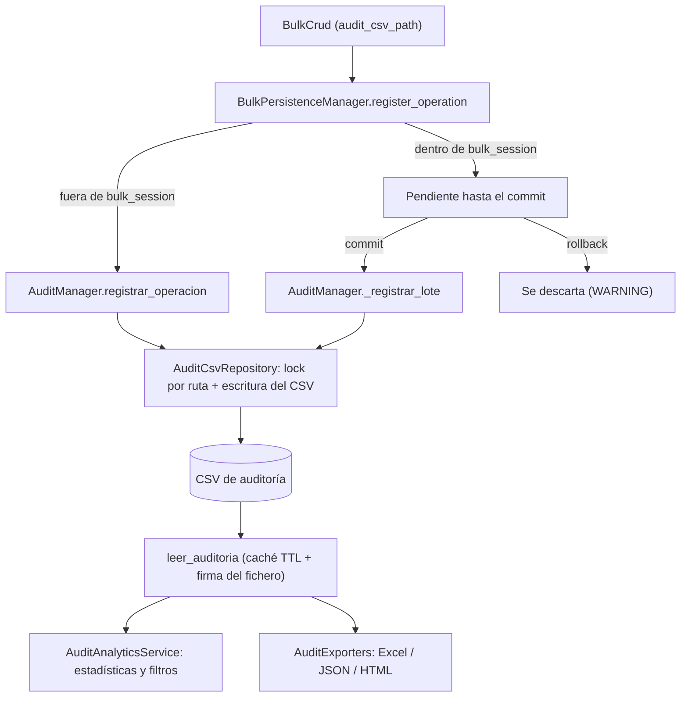

# Auditoría Bulk (AuditManager)

`AuditManager` es la fachada del subsistema de auditoría de operaciones bulk: escribe una fila por operación en un CSV tabulado, lo relee con caché y ofrece estadísticas, filtros y exportación a Excel, JSON y HTML. `BulkCrud` lo usa internamente a través de `audit_csv_path`; también se puede usar directamente para consultar o exportar un CSV existente.

## 1. Arquitectura y Diseño

## 2. Modelo de Datos / Contratos

### API pública

| Método | Firma simplificada | Descripción | Retorna |
|---|---|---|---|
| `AuditManager` | `(audit_csv_path?, cache_enabled?, cache_ttl_seconds?)` | Crea la fachada; crea el directorio del CSV si no existe | `AuditManager` |
| `registrar_operacion` | `(tabla, motor, operacion, rowcount, elapsed, genero_sql?)` | Añade una fila al CSV. Sin `audit_csv_path` no hace nada (un WARNING por instancia) | `None` |
| `leer_auditoria` | `(usar_cache?)` | Lee el CSV completo | `pd.DataFrame` |
| `limpiar_cache` / `invalidar_cache` | `()` | Fuerza releer el CSV en la próxima lectura | `None` |
| `obtener_estadisticas` | `()` | Totales, medias, máximos, tabla y motor más usados, periodo | `dict[str, Any]` |
| `obtener_operaciones_por_tipo` | `()` | Conteo por `operacion` | `dict[str, int]` |
| `obtener_operaciones_por_tabla` | `()` | Conteo por `tabla` | `dict[str, int]` |
| `obtener_operaciones_lentas` | `(umbral_segundos=5.0)` | Filas con `tiempo_seg` mayor que el umbral, de más a menos lentas | `pd.DataFrame` |
| `filtrar_por_operacion` | `(operacion)` | Filas de `INSERT`, `UPDATE` o `DELETE` | `pd.DataFrame` |
| `filtrar_por_tabla` / `filtrar_por_motor` | `(tabla)` / `(motor)` | Filas de una tabla o de un motor | `pd.DataFrame` |
| `filtrar_por_rango_tiempo` | `(inicio, fin)` | Filas con `timestamp` entre ambas fechas, ordenadas | `pd.DataFrame` |
| `filtrar_multiple` | `(operacion?, tabla?, motor?, umbral_tiempo?)` | Combina criterios con AND | `pd.DataFrame` |
| `exportar_resumen_excel` | `(agrupar_por="tabla")` | Resumen agrupado por `tabla`, `fecha` o `tabla_fecha` en `auditoria.xlsx`, junto al CSV | `Path` |
| `exportar_resumen_json` | `(output_path?)` | Estadísticas y conteos en JSON (por defecto `auditoria.json` junto al CSV) | `Path` |
| `exportar_resumen_html` | `(output_path?)` | Informe HTML (por defecto `auditoria.html` junto al CSV) | `Path` |

Propiedades: `audit_csv_path`, `cache_enabled`, `cache_ttl_seconds` (lectura y escritura) y `columnas_auditoria` (asignarla está obsoleto: emite `DeprecationWarning`).

### Contrato de entrada

| Parámetro | Tipo | Descripción | Restricciones |
|---|---|---|---|
| `audit_csv_path` | `Path \| None` | Fichero CSV de auditoría | `None` = auditoría desactivada |
| `cache_enabled` | `bool` | Cachear la lectura del CSV | Default `True` |
| `cache_ttl_seconds` | `int` | Validez máxima de la caché | Default `300`; además se descarta si el fichero cambió |
| `tabla`, `motor` | `str` | Tabla y motor de la operación | No vacíos |
| `operacion` | `str` | Tipo de operación | `"INSERT"`, `"UPDATE"` o `"DELETE"` |
| `rowcount` | `int` | Filas enviadas a la operación | `>= 0` |
| `elapsed` | `float` | Segundos de la operación | `>= 0` |

### Contrato de salida

- **CSV de auditoría** — separado por tabuladores, con columnas `timestamp`, `tabla`, `motor`, `operacion`, `total_filas`, `tiempo_seg`, `sql`. `timestamp` tiene resolución de segundo y es el fin de la operación. `total_filas` son las filas **enviadas** a la operación (`len(df)` en `BulkCrud`), no las que la BD dice haber modificado: un DELETE o UPDATE con claves inexistentes cuenta todas las enviadas. `tiempo_seg` usa coma decimal y es la única columna de tiempo: con `sql=No` mide la ejecución en BD; con `sql=Sí`, generar y escribir el fichero SQL (no se ejecuta nada en BD). Si el fichero no existe o está vacío, se escribe antes la cabecera.
- **Concurrencia** — las escrituras de varias instancias sobre el mismo CSV se serializan con un lock por ruta dentro del proceso (no entre procesos).
- **Resumen Excel** — agrupa también por `sql` (Sí/No) y muestra esa columna en cada hoja y en `Resumen_global`, de modo que la generación de SQL no se mezcla con la ejecución. Los textos que empiezan por `=` se guardan como texto, no como fórmula. Los totales de JSON y HTML suman ambos tipos de fila.

### Errores y casos especiales

| Error | Cuándo ocurre |
|---|---|
| `AuditValidationError` | Parámetros inválidos en `registrar_operacion` o en los filtros; rango de fechas invertido; `agrupar_por` desconocido |
| `AuditConfigError` | No se puede crear el directorio de `audit_csv_path`; leer, estadísticas o exportar sin CSV configurado. Hereda también de `ValueError` |
| `AuditFileError` | Leer un CSV que no existe |
| `AuditDataError` | CSV ilegible o sin filas al pedir estadísticas; fallo al exportar JSON o HTML |
| `OSError` | No se puede escribir el CSV (permisos, fichero abierto en Excel, disco lleno) |
| — | Usado desde `BulkCrud`, un fallo al escribir el CSV no interrumpe la operación salvo con `BulkCrud(audit_strict=True)`: se registra como ERROR y se cuenta en `BulkCrud.audit_failures`. Dentro de `bulk_session` las filas se escriben al confirmarse la transacción y se descartan si hay rollback. Ver [BulkCrud](bulk-crud.md) |

## 3. Componentes y Clases

| Clase | Responsabilidad |
|---|---|
| `AuditManager` | Fachada pública; valida y delega en repositorio, analítica y exportadores |
| `AuditCsvRepository` | Escritura del CSV (lock por ruta, cabecera) y lectura con caché validada por TTL y firma del fichero |
| `AuditAnalyticsService` | Estadísticas, filtros y agrupaciones sobre el CSV |
| `AuditExporters` | Exportación a Excel, JSON y HTML |
| `AuditRecord` | Una fila del CSV (interno; lo usa la auditoría diferida de `bulk_session`) |

## 4. Dependencias y Requisitos

| Dependencia | Propósito | Requerida | Comportamiento sin ella |
|---|---|---|---|
| `pandas` | Lectura, filtrado y agregación del CSV | Sí (dependencia de la librería) | No aplica |
| `openpyxl` | Exportación a Excel | Sí (dependencia de la librería) | No aplica |

## 5. Ejemplos Relacionados

- [Ejemplo: Bulk Insert desde CSV con Auditoría](../examples/bulk_insert_csv.md) — `BulkCrud` con `audit_csv_path` y lectura del CSV resultante
