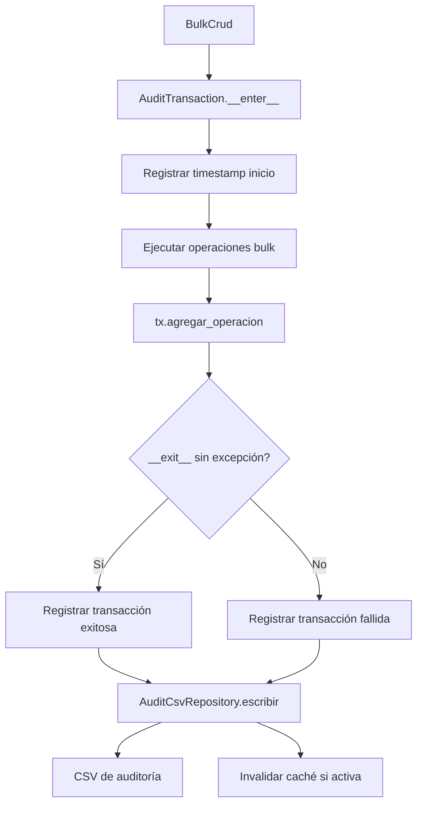

# Auditoría Bulk (AuditManager)

`AuditManager` es la fachada del subsistema de auditoría de operaciones bulk: coordina persistencia en CSV, estadísticas y exportación; `AuditTransaction` es el context manager que agrupa y registra operaciones atómicamente.

## 1. Arquitectura y Diseño

## 2. Modelo de Datos / Contratos

### API pública

#### Clase `AuditManager`

| Método | Firma simplificada | Descripción | Retorna |
|---|---|---|---|
| `AuditManager` | `(audit_csv_path?, cache_enabled?, cache_ttl_seconds?)` | Crea fachada de auditoría | `AuditManager` |
| `transaction` | `(nombre)` | Crea y retorna `AuditTransaction` vinculado | `AuditTransaction` |
| `obtener_resumen` | `()` | Estadísticas agregadas por tabla y motor | `dict[str, Any]` |
| `exportar_excel` | `(ruta)` | Exporta historial a Excel | `None` |
| `exportar_json` | `(ruta)` | Exporta historial a JSON | `None` |
| `exportar_html` | `(ruta)` | Exporta historial a HTML | `None` |
| `filtrar_por_fecha` | `(desde, hasta?)` | Filtra operaciones por rango de fechas | `pd.DataFrame` |
| `invalidar_cache` | `()` | Fuerza recarga del CSV en la próxima lectura | `None` |

#### Clase `AuditTransaction`

| Método / Propiedad | Firma simplificada | Descripción | Retorna |
|---|---|---|---|
| `AuditTransaction` | `(manager, nombre)` | Context manager de transacción | `AuditTransaction` |
| `agregar_operacion` | `(tabla, motor, operacion, rowcount, elapsed, genero_sql?)` | Agrega operación a la transacción en curso | `None` |
| `obtener_resumen` | `()` | Dict con métricas de la transacción | `dict[str, Any]` |
| `duracion_segundos` | propiedad | Segundos entre inicio y fin | `float` |
| `total_operaciones` | propiedad | Número de operaciones registradas | `int` |
| `total_filas` | propiedad | Suma de filas afectadas | `int` |

### Contrato de entrada

| Parámetro | Tipo | Descripción | Restricciones |
|---|---|---|---|
| `audit_csv_path` | `Path \| None` | Fichero CSV donde persistir el historial | `None` = sin persistencia en disco |
| `cache_enabled` | `bool` | Activar caché del CSV con TTL | Default `True` |
| `cache_ttl_seconds` | `int` | Segundos de validez de la caché del CSV | Default `300` (5 min) |
| `nombre` | `str` | Nombre de la transacción | No puede ser vacío ni solo espacios; `AuditValidationError` si se viola |
| `operacion` | `str` | Tipo en `agregar_operacion` | `"INSERT"`, `"UPDATE"` o `"DELETE"` |

### Contrato de salida

- **`obtener_resumen`** (`AuditTransaction`) — `dict` con `nombre`, `exito`, `duracion_segundos`, `total_operaciones`, `total_filas`, `operaciones`.
- **`filtrar_por_fecha`** — `pd.DataFrame` con columnas del CSV filtradas por rango de fechas.
- Exportadores — `None`; crean el fichero en la ruta indicada.
- **CSV de auditoría** — columnas `timestamp`, `tabla`, `motor`, `operacion`, `total_filas`, `tiempo_seg`, `sql`. `tiempo_seg` es la única columna de tiempo y mide la operación: con `sql=No`, la ejecución en BD; con `sql=Sí`, generar y escribir el fichero SQL (no se ejecuta nada en BD).
- **Resumen Excel** (`exportar_resumen_excel`) — agrupa también por `sql` (Sí/No) y muestra esa columna en cada hoja y en `Resumen_global`, de modo que `tiempo_total` y `tiempo_medio` de la generación de SQL no se mezclan con los de la ejecución. Los totales de JSON y HTML suman ambos tipos de fila.

### Errores y casos especiales

| Error | Cuándo ocurre |
|---|---|
| `AuditValidationError` | Nombre de transacción vacío; `agregar_operacion` sobre transacción ya cerrada |
| `AuditFileError` | Error de escritura en el CSV (permisos, ruta inválida) |
| — | Usado desde `BulkCrud`, un fallo al escribir el CSV no interrumpe la operación salvo con `BulkCrud(audit_strict=True)`: se registra como ERROR y se cuenta en `BulkCrud.audit_failures`. Dentro de `bulk_session` las filas se escriben al confirmarse la transacción y se descartan si hay rollback. Ver [BulkCrud](bulk-crud.md) |
| `AuditConfigError` | Configuración inválida al inicializar; exportar sin CSV configurado |

## 3. Componentes y Clases

| Clase | Responsabilidad |
|---|---|
| `AuditManager` | Fachada pública; coordina repositorio, analytics y exportadores |
| `AuditTransaction` | Context manager que agrupa y registra operaciones atómicamente |
| `AuditCsvRepository` | Persistencia en CSV con caché TTL |
| `AuditAnalyticsService` | Estadísticas y filtros sobre el historial |

## 4. Dependencias y Requisitos

| Dependencia | Propósito | Requerida | Comportamiento sin ella |
|---|---|---|---|
| `pandas` | Lectura y filtrado del CSV de auditoría | Sí | Sin pandas no se puede leer ni exportar el historial |
| `openpyxl` | Exportación a Excel | Solo para `exportar_excel` | `AuditConfigError` al intentar exportar a Excel |

## 5. Ejemplos Relacionados

- [Ejemplo: Bulk Insert desde CSV con Auditoría](../examples/bulk_insert_csv.md) — Uso de `AuditManager` con transacciones de auditoría
