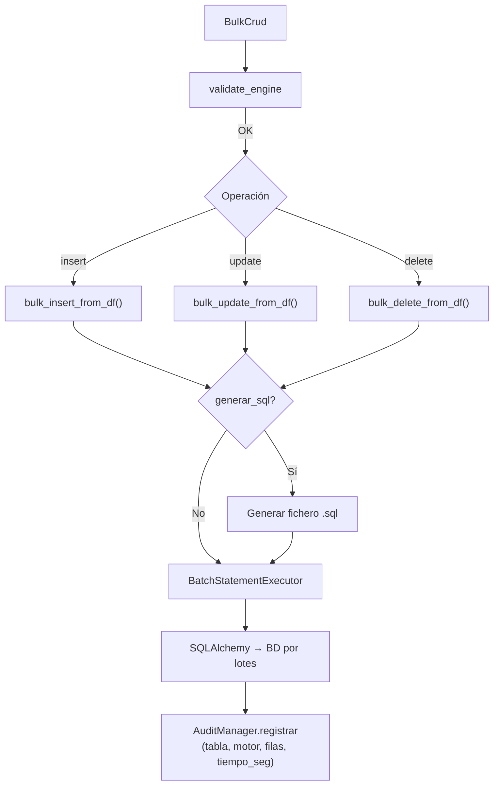

# CRUD Masivo (BulkCrud)

Proporciona operaciones de INSERT, UPDATE y DELETE masivo sobre tablas existentes usando DataFrames de pandas como fuente, con normalización de identificadores por motor, procesamiento por lotes y auditoría opcional.

## 1. Arquitectura y Diseño

## 2. Modelo de Datos / Contratos

### API pública

| Método | Firma simplificada | Descripción | Retorna |
|---|---|---|---|
| `BulkCrud` | `(engine, chunk_size?, audit_csv_path?, enable_fast_executemany?, insert_resolver?, commit_every_n_chunks?, update_via_staging?)` | Crea instancia con engine SQLAlchemy | `BulkCrud` |
| `bulk_insert_from_df` | `(df, tabla_destino, generar_sql?, path_sql?)` | INSERT masivo desde DataFrame | `None` |
| `bulk_insert_from_chunks` | `(chunks, tabla_destino, *, override_identity?, exclude_autoincrement_pk?)` | INSERT streaming de iterable de DataFrames; resuelve columnas/identidad una sola vez | `int` (filas insertadas) |
| `bulk_update_from_df` | `(df, tabla_destino, generar_sql?, path_sql?)` | UPDATE masivo desde DataFrame | `None` |
| `bulk_delete_from_df` | `(df, tabla_destino, generar_sql?, path_sql?)` | DELETE masivo desde DataFrame | `None` |
| `bulk_session` | `(*, atomic=True)` | Context manager para loop de inserts con 1 transacción | `Iterator[None]` |
| `maintenance_scope` | `(tabla_destino, *, disable_constraints=True, disable_indexes=False)` | Context manager que deshabilita FKs/triggers e índices para cargas >1 M filas; restaura siempre al salir. Requiere `bulk_session` activo | `Generator[None, None, None]` |
| `reflect_table` | `(tabla_destino)` | Refleja tabla SQLAlchemy (con caché interno) | `Table` |
| `sync_pk_sequences` | `(tables=None)` | Resincroniza contadores PK al `MAX` actual | `list[PKSyncResult]` |

### Contrato de entrada

| Parámetro | Tipo | Descripción | Restricciones |
|---|---|---|---|
| `engine` | `Engine` | Engine síncrono de SQLAlchemy | No puede ser `None`; lanza `ValueError` si es `None` |
| `chunk_size` | `int` | Filas por lote | Default `5000` |
| `audit_csv_path` | `Path \| None` | Ruta del CSV de auditoría | `None` desactiva la auditoría |
| `enable_fast_executemany` | `bool` | Si `True` (default) y el engine es `mssql+pyodbc`, activa `fast_executemany` en el dialecto, igual que `create_engine(..., fast_executemany=True)` (INSERT ~12× más rápido). Sin efecto en otros motores | Default `True` |
| `insert_resolver` | `InsertStrategyResolver \| None` | Estrategia INSERT personalizada | Default `None` (resolución automática por motor) |
| `commit_every_n_chunks` | `int \| None` | Commit cada N lotes en lugar de una sola transacción. La carga deja de ser atómica | Default `None` (una sola transacción) |
| `update_via_staging` | `bool` | Solo MySQL/MariaDB: `bulk_update_from_df` carga cada lote en una tabla temporal y aplica un único `UPDATE ... JOIN` en lugar de un UPDATE por fila. Mismo resultado final; requiere el privilegio `CREATE TEMPORARY TABLES`; si el servidor lo deniega, vuelve al UPDATE fila a fila y registra un WARNING (una vez por instancia). Ignorado en otros motores | Default `True` |
| `df` | `pd.DataFrame` | Datos fuente | No puede estar vacío; columnas deben coincidir con tabla destino |
| `tabla_destino` | `str` | Nombre de la tabla en BD | Debe existir; se normaliza mayúsculas/minúsculas por motor |
| `generar_sql` | `bool` | Escribir el SQL generado en fichero | Si `True`, `path_sql` es obligatorio |
| `path_sql` | `Path \| None` | Directorio base para el fichero SQL | Nombre generado automáticamente (tabla + operación + timestamp) |

### Contrato de salida

- Los métodos de escritura (`bulk_insert_from_df`, `bulk_update_from_df`, `bulk_delete_from_df`) retornan `None`.
- `bulk_insert_from_chunks` retorna `int` (filas insertadas).
- `sync_pk_sequences` retorna `list[PKSyncResult]`; errores capturados en `PKSyncResult.status="error"`, nunca propagados.
- Efectos secundarios: filas modificadas en BD, fichero `.sql` opcional, entrada en CSV de auditoría.

### Errores y casos especiales

| Error | Cuándo ocurre |
|---|---|
| `ValueError` | `engine=None`, DataFrame vacío, `generar_sql=True` sin `path_sql`, no hay PKs para UPDATE/DELETE |
| `SQLAlchemyError` | Error al reflejar la tabla, timeout de BD, violación de constraint |

**Estrategias INSERT por motor** (cuando `insert_resolver=None`):

| Motor / driver | Estrategia |
|---|---|
| `postgresql` + `psycopg` (psycopg3) | `COPY ... FROM STDIN` — vía más rápida de PostgreSQL |
| `postgresql` + `psycopg2` | `psycopg2.extras.execute_values` — un único `INSERT ... VALUES` multi-fila por chunk |
| `mysql` / `mariadb` + `pymysql` | `executemany` del driver sin procesadores de tipo (PyMySQL lo envía como `INSERT ... VALUES` multi-fila) |
| `mysql` / `mariadb` + otro driver (p.ej. `mariadbconnector`) | `INSERT ... VALUES` multi-fila sub-loteado en grupos de 1000 filas |
| `oracle`, `mssql`, `sqlite`, `hsqldb` | `executemany` estándar de SQLAlchemy |

## 3. Componentes y Clases

| Clase | Responsabilidad |
|---|---|
| `BulkCrud` | Fachada pública para operaciones bulk; gestiona normalización, lotes y auditoría |
| `BatchStatementExecutor` | Ejecuta sentencias SQL por lotes sobre una conexión SQLAlchemy |
| `InsertStrategyResolver` | Selecciona la estrategia INSERT óptima según motor y driver |

## 4. Dependencias y Requisitos

| Dependencia | Propósito | Requerida | Comportamiento sin ella |
|---|---|---|---|
| `util.timing.medir_tiempo` | Decorator para capturar duración de operaciones bulk | Sí (incluida en pyproject.toml) | Fallback: decorator placeholder; timing=0 ms en CSV de auditoría |
| `pandas` | DataFrame como fuente de datos | Sí | Sin pandas no hay datos para insertar |
| `sqlalchemy` | Reflexión de tabla, ejecución de sentencias | Sí | Módulo no funciona sin SQLAlchemy |

## 5. Ejemplos Relacionados

- [Ejemplo: Bulk Insert desde CSV con Auditoría](../examples/bulk_insert_csv.md) — Carga un CSV con `BulkCrud`, auditoría incluida
- [Ejemplo: Carga Paralela de Millones de Filas](../examples/parallel_bulk_insert.md) — Uso de `bulk_insert_from_chunks` con particionado
- [Ejemplo: Benchmark — Impacto de commit_every_n_chunks](../examples/benchmark_commit_cadence.md) — Ajuste de cadencia de commit para alto volumen
