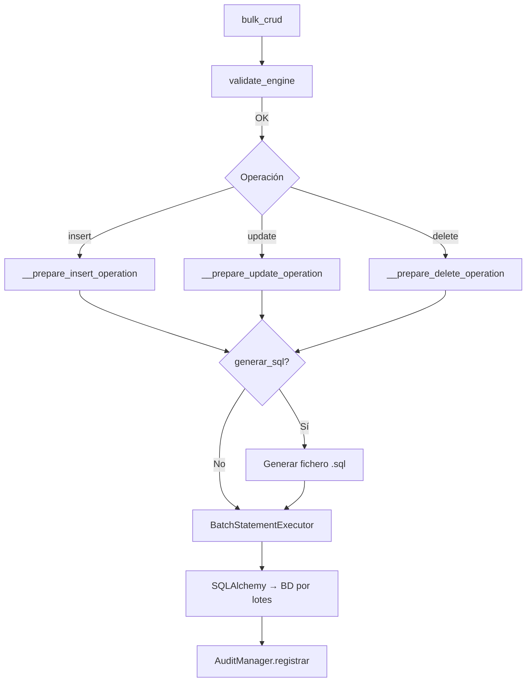

## Responsabilidad del módulo

Proporciona operaciones de INSERT, UPDATE y DELETE masivo sobre tablas existentes usando DataFrames de pandas como fuente. Internamente aplica normalización de identificadores por motor (minúsculas para Oracle/PostgreSQL, mayúsculas para MySQL/MariaDB/SQL Server/HSQLDB), divide los datos en lotes (`chunk_size`) y delega la ejecución en `BatchStatementExecutor`. Opcionalmente registra cada operación en `AuditManager` y puede generar el SQL equivalente en fichero.

## Diagrama

## API pública

| Método | Firma simplificada | Descripción | Retorna |
|---|---|---|---|
| `bulk_crud` | `(engine, chunk_size?, audit_csv_path?)` | Crea instancia con engine SQLAlchemy | `bulk_crud` |
| `bulk_insert_from_df` | `(df, tabla_destino, generar_sql?, path_sql?)` | INSERT masivo desde DataFrame | `None` |
| `bulk_update_from_df` | `(df, tabla_destino, generar_sql?, path_sql?)` | UPDATE masivo desde DataFrame | `None` |
| `bulk_delete_from_df` | `(df, tabla_destino, generar_sql?, path_sql?)` | DELETE masivo desde DataFrame | `None` |

## Contrato de entrada

| Parámetro | Tipo | Descripción | Restricciones |
|---|---|---|---|
| `engine` | `Engine` | Engine síncrono de SQLAlchemy | No puede ser `None`; lanza `ValueError` si es `None` |
| `chunk_size` | `int` | Filas por lote | Default `5000`; valores muy bajos aumentan nº de round-trips a BD |
| `audit_csv_path` | `Path \| None` | Ruta del CSV de auditoría | `None` desactiva la auditoría |
| `df` | `pd.DataFrame` | Datos fuente de la operación | No puede estar vacío; columnas deben coincidir con tabla destino |
| `tabla_destino` | `str` | Nombre de la tabla en BD | La tabla debe existir; se normaliza mayúsculas/minúsculas por motor |
| `generar_sql` | `bool` | Escribir el SQL generado en fichero | Si `True`, `path_sql` es obligatorio |
| `path_sql` | `Path \| None` | Directorio base para el fichero SQL | El nombre de fichero se genera automáticamente (tabla + operación + timestamp) |

## Contrato de salida

- Todos los métodos públicos retornan `None`.
- Efecto secundario principal: filas modificadas en BD.
- Efecto secundario opcional: fichero `.sql` escrito en `path_sql` y entrada registrada en el CSV de auditoría.

## Errores y casos especiales

| Error | Cuándo ocurre |
|---|---|
| `ValueError` | `engine=None`, DataFrame vacío, `generar_sql=True` sin `path_sql`, no hay PKs para UPDATE/DELETE |
| `SQLAlchemyError` | Error al reflejar la tabla, timeout de BD, violación de constraint |

**Casos especiales:**
- **Normalización de identificadores**: Oracle, PostgreSQL y SQLite usan minúsculas; MySQL, MariaDB, SQL Server y HSQLDB usan mayúsculas. La clase detecta el dialecto desde `engine.dialect.name` y normaliza automáticamente los nombres de columna del DataFrame.
- **SQL Server**: detecta el driver (`pymssql` vs `pyodbc`) inspeccionando `engine.url.drivername` y ajusta el `db_info` de auditoría.
- **generar_sql=True**: el fichero SQL se escribe con el nombre `{tabla}_{operacion}_{timestamp}.sql` dentro de `path_sql`. Si `path_sql` no existe o no es un directorio válido, lanza `ValueError` antes de ejecutar ninguna operación en BD.
- La auditoría se registra aunque la operación falle parcialmente (el registro refleja las filas afectadas hasta el punto de fallo).
