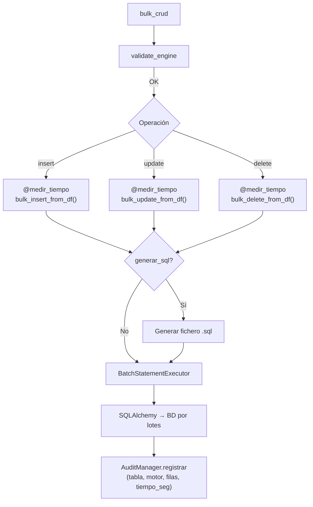

## Responsabilidad del módulo

Proporciona operaciones de INSERT, UPDATE y DELETE masivo sobre tablas existentes usando DataFrames de pandas como fuente. Internamente aplica normalización de identificadores por motor (minúsculas para Oracle/PostgreSQL, mayúsculas para MySQL/MariaDB/SQL Server/HSQLDB), divide los datos en lotes (`chunk_size`) y delega la ejecución en `BatchStatementExecutor`. Opcionalmente registra cada operación en `AuditManager` y puede generar el SQL equivalente en fichero.

Para loops de múltiples inserts sobre la misma tabla (p.ej. volcado por chunks), usar `bulk_session()` para reutilizar una única transacción y aprovechar el caché de reflexión de tabla. Para **cargas de gran volumen** existe `bulk_insert_from_chunks()`, que consume un iterable de DataFrames (p.ej. `pandas.read_sql(chunksize=N)`) resolviendo columnas e identidad una sola vez; y, para insertar **particiones disjuntas en paralelo**, la clase [`ParallelBulkLoader`](bulk-parallel.md).

## Internal Dependencies

| Dependencia | Propósito | Requerida | Comportamiento sin ella |
|---|---|---|---|
| `util.timing.medir_tiempo` | Decorator para capturar duración de operaciones bulk | Sí (incluida en pyproject.toml) | Fallback: decorator placeholder, timing=0 ms en CSV |

## Diagrama

## API pública

| Método | Firma simplificada | Descripción | Retorna |
|---|---|---|---|
| `bulk_crud` | `(engine, chunk_size?, audit_csv_path?)` | Crea instancia con engine SQLAlchemy | `bulk_crud` |
| `bulk_insert_from_df` | `(df, tabla_destino, generar_sql?, path_sql?)` | INSERT masivo desde DataFrame | `None` |
| `bulk_insert_from_chunks` | `(chunks, tabla_destino, *, override_identity?, exclude_autoincrement_pk?)` | INSERT en streaming de un iterable de DataFrames; resuelve columnas/identidad **una sola vez**. Solo ejecuta (no genera SQL). | `int` (filas insertadas) |
| `bulk_update_from_df` | `(df, tabla_destino, generar_sql?, path_sql?)` | UPDATE masivo desde DataFrame | `None` |
| `bulk_delete_from_df` | `(df, tabla_destino, generar_sql?, path_sql?)` | DELETE masivo desde DataFrame | `None` |
| `bulk_session` | `(*, atomic=True)` | Context manager para loop de inserts con 1 transacción | `Iterator[None]` |
| `reflect_table` | `(tabla_destino)` | Refleja tabla SQLAlchemy (con caché interno) | `Table` |
| `sync_pk_sequences` | `(tables=None)` | Resincroniza contadores PK (sequence / IDENTITY / AUTO_INCREMENT) al `MAX` actual. `None` = todas las tablas reflejadas en la sesión. | `list[PKSyncResult]` |

## Contrato de entrada

| Parámetro | Tipo | Descripción | Restricciones |
|---|---|---|---|
| `engine` | `Engine` | Engine síncrono de SQLAlchemy | No puede ser `None`; lanza `ValueError` si es `None` |
| `chunk_size` | `int` | Filas por lote | Default `5000`; valores muy bajos aumentan nº de round-trips a BD |
| `audit_csv_path` | `Path \| None` | Ruta del CSV de auditoría | `None` desactiva la auditoría |
| `enable_fast_executemany` | `bool` | Si `True` (default) y el engine es `mssql+pyodbc`, registra `cursor.fast_executemany = True` antes de cada `executemany`, acelerando las operaciones 5–15×. Poner a `False` si el entorno SQL Server presenta incompatibilidades con esta opción (p.ej. `NVARCHAR(MAX)` con pyodbc < 4.0.28). Sin efecto en otros motores. | Default `True` |
| `insert_resolver` | `InsertStrategyResolver \| None` | Estrategia INSERT personalizada. `None` usa resolución automática: `execute_values` para PostgreSQL+psycopg2 (3–5×), `executemany` estándar para el resto. Útil en tests o para inyectar estrategias personalizadas. | Default `None` |
| `commit_every_n_chunks` | `int \| None` | Si se indica (entero ≥ 1), commitea cada N lotes de `chunk_size` filas (commit-as-you-go) en lugar de en una única transacción, acotando el tamaño de la transacción en cargas de alto volumen. **Advertencia:** la sesión deja de ser atómica (un fallo a mitad deja committeados los lotes anteriores). | Default `None` (una sola transacción) |
| `df` | `pd.DataFrame` | Datos fuente de la operación | No puede estar vacío; columnas deben coincidir con tabla destino |
| `tabla_destino` | `str` | Nombre de la tabla en BD | La tabla debe existir; se normaliza mayúsculas/minúsculas por motor |
| `generar_sql` | `bool` | Escribir el SQL generado en fichero | Si `True`, `path_sql` es obligatorio |
| `path_sql` | `Path \| None` | Directorio base para el fichero SQL | El nombre de fichero se genera automáticamente (tabla + operación + timestamp) |

## Contrato de salida

- Los métodos de escritura (`bulk_insert_from_df`, `bulk_update_from_df`, `bulk_delete_from_df`) retornan `None`.
- `sync_pk_sequences(tables?)` retorna `list[PKSyncResult]` — uno por columna PK identity procesada. Los errores se capturan en `PKSyncResult.status = "error"` y nunca se propagan.
- Efecto secundario principal: filas modificadas en BD (escritura) o contadores PK actualizados (sync).
- Efecto secundario opcional: fichero `.sql` escrito en `path_sql` y entrada registrada en el CSV de auditoría.

## Errores y casos especiales

| Error | Cuándo ocurre |
|---|---|
| `ValueError` | `engine=None`, DataFrame vacío, `generar_sql=True` sin `path_sql`, no hay PKs para UPDATE/DELETE |
| `SQLAlchemyError` | Error al reflejar la tabla, timeout de BD, violación de constraint |

**Casos especiales:**
- **Normalización de identificadores**: Oracle, PostgreSQL y SQLite usan minúsculas; MySQL, MariaDB, SQL Server y HSQLDB usan mayúsculas. La clase detecta el dialecto desde `engine.dialect.name` y normaliza automáticamente los nombres de columna del DataFrame.
- **SQL Server (pyodbc)**: cuando `enable_fast_executemany=True` (default), registra un listener `before_cursor_execute` en el engine que activa `cursor.fast_executemany = True`. El listener se registra como máximo una vez por engine (deduplica vía `event.contains`). Poner `enable_fast_executemany=False` si el entorno lo requiere.
- **PostgreSQL (psycopg2)**: cuando `insert_resolver=None` (default) y el driver es `psycopg2`, `BulkCrud` usa automáticamente `psycopg2.extras.execute_values` para los INSERT — genera un único `INSERT ... VALUES (...), (...), ...` por chunk en lugar de N sentencias. Si psycopg2 no está disponible o la sentencia es un `TextClause` (`override_identity`), degradación automática a `executemany`.
- **SQL Server**: detecta el driver (`pymssql` vs `pyodbc`) inspeccionando `engine.url.drivername` y ajusta el `db_info` de auditoría.
- **generar_sql=True**: el fichero SQL se escribe con el nombre `{tabla}_{operacion}_{timestamp}.sql` dentro de `path_sql`. Si `path_sql` no existe o no es un directorio válido, lanza `ValueError` antes de ejecutar ninguna operación en BD.
- La auditoría se registra aunque la operación falle parcialmente (el registro refleja las filas afectadas hasta el punto de fallo).
- **`reflect_table` — Identity Map**: la reflexión de tabla (`autoload_with=engine`) se cachea en `_table_cache` por instancia. Llamadas sucesivas con el mismo nombre de tabla devuelven el objeto `Table` sin nuevo round-trip SQL. El caché es independiente por instancia (no compartido entre instancias de `BulkCrud`).
- **`bulk_session(atomic=True)`**: abre una única transacción para todos los inserts dentro del bloque. Un error en cualquier insert hace rollback completo (semántica table-atomic). Con `atomic=False` cada `bulk_insert_from_df` gestiona su propia transacción (comportamiento legacy). Si la instancia se construyó con `commit_every_n_chunks=N`, la sesión usa commit-as-you-go (commitea cada N lotes y el resto al salir) y **no** es atómica aunque `atomic=True`. `BulkCrud` no es thread-safe; no compartir instancias entre hilos.
- **`bulk_insert_from_chunks(chunks, tabla_destino)`**: inserta en streaming un iterable de DataFrames (p.ej. `pandas.read_sql(chunksize=N)`) sin materializar todo el dataset. Resuelve las columnas de inserción y la estrategia de identidad **una sola vez** a partir del primer chunk no vacío (frente a la re-resolución por chunk de `bulk_insert_from_df`). Gestiona su propio `bulk_session` (respeta `commit_every_n_chunks`); **no** debe invocarse dentro de un `bulk_session` ya abierto. Asume esquema de columnas **homogéneo** entre chunks (invariante natural de `read_sql(chunksize=...)`). Devuelve el total de filas insertadas. Para insertar varias particiones disjuntas en paralelo, ver [`ParallelBulkLoader`](bulk-parallel.md).

#### Auditoría con métricas de timing

Cada operación bulk genera automáticamente CSV audit_[operacion]_[timestamp].csv con 7 columnas exactas:

| Columna | Tipo | Ejemplo | Descripción |
|---|---|---|---|
| timestamp | datetime | 2026-05-08 14:30:45.123 | Momento inicio operación |
| tabla | str | usuarios | Tabla destino |
| motor | str | postgresql | Driver utilizado |
| operacion | str | insert | insert, update, delete |
| total_filas | int | 1250 | Filas procesadas en lote |
| tiempo_seg | float | 2.345 | **Duración capturada por util.timing** |
| sql | str | INSERT INTO usuarios (...) | SQL template generado |

**Nota**: El timing se mide automáticamente con `perf_counter()` dentro de la operación; siempre estará presente en `tiempo_seg`. Si `util.timing` no está disponible, se usa un decorator placeholder sin impacto funcional (el timing manual continúa capturándose correctamente).
