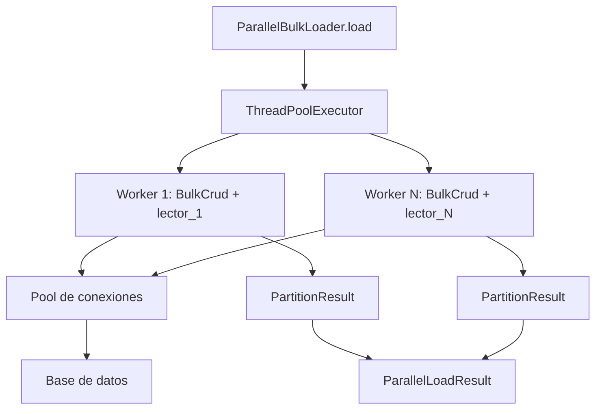

# Carga Masiva Paralela (ParallelBulkLoader)

`ParallelBulkLoader` inserta varias particiones de datos en paralelo, una `BulkCrud` por hilo, delegando la política de particionado al llamador y encargándose solo del mecanismo de paralelización.

## 1. Arquitectura y Diseño

## 2. Modelo de Datos / Contratos

### API pública

#### Clases `RangePartitioner` y `HashPartitioner`

Exportadas desde `util_bbdd.bulk`. Generan listas de particiones disjuntas para usarse como `partition_readers` en `ParallelBulkLoader.load`.

| Clase | Método | Firma simplificada | Descripción | Retorna |
|---|---|---|---|---|
| `RangePartitioner` | `partition_dataframe` | `(df, pk_col, n_partitions)` → `list[DataFrame]` | Ordena `df` por `pk_col` (int/datetime64) y devuelve N slices disjuntos | `list[pd.DataFrame]` |
| `RangePartitioner` | `partition_ranges` | `(min_val, max_val, n_partitions)` → `list[tuple[int,int]]` | Genera N rangos `(lo, hi)` inclusivos que cubren `[min_val, max_val]`. Útil para lectores SQL sin materializar el DataFrame completo | `list[tuple[int, int]]` |
| `HashPartitioner` | `partition_dataframe` | `(df, pk_col, n_partitions)` → `list[DataFrame]` | Asigna cada fila al bucket `hash(pk_col) % n_partitions`. Admite cualquier tipo hashable | `list[pd.DataFrame]` |

**Errores de `RangePartitioner`**:

| Error | Cuándo ocurre |
|---|---|
| `ValueError` | `n_partitions < 1` o `min_val > max_val` |
| `TypeError` | `pk_col` no es de tipo entero ni `datetime64` en `partition_dataframe` |

**Errores de `HashPartitioner`**:

| Error | Cuándo ocurre |
|---|---|
| `ValueError` | `pk_col` no existe en `df` o `n_partitions < 1` |

#### Clase `ParallelBulkLoader`

| Método | Firma simplificada | Descripción | Retorna |
|---|---|---|---|
| `ParallelBulkLoader` | `(engine, *, chunk_size?, max_workers?, commit_every_n_chunks?, audit_csv_path?, enable_fast_executemany?, max_retries?, disable_constraints?, audit_strict?, strip_strings?, reflect_foreign_keys?)` | Crea instancia con engine y configuración de paralelismo | `ParallelBulkLoader` |
| `load` | `(tabla_destino, partition_readers, *, override_identity?, exclude_autoincrement_pk?)` | Inserta todas las particiones en paralelo | `ParallelLoadResult` |

#### Dataclass `ParallelLoadResult`

| Atributo | Tipo | Descripción |
|---|---|---|
| `total_rows` | `int` | Suma de filas insertadas en todas las particiones |
| `partition_errors` | `list[str]` | Un mensaje por partición fallida; vacío si todo fue bien |
| `partition_results` | `list[PartitionResult]` | Resultado de cada partición: `rows`, `elapsed_seconds`, `error`, `retries` y los contadores de auditoría `audit_failures`, `audited_rows`, `unaudited_committed_rows` y `audit_uncommitted_records` |
| `audit_failures` | `int` (propiedad) | Registros de auditoría que no se pudieron escribir en el CSV, sumados de todas las particiones |
| `audited_rows` | `int` (propiedad) | Filas que constan en el CSV de auditoría, sumadas de todas las particiones |
| `unaudited_committed_rows` | `int` (propiedad) | Con `commit_every_n_chunks`: filas confirmadas en la BD que no constan en el CSV porque su operación no llegó a confirmarse entera antes de un fallo |
| `audit_uncommitted_records` | `int` (propiedad) | Con `audit_strict=True`: registros escritos en el CSV antes de un commit que falló (esas filas no están en la BD) |

**Conciliación**: con auditoría activa, `audit_failures == 0` y `audit_uncommitted_records == 0`, se cumple
`audited_rows + unaudited_committed_rows == total_rows`.

### Contrato de entrada

| Parámetro | Tipo | Descripción | Restricciones |
|---|---|---|---|
| `engine` | `Engine` | Engine SQLAlchemy de destino (thread-safe por diseño del pool) | Requerido |
| `chunk_size` | `int` | Filas por lote en cada worker | Default `5000` |
| `max_workers` | `int` | Hilos concurrentes | ≥ 1; `ValueError` si no. Se acota al número de particiones. El pool del engine debe tener capacidad ≥ `max_workers` |
| `commit_every_n_chunks` | `int \| None` | Propagado a cada `BulkCrud` worker | Default `None` |
| `audit_csv_path` | `Path \| None` | CSV de auditoría; escrituras concurrentes son seguras (lock por-ruta). Cada partición anota sus chunks al confirmarse; un intento fallido y reintentado no deja filas. Un fallo al escribir el CSV no hace fallar la partición: queda como ERROR en el log y se cuenta en `audit_failures` (salvo con `audit_strict=True`). El directorio se valida en el constructor. Sin ruta, `load()` lo avisa una vez con un INFO | Default `None`; `AuditConfigError` (subclase de `ValueError`) si no se puede crear el directorio |
| `audit_strict` | `bool` | Se pasa a la `BulkCrud` de cada partición. `False`: un fallo al escribir el CSV de auditoría no hace fallar la partición y se cuenta en `PartitionResult.audit_failures` / `ParallelLoadResult.audit_failures`. `True`: el fallo deshace esa partición y queda en `partition_errors` sin reintentarse. En modo estricto la auditoría se escribe antes del commit: si falla el commit, la partición **no se reintenta** aunque el error sea retriable (el reintento duplicaría la traza) y lo escrito se cuenta en `audit_uncommitted_records` | Default `False` |
| `strip_strings` | `bool` | Se pasa a la `BulkCrud` de cada partición: con `False` las cadenas se envían sin quitar los espacios de los extremos (`dump` lo usa) | Default `True` |
| `reflect_foreign_keys` | `bool` | Se pasa a las `BulkCrud` del loader: con `False` la reflexión de la tabla destino no lee sus claves foráneas (`dump` lo usa) | Default `True` |
| `partition_readers` | `Sequence[Callable[[], Iterable[pd.DataFrame]]]` | Un callable por partición, invocado dentro de su hilo | Las particiones deben ser disjuntas |
| `override_identity` | `bool` | Pasar por alto la columna IDENTITY/SERIAL al insertar | Default `False` |

### Contrato de salida

- `load` retorna `ParallelLoadResult` siempre, incluso si alguna partición falló.
- Sin particiones (`[]`) → `ParallelLoadResult()` vacío con `total_rows=0`.
- Los errores de partición se capturan en `partition_errors`; no se propagan como excepciones.

### Errores y casos especiales

| Error | Cuándo ocurre |
|---|---|
| `ValueError` | `max_workers < 1` |
| Error capturado en `partition_errors` | Cualquier excepción dentro de un worker (también al crear su `BulkCrud` o en el lector de la partición); el resto de workers continúan. `OperationalError` y `TimeoutError` se reintentan antes hasta `max_retries` veces. Solo `KeyboardInterrupt` y `SystemExit` interrumpen `load()` |

## 3. Componentes y Clases

| Clase | Responsabilidad |
|---|---|
| `RangePartitioner` | Genera particiones disjuntas por rango de PK entera o `datetime64`; dos variantes: DataFrame en memoria o rangos `(lo, hi)` para lectores SQL |
| `HashPartitioner` | Genera particiones disjuntas por hash de columna; admite cualquier tipo hashable |
| `ParallelBulkLoader` | Orquesta el paralelismo: `ThreadPoolExecutor` + una `BulkCrud` por hilo |
| `ParallelLoadResult` | Dataclass con el resultado agregado (filas totales + errores por partición) |

## 4. Dependencias y Requisitos

| Dependencia | Propósito | Requerida | Comportamiento sin ella |
|---|---|---|---|
| `BulkCrud` (interno) | Inserción de cada partición | Sí | Módulo no funciona |
| `sqlalchemy` | Pool de conexiones thread-safe | Sí | Módulo no funciona |
| `pandas` | DataFrames producidos por los lectores de partición | Sí | Sin pandas no hay datos que insertar |

## 5. Ejemplos Relacionados

- [Ejemplo: Carga Paralela de Millones de Filas](../examples/parallel_bulk_insert.md) — Uso completo de `ParallelBulkLoader` con lectores de partición
