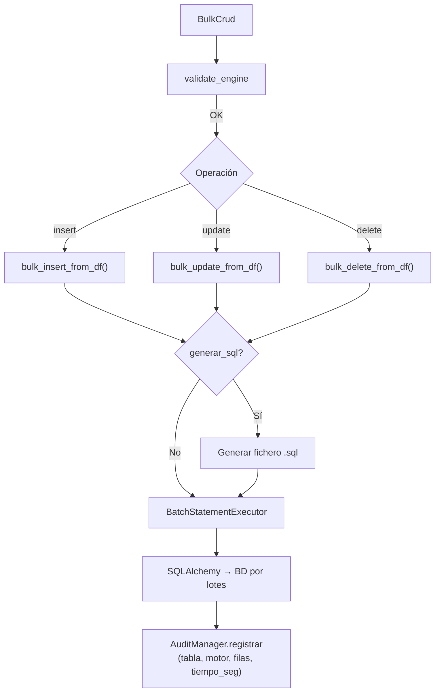

# CRUD Masivo (BulkCrud)

Proporciona operaciones de INSERT, UPDATE y DELETE masivo sobre tablas existentes usando DataFrames de pandas como fuente, con normalización de identificadores por motor, procesamiento por lotes y auditoría opcional.

## 1. Arquitectura y Diseño



## 2. Modelo de Datos / Contratos

### API pública

| Método | Firma simplificada | Descripción | Retorna |
|---|---|---|---|
| `BulkCrud` | `(engine, *, batch?, audit?, rejects?, execution?, parallel?)` | Crea instancia con engine SQLAlchemy y [paquetes de opciones](#paquetes-de-opciones-v300) (v3.0.0; hasta v2.x, 16 parámetros sueltos: [guía de migración](../guides/api_3_0_migration.md)) | `BulkCrud` |
| `bulk_insert_from_df` | `(df, tabla_destino, generar_sql?, path_sql?)` | INSERT masivo desde DataFrame | `None` |
| `bulk_insert_from_chunks` | `(chunks, tabla_destino, *, override_identity?, exclude_autoincrement_pk?)` | INSERT streaming de iterable de DataFrames; resuelve columnas/identidad una sola vez | `int` (filas insertadas) |
| `bulk_update_from_df` | `(df, tabla_destino, generar_sql?, path_sql?)` | UPDATE masivo desde DataFrame | `None` |
| `bulk_delete_from_df` | `(df, tabla_destino, generar_sql?, path_sql?)` | DELETE masivo desde DataFrame | `None` |
| `bulk_update_from_chunks` | `(chunks, tabla_destino)` | UPDATE en streaming: `bulk_update_from_df` por chunk dentro de una sola sesión; lee el iterable de forma perezosa y lo cierra al terminar | `int` (filas enviadas) |
| `bulk_delete_from_chunks` | `(chunks, tabla_destino)` | DELETE en streaming, como `bulk_update_from_chunks` | `int` (filas enviadas) |
| `last_operation_rows_committed` | propiedad | Con `commit_every_n_chunks`: filas de la última operación (o de la que falló) confirmadas por commits periódicos, es decir, su prefijo confirmado. Para reanudar: `df.iloc[n:]`, o saltar `n` filas de la secuencia en `*_from_chunks` (cuentan como una operación). 0 en modo atómico | `int` |
| `rows_rejected` | propiedad | Con `on_error="isolate"`: filas rechazadas por la instancia (acumulado), escritas en `rejects_csv_path`. No están en la BD ni en la auditoría, pero sí cuentan en `rows_committed` y `last_operation_rows_committed`, que son posiciones de la entrada para reanudar | `int` |
| `bulk_session` | `(*, atomic=True)` | Context manager para loop de inserts con 1 transacción | `Generator[None, None, None]` |
| `rejects_scope` | `(*, partition=None, row_offset=0)` | Con `on_error="isolate"`: las operaciones del bloque forman una sola secuencia para los rechazos — un presupuesto de `max_rejects` y la columna `fila` continua desde `row_offset` (p. ej. chunks con `bulk_insert_from_df` dentro de `bulk_session`, o reanudar tras `last_operation_rows_committed`); `partition` va a la columna `particion`. Sin `isolate` no hace nada; anidado → `RuntimeError` | `Generator[None, None, None]` |
| `maintenance_scope` | `(tabla_destino, disable_constraints=True, disable_indexes=False, require_optimization=False)` | Context manager que deshabilita FKs/triggers e índices para cargas >1 M filas; restaura siempre al salir. Requiere `bulk_session` activo. Con `require_optimization=True`, `RuntimeError` si no puede desactivar nada (p. ej. PostgreSQL sin ser propietario de la tabla). En Oracle, `DISABLE`/`ENABLE CONSTRAINT` confirman la transacción de la sesión; si el bloque falla, las constraints se reactivan tras el rollback de la sesión. Qué hace por motor: [guía de constraints](../guides/performance_audit_constraints_guide.md#referencia-rapida-por-motor) | `MaintenanceScopeResult` (`optimization_applied`; `constraint_results` al salir del bloque) |
| `reflect_table` | `(tabla_destino)` | Refleja tabla SQLAlchemy (con caché interno) | `Table` |
| `sync_pk_sequences` | `(tables=None)` | Resincroniza contadores PK al `MAX` actual | `list[PKSyncResult]` |
| `audit_failures` | propiedad | Registros de auditoría que no se pudieron escribir en el CSV (con `audit.strict=False`). Este y el resto de contadores de auditoría, y `rows_rejected`, incluyen los de las cargas paralelas de la instancia | `int` |
| `audited_rows` | propiedad | Filas de los registros escritos en el CSV de auditoría (incluye `generar_sql=True`) | `int` |
| `unaudited_committed_rows` | propiedad | Con `commit_every_n_chunks`: filas confirmadas por commits periódicos que no constan en el CSV porque la sesión falló antes de confirmar entera su operación | `int` |
| `audit_uncommitted_records` | propiedad | Con `audit.strict=True`: registros escritos en el CSV antes de un commit que falló | `int` |
| `options` | propiedad | Paquetes de opciones de la instancia (v3.0.0) | `BulkOptions` |
| `parallel_plan` | `(operation, rows)` | Plan de ejecución de un `bulk_*_from_df` con las `ParallelOptions` de la instancia: hilos y motivos (`reasons`). Sin `parallel`, en serie | `ParallelPlan` |
| `last_parallel_result` | propiedad | Resultado de la última carga paralela de un `bulk_*_from_df` (también tras `ParallelLoadError`); `None` si no hubo. Sus filas no cuentan en `rows_committed` | `ParallelLoadResult \| None` |

### Contrato de entrada

| Parámetro | Tipo | Descripción | Restricciones |
|---|---|---|---|
| `engine` | `Engine` | Engine síncrono de SQLAlchemy | No puede ser `None`; lanza `ValueError` si es `None` |
| `batch.chunk_size` | `int \| None` | Filas por lote. `None` elige el lote por motor y operación: 20 000 en el INSERT y el DELETE de PostgreSQL y en el DELETE de SQL Server, 5000 en el resto; con `commit_every_n_chunks`, 5000 en todas. Un entero se usa en todas las operaciones. `batch_sizes` devuelve los lotes resueltos | Default `None` (hasta v0.24.x, `5000`) |
| `audit.csv_path` | `str \| Path \| None` | Ruta del CSV de auditoría (desde v1.1.0 también `str`) | `None` desactiva la auditoría |
| `execution.fast_executemany` | `bool` | Si `True` (default) y el engine es `mssql+pyodbc`, activa `fast_executemany` en el dialecto, igual que `create_engine(..., fast_executemany=True)` (INSERT ~12× más rápido). Sin efecto en otros motores | Default `True` |
| `execution.insert_resolver` | `InsertStrategyResolver \| None` | Estrategia INSERT personalizada | Default `None` (resolución automática por motor) |
| `batch.commit_every_n_chunks` | `int \| None` | Commit cada N lotes en lugar de una sola transacción. La carga deja de ser atómica | Default `None` (una sola transacción) |
| `execution.update_via_staging` | `bool` | MySQL/MariaDB y PostgreSQL: `bulk_update_from_df` carga cada lote en una tabla temporal y aplica un único `UPDATE` con join en lugar de un UPDATE por fila (1M filas: MySQL/MariaDB ~12,5×, PostgreSQL 2,35×). Mismo resultado final; requiere el privilegio `CREATE TEMPORARY TABLES` (MySQL/MariaDB) o `TEMP` (PostgreSQL, se comprueba antes de intentarlo); sin él, vuelve al UPDATE fila a fila y registra un WARNING (una vez por instancia). Ignorado en otros motores | Default `True` |
| `batch.prefetch_blocks` | `bool` | Prepara el lote siguiente de INSERT y UPDATE en un hilo (cola de 2) mientras se envía el actual. Mismo resultado. 1M filas: SQL Server INSERT −10,6 % / UPDATE −6,2 %, MySQL y MariaDB −2 % a −6 %, Oracle/PostgreSQL/SQLite sin cambio medible | Default `False` |
| `rejects.on_error` | `"raise" \| "isolate"` | `"raise"`: un error en un lote hace fallar la operación. `"isolate"`: cada lote va en un SAVEPOINT; si falla con `IntegrityError` o `DataError` (PK duplicada, FK, valor demasiado largo...), se reenvía por mitades hasta aislar las filas que fallan, que se omiten y se escriben en `rejects.csv_path`; el resto se aplica. Otros errores se propagan. Solo INSERT, UPDATE y DELETE ejecutados (no `generar_sql`); también en `ParallelBulkLoader` (por partición) y `dump`. Coste: sin filas malas, un SAVEPOINT por lote; cada fila mala reenvía unas 2 veces su lote (ver [benchmarks](../guides/benchmarks.md#tuning-de-carga-masiva-bulk)) | Default `"raise"` |
| `rejects.csv_path` | `str \| Path \| None` | CSV de filas rechazadas (desde v1.1.0 también `str`) (UTF-8, tabuladores; se crea con cabecera o se añade): `timestamp`, `tabla`, `operacion`, `particion` (la de `ParallelBulkLoader`; vacía con `BulkCrud`), `fila` (posición base 0 en la entrada; en `*_from_chunks`, en la secuencia), `error` (clase y primera línea del error del driver) y `valores` (JSON con las columnas de la tabla). **Contiene datos de las filas**; las celdas que empiezan como una fórmula (`=`, `+`, `-`, `@`) llevan un `'` delante | Obligatorio con `on_error="isolate"`; `ValueError` sin él o si se pasa con `"raise"` |
| `rejects.max_rejects` | `int \| None` | Filas que una operación (un `*_from_chunks` es una; dentro de `rejects_scope`, todas las del bloque juntas) puede rechazar; la siguiente hace fallar la operación con su error y una nota, como sin aislamiento (lo ya escrito en el CSV se queda) | Default `None` (sin límite); entero ≥ 0; solo con `on_error="isolate"` |
| `audit.strict` | `bool` | Qué hacer si falla la escritura del CSV de auditoría (fichero abierto en Excel, disco lleno, permisos). `False`: la operación sigue, porque sus datos ya están en la BD; se registra un ERROR con los registros perdidos y se cuentan en `audit_failures`. `True`: se propaga `AuditError`/`OSError`; dentro de `bulk_session` la auditoría se escribe antes del commit y el fallo deshace la sesión. Si lo que falla es el commit, lo ya escrito se cuenta en `audit_uncommitted_records` | Default `False` |
| `audit.warn_if_disabled` | `bool` | Sin `audit_csv_path`, avisar una vez con un WARNING de que la auditoría está deshabilitada. `ParallelBulkLoader` y `dump` pasan `False` a sus instancias y avisan una sola vez por carga | Default `True` |
| `execution.strip_strings` | `bool` | Si `True`, quita los espacios de los extremos de las cadenas antes de enviarlas (INSERT, UPDATE, DELETE y SQL generado). `dump` pasa `False` para copiar el origen sin alterarlo | Default `True` |
| `execution.reflect_foreign_keys` | `bool` | Si `True`, la `Table` de `reflect_table` incluye las claves foráneas de la tabla. `BulkCrud` no las usa: con `False` no se leen y la reflexión es más barata (SQL Server: ≈ 32 → 16 ms por tabla). `dump` pasa `False` | Default `True` |
| `parallel` | `ParallelOptions \| None` | Ejecución paralela de `bulk_*_from_df`: el DataFrame se reparte en particiones disjuntas (INSERT: tramos consecutivos; UPDATE/DELETE: por PK, o `partition_column`, por rangos si es una columna entera o datetime y por hash si no) que carga `ParallelBulkLoader`, una transacción por partición. **Deja de ser atómica.** Ver [carga paralela](#carga-paralela-desde-bulkcrud-v300) | Default `None` (en serie) |
| `df` | `pd.DataFrame` | Datos fuente | No puede estar vacío; columnas deben coincidir con tabla destino |
| `tabla_destino` | `str` | Nombre de la tabla en BD | Debe existir; se normaliza mayúsculas/minúsculas por motor |
| `generar_sql` | `bool` | Escribir el SQL generado en fichero | Si `True`, `path_sql` es obligatorio |
| `path_sql` | `str \| Path \| None` | Directorio base para el fichero SQL (desde v1.1.0 también `str`) | Nombre generado automáticamente (tabla + operación + timestamp) |

### Paquetes de opciones (v3.0.0)

Los paquetes están en `util_bbdd.bulk` (y en `util_bbdd.bulk.options`). Son inmutables (`frozen`) y validan sus valores al
construirse, antes de tocar la BD. `ParallelBulkLoader` recibe los mismos.

| Paquete | Campos (default) |
|---|---|
| `BatchOptions` | `chunk_size=None`, `commit_every_n_chunks=None`, `prefetch_blocks=False` |
| `AuditOptions` | `csv_path=None`, `strict=False`, `sink=None`, `run_id=None`, `warn_if_disabled=True` |
| `RejectOptions` | `on_error="raise"`, `csv_path=None`, `max_rejects=None` |
| `ExecutionOptions` | `fast_executemany=True`, `insert_resolver=None`, `update_via_staging=True`, `strip_strings=True`, `reflect_foreign_keys=True` |
| `ParallelOptions` | `mode="manual"`, `max_workers=4`, `partition_column=None`, `min_rows=None`, `disable_constraints=False`, `retry=RetryOptions()` |
| `RetryOptions` | `max_retries=0`, `backoff=(0.5, 30.0)`, `retry_on=None` |

```python
from util_bbdd.bulk import AuditOptions, BatchOptions, BulkCrud, RejectOptions

crud = BulkCrud(
    engine,
    batch=BatchOptions(commit_every_n_chunks=20),
    audit=AuditOptions(csv_path="logs/audit.csv"),
    rejects=RejectOptions(on_error="isolate", csv_path="logs/rejects.csv", max_rejects=100),
)
```

### Carga paralela desde BulkCrud (v3.0.0)

Con `parallel=ParallelOptions(...)`, `bulk_insert_from_df`, `bulk_update_from_df` y `bulk_delete_from_df` (con
`generar_sql=False`) consultan [`ParallelPlanner`](bulk_parallel.md#planificador-parallelplanner-v300): si el plan da más de
un hilo, reparten el DataFrame y lo cargan con `ParallelBulkLoader`; si no, siguen en serie como siempre.

- `mode="manual"`: `max_workers` hilos, recortados por la capacidad del pool, SQLite (un solo escritor) y el UPDATE de
  PostgreSQL sin privilegio `TEMP`.
- `mode="auto"`: además, solo paraleliza las combinaciones de motor y operación que ganan en las mediciones del banco
  ([benchmarks](../guides/benchmarks.md#carga-paralela-por-particiones)) y desde el menor volumen medido.
- Siempre en serie: con `generar_sql=True`, dentro de `bulk_session()` (los hilos usan otras conexiones) y en las vías
  `*_from_chunks` (el iterable se recorre una sola vez y la reanudación de una partición necesita volver a leerla).
- Cada partición es una transacción: si alguna falla, las demás quedan confirmadas y se lanza `ParallelLoadError`, con el
  `ParallelLoadResult` en `exc.result` y en `last_parallel_result`.
- Con `rejects.on_error="isolate"`, el CSV de rechazos lleva la partición en `particion` y en `fila` la posición dentro de
  ella (no en el DataFrame); `max_rejects` es por partición. Dentro de `rejects_scope()` la carga va en serie.
- UPDATE y DELETE se reparten por rangos solo si la PK es una columna entera o datetime **sin repetidos**; si no, por
  hash, para que las filas con la misma clave vayan siempre a la misma partición.

```python
from util_bbdd.bulk import BulkCrud, ParallelOptions

crud = BulkCrud(engine, parallel=ParallelOptions(mode="auto"))
print(crud.parallel_plan("insert", len(df)).reasons)  # por qué irá en serie o en paralelo
crud.bulk_insert_from_df(df, "ventas", generar_sql=False)
```

### Contrato de salida

- Los métodos de escritura (`bulk_insert_from_df`, `bulk_update_from_df`, `bulk_delete_from_df`) retornan `None`.
- `bulk_insert_from_chunks` retorna `int` (filas insertadas); `bulk_update_from_chunks` y `bulk_delete_from_chunks`, las filas enviadas.
- El error de un lote lleva una nota (`exc.__notes__`) con la operación, la tabla, el lote (y el chunk en `*_from_chunks`) y las filas de la entrada: `bulk UPDATE en 'items': falló el lote 1 del chunk 3 (filas 4005–4009 de la entrada, base 0)`. El tipo y el mensaje de la excepción no cambian.
- `sync_pk_sequences` retorna `list[PKSyncResult]`; errores capturados en `PKSyncResult.status="error"`, nunca propagados.
- Efectos secundarios: filas modificadas en BD, fichero `.sql` opcional, entrada en CSV de auditoría.
- Auditoría y transacciones: fuera de `bulk_session` cada operación se anota al terminar, con sus datos ya confirmados. Dentro de `bulk_session` (y en `bulk_insert_from_chunks`, que abre la suya) se anota cuando un commit la confirma: al salir del bloque o, con `commit_every_n_chunks`, en el commit periódico. Si la sesión acaba en rollback no queda ninguna fila de auditoría de lo deshecho (se avisa con un WARNING), y reintentar la sesión no la duplica. Con `commit_every_n_chunks`, una operación que falla con parte de sus lotes ya confirmados no se anota; `rows_committed` da esas filas. Las operaciones con `generar_sql=True` no tocan la BD y se anotan al momento.

### Errores y casos especiales

| Error | Cuándo ocurre |
|---|---|
| `ValueError` | `engine=None`, DataFrame vacío, `generar_sql=True` sin `path_sql`, no hay PKs para UPDATE/DELETE |
| `SQLAlchemyError` | Error al reflejar la tabla, timeout de BD, violación de constraint |
| `AuditError` / `OSError` | Solo con `audit.strict=True`: no se pudo escribir el CSV de auditoría. Con el valor por defecto (`False`) no se lanza |
| `ParallelLoadError` | Con `parallel`: falló alguna partición de una carga paralela; las demás quedan confirmadas. `exc.result` es el `ParallelLoadResult` |
| `RuntimeError` | `bulk_insert_from_chunks`, `bulk_update_from_chunks` o `bulk_delete_from_chunks` dentro de un `bulk_session` abierto: gestionan su propia transacción (dentro de la sesión, usar `*_from_df` por chunk) |

**Aislamiento de filas (`on_error="isolate"`), límites:**

- Solo se aíslan `IntegrityError` y `DataError`. Un error estructural (columna inexistente, permisos, sintaxis) se propaga: aislarlo rechazaría todas las filas.
- Algunos drivers no clasifican el valor demasiado largo como `DataError` y entonces la operación falla como sin aislamiento: SQL Server con pyodbc y `fast_executemany` (`ProgrammingError` en el cliente) y con pymssql (2628 como `OperationalError`). PK duplicada y FK sí se aíslan en los 6 motores.
- **Oracle con oracledb** aísla con `batcherrors`: un envío por lote, sin bisección; el driver aplica las filas buenas y devuelve las erróneas con su posición. Así se aíslan también el valor demasiado largo (ORA-12899), NOT NULL (ORA-01400) y la precisión (ORA-01438). La columna `error` del CSV es `DatabaseError: ORA-xxxxx: …`. Excepción: en un UPDATE con alguna columna LOB (`Text`, `LargeBinary`, `JSON`, CLOB/BLOB) o `String` de más de 4000 caracteres (`VARCHAR2` largo con `MAX_STRING_SIZE=EXTENDED`) se usa la bisección, porque oracledb en modo thin (comprobado en 4.0.1, 4.0.2 y 26.0.1) da ORA-03106 con `batcherrors`, un bind LOB de más de 8000 caracteres y una fila mala (el INSERT no falla); ahí el demasiado largo sigue sin aislarse. Si `max_rejects` se supera dentro de un lote, se reenvía sin `batcherrors` y llega el error real del driver.
- Si casi todas las filas fallan (p. ej. recargar datos ya cargados), la bisección acaba enviando fila a fila: usar `max_rejects`.
- La auditoría registra las filas aplicadas (enviadas − rechazadas).
- Los rechazos se escriben al detectarse: si después la operación o la sesión se deshacen por otra causa, el CSV los conserva.
- Si no se puede escribir el CSV de rechazos (p. ej. abierto en Excel), la operación falla con `OSError` y la nota «bulk: no se pudo escribir el CSV de rechazos»: no se pierde ningún rechazo en silencio. El detalle por fila va al log en DEBUG; el resumen de la operación, en WARNING.
- Con la misma PK repetida en un lote, aislar puede cambiar cuál de las filas se aplica.
- En SQLite (pysqlite), si la transacción aún no ha empezado se emite `BEGIN` antes del primer SAVEPOINT; si no, el `RELEASE` del SAVEPOINT confirmaba el lote fuera de la sesión.
- SQLite con `sqlite3` en `autocommit=True` (`connect_args={"autocommit": True}`): `ValueError` antes de enviar nada, porque no hay transacción que proteja los SAVEPOINT (las filas no se confirmaban y la BD quedaba bloqueada). El modo `isolation_level="AUTOCOMMIT"` de SQLAlchemy funciona.
- SQL Server con `XACT_ABORT ON`: el primer error de datos deshace la transacción entera y no se puede aislar; llega ese error (`IntegrityError`/`DataError`) con una nota que lo explica, y no se aplica nada. Sin filas malas la carga funciona.
- El CSV de rechazos se escribe con el mismo lock por ruta que la auditoría (entre hilos de un proceso, no entre procesos). Si ya existe con otra cabecera, se aparta como `<nombre>.invalid-<fecha>.csv` con un WARNING y se empieza uno nuevo.

**Estrategias INSERT por motor** (cuando `insert_resolver=None`):

| Motor / driver | Estrategia |
|---|---|
| `postgresql` + `psycopg` (psycopg3) | `COPY ... FROM STDIN` — vía más rápida de PostgreSQL |
| `postgresql` + `psycopg2` | `psycopg2.extras.execute_values` — un único `INSERT ... VALUES` multi-fila por chunk |
| `mysql` / `mariadb` + `pymysql` | `executemany` del driver sin procesadores de tipo (PyMySQL lo envía como `INSERT ... VALUES` multi-fila) |
| `mysql` / `mariadb` + `mariadbconnector` | `executemany` del driver (envío masivo) si cada columna del lote tiene un único tipo Python (sin contar `None`); si no, `INSERT ... VALUES` multi-fila |
| `mysql` / `mariadb` + otro driver | `INSERT ... VALUES` multi-fila sub-loteado en grupos de 1000 filas |
| `oracle`, `mssql`, `sqlite`, `hsqldb` | `executemany` estándar de SQLAlchemy |

## 3. Componentes y Clases

| Clase | Responsabilidad |
|---|---|
| `BulkCrud` | Fachada pública para operaciones bulk; gestiona normalización, lotes y auditoría |
| `BatchStatementExecutor` | Ejecuta sentencias SQL por lotes sobre una conexión SQLAlchemy |
| `Isolator` / `RejectsWriter` (`bulk/_support/rejects.py`, internos) | SAVEPOINT por lote y bisección de `on_error="isolate"`; escritura del CSV de rechazos |
| `InsertStrategyResolver` | Selecciona la estrategia INSERT óptima según motor y driver |

## 4. Dependencias y Requisitos

| Dependencia | Propósito | Requerida | Comportamiento sin ella |
|---|---|---|---|
| `util.timing.medir_tiempo` | Decorator para capturar duración de operaciones bulk | Sí (incluida en pyproject.toml) | Fallback: decorator placeholder; timing=0 ms en CSV de auditoría |
| `pandas` | DataFrame como fuente de datos | Sí | Sin pandas no hay datos para insertar |
| `sqlalchemy` | Reflexión de tabla, ejecución de sentencias | Sí | Módulo no funciona sin SQLAlchemy |

## 5. Ejemplos Relacionados

- [Ejemplo: Bulk Insert desde CSV con Auditoría](../examples/bulk_insert_csv.md) — Carga un CSV con `BulkCrud`, auditoría incluida
- [Ejemplo: Carga Paralela de Millones de Filas](../examples/parallel_bulk_insert.md) — Uso de `bulk_insert_from_chunks` con particionado
- [Ejemplo: Benchmark — Impacto de commit_every_n_chunks](../examples/benchmark_commit_cadence.md) — Ajuste de cadencia de commit para alto volumen
