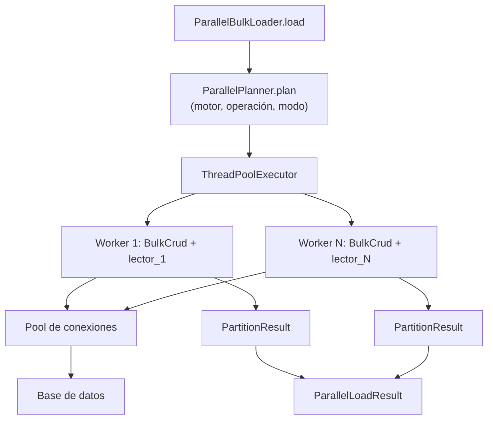

# Carga Masiva Paralela (ParallelBulkLoader)

`ParallelBulkLoader` inserta varias particiones de datos en paralelo, una `BulkCrud` por hilo, delegando la política de particionado al llamador y encargándose solo del mecanismo de paralelización.

## 1. Arquitectura y Diseño

## 2. Modelo de Datos / Contratos

### API pública

#### Clases `RangePartitioner` y `HashPartitioner`

Exportadas desde `util_bbdd.bulk`. Generan listas de particiones disjuntas para usarse como `partition_readers` en `ParallelBulkLoader.load`.

| Clase | Método | Firma simplificada | Descripción | Retorna |
|---|---|---|---|---|
| `RangePartitioner` | `partition_dataframe` | `(df, pk_col, n_partitions)` → `list[DataFrame]` | Ordena `df` por `pk_col` (int/datetime64) y devuelve N slices disjuntos | `list[pd.DataFrame]` |
| `RangePartitioner` | `partition_ranges` | `(min_val, max_val, n_partitions)` → `list[tuple[int,int]]` | Genera N rangos `(lo, hi)` inclusivos que cubren `[min_val, max_val]`. Útil para lectores SQL sin materializar el DataFrame completo | `list[tuple[int, int]]` |
| `RangePartitioner` | `validate_disjoint` | `(ranges, n_readers)` | Valida que los rangos `(lo, hi)` sean disjuntos y que haya uno por lector (v3.0.0; lo usa `partition_ranges`) | `None` |
| `RangePartitioner` | `is_rangeable` | `(series)` | `True` si la columna es entera o `datetime64` (v3.0.0) | `bool` |
| `HashPartitioner` | `partition_dataframe` | `(df, pk_col, n_partitions)` → `list[DataFrame]` | Asigna cada fila al bucket `hash(pk_col) % n_partitions`. Admite cualquier tipo hashable y, desde v3.0.0, varias columnas (`pk_col` como lista, p. ej. una PK compuesta) | `list[pd.DataFrame]` |

**Errores de `RangePartitioner`**:

| Error | Cuándo ocurre |
|---|---|
| `ValueError` | `n_partitions < 1` o `min_val > max_val` |
| `TypeError` | `pk_col` no es de tipo entero ni `datetime64` en `partition_dataframe` |

**Errores de `HashPartitioner`**:

| Error | Cuándo ocurre |
|---|---|
| `ValueError` | Alguna columna de `pk_col` no existe en `df`, `pk_col` está vacía o `n_partitions < 1` |

#### Clase `ParallelBulkLoader`

| Método | Firma simplificada | Descripción | Retorna |
|---|---|---|---|
| `ParallelBulkLoader` | `(engine, *, batch?, audit?, rejects?, execution?, parallel?)` | Crea instancia con engine y los mismos [paquetes de opciones](bulk_crud.md#paquetes-de-opciones-v300) que `BulkCrud` (v3.0.0; hasta v2.x, 17 parámetros sueltos). Cada worker recibe los paquetes tal cual | `ParallelBulkLoader` |
| `options` | propiedad | Paquetes de opciones del loader (`parallel` nunca es `None`) | `BulkOptions` |
| `load` | `(tabla_destino, partition_readers, *, partition_ranges?, override_identity?, exclude_autoincrement_pk?)` | Inserta todas las particiones en paralelo | `ParallelLoadResult` |
| `update` | `(tabla_destino, partition_readers, *, partition_ranges?)` | Actualiza en paralelo (`bulk_update_from_chunks` por partición). Particiones disjuntas por PK. En PostgreSQL sin privilegio `TEMP` (o con `execution.update_via_staging=False`) usa un solo hilo (WARNING) | `ParallelLoadResult` |
| `delete` | `(tabla_destino, partition_readers, *, partition_ranges?)` | Borra en paralelo (`bulk_delete_from_chunks` por partición). Particiones disjuntas por PK | `ParallelLoadResult` |

### Planificador `ParallelPlanner` (v3.0.0)

`ParallelPlanner.plan(PlanInput(...)) -> ParallelPlan` decide los hilos de una carga. Lo usan `ParallelBulkLoader`,
`BulkCrud` (`parallel=ParallelOptions(...)`) y `dump` (`parallel_pk_ranges="auto"`). Es una función pura: los hechos del
entorno (capacidad del pool, privilegio `TEMP`) los obtiene quien llama.

| Modo | Reglas |
|---|---|
| `"off"` | Un hilo |
| `"manual"` | Los hilos pedidos, recortados por las **reglas de seguridad**: capacidad del pool, SQLite (un solo escritor: con varios, `database is locked`; v3.0.0) y el UPDATE de PostgreSQL fila a fila (sin `TEMP` o sin `update_via_staging`), que empeora con cada hilo |
| `"auto"` | Seguridad y además las **reglas medidas** (`ParallelPlanner.RULES`): paraleliza si la mejor aceleración medida es de al menos 1,5×, con los hilos del mejor tiempo, y solo desde el menor volumen medido (`ParallelOptions.min_rows` lo cambia). Lo no medido va en serie |

Reglas medidas con los datos ya en memoria (fuente: [benchmarks](../guides/benchmarks.md#carga-paralela-por-particiones)):

| Motor | INSERT (desde 50K filas) | UPDATE (desde 1M) | DELETE (desde 1M) |
|---|---|---|---|
| SQL Server | 4 hilos | 4 hilos | 4 hilos |
| MySQL | 4 hilos | 4 hilos (con tabla temporal) | 2 hilos |
| MariaDB | 4 hilos | 4 hilos (con tabla temporal) | 2 hilos |
| PostgreSQL | En serie (≤ 1,2×) | 4 hilos (con `TEMP`) | 4 hilos |
| Oracle | En serie (≤ 1,04× con 200K y 1M) | En serie (≤ 1,04×) | En serie (≤ 1,15×) |
| SQLite, HSQLDB | En serie | En serie | En serie |

Cuando cada hilo lee además su rango del origen (`dump`), solo gana SQL Server (4 rangos, −37 % a 3,5M filas); el resto va
en serie. `ParallelLoadResult.plan.reasons` y `BulkCrud.parallel_plan()` dicen qué regla se aplicó.

#### Dataclass `ParallelLoadResult`

| Atributo | Tipo | Descripción |
|---|---|---|
| `total_rows` | `int` | Suma de filas insertadas en todas las particiones |
| `elapsed_seconds` | `float` | Duración total de la operación |
| `audit_run_id` | `str \| None` | Identificador de la ejecución en los eventos de `audit.sink` ([auditoría](audit.md)) |
| `plan` | `ParallelPlan \| None` | Hilos usados (`workers`) y por qué (`reasons`), según [`ParallelPlanner`](#planificador-parallelplanner-v300) (v3.0.0); `None` sin particiones |
| `partition_errors` | `list[str]` | Un mensaje por partición fallida; vacío si todo fue bien |
| `partition_results` | `list[PartitionResult]` | Resultado de cada partición: `index`, `rows`, `elapsed_seconds`, `error`, `retries`, `retry_wait_seconds`, `rows_rejected` y los contadores de auditoría `audit_failures`, `audited_rows`, `unaudited_committed_rows` y `audit_uncommitted_records` |
| `rows_per_second` | `float` (propiedad) | `total_rows / elapsed_seconds` |
| `audit_failures` | `int` (propiedad) | Registros de auditoría que no se pudieron escribir en el CSV, sumados de todas las particiones |
| `audited_rows` | `int` (propiedad) | Filas que constan en el CSV de auditoría, sumadas de todas las particiones |
| `unaudited_committed_rows` | `int` (propiedad) | Con `commit_every_n_chunks`: filas confirmadas en la BD que no constan en el CSV porque su operación no llegó a confirmarse entera antes de un fallo |
| `audit_uncommitted_records` | `int` (propiedad) | Con `audit_strict=True`: registros escritos en el CSV antes de un commit que falló (esas filas no están en la BD) |
| `rows_rejected` | `int` (propiedad) | Con `on_error="isolate"`: filas apartadas al CSV de rechazos, sumadas de todas las particiones. Cuentan en `total_rows` (posiciones), no en la BD ni en la auditoría: sin fallos, `audited_rows + rows_rejected + unaudited_committed_rows == total_rows` |

**Conciliación**: con auditoría activa, `audit_failures == 0`, `audit_uncommitted_records == 0` y sin
`partition_errors`, se cumple `audited_rows + rows_rejected + unaudited_committed_rows == total_rows` (`rows_rejected`
es 0 sin `on_error="isolate"`). Una partición fallida no suma a `total_rows` lo que se deshizo, pero los rechazos que
ya había escrito siguen en el CSV y en `rows_rejected`.

### Contrato de entrada

| Parámetro | Tipo | Descripción | Restricciones |
|---|---|---|---|
| `engine` | `Engine` | Engine SQLAlchemy de destino (thread-safe por diseño del pool) | Requerido |
| `batch.chunk_size` | `int \| None` | Filas por lote en cada worker; `None` usa el lote por motor y operación de `BulkCrud` | Default `None` (hasta v0.24.x, `5000`) |
| `parallel.mode` | `"off" \| "manual" \| "auto"` | Quién decide los hilos de cada carga: ver [planificador](#planificador-parallelplanner-v300) | Default `"manual"` (como hasta v2.x) |
| `parallel.max_workers` | `int` | Hilos concurrentes (en `"auto"`, el tope). Con 4 hilos (1M filas, v0.26.0): SQL Server 2,7×, MySQL/MariaDB 1,7×; PostgreSQL con psycopg 3 1,05× (el cliente no escala con hilos), Oracle 1,14×, SQLite sin ganancia. En PostgreSQL sin privilegio `TEMP`, `update()` usa un solo hilo. Ver [benchmarks](../guides/benchmarks.md#carga-paralela-por-particiones) | ≥ 1; `ValueError` si no. Se acota al número de particiones. Si supera la capacidad del pool (`pool_size + max_overflow`), se reduce a ella con un WARNING |
| `batch.commit_every_n_chunks` | `int \| None` | Propagado a cada `BulkCrud` worker | Default `None` |
| `audit.csv_path` | `str \| Path \| None` | CSV de auditoría (desde v1.1.0 también `str`); escrituras concurrentes son seguras (lock por-ruta). Cada partición anota sus chunks al confirmarse; un intento fallido y reintentado no deja filas. Un fallo al escribir el CSV no hace fallar la partición: queda como ERROR en el log y se cuenta en `audit_failures` (salvo con `audit_strict=True`). El directorio se valida en el constructor. Sin ruta, `load()` lo avisa una vez con un INFO | Default `None`; `AuditConfigError` (subclase de `ValueError`) si no se puede crear el directorio |
| `rejects.on_error` | `"raise" \| "isolate"` | Como en [`BulkCrud`](bulk_crud.md): con `"isolate"` cada partición aparta sus filas con errores de datos a `rejects_csv_path` y aplica el resto. El CSV es común (lock por ruta entre hilos); la columna `particion` lleva el índice de la partición y `fila` la posición dentro de ella (también tras reanudar con `commit_every_n_chunks` y con `disable_constraints=True`, que carga la partición chunk a chunk; cada intento va en un `BulkCrud.rejects_scope`). Si un intento que ya escribió rechazos falla después, la partición **no se reintenta** aunque el error sea transitorio (reintentar los duplicaría en el CSV) y queda en `partition_errors`. Con `disable_constraints=True` las FK no fallan: se aíslan PK duplicadas y errores de tipo | Default `"raise"`; mismas reglas de validación que `BulkCrud` (`ValueError` antes de lanzar hilos) |
| `rejects.csv_path` | `str \| Path \| None` | CSV de rechazos común a todas las particiones (desde v1.1.0 también `str`) | Obligatorio con `on_error="isolate"` |
| `rejects.max_rejects` | `int \| None` | Filas que **cada partición** puede rechazar (con N particiones, hasta N × `max_rejects` en total); la siguiente hace fallar esa partición, sin parar las demás | Default `None` (sin límite) |
| `audit.strict` | `bool` | Se pasa a la `BulkCrud` de cada partición. `False`: un fallo al escribir el CSV de auditoría no hace fallar la partición y se cuenta en `PartitionResult.audit_failures` / `ParallelLoadResult.audit_failures`. `True`: el fallo deshace esa partición y queda en `partition_errors` sin reintentarse. En modo estricto la auditoría se escribe antes del commit: si falla el commit, la partición **no se reintenta** aunque el error sea retriable (el reintento duplicaría la traza) y lo escrito se cuenta en `audit_uncommitted_records` | Default `False` |
| `execution.strip_strings` | `bool` | Se pasa a la `BulkCrud` de cada partición: con `False` las cadenas se envían sin quitar los espacios de los extremos (`dump` lo usa) | Default `True` |
| `execution.reflect_foreign_keys` | `bool` | Se pasa a las `BulkCrud` del loader: con `False` la reflexión de la tabla destino no lee sus claves foráneas (`dump` lo usa) | Default `True` |
| `execution` (resto) | `ExecutionOptions` | `fast_executemany`, `insert_resolver` (compartido entre hilos: debe ser thread-safe) y `update_via_staging` llegan a cada worker (hasta v2.x, `insert_resolver` y `update_via_staging` no llegaban) | — |
| `batch.prefetch_blocks` | `bool` | Llega a cada worker: un hilo de preparación por partición, además del suyo | Default `False` |
| `parallel.disable_constraints` | `bool` | Solo `load()`: desactiva las constraints durante la carga (SQL Server y PostgreSQL, una vez antes de lanzar los hilos; el resto, cada worker con `maintenance_scope`). Nunca los índices (lock DDL global en SQL Server) | Default `False`; requiere permisos DDL |
| `parallel.retry.max_retries` | `int` | Reintentos de una partición ante errores **transitorios**, decididos por el código del error: desconexiones, deadlocks (PostgreSQL `40P01`, MySQL 1213, SQL Server 1205, Oracle ORA-00060), lock wait timeout, serialización y timeouts. Los errores de datos, integridad, sintaxis o permisos no se reintentan (hasta v0.23.x se decidía por clase `OperationalError`) | Default `0`; ≥ 0. Con `commit_every_n_chunks`, el reintento **reanuda** la partición tras sus filas ya confirmadas (el lector debe dar las filas en el mismo orden en cada llamada); en modo atómico la reintenta entera. Hasta v0.23.x la combinación lanzaba `ValueError` |
| `parallel.retry.backoff` | `tuple[float, float]` | `(base, máximo)` en segundos: antes de cada reintento espera un valor aleatorio entre 0 y `min(máximo, base · 2**(intento − 1))` (backoff exponencial con jitter completo). `(0, 0)` reintenta sin esperar | Default `(0.5, 30.0)`; números finitos ≥ 0 |
| `parallel.retry.retry_on` | `Callable[[BaseException], bool] \| None` | Criterio propio de reintento | Default `None` (`is_retriable`) |
| `partition_readers` | `Sequence[PartitionReader]` (`Callable[[], Iterable[pd.DataFrame]]`) | Un callable por partición, invocado dentro de su hilo | Las particiones deben ser disjuntas |
| `partition_ranges` | `Sequence[tuple[int, int]] \| None` | Rango de PK de cada partición, en el mismo orden que los lectores | Uno por lector y sin solapes (`ValueError` si no) |
| `override_identity` | `bool` | Solo PostgreSQL: `INSERT … OVERRIDING SYSTEM VALUE` para columnas `GENERATED ALWAYS AS IDENTITY`; se ignora en el resto | Default `False` |
| `exclude_autoincrement_pk` | `bool` | Quita del `INSERT` la PK autoincremental/identity (la genera la BD) | Default `False` |

### Contrato de salida

- `load` retorna `ParallelLoadResult` siempre, incluso si alguna partición falló.
- Sin particiones (`[]`) → `ParallelLoadResult()` vacío con `total_rows=0`.
- Los errores de partición se capturan en `partition_errors`; no se propagan como excepciones.

### Errores y casos especiales

| Error | Cuándo ocurre |
|---|---|
| `ValueError` | Al construir un paquete no válido (`max_workers < 1`, `max_retries < 0`, `backoff` no válido...), o `partition_ranges` solapados o en distinto número que los lectores |
| Error capturado en `partition_errors` | Cualquier excepción dentro de un worker (también al crear su `BulkCrud` o en el lector de la partición); el resto de workers continúan. Los errores transitorios (ver `parallel.retry.max_retries`) se reintentan antes hasta `max_retries` veces, con la espera de `backoff`. Solo `KeyboardInterrupt` y `SystemExit` interrumpen `load()` |

## 3. Componentes y Clases

| Clase | Responsabilidad |
|---|---|
| `RangePartitioner` | Genera particiones disjuntas por rango de PK entera o `datetime64`; dos variantes: DataFrame en memoria o rangos `(lo, hi)` para lectores SQL |
| `HashPartitioner` | Genera particiones disjuntas por hash de columna; admite cualquier tipo hashable |
| `ParallelPlanner` | Decide los hilos de una carga (reglas de seguridad y, en `"auto"`, mediciones por motor y operación); función pura, sin SQL |
| `ParallelBulkLoader` | Orquesta el paralelismo: `ThreadPoolExecutor` + una `BulkCrud` por hilo |
| `ParallelLoadResult` | Dataclass con el resultado agregado (filas totales + errores por partición) |

## 4. Dependencias y Requisitos

| Dependencia | Propósito | Requerida | Comportamiento sin ella |
|---|---|---|---|
| `BulkCrud` (interno) | Inserción de cada partición | Sí | Módulo no funciona |
| `sqlalchemy` | Pool de conexiones thread-safe | Sí | Módulo no funciona |
| `pandas` | DataFrames producidos por los lectores de partición | Sí | Sin pandas no hay datos que insertar |

## 5. Ejemplos Relacionados

- [Ejemplo: Carga Paralela de Millones de Filas](../examples/parallel_bulk_insert.md) — Uso completo de `ParallelBulkLoader` con lectores de partición
