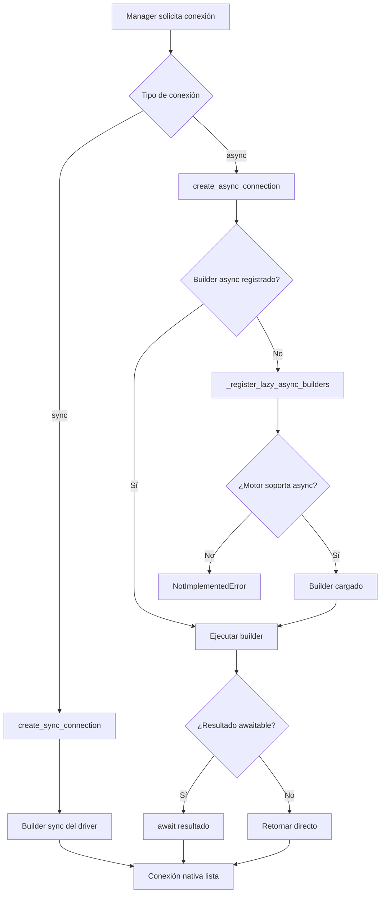

## Responsabilidad del módulo

Factory centralizado para crear conexiones nativas sync y async según el tipo de motor. Mantiene un registro de builders async (uno por motor), los carga bajo demanda (lazy loading) y verifica si el motor soporta conexiones asíncronas antes de intentar crearlas. Los managers nunca importan drivers directamente: siempre pasan por `ConnectionFactory`.

## Diagrama

## API pública

| Función/Clase | Firma simplificada | Descripción | Retorna |
|---|---|---|---|
| `ConnectionFactory` | — | Factory (no se instancia; todos sus métodos son `@staticmethod`) | — |
| `register_async_connection` | `(db_type, builder)` *(estático)* | Registra builder async para un motor | `None` |
| `create_async_connection` | `async (db_type, conn_params, **kwargs)` *(estático)* | Crea conexión async con lazy loading | `Any` |
| `create_sync_connection` | `(db_type, conn_params, **kwargs)` *(estático)* | Crea conexión sync nativa del motor | `Any` |

## Contrato de entrada

| Parámetro | Tipo | Descripción | Restricciones |
|---|---|---|---|
| `db_type` | `str` | Tipo de motor de base de datos | Se normaliza a minúsculas; debe ser un motor reconocido |
| `conn_params` | `dict[str, Any]` | Parámetros de conexión nativos del driver | Estructura específica por motor y driver |
| `builder` | `Callable[..., Any]` | Callable que recibe `conn_params` y retorna conexión o corrutina | Puede ser corrutina (async) o función síncrona; `ConnectionFactory` detecta y adapta |
| `**kwargs` | `Any` | Parámetros adicionales al builder | Opcionales; se pasan directamente al builder del driver |

## Contrato de salida

- **`create_async_connection`** — objeto de conexión async del driver (`asyncpg.Connection`, `aiomysql.Connection`, etc.); tipo opaco dependiente del motor.
- **`create_sync_connection`** — objeto de conexión sync (`pyodbc.Connection`, `cx_Oracle.Connection`, etc.); tipo opaco dependiente del motor.
- **`register_async_connection`** — `None`; efecto secundario: registra el builder en `_async_connection_builders` (dict de clase compartido).

## Errores y casos especiales

| Error | Cuándo ocurre |
|---|---|
| `NotImplementedError` | `create_async_connection` cuando el motor no tiene soporte async declarado (`is_async_supported` retorna `False`) |
| `ValueError` | Builder async no disponible y `is_async_supported` retorna `True` pero no hay builder registrado (inconsistencia de registro) |
| `ConnectionError` | El builder falla al crear la conexión (credenciales incorrectas, servidor no alcanzable) |

**Casos especiales:**
- `_async_connection_builders` es un atributo de **clase** (no de instancia), compartido entre todos los usos de `ConnectionFactory` en el proceso. Llamar a `register_async_connection` una vez tiene efecto global.
- El lazy loading se activa en la primera llamada por motor: si el builder no está pre-registrado, `_register_lazy_async_builders` lo importa dinámicamente. Drivers no instalados generan `ImportError` en este punto, no al importar la librería.
- Si el builder retorna algo awaitable, `ConnectionFactory` hace el `await` internamente — el llamador recibe la conexión ya resuelta, no una corrutina.
