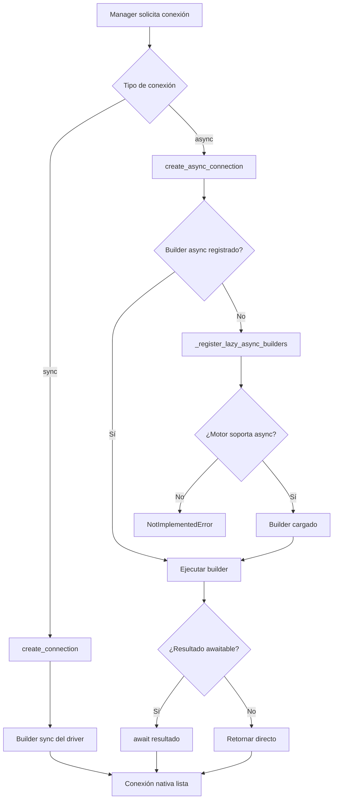

# Factory de Conexiones (ConnectionFactory)

Factory centralizado para crear conexiones nativas sync y async según el tipo de motor, con registro lazy de builders por motor y verificación de soporte async antes de intentar la conexión.

## 1. Arquitectura y Diseño

## 2. Modelo de Datos / Contratos

### API pública

| Función/Clase | Firma simplificada | Descripción | Retorna |
|---|---|---|---|
| `ConnectionFactory` | — | Factory de solo métodos estáticos; no se instancia. Se importa de `util_bbdd.factory` (o `util_bbdd.connection`) | — |
| `register_async_connection` | `(db_type, builder)` *(estático)* | Registra builder async para un motor | `None` |
| `create_async_connection` | `async (db_type, conn_params, **kwargs)` *(estático)* | Crea conexión async con lazy loading | `Any` |
| `create_connection` | `(db_type, conn_params, db_validator=None, sql_server_driver="pymssql", found_rows=False)` *(estático)* | Crea conexión sync nativa del motor. `sql_server_driver`: `"pymssql"` o `"pyodbc"` (los managers pasan el suyo); `found_rows`: `CLIENT.FOUND_ROWS` en MariaDB/MySQL | `Any` |

### Contrato de entrada

| Parámetro | Tipo | Descripción | Restricciones |
|---|---|---|---|
| `db_type` | `str` | Tipo de motor | Se normaliza a minúsculas |
| `conn_params` | `dict[str, Any]` | Parámetros de conexión ya filtrados para el motor | Estructura específica por motor ([guía de conexión](../guides/connection_guide.md)) |
| `builder` | `Callable[..., Any]` | Callable que recibe `conn_params` y retorna conexión o corrutina | Puede ser sync o async; `ConnectionFactory` detecta y adapta |

### Contrato de salida

- **`create_async_connection`** — conexión async del driver (`asyncpg.Connection`, `aiomysql.Connection`, etc.); tipo opaco.
- **`create_connection`** — conexión sync del driver (`sqlite3.Connection`, `pyodbc.Connection`, etc.); tipo opaco.
- **`register_async_connection`** — `None`; efecto secundario: registra el builder en el dict de clase compartido.

### Errores y casos especiales

| Error | Cuándo ocurre |
|---|---|
| `InvalidDatabaseType` | `create_connection` con un `db_type` no soportado |
| `NotImplementedError` | `create_async_connection` con un motor sin soporte async (HSQLDB) |
| `ValueError` | Builder async no disponible y motor declarado como async soportado |
| `ConnectionError` | Builder falla al crear la conexión (credenciales, servidor no alcanzable) |

`_async_connection_builders` es un atributo de clase compartido globalmente; `register_async_connection` una vez tiene efecto global en el proceso.

## 3. Componentes y Clases

*No aplica para este módulo.* `ConnectionFactory` es la única clase del módulo y no se instancia.

## 4. Dependencias y Requisitos

| Dependencia | Propósito | Requerida | Comportamiento sin ella |
|---|---|---|---|
| Driver Python del motor | Conexión nativa con la BD | Sí (motor-específico) | `ImportError` en lazy loading al primer uso |

### Parámetros driver-específicos

Ciertos parámetros en `conn_params` son consumidos por drivers específicos y pasan transparentemente
a través de la factoría:

| Motor | Parámetro | Valor por defecto | Propósito | Mínima versión |
|---|---|---|---|---|
| `mariadb` | `charset` | `utf8mb4` | Charset de la conexión async (aiomysql); el conector sync trabaja siempre en utf8mb4 | cualquiera |
| `mariadb` | `init_command` | `"SET NAMES utf8mb4"` | SQL ejecutado en cada conexión sync/pool | v0.35.0+ |
| `mariadb` | `encoding_errors` | — | Obsoleto y sin efecto: ningún driver de MariaDB lo admite (`FutureWarning`) | — |

Para MariaDB: MariaDB Connector/Python (1.1.14, la última) no admite `charset` ni `encoding_errors`; la librería no
se los envía. Si un driver antiguo rechaza `init_command`, el pool lo ejecuta a mano en cada `get_connection()`.

Ver [Guía: Conexión § 6 — Parámetros especiales de MariaDB](../guides/connection_guide.md#6-parametros-especiales-de-mariadb-init_command-y-encoding_errors)
para más detalles.

## 5. Ejemplos Relacionados

- [Ejemplo: Conexiones Nativas con ConnectionFactory](../examples/connection_factory_example.md) — conexión sync y async sin pool sobre SQLite y rechazo de un motor no soportado
- [Ejemplo: Conectar e Introspeccionar Base de Datos](../examples/example_connect_introspect.md) — el uso habitual, a través de un manager
