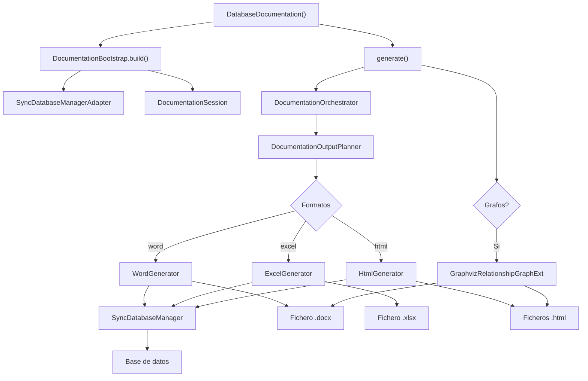

# Generador de Documentación de BD (DatabaseDocumentation)

Fachada pública que orquesta la generación de documentación de bases de datos en múltiples formatos mediante una arquitectura interna de bootstrap, sesión, planner y renderers. El constructor prepara metadatos iniciales; `generate()` dispara la escritura de ficheros.

## 1. Arquitectura y Diseño

## 2. Modelo de Datos / Contratos

### API pública

| Método | Firma simplificada | Descripción | Retorna |
|---|---|---|---|
| `DatabaseDocumentation` | `(db_manager, directorio_salida?, fichero_salida?, imprimir?, formatos?, headers_file?)` | Configura estado y carga metadatos iniciales | `DatabaseDocumentation` |
| `generate` | `()` | Genera documentación para todos los formatos configurados | `None` |

### Contrato de entrada

| Parámetro | Tipo | Descripción | Restricciones |
|---|---|---|---|
| `db_manager` | `DocumentationSourcePort` | Fuente de metadatos y consultas, normalmente un `SyncDatabaseManager` con conexión activa | No puede ser `None`; debe cumplir el puerto (`doc/application/ports.py`); no soporta `AsyncDatabaseManager` |
| `directorio_salida` | `Path` | Directorio base donde escribir ficheros | Se crean subdirectorios por ejecución y formato |
| `fichero_salida` | `Path \| None` | Nombre base sin extensión | `None` genera automáticamente con timestamp y clave de BD |
| `imprimir` | `dict[str, Any] \| None` | Configuración de secciones, estilos y grafos | `None` usa valores por defecto |
| `formatos` | `list[str] \| None` | `["word"]`, `["excel"]`, `["html"]` o combinaciones | `None` usa `["word"]`; valores inválidos lanzan `ValueError` |

### Contrato de salida

- `generate()` retorna `None`; los ficheros se escriben en `directorio_salida`.
- **Word** → fichero `.docx` bajo `WORD/`.
- **Excel** → fichero `.xlsx` bajo `EXCEL/`.
- **HTML** → sitio HTML bajo `HTML/`.
- Los grafos se insertan como imágenes generadas por Graphviz en Word y HTML cuando están configurados.

### Errores y casos especiales

| Error | Cuándo ocurre |
|---|---|
| Error de `SyncDatabaseManager` | Conexión caída o permisos insuficientes durante la consulta de metadatos |
| `ValueError` | `formatos` contiene valores inválidos o queda vacío |
| `FileNotFoundError` | Plantilla Word o fichero de headers inexistente cuando se configure explícitamente |

## 3. Componentes y Clases

| Clase | Responsabilidad |
|---|---|
| `DatabaseDocumentation` | Fachada pública; separa configuración (`__init__`) de ejecución (`generate()`) |
| `DocumentationBootstrap` | Preparación del adaptador y sesión de documentación |
| `DocumentationOrchestrator` | Coordinación del flujo de generación por formato |
| `HtmlGenerator` / `ExcelGenerator` / `WordGenerator` | Renderers específicos por formato de salida |

## 4. Dependencias y Requisitos

| Dependencia | Propósito | Requerida | Comportamiento sin ella |
|---|---|---|---|
| `SyncDatabaseManager` | Proveedor de metadatos desde BD | Sí | Módulo no funciona |
| `python-docx` | Generación de documentos Word | Solo para `word` | Error al intentar generar Word |
| `openpyxl` | Generación de hojas Excel | Solo para `excel` | Error al intentar generar Excel |
| `Jinja2` | Generación de HTML | Solo para `html` | Error al intentar generar HTML |
| `graphviz` + binarios | Generación de grafos | Opcional | Sin grafos cuando no disponible |
| Extra `util_bbdd[doc]` | Instala dependencias de documentación | Sí para cualquier formato | Dependencias no disponibles |

## 5. Ejemplos Relacionados

- [Ejemplo: Generación de Documentación de Base de Datos](../examples/database_documentation_generation.md) — Generación de HTML, Word y Excel desde SQLite en memoria
