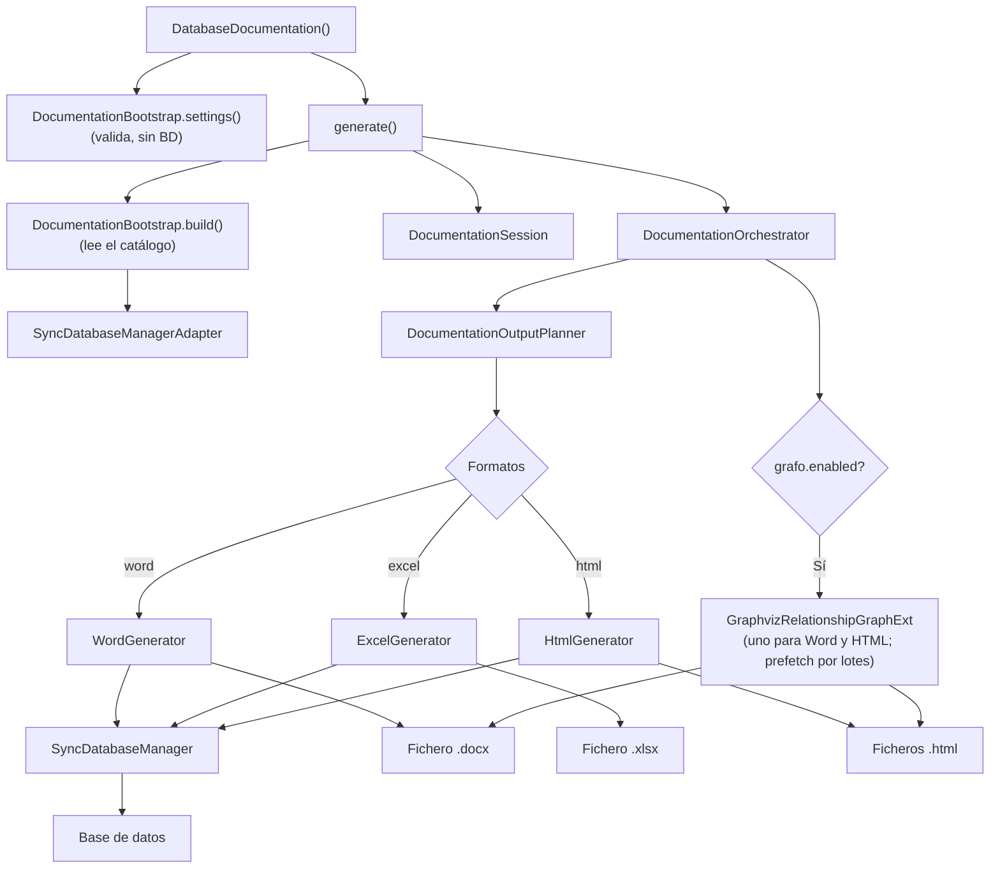

# Generador de Documentación de BD (DatabaseDocumentation)

Fachada pública que orquesta la generación de documentación de bases de datos en múltiples formatos mediante una arquitectura interna de bootstrap, sesión, planner y renderers. El constructor solo valida la configuración (no consulta la base de datos); `generate()` lee el catálogo, escribe los ficheros y devuelve un `DocumentationResult`.

## 1. Arquitectura y Diseño

## 2. Modelo de Datos / Contratos

### API pública

| Método | Firma simplificada | Descripción | Retorna |
|---|---|---|---|
| `DatabaseDocumentation` | `(db_manager, directorio_salida?, fichero_salida?, imprimir?, formatos?, headers_file?)` | Valida la configuración (no consulta la BD) | `DatabaseDocumentation` |
| `generate` | `()` | Lee el catálogo y genera todos los formatos configurados | `DocumentationResult` |

Ambas se importan de `util_bbdd.doc` (`from util_bbdd.doc import DatabaseDocumentation, DocumentationResult`). Desde
0.41.0 los generadores por formato (`WordGenerator`, `ExcelGenerator`, `HtmlGenerator`) ya no se exportan: se eligen
con `formatos=[...]`.

### Contrato de entrada

| Parámetro | Tipo | Descripción | Restricciones |
|---|---|---|---|
| `db_manager` | `DocumentationSourcePort` | Fuente de metadatos y consultas, normalmente un `SyncDatabaseManager` con conexión activa | No puede ser `None`; debe cumplir el puerto (`doc/application/ports.py`), incluido `get_schema_metadata()`: el catálogo se lee por lotes, una consulta por tipo de objeto (`doc.application.use_cases.catalog_rows`); no soporta `AsyncDatabaseManager` |
| `directorio_salida` | `Path` | Directorio base donde escribir ficheros | Se crean subdirectorios por ejecución y formato |
| `fichero_salida` | `Path \| None` | Nombre base sin extensión | `None` genera automáticamente con timestamp y clave de BD |
| `imprimir` | `dict[str, Any] \| None` | Configuración de secciones, estilos y grafos | `None` usa valores por defecto |
| `formatos` | `list[str] \| None` | `["word"]`, `["excel"]`, `["html"]` o combinaciones | `None` usa `["word"]`; valores inválidos lanzan `DocumentationConfigError` |
| `headers_file` | `Path` | JSON de cabeceras: `{"headers": {"COLUMNAS": {"base": [...]}, ...}}` | Desde 0.41.0 solo `base` por sección (las cabeceras son iguales en todos los motores) |

Opciones de `imprimir["grafo"]` relevantes para el rendimiento:

| Clave | Por defecto | Efecto |
|---|---|---|
| `enabled` | `False` | Diagramas de relaciones en Word y HTML (necesita Graphviz) |
| `workers` | núcleos, hasta 8 | Procesos `dot` simultáneos. Los diagramas se precargan por lotes (`dot -O`, un proceso por lote): arrancar `dot` cuesta ~0,25 s y renderizar ~0,01 s por grafo |
| `images_paginated` / `max_subnodes` | `True` / `10` (5 en Word) | Diagramas de Word partidos en varias imágenes |

### Contrato de salida

- `generate()` retorna un `DocumentationResult`: `outputs` (ruta de cada formato), `tables`, `views` y `routines`.
- Los ficheros se escriben en `directorio_salida/<fichero_salida>/<FORMATO>/`.
- **Word** → fichero `.docx` bajo `WORD/`.
- **Excel** → fichero `.xlsx` bajo `EXCEL/`.
- **HTML** → sitio HTML bajo `HTML/`.
- Los grafos se insertan como imágenes generadas por Graphviz en Word y HTML cuando están configurados. Cada formato
  produce lo mismo con independencia de los demás formatos pedidos en la misma llamada.

### Errores y casos especiales

| Error | Cuándo ocurre |
|---|---|
| `DocumentationConfigError` (también `ValueError`) | Al crear la instancia: formato no soportado, `imprimir` que no es un diccionario, fichero de cabeceras inexistente o mal formado, plantilla Word que no existe (solo si se pide Word) |
| `DocumentationRenderError` | En `generate()`: falla la escritura de un formato; la causa queda en `__cause__` |
| Error de `SyncDatabaseManager` (`DatabaseException`) | En `generate()`: conexión caída o permisos insuficientes al leer el catálogo; no se envuelve |

## 3. Componentes y Clases

| Clase | Responsabilidad |
|---|---|
| `DatabaseDocumentation` | Fachada pública; separa configuración (`__init__`) de ejecución (`generate()`) |
| `DocumentationResult` | Resultado de `generate()`: salidas por formato y recuentos |
| `DocumentationBootstrap` | `settings()` valida la configuración; `build()` resuelve la salida y lee el inventario del catálogo |
| `DocumentationOrchestrator` | Un generador de grafos para todos los formatos y despacho por formato; traduce los fallos de renderer a `DocumentationRenderError` |
| `HtmlGenerator` / `ExcelGenerator` / `WordGenerator` | Renderers internos por formato de salida |
| `doc/infrastructure/storage/engines.py` | Inventario de almacenamiento: una entrada por motor (consultas, cabeceras, tratamiento) |

## 4. Dependencias y Requisitos

| Dependencia | Propósito | Requerida | Comportamiento sin ella |
|---|---|---|---|
| `SyncDatabaseManager` | Proveedor de metadatos desde BD | Sí | Módulo no funciona |
| `python-docx` | Generación de documentos Word | Solo para `word` | Error al intentar generar Word |
| `openpyxl` | Generación de hojas Excel | Solo para `excel` | Error al intentar generar Excel |
| `Jinja2` | Generación de HTML | Solo para `html` | Error al intentar generar HTML |
| `graphviz` + binarios | Generación de grafos | Opcional | Sin grafos cuando no disponible |
| `openpyxl`, `python-docx`, `Jinja2` | Excel, Word y HTML | Incluidas en la instalación base (no hay extra `doc`) | Instalación incompleta: reinstalar `util_bbdd` |

## 5. Ejemplos Relacionados

- [Ejemplo: Generación de Documentación de Base de Datos](../examples/database_documentation_generation.md) — Generación de HTML, Word y Excel desde SQLite en memoria
