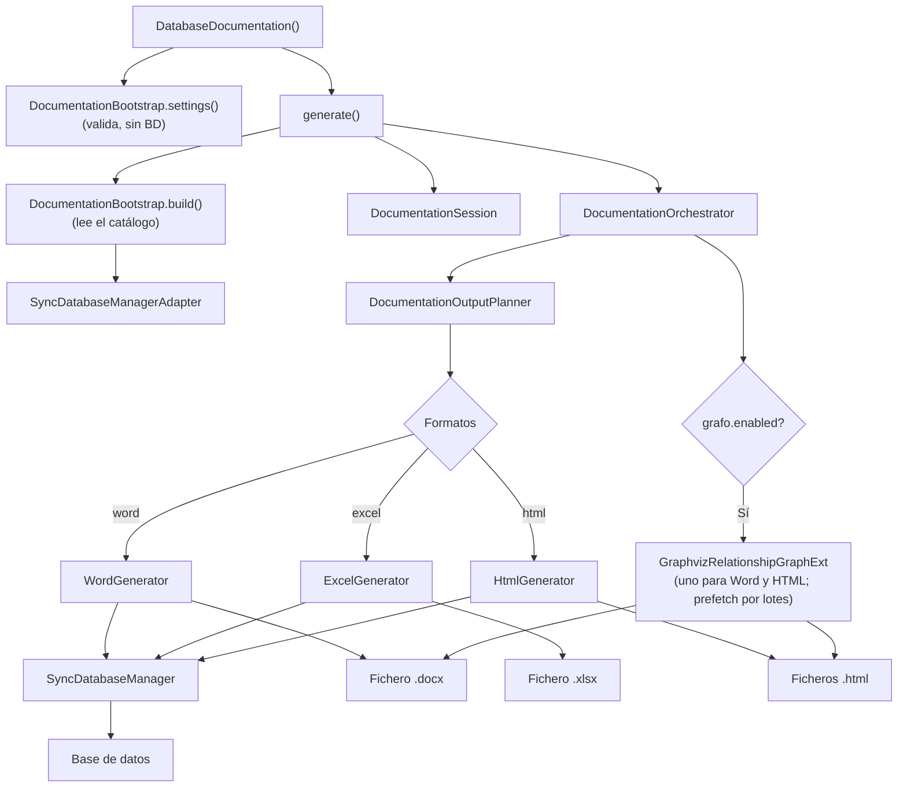

# Generador de Documentación de BD (DatabaseDocumentation)

Fachada pública que orquesta la generación de documentación de bases de datos en múltiples formatos mediante una arquitectura interna de bootstrap, sesión, planner y renderers. El constructor solo valida la configuración (no consulta la base de datos); `generate()` lee el catálogo, escribe los ficheros y devuelve un `DocumentationResult`.

## 1. Arquitectura y Diseño



## 2. Modelo de Datos / Contratos

### API pública

| Método | Firma simplificada | Descripción | Retorna |
|---|---|---|---|
| `DatabaseDocumentation` | `(db_manager, directorio_salida?, fichero_salida?, imprimir?, formatos?, headers_file?, batch_window_seconds?, schema?)` | Valida la configuración (no consulta la BD) | `DatabaseDocumentation` |
| `generate` | `()` | Lee el catálogo y genera todos los formatos configurados | `DocumentationResult` |

Ambas se importan de `util_bbdd.doc` (`from util_bbdd.doc import DatabaseDocumentation, DocumentationResult`). Desde
0.41.0 los generadores por formato (`WordGenerator`, `ExcelGenerator`, `HtmlGenerator`) ya no se exportan: se eligen
con `formatos=[...]`.

### Contrato de entrada

| Parámetro | Tipo | Descripción | Restricciones |
|---|---|---|---|
| `db_manager` | `DocumentationSourcePort` | Fuente de metadatos y consultas, normalmente un `SyncDatabaseManager` con conexión activa | No puede ser `None`; debe cumplir el puerto (`doc/application/ports.py`), incluido `get_schema_metadata()`: el catálogo se lee por lotes, una consulta por tipo de objeto (`doc.application.use_cases.catalog_rows`); no soporta `AsyncDatabaseManager` |
| `directorio_salida` | `Path` | Directorio base donde escribir ficheros | Se crean subdirectorios por ejecución y formato |
| `fichero_salida` | `Path \| None` | Nombre base sin extensión | `None` genera automáticamente con timestamp y clave de BD; se reutiliza si hay generaciones seguidas dentro de `batch_window_seconds` |
| `imprimir` | `dict[str, Any] \| None` | Configuración de secciones, estilos y grafos: qué se documenta, con qué plantilla y estilo, y cómo se dibujan los diagramas. Referencia completa en [Configuración de `imprimir`](#configuracion-de-imprimir) | `None` usa los valores por defecto (todas las secciones desactivadas) |
| `formatos` | `list[str] \| None` | `["word"]`, `["excel"]`, `["html"]` o combinaciones | `None` usa `["word"]`; valores inválidos lanzan `DocumentationConfigError` |
| `headers_file` | `Path` | JSON de cabeceras: `{"headers": {"COLUMNAS": {"base": [...]}, ...}}` | Desde 0.41.0 solo `base` por sección (las cabeceras son iguales en todos los motores) |
| `batch_window_seconds` | `int \| None` | Ventana temporal en segundos para agrupar generaciones automáticas | `None` usa 90 s; solo aplica si `fichero_salida` es `None`. Generaciones lanzadas en esta ventana reutilizan el mismo nombre. Usar 0 para deshabilitar. Un valor que no sea un entero ≥ 0 (también `bool`) da `DocumentationConfigError` al construir |
| `schema` | `str \| None` | Schema que documentar (owner en Oracle, base de datos en MySQL/MariaDB) | `None` usa el contexto de metadatos del manager. Desde 4.1.0: catálogo, DDL, diagramas y almacenamiento se leen de ese schema con la misma conexión (el usuario necesita permiso de lectura sobre sus objetos) |

### Configuración de `imprimir`

`imprimir` decide qué secciones lleva la documentación, con qué plantilla y estilo se presentan y cómo se dibujan los
diagramas de relaciones. Se normaliza una sola vez (`PrintConfigManager.normalize`) y vale igual para los tres formatos;
cada formato ignora lo que no le aplica (las plantillas o `tablas_por_documento`, por ejemplo).

**Reglas de lectura**:

- Es un `dict`; cualquier otro tipo lanza `DocumentationConfigError` al crear la instancia. `None` equivale a `{}`.
- Las claves pueden ir directamente o dentro de un bloque `{"imprimir": {...}}` (la forma de una sección `[imprimir]` de
  un fichero TOML cargado con `tomllib`).
- **Todo está desactivado por defecto**: sin activar ninguna sección, los documentos solo llevan el título y el
  «Resumen de inventario».
- Cada sección es un `dict` de banderas. Se convierten con `bool()`: usa `True`/`False`. Una cadena no vacía, incluida
  `"false"`, cuenta como `True`. Una sección que no es un `dict` se trata como vacía.
- Los números (`tablas_por_documento`, `html_items_por_pagina`, `max_depth`, `dpi`…) que no son enteros positivos
  vuelven a su valor por defecto. Los textos con valores fijos (`direction`, `columns.mode`, `render_format`) también.
- Las claves desconocidas se ignoran sin aviso: revisa la ortografía si una sección no aparece.

#### Secciones de contenido

| Sección | Clave | Por defecto | Qué añade |
|---|---|---|---|
| `tablas` | `imprimir_tablas` | `False` | Activa la documentación de tablas: una entrada por tabla con su comentario |
| | `ddl` | `False` | DDL de la tabla |
| | `columnas` | `False` | Columnas: nombre, tipo, nulo, valor por defecto, generación y comentario |
| | `pk` | `False` | Clave primaria |
| | `fk` | `False` | Claves foráneas, con tabla y columna referenciadas y reglas `ON DELETE`/`ON UPDATE` |
| | `unicas` | `False` | Restricciones `UNIQUE` |
| | `indices` | `False` | Índices |
| | `charset_collation` | `False` | Sin efecto: se admite por compatibilidad. El charset y la collation de columnas se piden con `columnas_charset` |
| `vistas` | `imprimir_vistas` | `False` | Activa la documentación de vistas |
| | `ddl` | `False` | Definición de la vista |
| | `columnas` | `False` | Columnas de la vista |
| `rutinas` | `imprimir_procedures` | `False` | Procedimientos almacenados, con su DDL y parámetros |
| | `imprimir_function` | `False` | Funciones, con su DDL y parámetros |
| `almacenamiento` | `imprimir_almacenamiento` | `False` | Inventario físico (tablespaces, ficheros, tamaños) con las consultas de cada motor; HSQLDB, sin consultas propias, recibe un aviso |
| `condiciones_motor` | `imprimir_condiciones_motor` | `False` | Verificación de `EngineReadinessAdvisor` al final del documento (ver [Sección «Condiciones del motor»](#seccion-condiciones-del-motor)) |
| `info_database` | `imprimir_info_database` | `False` | Activa la información de la base de datos |
| | `version` | `False` | Versión del servidor |
| | `charset_collation` | `False` | Charset y collation de la base de datos |
| `columnas_charset` | `charset_collation` | `False` | Charset y collation de cada columna (Word y HTML junto a la tabla; Excel en la hoja «Charset & Collation») |

Las subclaves de `tablas` y `vistas` solo tienen efecto con `imprimir_tablas` / `imprimir_vistas` a `True`, y las de
`info_database` con `imprimir_info_database` a `True`.

#### Presentación

| Clave | Por defecto | Formato | Efecto |
|---|---|---|---|
| `plantilla_word` | `None` | Word | Ruta (`str` o `Path`) a un `.docx` cuyos estilos, encabezados y pies se reutilizan. Si no existe, no es un `.docx` válido o le falta alguno de los estilos de párrafo que usa la documentación (`Title`, `Heading 1`-`3`, `No Spacing`; desde 4.1.0), `DocumentationConfigError` al crear la instancia, con los estilos que faltan (solo cuando se pide Word). Word solo guarda los estilos usados: basta con aplicarlos una vez en la plantilla y guardarla |
| `plantilla_html` | `None` | HTML | Plantilla Jinja2 propia para las páginas de detalle (tablas, vistas, rutinas). El índice y las páginas de colección siguen siendo las de serie |
| `tablas_por_documento` | `50` | Word | Tablas por fichero `.docx`; con más tablas se generan varios documentos `<nombre>_parte_N.docx`. Las secciones finales (información de la BD, almacenamiento, condiciones del motor) van en el último |
| `table_style` | `"Table Grid"` | Word, Excel | Estilo de las tablas. En Word, el nombre de un estilo de tabla del documento o de la plantilla; si no existe, se usa `"Table Grid"` o `"Normal Table"`. En Excel, un estilo `TableStyle*` o `PivotStyle*`; `"Table Grid"` y `"Medium Shading 2 Accent 1"` se traducen a `TableStyleMedium2`, y cualquier otro valor se sustituye por ese con un aviso |
| `html_items_por_pagina` | `15` | HTML | Elementos por página en las listas del índice |

#### Diagramas de relaciones (`grafo`)

También se acepta la clave `graph`. Los diagramas necesitan Graphviz (el extra `analysis` y el binario `dot`) y solo se
dibujan en Word y HTML.

| Clave | Por defecto | Efecto |
|---|---|---|
| `enabled` | `False` | Activa los diagramas de cada tabla |
| `show_columns` | `True` | Muestra columnas dentro de los nodos |
| `render_format` | `"svg"` | `"svg"` o `"png"` (también con la clave `format`). Word usa siempre `png` |
| `direction` | `"both"` | Relaciones que se siguen desde la tabla: `"incoming"` (quién la referencia), `"outgoing"` (a quién referencia) o `"both"` |
| `max_depth` | `1` | Niveles de relaciones que se siguen desde la tabla |
| `view_policy` | `"exclude"` | Único valor admitido: las vistas no llevan diagrama |
| `images_paginated` | `True` | Parte los diagramas grandes de Word en varias imágenes |
| `max_subnodes` | `10` (`5` en Word) | Tablas por imagen al paginar. Word usa 5 mientras no se cambie el valor por defecto |
| `dpi` | `150` | Resolución de las imágenes `png` |
| `workers` | núcleos, hasta 8 | Procesos `dot` simultáneos. Los diagramas se precargan por lotes (`dot -O`, un proceso por lote): arrancar `dot` cuesta ~0,25 s y renderizar ~0,01 s por grafo |
| `orthogonal_edges` | `True` | Aristas ortogonales (`splines=ortho`). Con `False`, curvas (`splines=true`): el enrutado ortogonal de Graphviz 2.43 aborta en algunos grafos (`maze.c: chkSgraph`, `newtrap: Trapezoid-table overflow`); desde 4.1.0 ese diagrama queda con un aviso y el documento sigue |
| `output_dir` | Word: `./_table_diagrams`; HTML: `<HTML>/graphs` | Carpeta de los ficheros de los diagramas |
| `columns.mode` | `"relations"` | Columnas visibles en cada nodo: `"relations"` (solo las que participan en las relaciones dibujadas), `"compact"` (esas primero y después las demás hasta completar) o `"all"` (todas, en su orden) |
| `columns.max_items` | `8` | Máximo de columnas por nodo; las que no caben se indican como ocultas |
| `columns.show_data_types` | `False` | Añade el tipo de cada columna |
| `cardinality.show_constraint_name` | `False` | Rotula cada relación con el nombre de su clave foránea |
| `cardinality.style` | `"end_markers"` | Sin efecto: es el único estilo (marcas de cardinalidad en los extremos) |
| `summary.enabled` | `True` | Línea de resumen bajo cada diagrama: profundidad visible y niveles de entrada y salida dibujados frente a los existentes |

#### Ejemplo completo

Todas las claves con un valor distinto del de por defecto o explicado en el comentario:

```python
from pathlib import Path

from util_bbdd import SyncDatabaseManager
from util_bbdd.doc import DatabaseDocumentation

imprimir = {
    # --- Presentación ---
    "plantilla_word": Path("plantillas/corporativa.docx"),  # debe existir y tener los estilos si se pide Word
    "plantilla_html": None,  # None: páginas de detalle de serie
    "tablas_por_documento": 40,  # Word: una parte nueva cada 40 tablas
    "table_style": "Light Grid Accent 1",  # estilo de Word; Excel usará TableStyleMedium2 con un aviso
    "html_items_por_pagina": 25,
    # --- Contenido ---
    "tablas": {
        "imprimir_tablas": True,
        "ddl": True,
        "columnas": True,
        "pk": True,
        "fk": True,
        "unicas": True,
        "indices": True,
    },
    "vistas": {"imprimir_vistas": True, "ddl": True, "columnas": True},
    "rutinas": {"imprimir_procedures": True, "imprimir_function": True},
    "info_database": {"imprimir_info_database": True, "version": True, "charset_collation": True},
    "columnas_charset": {"charset_collation": True},
    "almacenamiento": {"imprimir_almacenamiento": True},
    "condiciones_motor": {"imprimir_condiciones_motor": True},
    # --- Diagramas de relaciones (Word y HTML; necesitan Graphviz) ---
    "grafo": {
        "enabled": True,
        "show_columns": True,
        "render_format": "svg",  # Word usa png de todos modos
        "direction": "both",
        "max_depth": 2,
        "images_paginated": True,
        "max_subnodes": 8,
        "dpi": 200,
        "workers": 4,
        "columns": {"mode": "relations", "max_items": 10, "show_data_types": True},
        "cardinality": {"show_constraint_name": True},
        "summary": {"enabled": True},
    },
}

with SyncDatabaseManager("postgresql", conn_params) as manager:
    result = DatabaseDocumentation(
        manager,
        Path("docs_bd"),
        imprimir=imprimir,
        formatos=["word", "excel", "html"],
    ).generate()

print(result.outputs)  # {"word": .../WORD/<nombre>.docx, "excel": .../EXCEL/<nombre>.xlsx, "html": .../HTML}
```

La misma configuración en un fichero TOML (`tomllib.load(f)` devuelve el `dict` con el bloque `imprimir`):

```toml
[imprimir]
tablas_por_documento = 40
table_style = "Light Grid Accent 1"

[imprimir.tablas]
imprimir_tablas = true
ddl = true
columnas = true
pk = true
fk = true

[imprimir.condiciones_motor]
imprimir_condiciones_motor = true

[imprimir.grafo]
enabled = true
max_depth = 2

[imprimir.grafo.columns]
mode = "relations"
max_items = 10
```

### Sección «Condiciones del motor»

`imprimir={"condiciones_motor": {"imprimir_condiciones_motor": True}}` (por defecto `False`) añade al final de la
documentación la verificación de `EngineReadinessAdvisor`: los checks estáticos con los `conn_params` del manager y los
dinámicos (variables del servidor) con una conexión de `get_sqlalchemy_engine()`. Se verifica una sola vez por
generación (`SyncDatabaseManager.get_engine_readiness()`), aunque se pidan varios formatos.

| Formato | Ubicación |
|---|---|
| Word | Al final del último documento, tras «Almacenamiento» |
| Excel | Hoja «Condiciones del motor» |
| HTML | `condiciones/condiciones-motor.html`, enlazada desde el índice |

Contenido: tabla «Verificación» (motor, momento en UTC, checks dinámicos sí/no), «Resumen por severidad» y
«Hallazgos» (nivel, parámetro, valor actual, recomendación; cabeceras ajustables con `CONDICIONES_MOTOR` en
`headers_file`), ordenados por severidad y parámetro. Un aviso explica las tablas vacías o incompletas: sin hallazgos,
motor sin checks (HSQLDB), solo checks estáticos (sin conexión; el motivo lleva el tipo de la excepción, nunca su
mensaje) u origen que no cumple `EngineReadinessSourcePort` (`doc/application/ports.py`). Si la verificación falla, la
generación continúa con el aviso.

### Contrato de salida

- `generate()` retorna un `DocumentationResult`: `outputs` (ruta de cada formato), `tables`, `views` y `routines`.
- Los ficheros se escriben en `directorio_salida/<fichero_salida>/<FORMATO>/`.
- **Word** → fichero `.docx` bajo `WORD/`.
- **Excel** → fichero `.xlsx` bajo `EXCEL/`.
- **HTML** → sitio HTML bajo `HTML/`.
- Los grafos se insertan como imágenes generadas por Graphviz en Word y HTML cuando están configurados. Cada formato
  produce lo mismo con independencia de los demás formatos pedidos en la misma llamada.

### Cache de nombres automáticos (Batching)

Cuando `fichero_salida` es `None`, el nombre se genera automáticamente como `<bd>-<fecha_hora>`. Para agrupar
generaciones seguidas en **la misma carpeta**, se cachea el nombre durante `batch_window_seconds` (default 90 s):

```python
# Primera llamada (t=0 s): genera postgresql-20261012_153025/
result1 = DatabaseDocumentation(manager, Path("out")).generate()

# Segunda llamada (t=30 s): reutiliza postgresql-20261012_153025/ (está en cache)
result2 = DatabaseDocumentation(manager, Path("out")).generate()

# Tercera llamada (t=100 s): genera postgresql-20261012_153125/ (caducó la cache)
result3 = DatabaseDocumentation(manager, Path("out")).generate()
```

**Configuración de la ventana**:
- `batch_window_seconds=0`: Deshabilita el batching; cada generación usa un nombre nuevo
- `batch_window_seconds=300`: Agrupa generaciones durante 5 minutos
- `batch_window_seconds=None`: Usa el default (90 s)

La cache es **global y thread-safe** (compartida entre instancias), con clave por directorio de salida y servidor:
`(directorio_salida, motor, host, puerto, base de datos, identificador)`, sin credenciales. Desde 4.1.0, dos bases de
datos con el mismo nombre en servidores distintos (o dos ficheros SQLite homónimos) ya no comparten carpeta. Para
que cada generación tenga su propia carpeta pase `fichero_salida` o `batch_window_seconds=0`, recomendado cuando
varios usuarios o procesos escriben en el mismo `directorio_salida`.

**Verificar uso de cache (Debug)**:

Activa logging nivel `DEBUG` para ver trazas claras de cuándo se usa la cache:

```python
import logging

logging.basicConfig(
    level=logging.DEBUG,
    format="%(asctime)s - %(name)s - %(levelname)s - %(message)s",
)

doc = DatabaseDocumentation(manager, Path("out")).generate()
# Log: ✨ Generando nuevo nombre de carpeta... (si es nuevo)
# Log: 📦 Reutilizando nombre de carpeta... (si está en cache)
```

| Símbolo | Significado | Información |
|---|---|---|
| ✨ | Nombre generado | Cache vacía o caducada; nuevo nombre creado |
| 📦 | Nombre reutilizado | Cache activa; antigüedad y ventana configurada |

### Errores y casos especiales

| Error | Cuándo ocurre |
|---|---|
| `DocumentationConfigError` (también `ValueError`) | Al crear la instancia: formato no soportado, `imprimir` que no es un diccionario, fichero de cabeceras inexistente o mal formado, plantilla Word que no existe (solo si se pide Word) |
| `DocumentationRenderError` | En `generate()`: falla la creación de la carpeta de salida (desde 1.1.1; antes, `OSError`) o la escritura de un formato; la causa queda en `__cause__` |
| Error de `SyncDatabaseManager` (`DatabaseException`) | En `generate()`: conexión caída o permisos insuficientes al leer el catálogo; no se envuelve |

## 3. Componentes y Clases

| Clase | Responsabilidad |
|---|---|
| `DatabaseDocumentation` | Fachada pública; separa configuración (`__init__`) de ejecución (`generate()`) |
| `DocumentationResult` | Resultado de `generate()`: salidas por formato y recuentos |
| `DocumentationBootstrap` | `settings()` valida la configuración; `build()` resuelve la salida y lee el inventario del catálogo |
| `DocumentationOrchestrator` | Un generador de grafos para todos los formatos y despacho por formato; traduce los fallos de renderer a `DocumentationRenderError` |
| `HtmlGenerator` / `ExcelGenerator` / `WordGenerator` | Renderers internos por formato de salida |
| `doc/infrastructure/storage/engines.py` | Inventario de almacenamiento: una entrada por motor (consultas, cabeceras, tratamiento) |

## 4. Dependencias y Requisitos

| Dependencia | Propósito | Requerida | Comportamiento sin ella |
|---|---|---|---|
| `SyncDatabaseManager` | Proveedor de metadatos desde BD | Sí | Módulo no funciona |
| `python-docx` | Generación de documentos Word | Solo para `word` | Error al intentar generar Word |
| `openpyxl` | Generación de hojas Excel | Solo para `excel` | Error al intentar generar Excel |
| `Jinja2` | Generación de HTML | Solo para `html` | Error al intentar generar HTML |
| `graphviz` + binarios | Generación de grafos | Opcional | Sin grafos cuando no disponible |
| `openpyxl`, `python-docx`, `Jinja2` | Excel, Word y HTML | Incluidas en la instalación base (no hay extra `doc`) | Instalación incompleta: reinstalar `util_bbdd` |

## 5. Ejemplos Relacionados

- [Ejemplo: Generación de Documentación de Base de Datos](../examples/database_documentation_generation.md) — Generación de HTML, Word y Excel desde SQLite en memoria
