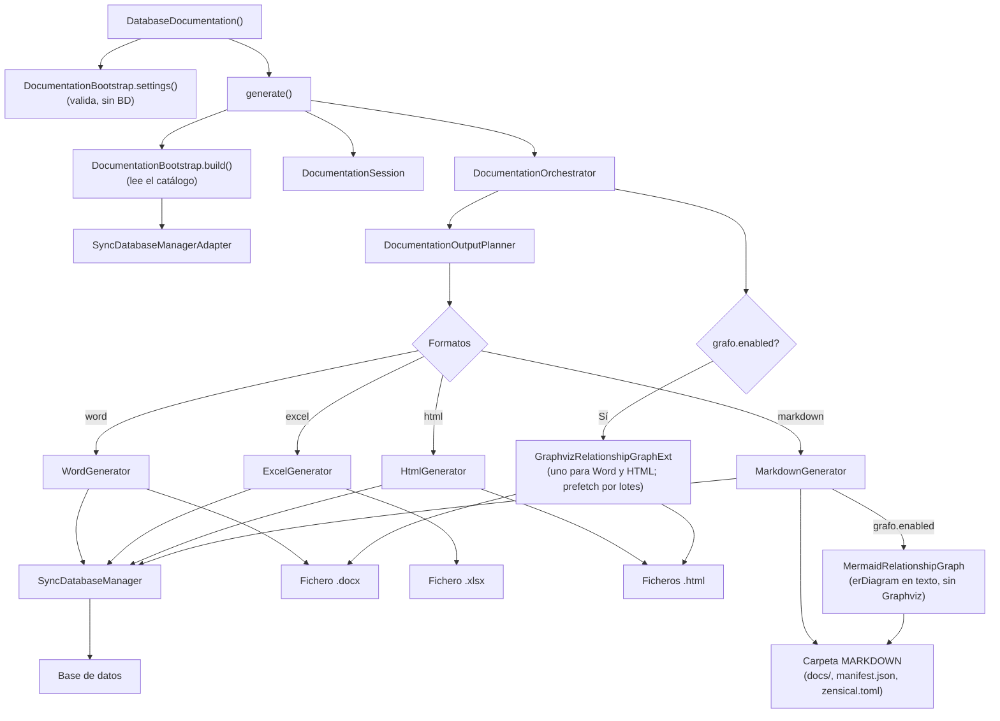

# Generador de Documentación de BD (DatabaseDocumentation)

Fachada pública que orquesta la generación de documentación de bases de datos en múltiples formatos mediante una arquitectura interna de bootstrap, sesión, planner y renderers. El constructor solo valida la configuración (no consulta la base de datos); `generate()` lee el catálogo, escribe los ficheros y devuelve un `DocumentationResult`.

## 1. Arquitectura y Diseño



## 2. Modelo de Datos / Contratos

### API pública

| Método | Firma simplificada | Descripción | Retorna |
|---|---|---|---|
| `DatabaseDocumentation` | `(db_manager, directorio_salida?, fichero_salida?, imprimir?, formatos?, headers_file?, batch_window_seconds?, schema?, on_progress?, cancel_token?)` | Valida la configuración (no consulta la BD) | `DatabaseDocumentation` |
| `generate` | `()` | Lee el catálogo y genera todos los formatos configurados | `DocumentationResult` |

Ambas se importan de `util_bbdd.doc` (`from util_bbdd.doc import DatabaseDocumentation, DocumentationResult`). Desde
0.41.0 los generadores por formato (`WordGenerator`, `ExcelGenerator`, `HtmlGenerator` y, desde 5.3.0,
`MarkdownGenerator`) no se exportan: se eligen con `formatos=[...]`.

### Contrato de entrada

| Parámetro | Tipo | Descripción | Restricciones |
|---|---|---|---|
| `db_manager` | `DocumentationSourcePort` | Fuente de metadatos y consultas, normalmente un `SyncDatabaseManager` con conexión activa | No puede ser `None`; debe cumplir el puerto (`doc/application/ports.py`), incluido `get_schema_metadata()`: el catálogo se lee por lotes, una consulta por tipo de objeto (`doc.application.use_cases.catalog_rows`); no soporta `AsyncDatabaseManager` |
| `directorio_salida` | `Path` | Directorio base donde escribir ficheros | Se crean subdirectorios por ejecución y formato |
| `fichero_salida` | `Path \| None` | Nombre base sin extensión | `None` genera automáticamente con timestamp y clave de BD: uno por generación (con sufijo `-2`, `-3`… si coincide el segundo) o, con `batch_window_seconds` > 0, reutilizado por las generaciones seguidas dentro de la ventana |
| `imprimir` | `dict[str, Any] \| None` | Configuración de secciones, estilos y grafos: qué se documenta, con qué plantilla y estilo, y cómo se dibujan los diagramas. Referencia completa en [Configuración de `imprimir`](#configuracion-de-imprimir) | `None` usa los valores por defecto (todas las secciones desactivadas) |
| `formatos` | `list[str] \| None` | `["word"]`, `["excel"]`, `["html"]`, `["markdown"]` (alias `"md"`, desde 5.3.0) o combinaciones | `None` usa `["word"]`; valores inválidos lanzan `DocumentationConfigError` |
| `headers_file` | `Path` | JSON de cabeceras: `{"headers": {"COLUMNAS": {"base": [...]}, ...}}` | Desde 0.41.0 solo `base` por sección (las cabeceras son iguales en todos los motores) |
| `batch_window_seconds` | `int \| None` | Ventana temporal en segundos para agrupar generaciones automáticas | `None` usa 0 (sin agrupar; hasta 4.x, 90 s); solo aplica si `fichero_salida` es `None`. Con un valor > 0, las generaciones lanzadas en esta ventana reutilizan el mismo nombre. Un valor que no sea un entero ≥ 0 (también `bool`) da `DocumentationConfigError` al construir |
| `schema` | `str \| None` | Schema que documentar (owner en Oracle, base de datos en MySQL/MariaDB) | `None` usa el contexto de metadatos del manager. Desde 4.1.0: catálogo, DDL, diagramas y almacenamiento se leen de ese schema con la misma conexión (el usuario necesita permiso de lectura sobre sus objetos) |
| `on_progress` | `ProgressCallback \| None` | Recibe los `ProgressEvent` de la generación ([Progreso y cancelación](progress_autodoc.md)) | Operación `"documentation"`: fase `"metadata"` y, por formato (`"word"`, `"excel"`, `"html"`, `"markdown"`), un evento al empezar (`0` de N tablas) y uno por tabla. Un callback que falla se registra una vez y deja de llamarse. Desde 4.1.0 |
| `cancel_token` | `CancellationToken \| None` | Parada cooperativa | Se comprueba antes de leer el catálogo, antes de cada formato y entre tablas: `OperationCancelledError`. Los formatos terminados quedan; el que estaba en curso puede quedar incompleto, salvo el Markdown, que escribe en una carpeta temporal y deja intacta la versión anterior. Desde 4.1.0 |

### Configuración de `imprimir`

`imprimir` decide qué secciones lleva la documentación, con qué plantilla y estilo se presentan y cómo se dibujan los
diagramas de relaciones. Se normaliza una sola vez (`PrintConfigManager.normalize`) y vale igual para los cuatro
formatos; cada formato ignora lo que no le aplica (las plantillas o `tablas_por_documento`, por ejemplo). El bloque
`markdown` solo lo usa el formato Markdown ([Documentación Markdown](#documentacion-markdown-markdown)).

**Reglas de lectura**:

- Es un `dict`; cualquier otro tipo lanza `DocumentationConfigError` al crear la instancia. `None` equivale a `{}`.
- Las claves pueden ir directamente o dentro de un bloque `{"imprimir": {...}}` (la forma de una sección `[imprimir]` de
  un fichero TOML cargado con `tomllib`).
- **Todo está desactivado por defecto**: sin activar ninguna sección, los documentos solo llevan el título y el
  «Resumen de inventario».
- Cada sección es un `dict` de banderas. Se convierten con `bool()`: usa `True`/`False`. Una cadena no vacía, incluida
  `"false"`, cuenta como `True`. Una sección que no es un `dict` se trata como vacía.
- Los números (`tablas_por_documento`, `html_items_por_pagina`, `max_depth`, `dpi`…) que no son enteros positivos
  vuelven a su valor por defecto. Los textos con valores fijos (`direction`, `columns.mode`, `render_format`) también.
- Las claves desconocidas se ignoran sin aviso: revisa la ortografía si una sección no aparece.

#### Secciones de contenido

| Sección | Clave | Por defecto | Qué añade |
|---|---|---|---|
| `tablas` | `imprimir_tablas` | `False` | Activa la documentación de tablas: una entrada por tabla con su comentario |
| | `ddl` | `False` | DDL de la tabla |
| | `columnas` | `False` | Columnas: nombre, tipo, nulo, valor por defecto, generación y comentario |
| | `pk` | `False` | Clave primaria |
| | `fk` | `False` | Claves foráneas, con tabla y columna referenciadas y reglas `ON DELETE`/`ON UPDATE` |
| | `unicas` | `False` | Restricciones `UNIQUE` |
| | `indices` | `False` | Índices |
| | `charset_collation` | `False` | Sin efecto: se admite por compatibilidad. El charset y la collation de columnas se piden con `columnas_charset` |
| `vistas` | `imprimir_vistas` | `False` | Activa la documentación de vistas |
| | `ddl` | `False` | Definición de la vista |
| | `columnas` | `False` | Columnas de la vista |
| `rutinas` | `imprimir_procedures` | `False` | Procedimientos almacenados, con su DDL y parámetros |
| | `imprimir_function` | `False` | Funciones, con su DDL y parámetros |
| `almacenamiento` | `imprimir_almacenamiento` | `False` | Inventario físico (tablespaces, ficheros, tamaños) con las consultas de cada motor; HSQLDB, sin consultas propias, recibe un aviso |
| `condiciones_motor` | `imprimir_condiciones_motor` | `False` | Verificación de `EngineReadinessAdvisor` al final del documento (ver [Sección «Condiciones del motor»](#seccion-condiciones-del-motor)) |
| `info_database` | `imprimir_info_database` | `False` | Activa la información de la base de datos |
| | `version` | `False` | Versión del servidor |
| | `charset_collation` | `False` | Charset y collation de la base de datos |
| `columnas_charset` | `charset_collation` | `False` | Charset y collation de cada columna (Word y HTML junto a la tabla; Excel en la hoja «Charset & Collation») |

Las subclaves de `tablas` y `vistas` solo tienen efecto con `imprimir_tablas` / `imprimir_vistas` a `True`, y las de
`info_database` con `imprimir_info_database` a `True`.

#### Filtro de tablas y vistas (`filtro`)

Desde 5.5.0. Documenta solo una parte del schema (un módulo, un prefijo) en **todos los formatos**: el filtro se aplica
una vez al leer el catálogo, antes de que lo vea ningún formato. Las rutinas no se filtran.

| Clave | Por defecto | Efecto |
|---|---|---|
| `incluir` | `[]` (todas) | Patrones de las tablas y vistas que se documentan; una lista o un solo patrón como cadena |
| `excluir` | `[]` | Patrones que se quitan, aunque casen con `incluir` |
| `frontera` | `True` | Calcula la **frontera**: las tablas no documentadas unidas por una FK (en cualquier sentido) a alguna documentada, salvo las de `excluir` |

- Patrones *glob* sin distinguir mayúsculas: `*` cualquier texto, `?` un carácter, `[ABC]` uno de esos caracteres.
  `MVG_*` casa con `MVG_PEDIDO` y con `mvg_pedido`; `_` es un carácter normal.
- Un patrón vacío, con caracteres de control, de más de 128 caracteres, que no es una cadena, o más de 100 patrones en
  una lista → `DocumentationConfigError` al crear la instancia. Sin ningún patrón, no hay filtro.
- Si el filtro no deja ninguna tabla ni vista, se genera igual y el log avisa.
- La frontera se devuelve en `DocumentationResult.frontier`. En Markdown, la portada lleva la sección «Alcance» (los
  patrones y las tablas de frontera, sin ficha propia); en las relaciones de cada tabla, una tabla no documentada se
  marca «frontera, sin ficha» o «excluida por el filtro». Los diagramas siguen mostrando las tablas vecinas aunque no
  se documenten.
- `catalog.json` y `manifest.json` guardan el filtro (`filter`) y la frontera. Con `markdown.previous`, si las dos
  generaciones tienen distinto filtro, solo se comparan las tablas y vistas que entran en ambos: lo que uno dejó fuera
  no aparece como eliminado.

```python
imprimir = {
    "tablas": {"imprimir_tablas": True, "columnas": True, "fk": True},
    "filtro": {"incluir": ["MVG_*"], "excluir": ["*_BAK", "TMP_*"]},
}
result = DatabaseDocumentation(manager, Path("out"), imprimir=imprimir, formatos=["markdown"]).generate()
result.frontier  # ('AUX_PAIS', 'COB_LINEA'): vecinas por FK que quedan fuera
```

#### Presentación

| Clave | Por defecto | Formato | Efecto |
|---|---|---|---|
| `plantilla_word` | `None` | Word | Ruta (`str` o `Path`) a un `.docx` cuyos estilos, encabezados y pies se reutilizan. Si no existe, no es un `.docx` válido o le falta alguno de los estilos de párrafo que usa la documentación (`Title`, `Heading 1`-`3`, `No Spacing`; desde 4.1.0), `DocumentationConfigError` al crear la instancia, con los estilos que faltan (solo cuando se pide Word). Word solo guarda los estilos usados: basta con aplicarlos una vez en la plantilla y guardarla |
| `plantilla_html` | `None` | HTML | Plantilla Jinja2 propia para las páginas de detalle (tablas, vistas, rutinas). El índice y las páginas de colección siguen siendo las de serie |
| `tablas_por_documento` | `50` | Word | Tablas por fichero `.docx`; con más tablas se generan varios documentos `<nombre>_parte_N.docx`. Las secciones finales (información de la BD, almacenamiento, condiciones del motor) van en el último |
| `table_style` | `"Table Grid"` | Word, Excel | Estilo de las tablas. En Word, el nombre de un estilo de tabla del documento o de la plantilla; si no existe, se usa `"Table Grid"` o `"Normal Table"`. En Excel, un estilo `TableStyle*` o `PivotStyle*`; `"Table Grid"` y `"Medium Shading 2 Accent 1"` se traducen a `TableStyleMedium2`, y cualquier otro valor se sustituye por ese con un aviso |
| `table_style_excel` | `None` | Excel | Estilo de las tablas del Excel (`TableStyleLight1`…`TableStyleDark11`, `PivotStyle*`), independiente del de Word. Si no se da, se usa `table_style` como arriba. Desde 4.1.0 |
| `plantilla_excel` | `None` | Excel | Ruta (`str` o `Path`) a un `.xlsx` o `.xltx`. El libro toma su tema; los colores de la paleta fija pasan a ser colores del tema (`accent1`/`accent5` con su tono) y las fuentes siguen la fuente del tema; cada hoja copia el encabezado, el pie y la configuración de página de la primera hoja de la plantilla (sin imágenes `&G`). Sin portada. Si no existe, no es un libro válido, no tiene hojas o su tema referencia imágenes, `DocumentationConfigError` al crear la instancia (solo cuando se pide Excel). Desde 4.1.0 |
| `html_items_por_pagina` | `15` | HTML | Elementos por página en las listas del índice |

#### Diagramas de relaciones (`grafo`)

También se acepta la clave `graph`. En Word y HTML, los diagramas necesitan Graphviz (el extra `analysis` y el binario
`dot`). En Markdown (desde 5.3.0) son diagramas `erDiagram` de Mermaid en texto, generados por
`MermaidRelationshipGraph` **sin Graphviz**. Usan `enabled`, `show_columns`, `direction`, `max_depth` (con el tope
`markdown.max_diagram_depth`), `max_subnodes`, `columns.mode`, `columns.max_items`,
`cardinality.show_constraint_name` y `summary.enabled`. Las demás claves son de Graphviz; los tipos de columna se
muestran siempre, porque la sintaxis de Mermaid los exige.

| Clave | Por defecto | Efecto |
|---|---|---|
| `enabled` | `False` | Activa los diagramas de cada tabla |
| `show_columns` | `True` | Muestra columnas dentro de los nodos |
| `render_format` | `"svg"` | `"svg"` o `"png"` (también con la clave `format`). Word usa siempre `png` |
| `direction` | `"both"` | Relaciones que se siguen desde la tabla: `"incoming"` (quién la referencia), `"outgoing"` (a quién referencia) o `"both"` |
| `max_depth` | `1` | Niveles de relaciones que se siguen desde la tabla |
| `view_policy` | `"exclude"` | Único valor admitido: las vistas no llevan diagrama |
| `images_paginated` | `True` | Parte los diagramas grandes de Word en varias imágenes |
| `max_subnodes` | `10` (`5` en Word) | Tablas por imagen al paginar. Word usa 5 mientras no se cambie el valor por defecto |
| `dpi` | `150` | Resolución de las imágenes `png` |
| `workers` | núcleos, hasta 8 | Procesos `dot` simultáneos. Los diagramas se precargan por lotes (`dot -O`, un proceso por lote): arrancar `dot` cuesta ~0,25 s y renderizar ~0,01 s por grafo |
| `orthogonal_edges` | `True` | Aristas ortogonales (`splines=ortho`). Con `False`, curvas (`splines=true`): el enrutado ortogonal de Graphviz 2.43 aborta en algunos grafos (`maze.c: chkSgraph`, `newtrap: Trapezoid-table overflow`); desde 4.1.0 ese diagrama queda con un aviso y el documento sigue |
| `output_dir` | Word: `./_table_diagrams`; HTML: `<HTML>/graphs` | Carpeta de los ficheros de los diagramas |
| `columns.mode` | `"relations"` | Columnas visibles en cada nodo: `"relations"` (solo las que participan en las relaciones dibujadas), `"compact"` (esas primero y después las demás hasta completar) o `"all"` (todas, en su orden) |
| `columns.max_items` | `8` | Máximo de columnas por nodo; las que no caben se indican como ocultas |
| `columns.show_data_types` | `False` | Añade el tipo de cada columna |
| `cardinality.show_constraint_name` | `False` | Rotula cada relación con el nombre de su clave foránea |
| `cardinality.style` | `"end_markers"` | Sin efecto: es el único estilo (marcas de cardinalidad en los extremos) |
| `summary.enabled` | `True` | Línea de resumen bajo cada diagrama: niveles por sentido y niveles salientes y entrantes dibujados frente a los existentes («Salientes: 1 de 2») |

Un **nivel** son las tablas unidas directamente por una FK, y se cuenta **en cada sentido**: con `max_depth: 1` y
`direction: "both"`, el diagrama de `B` en `A → B → C` muestra las tres tablas (un nivel hacia `A` y otro hacia
`C`). Desde 5.5.0 el resumen dice «Niveles por sentido» en lugar de «Profundidad visible».

#### Documentación Markdown (`markdown`)

Desde 5.3.0. Solo aplica con `formatos=["markdown"]`. Las rutas se aceptan como `str` o `Path`.

| Clave | Por defecto | Efecto |
|---|---|---|
| `max_diagram_depth` | `2` | Tope de profundidad de los diagramas: la efectiva es `min(grafo.max_depth, este)`. Si recorta, la página lo avisa (`!!! warning`) |
| `index_page_size` | `200` | Entradas por página de los índices por letra (`tables/index-a.md`, `index-a-2.md`…) |
| `front_matter` | `True` | Front matter JSON en una línea por página: `id` estable (`table:<schema>.<nombre>`), `pk`, `fk_out`, `fk_in`, `hash` y, con mapa de trazabilidad, `trace` |
| `column_anchors` | `True` | Ancla `col-<columna>` por columna (`<a id>` en la tabla «Columnas») para enlazar desde el código |
| `catalog_json` | `True` | `docs/catalog.json`: catálogo de los objetos documentados, contrato versionado ([ADR-006](../adr/ADR-006-catalogo-documentacion-markdown.md)) |
| `llms_txt` | `True` | `docs/llms.txt` (formato de llmstxt.org) |
| `llms_full_txt` | `True` | `docs/llms-full.txt`: todas las páginas en un fichero, cada una precedida de su id y su ruta |
| `zensical_toml` | `True` | Desde 5.6.0. `zensical.toml` (formato nativo de Zensical) listo para `zensical build`, con `nav` corta: portada e índices |
| `mkdocs_yml` | `False` | **En desuso** desde 5.6.0 (se retirará en 6.0.0; aviso en el log si se activa). `mkdocs.yml` con el mismo sitio. Hasta 5.5.0 era `True` y la única configuración generada |
| `site_name` | `None` | Título del sitio; `None`: «Documentación de <base de datos>» |
| `mermaid_js` | `None` | Ruta a un `mermaid.min.js` local. Se copia al sitio y se carga en lugar del de unpkg, así que los diagramas se dibujan **sin Internet**; además pone `font = false` en el tema. Debe existir: si no, `DocumentationConfigError` al construir |
| `mermaid_js_ref` | `None` | Desde 5.4.0. Mermaid **ya publicado**, sin copiarlo: ruta relativa a `docs/` (`assets/javascripts/mermaid.min.js`) o URL `https://`. Se escribe en `extra_javascript`; con una ruta relativa pone también `font = false` en el tema (sitio sin Internet). Excluyente con `mermaid_js`. Solo afecta a la configuración del sitio (`zensical.toml` y, si se pide, `mkdocs.yml`); sin ninguna, aviso en el log. Ver [Mermaid referenciado](#mermaid-referenciado-mermaid_js_ref) |
| `trace_map` | `None` | Mapa de trazabilidad `.toml` (recomendado) o `.json`: objeto o columna → código, documentos funcionales y técnicos, requisitos ([guía](../guides/markdown_documentation_guide.md#35-mapa-de-trazabilidad)). Se valida al construir |
| `previous` | `None` | Generación anterior (carpeta `MARKDOWN`, su `docs/` o su `catalog.json`): añade `docs/changes.md` y `docs/changes.json` con los cambios de esquema, sin conexión a la base de datos. Se valida al construir |
| `readme` | `True` | Desde 5.5.0. `README.md` en la raíz de la carpeta: cómo ver la documentación (vista previa de VS Code con la extensión de Mermaid o `zensical serve`) y qué contiene cada fichero generado. Sin fecha ni rutas locales |

##### Mermaid referenciado (`mermaid_js_ref`)

Para publicar muchas documentaciones con un único `mermaid.min.js` (p. ej. un servidor que guarda cada generación):
la librería no copia nada y **no comprueba** que el fichero exista, porque la ruta es la del sitio publicado. Valores
admitidos: ruta POSIX relativa a `docs/` sin `\`, sin `/` inicial, sin `:` y sin segmentos vacíos, `.` ni `..`, o URL
`https://` con host. Sin espacios ni caracteres de control. Cualquier otro valor (`http:`, `javascript:`, `data:`,
`//host`, rutas absolutas o de Windows) → `DocumentationConfigError` al construir.

Si al publicar falta el fichero de una ruta relativa (verificado con Zensical 0.0.71 y 0.1.1):

| Paso | Qué pasa |
|---|---|
| `zensical build --strict` | Termina **sin error ni aviso**: el build no detecta la referencia rota |
| Página publicada | Pide `assets/javascripts/mermaid.min.js` (404); como `window.mermaid` no existe, Zensical carga Mermaid de `unpkg.com` (`mermaid@12` desde 0.0.73) |
| Navegador con Internet | Los diagramas se dibujan (con el Mermaid de unpkg) |
| Navegador sin Internet | Los diagramas se quedan como bloque de código `erDiagram` |

Al regenerar en la misma carpeta una documentación que antes copiaba Mermaid (`mermaid_js`) y ahora lo referencia en la
misma ruta, la copia **no se borra**: queda como fichero ajeno (fuera de `manifest.json`).

Las secciones de cada página son las de Word (mismos flags, cabeceras de `headers_file` y mensajes), con estas
diferencias:

- un fichero por tabla, vista y rutina, en orden alfabético;
- con `tablas.fk`, la sección de claves foráneas enlaza la tabla referenciada y, desde 5.5.0, añade «Referenciada
  por» con las tablas que apuntan a esta;
- el DDL va en bloques `sql`;
- no aplican `tablas_por_documento`, `table_style` ni las plantillas.

#### Ejemplo completo

Todas las claves con un valor distinto del de por defecto o explicado en el comentario:

```python
from pathlib import Path

from util_bbdd import SyncDatabaseManager
from util_bbdd.doc import DatabaseDocumentation

imprimir = {
    # --- Presentación ---
    "plantilla_word": Path("plantillas/corporativa.docx"),  # debe existir y tener los estilos si se pide Word
    "plantilla_html": None,  # None: páginas de detalle de serie
    "tablas_por_documento": 40,  # Word: una parte nueva cada 40 tablas
    "table_style": "Light Grid Accent 1",  # estilo de Word; Excel usará TableStyleMedium2 con un aviso
    "html_items_por_pagina": 25,
    # --- Contenido ---
    "tablas": {
        "imprimir_tablas": True,
        "ddl": True,
        "columnas": True,
        "pk": True,
        "fk": True,
        "unicas": True,
        "indices": True,
    },
    "vistas": {"imprimir_vistas": True, "ddl": True, "columnas": True},
    "rutinas": {"imprimir_procedures": True, "imprimir_function": True},
    "info_database": {"imprimir_info_database": True, "version": True, "charset_collation": True},
    "columnas_charset": {"charset_collation": True},
    "almacenamiento": {"imprimir_almacenamiento": True},
    "condiciones_motor": {"imprimir_condiciones_motor": True},
    # --- Diagramas de relaciones (Word y HTML; necesitan Graphviz) ---
    "grafo": {
        "enabled": True,
        "show_columns": True,
        "render_format": "svg",  # Word usa png de todos modos
        "direction": "both",
        "max_depth": 2,
        "images_paginated": True,
        "max_subnodes": 8,
        "dpi": 200,
        "workers": 4,
        "columns": {"mode": "relations", "max_items": 10, "show_data_types": True},
        "cardinality": {"show_constraint_name": True},
        "summary": {"enabled": True},
    },
}

with SyncDatabaseManager("postgresql", conn_params) as manager:
    result = DatabaseDocumentation(
        manager,
        Path("docs_bd"),
        imprimir=imprimir,
        formatos=["word", "excel", "html"],
    ).generate()

print(result.outputs)  # {"word": .../WORD/<nombre>.docx, "excel": .../EXCEL/<nombre>.xlsx, "html": .../HTML}
```

La misma configuración en un fichero TOML (`tomllib.load(f)` devuelve el `dict` con el bloque `imprimir`):

```toml
[imprimir]
tablas_por_documento = 40
table_style = "Light Grid Accent 1"

[imprimir.tablas]
imprimir_tablas = true
ddl = true
columnas = true
pk = true
fk = true

[imprimir.condiciones_motor]
imprimir_condiciones_motor = true

[imprimir.grafo]
enabled = true
max_depth = 2

[imprimir.grafo.columns]
mode = "relations"
max_items = 10
```

### Sección «Condiciones del motor»

`imprimir={"condiciones_motor": {"imprimir_condiciones_motor": True}}` (por defecto `False`) añade al final de la
documentación la verificación de `EngineReadinessAdvisor`: los checks estáticos con los `conn_params` del manager y los
dinámicos (variables del servidor) con una conexión de `get_sqlalchemy_engine()`. Se verifica una sola vez por
generación (`SyncDatabaseManager.get_engine_readiness()`), aunque se pidan varios formatos.

| Formato | Ubicación |
|---|---|
| Word | Al final del último documento, tras «Almacenamiento» |
| Excel | Hoja «Condiciones del motor» |
| HTML | `condiciones/condiciones-motor.html`, enlazada desde el índice |

Contenido: tabla «Verificación» (motor, momento en UTC, checks dinámicos sí/no), «Resumen por severidad» y
«Hallazgos» (nivel, parámetro, valor actual, recomendación; cabeceras ajustables con `CONDICIONES_MOTOR` en
`headers_file`), ordenados por severidad y parámetro. Un aviso explica las tablas vacías o incompletas: sin hallazgos,
motor sin checks (HSQLDB), solo checks estáticos (sin conexión; el motivo lleva el tipo de la excepción, nunca su
mensaje) u origen que no cumple `EngineReadinessSourcePort` (`doc/application/ports.py`). Si la verificación falla, la
generación continúa con el aviso.

### Contrato de salida

- `generate()` retorna un `DocumentationResult`: `outputs` (ruta de cada formato), `tables`, `views` y `routines`
  (los documentados, tras `filtro`) y `frontier` (5.5.0: tablas de la frontera del filtro; vacío sin filtro).
- Los ficheros se escriben en `directorio_salida/<fichero_salida>/<FORMATO>/`.
- **Word** → fichero `.docx` bajo `WORD/`.
- **Excel** → fichero `.xlsx` bajo `EXCEL/`.
- **HTML** → sitio HTML bajo `HTML/`.
- **Markdown** (desde 5.3.0) → carpeta `MARKDOWN/`:

  ```text
  MARKDOWN/
    manifest.json            # versión de util_bbdd, motor, schema, fecha, sha256 de cada fichero e índice de páginas
    README.md                # markdown.readme (5.5.0): cómo verla y qué contiene
    zensical.toml            # markdown.zensical_toml (5.6.0; mkdocs.yml solo con markdown.mkdocs_yml, en desuso)
    docs/
      index.md               # inventario, alcance del filtro, enlaces y leyenda de los diagramas
      tables/index.md, tables/index-<letra>.md, tables/<slug>.md
      views/…, routines/<tipo>-<slug>.md
      database/info.md | storage.md | engine-conditions.md
      catalog.json, llms.txt, llms-full.txt
      traceability.md        # con markdown.trace_map
      changes.md, changes.json   # con markdown.previous
  ```

  - **Determinismo**: el contenido de `docs/` es idéntico byte a byte para el mismo catálogo y las mismas opciones; la
    fecha solo va en `manifest.json`.
  - **`manifest.json`** (contrato versionado, [ADR-006](../adr/ADR-006-catalogo-documentacion-markdown.md)):
    `format` `util_bbdd.doc.markdown`, `format_version` **2** desde 5.4.0 (antes 1), `util_bbdd_version`,
    `generated_at`, `engine`, `schema`, `database`, `previous` (con `markdown.previous`), `filter` (con `filtro`, 5.5.0:
    `include`, `exclude` y `frontier`), `files` (ruta → `sha256:…`) y `pages`, una entrada por cada `.md` de `docs/`
    (no `README.md`), en el orden de la `nav`:

    | Campo | Valor |
    |---|---|
    | `path` | Ruta relativa a `docs/` (POSIX) |
    | `title` | Título en **texto plano** (el H1 sin escapes ni entidades). Viene de la base de datos: escápalo al pintarlo |
    | `section` | `home`, `tables`, `views`, `routines`, `database`, `traceability`, `changes` |
    | `role` | `home` (portada), `index` (índice de sección), `letter` (página de letra), `object` (tabla, vista o rutina), `page` (resto) |
    | `letter` | Solo en `letter`: la letra (`a`, `0-9`, `otros`) |
    | `id`, `kind` | Solo en `object`: los mismos que `catalog.json` y el front matter, también con `catalog_json` o `front_matter` desactivados |

    Dentro de cada sección: índice, letras (con sus subpáginas `index-a-2.md`) y objetos en orden alfabético. Ejemplo:

    ```json
    {"path": "tables/acm-agenda.md", "title": "Tabla: ACM_AGENDA", "section": "tables", "role": "object",
     "id": "table:main.ACM_AGENDA", "kind": "table"}
    ```
  - **Escritura**: se escribe en una carpeta temporal y se publica al terminar. Al regenerar se borran solo los
    ficheros que listaba el `manifest.json` anterior y que nadie ha modificado; los ficheros ajenos se conservan.
  - **Seguridad**: el texto del catálogo se escapa (HTML y Markdown) y los nombres de fichero son seguros también en
    Windows.
- Los grafos se insertan como imágenes generadas por Graphviz en Word y HTML, y como bloques Mermaid en Markdown, cuando
  están configurados. Cada formato produce lo mismo con independencia de los demás formatos pedidos en la misma
  llamada.

### Cache de nombres automáticos (Batching)

Cuando `fichero_salida` es `None`, el nombre se genera automáticamente como `<bd>-<fecha_hora>`. Para agrupar
generaciones seguidas en **la misma carpeta**, pase `batch_window_seconds` > 0: el nombre se cachea durante ese tiempo.
Por defecto (desde 5.0.0; hasta 4.x eran 90 s) la ventana es `0` y cada generación tiene su carpeta; si dos caen en el
mismo segundo, la segunda lleva el sufijo `-2` (y así sucesivamente), y tampoco se reutiliza una carpeta que ya exista.

```python
# Primera llamada (t=0 s): genera postgresql-20261012_153025/
result1 = DatabaseDocumentation(manager, Path("out"), batch_window_seconds=90).generate()

# Segunda llamada (t=30 s): reutiliza postgresql-20261012_153025/ (está en cache)
result2 = DatabaseDocumentation(manager, Path("out"), batch_window_seconds=90).generate()

# Tercera llamada (t=100 s): genera postgresql-20261012_153205/ (caducó la cache)
result3 = DatabaseDocumentation(manager, Path("out"), batch_window_seconds=90).generate()
```

**Configuración de la ventana**:
- `batch_window_seconds=0` o `None` (default): sin batching; cada generación usa un nombre nuevo
- `batch_window_seconds=90`: el comportamiento por defecto hasta 4.x
- `batch_window_seconds=300`: Agrupa generaciones durante 5 minutos

La cache es **global y thread-safe** (compartida entre instancias), con clave por directorio de salida y servidor:
`(directorio_salida, motor, host, puerto, base de datos, identificador)`, sin credenciales. Desde 4.1.0, dos bases de
datos con el mismo nombre en servidores distintos (o dos ficheros SQLite homónimos) ya no comparten carpeta. Con
varios usuarios o procesos escribiendo en el mismo `directorio_salida`, no use ventana (es el valor por defecto) o
pase `fichero_salida`.

**Verificar uso de cache (Debug)**:

Activa logging nivel `DEBUG` para ver trazas claras de cuándo se usa la cache:

```python
import logging

logging.basicConfig(
    level=logging.DEBUG,
    format="%(asctime)s - %(name)s - %(levelname)s - %(message)s",
)

doc = DatabaseDocumentation(manager, Path("out")).generate()
# Log: ✨ Generando nuevo nombre de carpeta... (si es nuevo)
# Log: 📦 Reutilizando nombre de carpeta... (si está en cache)
```

| Símbolo | Significado | Información |
|---|---|---|
| ✨ | Nombre generado | Cache vacía o caducada; nuevo nombre creado |
| 📦 | Nombre reutilizado | Cache activa; antigüedad y ventana configurada |

### Errores y casos especiales

| Error | Cuándo ocurre |
|---|---|
| `DocumentationConfigError` (también `ValueError`) | Al crear la instancia: formato no soportado, `imprimir` que no es un diccionario, fichero de cabeceras inexistente o mal formado, plantilla Word que no existe (solo si se pide Word), patrón de `filtro` no válido (5.5.0). Con Markdown (5.3.0): `markdown.mermaid_js` que no es un fichero, `markdown.mermaid_js_ref` inválido o junto con `mermaid_js` (5.4.0), mapa de trazabilidad inválido (todos los errores juntos: extensión, sintaxis, sección o campo desconocido, tipo) o `markdown.previous` sin un `catalog.json` legible y de una versión soportada |
| `DocumentationConfigError` en `generate()` | Markdown con `previous` de otro motor de base de datos (los tipos no son comparables) |
| `DocumentationRenderError` | En `generate()`: falla la creación de la carpeta de salida (desde 1.1.1; antes, `OSError`) o la escritura de un formato; la causa queda en `__cause__` |
| Error de `SyncDatabaseManager` (`DatabaseException`) | En `generate()`: conexión caída o permisos insuficientes al leer el catálogo; no se envuelve |

## 3. Componentes y Clases

| Clase | Responsabilidad |
|---|---|
| `DatabaseDocumentation` | Fachada pública; separa configuración (`__init__`) de ejecución (`generate()`) |
| `DocumentationResult` | Resultado de `generate()`: salidas por formato y recuentos |
| `DocumentationBootstrap` | `settings()` valida la configuración; `build()` resuelve la salida y lee el inventario del catálogo |
| `DocumentationOrchestrator` | Un generador de grafos para todos los formatos y despacho por formato; traduce los fallos de renderer a `DocumentationRenderError` |
| `HtmlGenerator` / `ExcelGenerator` / `WordGenerator` / `MarkdownGenerator` | Renderers internos por formato de salida |
| `doc/infrastructure/renderers/markdown/` | Markdown (5.3.0): páginas, escape, nombres de fichero, front matter y `catalog.json`, `llms*.txt`, `zensical.toml`, mapa de trazabilidad (`_trace.py`), cambios (`_changes.py`) y escritura con staging (`_writer.py`) |
| `MermaidRelationshipGraph` (`analysis/mermaid_er.py`) | Diagramas `erDiagram` del Markdown, sin Graphviz ([Grafos de Relaciones](analysis.md)) |
| `doc/infrastructure/storage/engines.py` | Inventario de almacenamiento: una entrada por motor (consultas, cabeceras, tratamiento) |

## 4. Dependencias y Requisitos

| Dependencia | Propósito | Requerida | Comportamiento sin ella |
|---|---|---|---|
| `SyncDatabaseManager` | Proveedor de metadatos desde BD | Sí | Módulo no funciona |
| `python-docx` | Generación de documentos Word | Solo para `word` | Error al intentar generar Word |
| `openpyxl` | Generación de hojas Excel | Solo para `excel` | Error al intentar generar Excel |
| `Jinja2` | Generación de HTML | Solo para `html` | Error al intentar generar HTML |
| `graphviz` + binarios | Generación de grafos en Word y HTML | Opcional | Sin grafos cuando no disponible. El Markdown no lo necesita |
| Zensical | Publicar la carpeta Markdown como sitio (`zensical build`) | Opcional, fuera de la librería | La carpeta sigue siendo Markdown legible |
| `openpyxl`, `python-docx`, `Jinja2` | Excel, Word y HTML | Incluidas en la instalación base (no hay extra `doc`) | Instalación incompleta: reinstalar `util_bbdd` |

## 5. Ejemplos Relacionados

- [Ejemplo: Generación de Documentación de Base de Datos](../examples/database_documentation_generation.md) — Generación de HTML, Word y Excel desde SQLite en memoria
- [Ejemplo: Documentación Markdown](../examples/markdown_documentation.md) — Markdown con diagramas Mermaid, mapa de trazabilidad y cambios entre generaciones (SQLite)
- [Guía: Documentación Markdown](../guides/markdown_documentation_guide.md) — Publicar, versionar, trazar y usarla con IA
