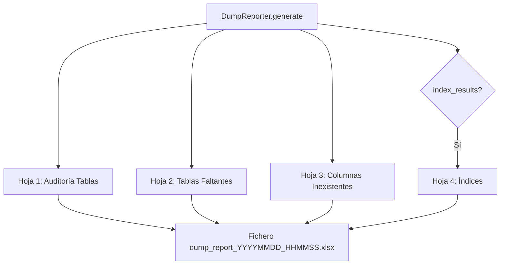

# Generador de Reportes de Volcado (DumpReporter)

Genera el informe Excel de auditoría para volcados de datos, con múltiples hojas que documentan volumetría, tablas/columnas faltantes, estado de constraints e índices.

## 1. Arquitectura y Diseño

## 2. Modelo de Datos / Contratos

### API pública

| Método | Firma simplificada | Descripción | Retorna |
|---|---|---|---|
| `DumpReporter` | `(output_dir: Path)` | Inicializa; crea `output_dir` si no existe | `DumpReporter` |
| `generate` | `(table_results, missing_tables, constraint_results, cycles, index_results?)` | Genera el fichero Excel con auditoría completa | `Path` |

### Contrato de entrada

| Parámetro | Tipo | Descripción | Restricciones |
|---|---|---|---|
| `output_dir` | `Path` | Directorio donde guardar el Excel | Se crea si no existe |
| `table_results` | `list[TableDumpResult]` | Resultado por tabla volcada | Estado, volumetría, columnas omitidas, errores |
| `missing_tables` | `list[str]` | Tablas en origen sin equivalente en destino | — |
| `constraint_results` | `list[ConstraintResult]` | Resultados de rehabilitación de constraints | — |
| `cycles` | `list[list[str]]` | Grupos de tablas con ciclos FK | — |
| `index_results` | `list[IndexActionResult] \| None` | Gestión de índices; `None` omite la hoja Índices | Default `None` |

### Contrato de salida

- Retorna `Path` del fichero Excel generado con nombre `dump_report_YYYYMMDD_HHMMSS.xlsx`.
- **Hoja 1 — Auditoría Tablas**: tabla, posición de carga, FK circular, filas origen/destino antes/después, estado, columnas omitidas, error.
- **Hoja 2 — Tablas Faltantes**: tablas presentes en origen pero ausentes en destino.
- **Hoja 3 — Columnas Inexistentes**: columnas en origen sin equivalente en destino, agrupadas por tabla.
- **Hoja 4 — Índices** (solo si `index_results` no es `None`): nombre, acción (`REBUILT`, `RECREATED`, `FAILED`, `UNSUPPORTED`), error si aplica.

### Errores y casos especiales

| Error | Cuándo ocurre |
|---|---|
| Error de escritura | Permisos insuficientes en `output_dir` |

## 3. Componentes y Clases

*No aplica para este módulo.* `DumpReporter` es la única clase del módulo.

## 4. Dependencias y Requisitos

| Dependencia | Propósito | Requerida | Comportamiento sin ella |
|---|---|---|---|
| `openpyxl` | Generación del fichero Excel | Sí | Error al llamar a `generate()` |

## 5. Ejemplos Relacionados

- [Ejemplo: Volcado de Datos entre Motores](../examples/dump_data_export.md) — Generación e interpretación del informe Excel de auditoría
