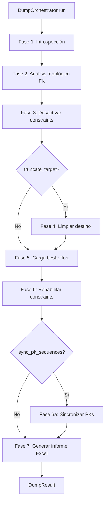

# Orquestador de Volcado (DumpOrchestrator)

Orquesta la copia completa de datos entre esquemas en 7 fases automáticas: introspección → análisis FK → desactivación de constraints → limpieza → carga → rehabilitación → informe Excel.

## 1. Arquitectura y Diseño

## 2. Modelo de Datos / Contratos

### API pública

#### Clase `DumpOrchestrator`

| Método | Firma simplificada | Descripción | Retorna |
|---|---|---|---|
| `DumpOrchestrator` | `(config: DumpConfig)` | Prepara inspectores; no abre conexiones hasta `run()` | `DumpOrchestrator` |
| `run` | `()` | Ejecuta las 7 fases y retorna resultado completo | `DumpResult` |

#### Dataclass `DumpConfig` (parámetros principales)

| Parámetro | Tipo | Default | Descripción |
|---|---|---|---|
| `source_engine` | `Engine` | — | Engine de origen (lectura) |
| `target_engine` | `Engine` | — | Engine de destino (escritura) |
| `source_schema` / `target_schema` | `str \| None` | `None` | Schema a volcar; `None` usa default del engine |
| `tables` | `list[str] \| None` | `None` | Tablas a volcar; `None` = todas las del origen |
| `chunk_size` | `int` | `5000` | Filas por chunk en lectura y bulk insert |
| `output_dir` | `Path` | `Path()` | Directorio donde guardar el informe Excel |
| `truncate_target` | `bool` | `True` | Vaciar destino antes de cargar: `TRUNCATE TABLE`; en PostgreSQL, un único `TRUNCATE` con todas las tablas del volcado (tabla a tabla si falla); `DELETE FROM` en SQLite (no tiene `TRUNCATE`) y en las tablas de SQL Server referenciadas por FK |
| `sync_pk_sequences` | `bool` | `True` | Resincronizar contadores PK tras la carga |
| `manage_indexes` | `bool` | `False` | Deshabilitar/reconstruir índices secundarios no únicos |
| `max_parallel_tables` | `int` | `1` | Tablas en paralelo dentro del mismo nivel FK |
| `parallel_pk_ranges` | `int` | `1` | Rangos de PK para particionar tablas grandes |
| `bulk_audit_path` | `Path \| None` | `None` | CSV de auditoría de los inserts en destino; `None` = sin auditoría |
| `bulk_audit_strict` | `bool` | `False` | Se pasa como `audit_strict` a cada `BulkCrud` y `ParallelBulkLoader`. `False`: un fallo al escribir el CSV no interrumpe la carga y se cuenta en `audit_summary.audit_failures`. `True`: el fallo deshace la carga de esa tabla (o partición) y queda como error de la tabla |

#### Dataclass `DumpResult`

| Atributo | Tipo | Descripción |
|---|---|---|
| `table_results` | `list[TableDumpResult]` | Resultado por tabla (incluye faltantes) |
| `constraint_results` | `list[ConstraintResult]` | Resultado de rehabilitación de constraints |
| `load_order` | `list[str]` | Orden topológico aplicado |
| `cycles_detected` | `list[list[str]]` | Grupos de tablas con FK circular |
| `report` | `Path` | Ruta del fichero Excel generado |
| `audit_summary` | `DumpAuditSummary \| None` | Métricas de auditoría del volcado leídas del CSV (`total_operaciones`, `total_filas`, tiempos, tablas) y contadores del propio volcado: `audit_failures` (registros que no se pudieron escribir), `audited_rows` (filas que este volcado escribió en el CSV), `unaudited_committed_rows` (filas confirmadas por commits periódicos que no constan en el CSV) y `audit_uncommitted_records` (con `bulk_audit_strict`, registros escritos antes de un commit que falló). `None` si no hay `bulk_audit_path` o si el CSV no tiene entradas del volcado y no hubo incidencias |
| `pk_sync_results` | `list[PKSyncResult] \| None` | Resultado sincronización PK; `None` si desactivado |
| `index_results` | `list[IndexActionResult] \| None` | Resultado gestión índices; `None` si desactivado |

`total_filas` sale del CSV filtrado por la hora de inicio, así que incluye lo que otros procesos escriban en el mismo
fichero durante el volcado; `audited_rows` cuenta solo lo de este volcado. Si no coinciden se registra un WARNING con
las dos cifras.

### Contrato de entrada

Ver tabla de `DumpConfig` arriba. Los engines deben estar conectables antes de llamar a `run()`.

### Contrato de salida

- `run()` retorna `DumpResult` siempre, incluso si algunas tablas fallaron (comportamiento best-effort).
- El informe Excel se genera siempre en `output_dir`, independientemente de errores parciales.

### Errores y casos especiales

| Error | Cuándo ocurre |
|---|---|
| `SQLAlchemyError` | Conexión a origen o destino falla antes de comenzar |
| Error capturado en `TableDumpResult.error` | Fallo en carga de una tabla individual; el resto continúa |
| Origen SQLite (WARNING al crear el orquestador) | SQLite no tiene tipos de columna: las fechas se leen como texto y los DECIMAL como `float`. Un destino servidor convierte las fechas; con destino SQLite, las tablas con columnas de fecha terminan en `error`. Los DECIMAL pueden perder precisión |
| Destino SQLite con `parallel_pk_ranges` o `max_parallel_tables` > 1 (WARNING) | SQLite admite un solo escritor: se carga sin paralelismo |

## 3. Componentes y Clases

| Clase | Responsabilidad |
|---|---|
| `DumpOrchestrator` | Coordinación de las 7 fases del volcado |
| `DumpConfig` | Configuración inmutable del volcado |
| `DumpResult` | Resultado completo incluyendo ruta del informe Excel |
| `ConstraintManager` | Gestión de desactivación/rehabilitación de constraints por motor |
| `IndexManager` | Gestión de desactivación/reconstrucción de índices secundarios |
| `DumpReporter` | Generación del informe Excel de auditoría |

## 4. Dependencias y Requisitos

| Dependencia | Propósito | Requerida | Comportamiento sin ella |
|---|---|---|---|
| `sqlalchemy` | Inspector, engines y ejecución SQL | Sí | Módulo no funciona |
| `BulkCrud` (interno) | Inserción de datos en destino | Sí | Módulo no funciona |
| `openpyxl` | Generación del informe Excel | Sí | Error al intentar generar el informe |
| `pandas` | Lectura de datos en chunks desde origen | Sí | Sin pandas no se pueden leer datos |

## 5. Ejemplos Relacionados

- [Ejemplo: Volcado de Datos entre Motores](../examples/dump_data_export.md) — PostgreSQL → SQL Server con `DumpOrchestrator`, modo paralelo y auditoría
