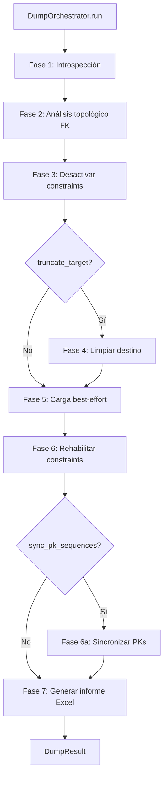

# Orquestador de Volcado (DumpOrchestrator)

Orquesta la copia completa de datos entre esquemas en 7 fases automáticas: introspección → análisis FK → desactivación de constraints → limpieza → carga → rehabilitación → informe Excel.

## 1. Arquitectura y Diseño



## 2. Modelo de Datos / Contratos

### API pública

#### Clase `DumpOrchestrator`

| Método | Firma simplificada | Descripción | Retorna |
|---|---|---|---|
| `DumpOrchestrator` | `(config: DumpConfig)` | Crea los `Inspector` de origen y destino (SQLAlchemy abre una conexión a cada uno) y emite los avisos de configuración | `DumpOrchestrator` |
| `run` | `(*, on_progress=None, cancel_token=None)` | Ejecuta las 7 fases y retorna resultado completo; progreso y cancelación desde 4.4.0 (ver abajo) | `DumpResult` |
| `plan` | `()` | Vista previa sin escribir en el destino (4.4.0): orden de carga, ciclos, tablas sin destino, columnas por tabla y avisos | `DumpPlan` |
| `restore_constraints` (función de `util_bbdd.dump`) | `(engine, journal)` | Reactiva lo que dejó desactivado un volcado interrumpido, a partir de su diario (4.4.0; ver abajo) | `list[ConstraintResult]` |

#### Dataclass `DumpConfig` (parámetros principales)

| Parámetro | Tipo | Default | Descripción |
|---|---|---|---|
| `source_engine` | `Engine` | — | Engine de origen (lectura) |
| `target_engine` | `Engine` | — | Engine de destino (escritura) |
| `source_schema` / `target_schema` | `str \| None` | `None` | Schema a volcar; `None` usa default del engine |
| `tables` | `list[str] \| None` | `None` | Tablas a volcar; `None` = todas las del origen |
| `chunk_size` | `int` | `5000` | Filas por chunk de lectura del origen; también el lote de escritura salvo lo que diga `write_batch_size` |
| `write_batch_size` | `int \| None` | `None` | Filas por lote de escritura. `None`: 20 000 con destino PostgreSQL (`COPY`; −31 % a 3,5M filas) y `chunk_size` en el resto (en SQL Server los lotes grandes son más lentos); con `commit_every_n_chunks`, siempre `chunk_size`. Un entero fija el lote en todos los motores |
| `output_dir` | `str \| Path` | `Path()` | Directorio donde guardar el informe Excel; se guarda como `Path` (desde v1.1.0 también `str`). Las tres rutas se leen siempre como `Path`, también para mypy, y se validan al reasignarlas (un tipo que no es ruta da `ValueError` en el acto) |
| `truncate_target` | `bool` | `False` | `False` (default desde 5.0.0; hasta 4.x era `True`, ver [Migración a la API 5.0](../guides/api_5_0_migration.md)) = modo append, no se borra nada del destino. `True` = vaciar destino antes de cargar: `TRUNCATE TABLE`; en PostgreSQL, un único `TRUNCATE` con todas las tablas del volcado (tabla a tabla si falla); `DELETE FROM` en SQLite (no tiene `TRUNCATE`) y en las tablas de SQL Server referenciadas por FK |
| `collect_row_counts` | `bool` | `True` | `COUNT(*)` en origen y destino por tabla para la volumetría del informe; `False` los omite (`-1`, «—» en el Excel) |
| `commit_every_n_chunks` | `int \| None` | `None` | Confirma cada N lotes en lugar de una transacción por tabla (acota el undo/redo log) |
| `sync_pk_sequences` | `bool` | `True` | Resincronizar contadores PK tras la carga |
| `manage_indexes` | `bool \| "secondary" \| "all"` | `False` | Deshabilitar/reconstruir índices secundarios no únicos; misma estrategia que `BulkCrud.maintenance_scope(disable_indexes=...)` (desde v3.2.0 también MySQL/MariaDB: InnoDB `DROP`→`ADD INDEX` sin los que necesita una FK, MyISAM/Aria `DISABLE KEYS`). Medido a 3,5M filas con 2 índices secundarios: Oracle −14 %, SQL Server −8 %, PostgreSQL sin ganancia; compensa más con muchos índices. `"all"` (v3.3.0): también índices únicos y PK/UNIQUE con sus FK entrantes, sin control de duplicados durante la carga (solo para datos validados); exige `truncate_target=True` y no admite `on_error="isolate"`; un único que no se reconstruye queda `"failed"` con sus claves duplicadas en `error_msg` |
| `validate_fks_after` | `bool` | `True` | MariaDB/MySQL (v3.3.0; por defecto desde v3.4.0, `False` vuelve a la fila única `"unverified"`): tras reactivar `FOREIGN_KEY_CHECKS`, un `NOT EXISTS` por FK de las tablas volcadas; `constraint_results` con `"enabled"`/`"failed"` por FK en vez de `"unverified"`. Coste medido: ~1 % de la carga (1M filas, 2 FK). En el resto de motores la validación ya se hace al reactivar |
| `max_parallel_tables` | `int` | `1` | Tablas en paralelo dentro del mismo nivel FK |
| `parallel_pk_ranges` | `int \| "auto"` | `1` | Rangos de PK para particionar tablas grandes (PK de una columna entera). Con `"auto"` (v3.0.0) los decide `ParallelPlanner` por tabla con las filas del origen (el `COUNT(*)` de `collect_row_counts`; con `collect_row_counts=False`, la cota `MAX(pk) − MIN(pk) + 1`, que sobrestima si la PK tiene huecos): hoy solo particiona con destino SQL Server y tablas desde 3,5M filas (4 rangos, o los que quepan en el pool); el motivo de cada tabla va al log (INFO). Medido con 4 rangos a 3,5M filas frente a la carga secuencial: SQL Server −37 % (recomendado); PostgreSQL −9 % y Oracle −2 %; MySQL/MariaDB casi el doble de tiempo (no recomendado, WARNING); SQLite se fuerza a 1. Necesita un pool con capacidad ≥ rangos × `max_parallel_tables` |
| `bulk_audit_path` | `str \| Path \| None` | `None` | CSV de auditoría de los inserts en destino (desde v1.1.0 también `str`); `None` = sin auditoría |
| `bulk_audit_strict` | `bool` | `False` | Se pasa como `AuditOptions.strict` a cada `BulkCrud` y `ParallelBulkLoader`. `False`: un fallo al escribir el CSV no interrumpe la carga y se cuenta en `audit_summary.audit_failures`. `True`: el fallo deshace la carga de esa tabla (o partición) y queda como error de la tabla |
| `on_error` | `"raise" \| "isolate"` | `"raise"` | Como en [`BulkCrud`](bulk_crud.md): con `"isolate"` las filas que el destino no admite (PK duplicada, NOT NULL, valor demasiado largo o fuera de precisión) se apartan a `rejects_csv_path` y el resto de la tabla se copia; la tabla queda `success` con `rows_rejected`. Durante la carga las constraints del destino están desactivadas: FK y CHECK no fallan aquí (una fila huérfana se copia y falla al rehabilitar la constraint). En SQL Server el valor demasiado largo no se aísla. La `fila` del CSV es la posición en la lectura del origen (`SELECT` sin `ORDER BY`, no se repite entre volcados); con `parallel_pk_ranges`, la del rango, que va en `particion` |
| `rejects_csv_path` | `str \| Path \| None` | `None` | CSV de rechazos común a todas las tablas (desde v1.1.0 también `str`); obligatorio con `on_error="isolate"` |
| `max_rejects` | `int \| None` | `None` | Filas que cada tabla (o cada rango) puede rechazar; la siguiente deja esa tabla en `error` y el volcado sigue |
| `audit_sink` | `AuditSink \| None` | `None` | Destino de eventos de [auditoría](audit.md); el identificador sale en `DumpResult.audit_run_id`. El evento `table` de cada tabla llega al terminar su carga (4.4.0; antes, todos al final); los de tablas sin destino, constraints, índices y contadores PK y el `run` de cierre, al terminar el volcado. Si el de una tabla no se puede escribir, se reintenta al final |

#### Dataclass `DumpResult`

| Atributo | Tipo | Descripción |
|---|---|---|
| `table_results` | `list[TableDumpResult]` | Resultado por tabla (incluye faltantes) |
| `constraint_results` | `list[ConstraintResult]` | Resultado de rehabilitación de constraints |
| `load_order` | `list[str]` | Orden topológico aplicado |
| `cycles_detected` | `list[list[str]]` | Grupos de tablas con FK circular |
| `report` | `Path` | Ruta del fichero Excel generado |
| `audit_summary` | `DumpAuditSummary \| None` | Métricas de auditoría del volcado leídas del CSV (`total_operaciones`, `total_filas`, tiempos, tablas) y contadores del propio volcado: `audit_failures` (registros que no se pudieron escribir), `audited_rows` (filas que este volcado escribió en el CSV), `unaudited_committed_rows` (filas confirmadas por commits periódicos que no constan en el CSV) y `audit_uncommitted_records` (con `bulk_audit_strict`, registros escritos antes de un commit que falló). `None` si no hay `bulk_audit_path` o si el CSV no tiene entradas del volcado y no hubo incidencias |
| `pk_sync_results` | `list[PKSyncResult] \| None` | Resultado sincronización PK; `None` si desactivado |
| `index_results` | `list[IndexActionResult] \| None` | Resultado gestión índices; `None` si desactivado |
| `audit_run_id` | `str \| None` | Identificador de la ejecución en los eventos de `audit_sink` |
| `constraint_reactivation_error` | `str \| None` | Mensaje de error si falló la reactivación general de constraints en el destino (fallo no recuperable en `ConstraintManager.enable_all()`). Distinto de `constraint_results` (fallos por-tabla/constraint). Si presente, aparece en la hoja «Errores de Reactivación» del informe Excel (con fondo rojo) y el evento `run` de `audit_sink` es `failed` con el atributo `constraint_reactivation_failed=True`. `None` si la reactivación fue exitosa. Desde 4.4.0 lleva la primera línea saneada del error, como los `error_msg` por tabla y constraint (ver abajo); el `error_msg` de los índices (`IndexActionResult`, de `bulk`) sigue con el texto completo, y con `manage_indexes="all"` lista las claves duplicadas: revisa el informe antes de compartirlo fuera del equipo |
| `constraints_journal` | `Path \| None` | Ruta del diario de constraints si sigue en `output_dir` al terminar (4.4.0): alguna constraint no se pudo reactivar (SQL Server, PostgreSQL u Oracle). `None` si todo se reactivó o el destino no lleva diario |
| `rows_rejected` | `int` (propiedad) | Con `on_error="isolate"`: filas apartadas al CSV de rechazos en todo el volcado (suma de `TableDumpResult.rows_rejected`, que también sale en la columna «Filas Rechazadas» de la hoja «Auditoría Tablas»). En una tabla con estado `error` (p. ej. `max_rejects` superado) no se copió nada, aunque cuente los rechazos que llegó a escribir |

`total_filas` sale del CSV filtrado por la hora de inicio, así que incluye lo que otros procesos escriban en el mismo
fichero durante el volcado; `audited_rows` cuenta solo lo de este volcado. Si no coinciden se registra un WARNING con
las dos cifras.

#### Vista previa: `DumpOrchestrator.plan()` → `DumpPlan` (4.4.0)

`plan()` lee lo mismo que el análisis de `run()` (tablas de origen y destino y FK del origen, con el mismo orden
topológico) y las columnas de las tablas con destino. No desactiva constraints, no limpia ni carga, no cuenta filas y no
escribe informe ni auditoría. `plan().load_order` es el `DumpResult.load_order` que daría `run()` con el mismo catálogo.
Si falla la introspección lanza `DumpError`.

| Campo | Tipo | Descripción |
|---|---|---|
| `load_order` | `list[str]` | Orden de carga (también las tablas sin destino, como `DumpResult.load_order`) |
| `cycles` | `list[list[str]]` | Grupos de tablas con FK circular |
| `missing_target` | `list[str]` | Tablas del origen que no existen en el destino |
| `tables` | `tuple[DumpPlanTable, ...]` | Por tabla, en el orden de carga: `table_name`, `target_table` (nombre en el destino o `None`), `load_order_position` (`-1` sin destino), `in_cycle`, `skipped_columns`, `required_target_columns` (del destino, sin nulos ni valor por defecto y que el origen no tiene) y `outside_references` (tablas que no se vuelcan y a las que apunta por FK) |
| `warnings` | `tuple[DumpPlanWarning, ...]` | `code`, `message` y `table` (`None` si es general) |
| `constraints_managed` | `bool` | `True` si `run()` desactiva las constraints del destino durante la carga |

Códigos de `DumpPlanWarning.code` (`DumpWarningCode`): `MISSING_TARGET`, `NO_COMMON_COLUMNS`, `SKIPPED_COLUMNS`,
`REQUIRED_TARGET_COLUMNS` (la carga de la tabla fallará), `OUTSIDE_REFERENCES`, `FK_CYCLE`, `CONSTRAINTS_NOT_MANAGED`
y `SQLITE_SOURCE`.

```python
from util_bbdd.dump import DumpOrchestrator

plan = DumpOrchestrator(config).plan()
for warning in plan.warnings:
    print(warning.code, warning.table, warning.message)
if not any(w.code == "REQUIRED_TARGET_COLUMNS" for w in plan.warnings):
    result = DumpOrchestrator(config).run()
```

#### Progreso y cancelación: `run(on_progress=, cancel_token=)` (4.4.0)

Con el contrato de [`util_bbdd.progress`](progress_autodoc.md), operación `"dump"`:

| Fase | Eventos | `current` / `total` / `message` |
|---|---|---|
| `"tables"` | Uno al empezar la carga y uno por tabla terminada (también con `max_parallel_tables`, desde el hilo principal) | tablas terminadas / tablas con destino / nombre de la tabla (vacío en el inicial) |
| `"rows"` | Uno por lote escrito de cada tabla (desde el hilo que la carga) | filas escritas de la tabla / `COUNT(*)` del origen (`None` con `collect_row_counts=False`) / nombre de la tabla |

La cancelación se comprueba antes de desactivar las constraints (si ya está cancelado, no se toca el destino), antes
de cada tabla y entre lotes. `OperationCancelledError` (`phase` `"tables"` o `"rows"`) sale **después** de reconstruir
los índices (`manage_indexes`) y reactivar las constraints, y el diario de constraints se borra si todo se reactivó.
La tabla en curso se deshace (salvo los lotes ya confirmados con `commit_every_n_chunks`) y las terminadas quedan
cargadas; con `truncate_target=True` las que faltaban ya están vacías. El evento `run` de `audit_sink` queda `failed`
con `error_type="OperationCancelledError"`. Con `parallel_pk_ranges`, una tabla que se carga por rangos no se
interrumpe a mitad ni emite `"rows"`: se comprueba antes de empezarla. Una cancelación que llega tras el último lote
de la última tabla no interrumpe nada: el volcado termina con normalidad.

```python
from util_bbdd.progress import CancellationToken

token = CancellationToken()  # token.cancel() desde otro hilo
result = DumpOrchestrator(config).run(on_progress=lambda e: print(e.phase, e.current, e.total), cancel_token=token)
```

#### Diario de constraints y `restore_constraints` (4.4.0)

En SQL Server, PostgreSQL y Oracle lo que el volcado desactiva queda desactivado en el catálogo si el proceso muere a
mitad (timeout, `kill`). Antes de desactivar nada, `run()` escribe en `output_dir` el diario
`constraints_journal.json` (motor, schema y tablas o constraints) y lo borra cuando todas se reactivan. Si el diario
sigue ahí, `restore_constraints(engine, ruta)` reactiva cada entrada desde otro proceso, igual que el volcado al
terminar, y borra el diario si ninguna falla. Es idempotente: reactivar lo ya activo no hace nada y, sin diario,
devuelve `[]`. En MariaDB/MySQL la desactivación es de la sesión (`FOREIGN_KEY_CHECKS`) y muere con ella: no hay
diario.

- Un `run()` con un diario pendiente en su `output_dir` lanza `DumpConstraintError` antes de tocar el destino.
- Una reactivación que falla (p. ej. filas que incumplen una FK) deja el diario y su ruta en
  `DumpResult.constraints_journal`, para reintentar tras corregir los datos.
- `ConstraintManager(engine, schema, journal_path=ruta)` hace lo mismo fuera del volcado.

```python
from util_bbdd.dump import restore_constraints

results = restore_constraints(target_engine, "salida/constraints_journal.json")
pendientes = [r for r in results if r.status == "failed"]
```

### Contrato de entrada

Ver tabla de `DumpConfig` arriba. Los engines deben estar conectables antes de llamar a `run()`.

### Contrato de salida

- `run()` retorna `DumpResult` siempre, incluso si algunas tablas fallaron (comportamiento best-effort).
- El informe Excel se genera siempre en `output_dir`, independientemente de errores parciales. Un `output_dir`
  relativo (el valor por defecto es `Path()`) se resuelve contra el directorio de trabajo del proceso.
- Si falla el resumen del CSV de auditoría (CSV ilegible o sin las columnas esperadas), se registra un WARNING, el
  informe sale sin la hoja «Auditoría Bulk» y `audit_summary` es `None`.
- Si falla el propio informe, la carga ya ha terminado: `run()` lanza `DumpReportError` con el resultado completo en
  `exc.result` (su `report` es la ruta prevista, `exc.output_path`, que no llegó a crearse).
- El informe se llama `dump_report_<AAAAMMDD_HHMMSS>.xlsx`; si ya existe uno con ese nombre (dos volcados en el mismo
  segundo), se añade `_2`, `_3`… en lugar de sobrescribirlo.
- Los textos del informe se escriben sin caracteres de control, y los que empiezan por `=` se guardan como texto, no
  como fórmula (igual en los informes Excel de `bulk`, `comparar` y `doc`; los informes Word de `comparar` y `doc`
  también eliminan los caracteres de control).

```python
from util_bbdd.dump import DumpOrchestrator, DumpReportError

try:
    result = DumpOrchestrator(config).run()
except DumpReportError as exc:
    result = exc.result  # la carga se completó; solo falta el Excel
```

### Errores y casos especiales

| Error | Cuándo ocurre |
|---|---|
| `SQLAlchemyError` | Al crear el `DumpOrchestrator`, si no se puede conectar al origen o al destino |
| `ValueError` | Al crear `DumpConfig`: `chunk_size`, `commit_every_n_chunks`, `write_batch_size` o la combinación `on_error`/`rejects_csv_path`/`max_rejects` no válidos |
| `DumpError` | En `run()` y `plan()`, si falla la lectura de las tablas de origen o destino (con el `SQLAlchemyError` en `__cause__`) |
| `DumpConstraintError` (subclase de `DumpError`) | En `run()`, si no se pueden desactivar las constraints del destino, si no se puede escribir el diario o si ya hay uno pendiente en `output_dir` (4.4.0). Un fallo al reactivarlas no se lanza: se registra como ERROR en el log |
| `ValueError` en `restore_constraints` | El fichero no es un diario válido o es de otro motor que el engine |
| `DumpReportError` | No se pudo generar el informe Excel (directorio, permisos, fichero abierto, disco lleno). La carga ya terminó: `exc.result` lleva el `DumpResult` |
| Error capturado en `TableDumpResult.error_msg` | Fallo en carga de una tabla individual; el resto continúa. Desde 4.4.0 (seguridad), `error_msg` de tablas y constraints y `constraint_reactivation_error` llevan solo la primera línea del error: sin la sentencia ni sus parámetros (filas del origen), sin URL y con los valores que MySQL/MariaDB (`Duplicate entry '…'`), SQL Server (`duplicate key value is (…)`) y PostgreSQL (`invalid input syntax …: "…"`) ponen en ella enmascarados. La traza completa sigue en el log |
| Origen SQLite (WARNING al crear el orquestador) | SQLite no tiene tipos de columna: los DECIMAL se leen como `float` y pueden perder precisión. Desde 4.4.0 el texto ISO de las columnas declaradas `DATE`, `DATETIME`/`TIMESTAMP` y `TIME` se convierte al leer en `date`, `datetime` y `time` si la columna del destino es de fecha u hora (`TIME` solo hacia `TIME`); antes, con destino SQLite, esas tablas terminaban en `error`. Hacia una columna de texto, o con un valor que no es ISO, llega texto como antes: un destino servidor lo intenta convertir y uno SQLite lo rechaza |
| Destino SQLite con `parallel_pk_ranges` o `max_parallel_tables` > 1 (WARNING) | SQLite admite un solo escritor: se carga sin paralelismo |
| Destino MySQL/MariaDB con `parallel_pk_ranges` > 1 (WARNING) | La carga por rangos es más lenta que la secuencial en estos motores; se aplica igualmente |

## 3. Componentes y Clases

| Clase | Responsabilidad |
|---|---|
| `DumpOrchestrator` | Coordinación de las 7 fases del volcado |
| `DumpConfig` | Configuración del volcado (dataclass; normaliza las rutas a `Path` y valida al construirse) |
| `DumpResult` | Resultado completo incluyendo ruta del informe Excel |
| `DumpPlan` | Vista previa de `plan()` (4.4.0): orden de carga, ciclos, tablas y avisos, sin escribir |
| `ConstraintManager` | Gestión de desactivación/rehabilitación de constraints por motor |
| `IndexManager` | Gestión de desactivación/reconstrucción de índices secundarios |
| `DumpReporter` | Generación del informe Excel de auditoría |

## 4. Dependencias y Requisitos

| Dependencia | Propósito | Requerida | Comportamiento sin ella |
|---|---|---|---|
| `sqlalchemy` | Inspector, engines y ejecución SQL | Sí | Módulo no funciona |
| `metadata/sqlserver` (interno) | SQL de las FK de todo el esquema en SQL Server (orden de carga y limpieza en una consulta) | Sí | — |
| `BulkCrud` (interno) | Inserción de datos en destino | Sí | Módulo no funciona |
| `openpyxl` | Generación del informe Excel | Sí | Error al intentar generar el informe |
| `pandas` | Lectura de datos en chunks desde origen | Sí | Sin pandas no se pueden leer datos |

## 5. Ejemplos Relacionados

- [Ejemplo: Volcado de Datos entre Motores](../examples/dump_data_export.md) — PostgreSQL → SQL Server con `DumpOrchestrator`, modo paralelo y auditoría
