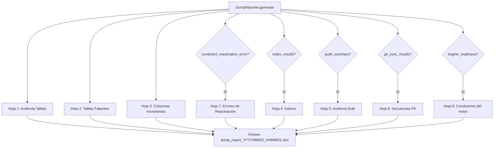

# Generador de Reportes de Volcado (DumpReporter)

Genera el informe Excel de auditoría para volcados de datos, con múltiples hojas que documentan volumetría, tablas/columnas faltantes, estado de constraints, índices, el resumen de la auditoría de `bulk`, la resincronización de contadores de PK y las condiciones de ejecución de los motores.

## 1. Arquitectura y Diseño

## 2. Modelo de Datos / Contratos

### API pública

| Método | Firma simplificada | Descripción | Retorna |
|---|---|---|---|
| `DumpReporter` | `(output_dir: Path)` | Inicializa; `generate()` crea `output_dir` si no existe | `DumpReporter` |
| `generate` | `(table_results, missing_tables, constraint_results, cycles, index_results?, audit_summary?, pk_sync_results?, constraint_reactivation_error?, engine_readiness?)` | Genera el fichero Excel con auditoría completa | `Path` |

### Contrato de entrada

| Parámetro | Tipo | Descripción | Restricciones |
|---|---|---|---|
| `output_dir` | `Path` | Directorio donde guardar el Excel | Se crea al generar si no existe |
| `table_results` | `list[TableDumpResult]` | Resultado por tabla volcada | Estado, volumetría, columnas omitidas, errores |
| `missing_tables` | `list[str]` | Tablas en origen sin equivalente en destino | — |
| `constraint_results` | `list[ConstraintResult]` | Resultados de rehabilitación de constraints | — |
| `cycles` | `list[list[str]]` | Grupos de tablas con ciclos FK | — |
| `index_results` | `list[IndexActionResult] \| None` | Gestión de índices; `None` omite la hoja Índices | Default `None` |
| `audit_summary` | `DumpAuditSummary \| None` | Resumen de la auditoría de `bulk` del volcado (`DumpResult.audit_summary`); `None` omite la hoja Auditoría Bulk | Default `None` |
| `pk_sync_results` | `list[PKSyncResult] \| None` | Resincronización de contadores de PK (`DumpResult.pk_sync_results`); `None` omite la hoja Secuencias PK | Default `None` |
| `constraint_reactivation_error` | `str \| None` | Error general de reactivación de constraints (`DumpResult.constraint_reactivation_error`); `None` omite la hoja Errores de Reactivación | Default `None` |
| `engine_readiness` | `Sequence[ReadinessBlock] \| None` | Bloques (título, informe de `EngineReadinessAdvisor`) de origen y destino; `None` omite la hoja Condiciones del motor. `DumpOrchestrator` la pasa siempre | Default `None` |

### Contrato de salida

- Retorna `Path` del fichero Excel generado con nombre `dump_report_YYYYMMDD_HHMMSS.xlsx` (`_2`, `_3`… si ya existe).
- **Hoja 1 — Auditoría Tablas**: tabla, posición de carga, FK circular, filas origen/destino antes/después, filas rechazadas, estado, columnas omitidas, error. Debajo, si las hay, las constraints con estado `FAILED` o `UNVERIFIED` al rehabilitarlas (tabla, constraint, dialect, estado, mensaje).
- **Hoja 2 — Tablas Faltantes**: tablas presentes en origen pero ausentes en destino.
- **Hoja 3 — Columnas Inexistentes**: columnas en origen sin equivalente en destino, agrupadas por tabla.
- **Hoja 4 — Índices** (solo si `index_results` no es `None`): tabla, índice, dialect, acción (`REBUILT`, `RECREATED`, `FAILED`, `UNSUPPORTED` o, desde 4.0.0, `SKIPPED`: índice único de Oracle sin constraint que se mantuvo durante la carga, con el motivo) y mensaje.
- **Hoja 5 — Auditoría Bulk** (solo si `audit_summary` no es `None`): métrica y valor. Ruta del CSV, operaciones y filas del CSV, filas escritas por el volcado (`audited_rows`), tiempos, tablas auditadas y tabla más activa, y los contadores de incidencia. Se resaltan en rojo `audit_failures` y `audit_uncommitted_records` mayores que 0, en naranja `unaudited_committed_rows` mayor que 0, y en amarillo las filas del CSV y las del volcado cuando no coinciden.
- **Hoja 6 — Secuencias PK** (solo si `pk_sync_results` no es `None`): tabla, columna PK, dialect, `MAX(PK)` (`—` si la tabla estaba vacía), estado y mensaje. Estado en verde (`SYNCED`, `NO_ROWS`), amarillo (`SKIPPED`: sin secuencia, p.ej. PK natural), naranja (`UNSUPPORTED`) o rojo (`ERROR`).
- **Hoja 7 — Errores de Reactivación** (solo si `constraint_reactivation_error` no es `None`): tipo de error y descripción, con fondo rojo. Incluye nota explicativa sobre la diferencia con fallos por-constraint que aparecen en la hoja "Auditoría Tablas". El error reportado es un fallo general no recuperable de `ConstraintManager.enable_all()` durante la Fase 6.
- **Hoja 8 — Condiciones del motor** (solo si `engine_readiness` no es `None`; `DumpOrchestrator` la pide siempre): un bloque por motor (`Origen · <motor>`, `Destino · <motor>`, o uno solo `Origen y destino` si es el mismo engine) con la verificación (motor, momento en UTC, checks dinámicos sí/no), el resumen por severidad y los hallazgos (nivel, parámetro, valor actual, recomendación), ordenados por severidad. Son las condiciones verificadas en el proceso (`EngineReadinessAdvisor.engine_report`): el destino no se vuelve a verificar porque su `BulkCrud` reutiliza el resultado. Un aviso explica los bloques vacíos o incompletos (motor sin checks, sin conexión, sin hallazgos); si la verificación falla, el volcado sigue y el bloque lleva el aviso.
- Las hojas opcionales van siempre detrás de las fijas, en el orden 4-5-6-7-8 (la numeración supone que están todas; las que no aplican no se crean), para no mover las existentes. De v1.2.0 a v2.1.0, «Errores de Reactivación» se insertaba la 4.ª y desplazaba Índices, Auditoría Bulk y Secuencias PK; lee las hojas por nombre.
- Ninguna celda se guarda como fórmula: un texto que empieza por `=` (nombre de tabla del catálogo o del CSV, mensaje de error) se escribe como texto en todas las hojas.

### Errores y casos especiales

| Error | Cuándo ocurre |
|---|---|
| `DumpReportError` | Cualquier fallo al generar el informe: crear `output_dir`, escribir el fichero (permisos, disco lleno, fichero abierto) o un valor que openpyxl no admite; `exc.output_path` lleva la ruta prevista |

## 3. Componentes y Clases

*No aplica para este módulo.* `DumpReporter` es la única clase del módulo.

## 4. Dependencias y Requisitos

| Dependencia | Propósito | Requerida | Comportamiento sin ella |
|---|---|---|---|
| `openpyxl` | Generación del fichero Excel | Sí | Error al llamar a `generate()` |

## 5. Ejemplos Relacionados

- [Ejemplo: Volcado de Datos entre Motores](../examples/dump_data_export.md) — Generación e interpretación del informe Excel de auditoría
