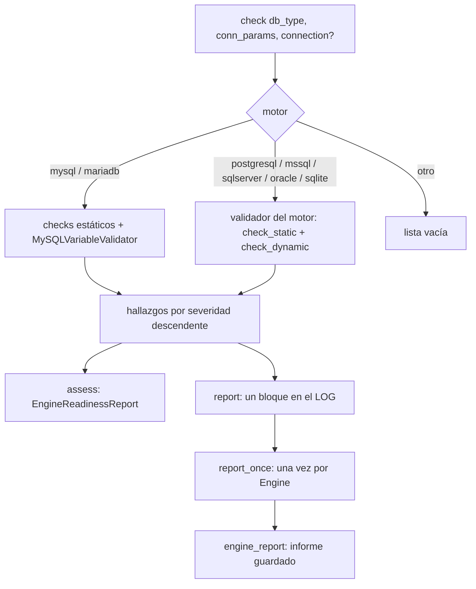

# Verificador de Condiciones del Motor (EngineReadinessAdvisor)

`util_bbdd.connection.EngineReadinessAdvisor` revisa, en modo solo lectura, la configuración de conexión y de pool y los
parámetros del servidor que afectan a las cargas masivas, y devuelve hallazgos (`AdvisoryFinding`) con su nivel y una
recomendación.

## 1. Arquitectura y Diseño

Los checks **estáticos** usan solo `conn_params` (no conectan). Los **dinámicos** necesitan una conexión y leen
parámetros del servidor. El advisor no cambia nada en el servidor: las recomendaciones son texto para quien administra
el motor.

## 2. Modelo de Datos / Contratos

### API pública

Importación: `from util_bbdd.connection import EngineReadinessAdvisor, EngineReadinessReport, AdvisoryFinding`.

| Método / atributo | Firma simplificada | Descripción | Retorna |
|---|---|---|---|
| `check` | `(db_type, conn_params, *, connection=None)` | Ejecuta los checks del motor; dinámicos solo con `connection` | `list[AdvisoryFinding]` |
| `assess_async` | `async (db_type, conn_params, *, engine=None)` | Como `assess`, con un `AsyncEngine`: los dinámicos usan su conexión vía `run_sync` | `EngineReadinessReport` |
| `assess` | `(db_type, conn_params, *, engine=None)` | `check` con las condiciones de la verificación; `engine` aporta la conexión de los dinámicos | `EngineReadinessReport` |
| `report` | `(db_type, conn_params, *, connection=None)` | `check` y un único mensaje al LOG (WARNING si hay WARNING o CRITICAL; si no, INFO) | `list[AdvisoryFinding]` |
| `report_once` | `(engine)` | Verifica e informa `engine` solo la primera vez en el proceso y guarda el informe | `bool` (`True` si verificó esta llamada) |
| `engine_report` | `(engine, *, timeout=60.0)` | Informe guardado de `engine`; lo verifica si no lo estaba y espera si otro hilo lo está verificando | `EngineReadinessReport` |
| `describe_engine` | `(engine)` (estático) | `motor · host:puerto/base`, sin usuario ni contraseña | `str` |
| `report_name` | `(db_type)` (estático) | Nombre del motor en los informes: minúsculas y `mssql` → `sqlserver` | `str` |
| `SUPPORTED_DB_TYPES` | `frozenset[str]` | `mysql`, `mariadb`, `postgresql`, `mssql`, `sqlserver`, `oracle`, `sqlite` | — |

`SyncDatabaseManager.get_engine_readiness()` llama a `assess` con los `conn_params` del manager y su engine de
SQLAlchemy ([managers sync](managers_sync.md)); `await AsyncDatabaseManager.get_engine_readiness()`, a `assess_async`
con su `AsyncEngine` ([managers async](managers_async.md)).

### Contrato de entrada

| Parámetro | Tipo | Descripción | Restricciones |
|---|---|---|---|
| `db_type` | `str` | Motor; se compara en minúsculas y sin espacios | Un motor fuera de `SUPPORTED_DB_TYPES` no tiene checks |
| `conn_params` | `dict[str, Any]` | Parámetros de conexión y pool (`pool_size`, `pool_timeout`, `autocommit`, `sslmode`…) | Solo se evalúan las claves presentes que conoce cada motor |
| `connection` | conexión SQLAlchemy | Conexión activa para los checks dinámicos | Opcional |
| `engine` | `sqlalchemy.engine.Engine` | Engine síncrono | `report_once`/`engine_report` leen host, puerto, base y pool de `engine.url` y `engine.pool` |

### Contrato de salida

`AdvisoryFinding` (dataclass inmutable):

| Campo | Tipo | Descripción |
|---|---|---|
| `level` | `"OK" \| "INFO" \| "WARNING" \| "CRITICAL"` | Severidad |
| `param` | `str` | Parámetro evaluado |
| `current` | `str` | Valor leído, formateado |
| `recommendation` | `str` | Recomendación; vacía en `OK` |

`EngineReadinessReport` (dataclass inmutable) distingue «sin hallazgos» de «no verificado»:

| Campo | Tipo | Descripción |
|---|---|---|
| `db_type` | `str` | Motor verificado, con el nombre de la librería en todos los caminos (`report_name`): SQL Server es siempre `sqlserver`, también desde un engine `mssql` |
| `findings` | `tuple[AdvisoryFinding, ...]` | Hallazgos por severidad descendente |
| `checked_at` | `datetime` | Momento de la verificación, en UTC |
| `dynamic` | `bool` | `True` si hubo conexión y se intentaron los checks dinámicos |
| `supported` | `bool` | `False` si el motor no tiene checks (p. ej. HSQLDB) |
| `error` | `str \| None` | Por qué no hubo checks dinámicos; solo el tipo de la excepción, nunca su mensaje |

### Errores y casos especiales

| Situación | Comportamiento |
|---|---|
| Fallo de un check o del driver al leer un parámetro | Se registra en DEBUG y el check se omite; `check` no lanza |
| Sin conexión en `assess`, `report_once` o `engine_report` | Solo checks estáticos; `dynamic=False` y el motivo en `error` |
| `engine_report` cuando otro hilo no termina en `timeout` | Informe vacío con `error` explicativo; no lanza |
| Contraseña en `conn_params` | `report` sustituye `password`, `passwd`, `pwd` y `secret` por `***` antes de escribir |
| `report_once` con el mismo `Engine` | La clave es el objeto, no la URL; `engine.dispose()` no provoca otra verificación. Las referencias son débiles: no retiene el engine |

## 3. Componentes y Clases

| Componente | Responsabilidad |
|---|---|
| `EngineReadinessAdvisor` | Punto de entrada: elige el validador del motor en un registro (Strategy: `motor → validador`), ordena, informa y guarda por engine |
| `AdvisoryFinding` | Un hallazgo |
| `EngineReadinessReport` | Hallazgos y condiciones de la verificación |
| `MySQLVariableValidator` | Lectura de variables de MySQL/MariaDB con `SHOW VARIABLES` ([referencia](mysql_variables.md)) |
| `PostgreSQLVariableValidator`, `SQLServerVariableValidator`, `OracleVariableValidator`, `SQLiteVariableValidator` | Checks estáticos (`check_static`) y dinámicos (`check_dynamic`) de cada motor (`util_bbdd.connection.<motor>`); cumplen el Protocol `ReadinessValidator` |
| `MySQLReadinessValidator` | Interno (`connection/mariadb/_readiness.py`): los checks de MySQL/MariaDB con la misma interfaz; lee las variables con `MySQLVariableValidator` |
| `audit.readiness.ReadinessSheetWriter` | Hoja «Condiciones del motor» de los Excel de `bulk` y `dump` ([auditoría bulk](bulk_audit.md), [informe de volcado](dump_reporter.md)) |

## 4. Dependencias y Requisitos

| Dependencia | Propósito | Requerida | Comportamiento sin ella |
|---|---|---|---|
| `sqlalchemy` | Conexión y engine | Sí | El módulo no funciona |
| Lectura de parámetros del servidor | MySQL/MariaDB: `SHOW VARIABLES`; PostgreSQL: `SHOW` (lista blanca); SQL Server: `sys.configurations` y `sys.databases`; Oracle: `V$PARAMETER`; SQLite: `PRAGMA` (lista blanca) | Para los checks dinámicos | Se omiten los checks que no se pueden leer (Oracle comprueba antes el acceso a `V$PARAMETER`) |

## 5. Ejemplos Relacionados

- [Guía: validación de parámetros de rendimiento](../guides/performance_readiness_guide.md) — umbrales por motor,
  `report_once`, `assess` y las hojas de los Excel.
- [Generación de documentación](../examples/database_documentation_generation.md) — sección «Condiciones del motor»
  en Word, Excel y HTML.
- Pendiente — crear ejemplo en `docs/examples/engine_readiness_advisor.md`.
