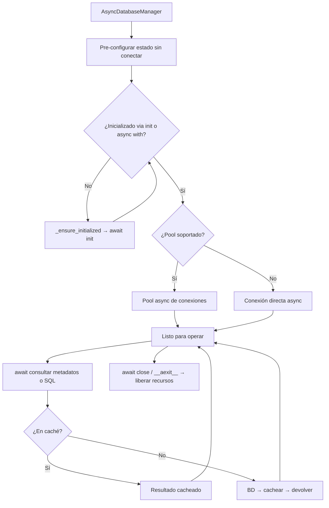

## Responsabilidad del módulo

Gestor asíncrono del ciclo de vida de conexiones de base de datos multi-motor con `async/await`: el constructor pre-configura el estado sin conectar; la conexión real se establece en `await init()` o al entrar en un bloque `async with`.

## Diagrama

## API pública

| Función/Clase | Firma simplificada | Descripción | Retorna |
|---|---|---|---|
| `AsyncDatabaseManager` | `(db_type, conn_params, use_pool?)` | Pre-configura el gestor sin conectar | `AsyncDatabaseManager` |
| `init` | `async ()` | Abre la conexión (pool o directa); idempotente | `AsyncDatabaseManager` |
| `__aenter__` / `__aexit__` | `async` | Context manager async | `AsyncDatabaseManager` / `None` |
| `get_connection` | `async ()` | Obtiene conexión del pool o directa | `Any` |
| `release_connection` | `async (connection)` | Libera conexión al pool | `None` |
| `get_tables` | `async ()` | Lista de tablas de la base de datos | `Rows` |
| `get_views` | `async ()` | Lista de vistas | `Rows` |
| `get_routines` | `async ()` | Lista de rutinas (procedures y funciones) | `Rows` |
| `get_columns` | `async (tabla)` | Columnas de una tabla | `Rows` |
| `get_tables_normalized` | `async ()` | Tablas en formato normalizado homogéneo | `list[NormalizedTableRow]` |
| `get_columns_normalized` | `async (tabla)` | Columnas en formato normalizado homogéneo | `list[NormalizedColumnRow]` |
| `get_ddl` | `async (tabla)` | DDL de una tabla | `str` |
| `get_view_ddl` | `async (vista)` | DDL de una vista | `str` |
| `get_indices` | `async (tabla)` | Índices de una tabla | `Rows` |
| `get_primary_keys` | `async (tabla)` | Claves primarias de una tabla | `Rows` |
| `get_foreign_keys` | `async (tabla)` | Claves foráneas de una tabla | `Rows` |
| `get_unique_constraints` | `async (tabla)` | Restricciones únicas de una tabla | `Rows` |
| `get_routine_parameters` | `async (rutina, tipo_rutina)` | Parámetros de una rutina | `Rows` |
| `get_routine_ddl` | `async (rutina, tipo_rutina)` | DDL de una rutina | `str` |
| `get_database_version` | `async ()` | Versión del motor de base de datos | `str` |
| `get_database_charset_collation` | `async ()` | Charset y collation de la base de datos | `dict[str, Any]` |
| `get_columns_charset_collation` | `async (tabla)` | Charset/collation por columna | `list[tuple[str, str\|None, str\|None]]` |
| `get_storage_inventory` | `async (tablespace?)` | Inventario de almacenamiento | `dict[str, Any]` |
| `execute_query_many` | `async (query_name, **params)` | Ejecuta query registrada, retorna varias filas | `Rows` |
| `execute_query_one` | `async (query_name, **params)` | Ejecuta query registrada, retorna una fila | `RowOrNone` |
| `execute_custom_many` | `async (sql, params?)` | Ejecuta SQL libre, retorna varias filas | `Rows` |
| `execute_custom_one` | `async (sql, params?)` | Ejecuta SQL libre, retorna una fila | `RowOrNone` |
| `resolve_query` | `async (query_name, **params)` | Resuelve SQL final de una query registrada | `Any` |
| `get_available_queries` | `async ()` | Nombres de queries disponibles | `list[str]` |
| `get_sqlalchemy_engine` | `async ()` | AsyncEngine de SQLAlchemy configurado | `AsyncEngine` |
| `get_database_info` | `async ()` | Información de la conexión y el motor activo | `dict[str, Any]` |
| `close` | `async (mode?)` | Cierra el gestor y libera recursos | `None` |
| `get_supported_db_types` | `()` *(estático)* | Tipos de BD soportados | `list[str]` |
| `get_database_type_name` | `()` *(síncrono)* | Nombre descriptivo del motor activo | `str` |
| `get_required_params` | `()` *(síncrono)* | Parámetros requeridos para el motor | `list[str]` |
| `get_default_port` | `()` *(síncrono)* | Puerto por defecto del motor | `int` |

## Contrato de entrada

| Parámetro | Tipo | Descripción | Restricciones |
|---|---|---|---|
| `db_type` | `str` | Tipo de motor de base de datos | Uno de los motores soportados por util_bbdd |
| `conn_params` | `dict[str, Any]` | Parámetros de conexión | Debe incluir `database`; driver-específicos según motor |
| `use_pool` | `bool` | Activar pool async de conexiones | Default `True`; cae a conexión directa si el motor no soporta pool async |
| `mode` en `close` | `str \| AsyncCloseMode` | Política de cierre | `"immediate"` (default), `"graceful"` o `"drain"` |
| `tabla` / `vista` / `rutina` | `str` | Nombre del objeto de base de datos | Sensible a mayúsculas según motor |
| `tipo_rutina` | `str` | Tipo de rutina | `PROCEDURE` o `FUNCTION` |
| `tablespace` | `str \| None` | Nombre de tablespace | Requerido para inventario en Oracle y PostgreSQL |

## Contrato de salida

- **`Rows`** — `list[tuple[Any, ...]]`. Cada tupla es una fila; orden y tipos dependen del motor.
- **`NormalizedTableRow`** / **`NormalizedColumnRow`** — dataclasses tipados con campos homogéneos entre motores.
- **`RowOrNone`** — una tupla si hay resultado, `None` si no hay filas.
- **`str`** (DDL/versión) — texto plano; formato varía por motor.
- **`AsyncEngine`** — instancia async de SQLAlchemy lista para usar con operaciones bulk async u otras librerías.
- **`init()`** — devuelve `self` para encadenamiento: `manager = await AsyncDatabaseManager(...).init()`.

Todos los métodos de metadatos usan caché en memoria por sesión; los resultados no se refrescan hasta reiniciar el gestor.

## Errores y casos especiales

| Error | Cuándo ocurre |
|---|---|
| `ValidationError` | `db_type` no reconocido al construir |
| `ConnectionError` | No se puede establecer conexión en `init()` |
| `DatabaseOperationError` | Operación de metadatos fallida o executor no inicializado |
| `QueryError` | Error en ejecución de `execute_custom_*` o `execute_query_*` |
| `QueryNotFoundError` | `query_name` no existe para el motor activo |

**Casos especiales:**
- Llamar a cualquier método sin haber llamado `init()` activa inicialización perezosa automática (`_ensure_initialized`).
- Si `use_pool=True` y el motor lanza `NotImplementedError` al crear el pool, el gestor cae a conexión directa sin error visible.
- SQLite no expone charset/collation: `get_columns_charset_collation()` devuelve lista vacía.
- Oracle: charset/collation por columna se detecta según versión del motor en la primera llamada y se cachea para el resto de la sesión.
- El modo de cierre `"drain"` espera a que las conexiones activas del pool terminen antes de cerrar; útil en apagados graceful de servicios.
- **Diferencia crítica respecto a SyncDatabaseManager**: el constructor NO conecta. Olvidar el `await init()` no genera error inmediato, pero sí en la primera operación.
