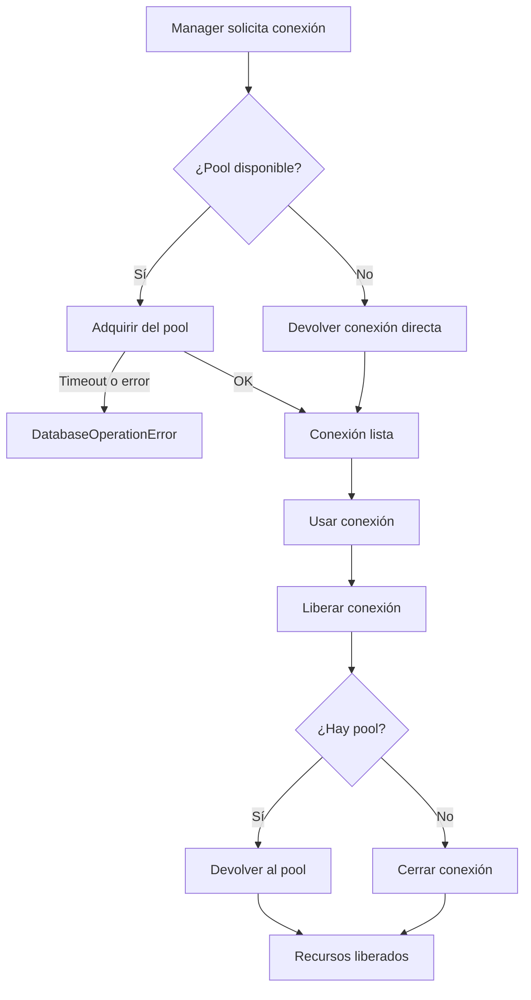

## Responsabilidad del módulo

Centraliza la lógica de apertura, adquisición, liberación y cierre de recursos de conexión (pool y directa) para los managers sync y async, proporcionando manejo uniforme de errores y logging consistente.

## Diagrama

## API pública

### Clase `SyncConnectionLifecycleManager`

| Función/Clase | Firma simplificada | Descripción | Retorna |
|---|---|---|---|
| `SyncConnectionLifecycleManager` | `(db_type, logger)` | Gestiona el ciclo de vida de conexiones sincrónicas | `SyncConnectionLifecycleManager` |
| `get_connection` | `(pool_connection, connection)` | Obtiene conexión del pool o devuelve la directa | `Any` |
| `release_connection` | `(pool_connection, connection)` | Devuelve la conexión al pool o la cierra | `None` |
| `close_resources` | `(pool_connection, cursor, connection, timeout_seconds, force)` | Cierra pool, cursor y conexión en orden, acumulando errores | `None` |

### Funciones async de módulo

| Función | Firma simplificada | Descripción | Retorna |
|---|---|---|---|
| `init_async_resources` | `async (use_pool, create_pool, create_connection)` | Inicializa recursos async con fallback a conexión directa | `tuple[bool, Any, Any]` |
| `get_async_connection` | `async (initialized, ensure_initialized, pool_connection, connection)` | Obtiene conexión async inicializando el manager si es necesario | `Any` |
| `release_async_connection` | `async (pool_connection, connection)` | Libera conexión async al pool; no-op si no hay pool | `None` |
| `close_async_resources` | `async (pool_connection, connection, close_mode)` | Cierra pool y conexión directa async con política de cierre | `None` |

## Contrato de entrada

| Parámetro | Tipo | Descripción | Restricciones |
|---|---|---|---|
| `db_type` | `str` | Tipo de motor de base de datos | Usado solo para mensajes de error y logging |
| `logger` | `logging.Logger` | Logger del manager propietario | No puede ser `None` |
| `pool_connection` | `Any \| None` | Pool de conexiones activo | `None` si se usa conexión directa |
| `connection` | `Any \| None` | Conexión directa activa | `None` si se usa pool |
| `cursor` | `Any \| None` | Cursor a cerrar | `None` si no hay cursor abierto |
| `timeout_seconds` | `float \| None` | Timeout para operaciones de cierre | `None` sin límite de tiempo |
| `force` | `bool` | Forzar cierre sin esperar | `True` en destructor; `False` en cierre normal |
| `close_mode` | `AsyncCloseMode` | Política de cierre async | `"immediate"`, `"graceful"` o `"drain"` |
| `use_pool` | `bool` | Intentar crear pool async | Si `True` y falla con `NotImplementedError`, cae a conexión directa |
| `create_pool` | `Callable[[], Awaitable[Any]]` | Factory async del pool | Se invoca solo si `use_pool=True` |
| `create_connection` | `Callable[[], Awaitable[Any]]` | Factory async de conexión directa | Se invoca si `use_pool=False` o si el pool falla |

## Contrato de salida

- **`get_connection`** / **`get_async_connection`** — la conexión adquirida; tipo opaco dependiente del driver (`pyodbc.Connection`, `asyncpg.Connection`, etc.).
- **`init_async_resources`** — tupla `(use_pool_resuelto: bool, pool_connection: Any, connection: Any)`. Exactamente uno de los dos últimos será distinto de `None`.
- **`close_resources`** — retorna `None`; si hay varios errores al cerrar, los acumula y lanza un único `DatabaseOperationError` con todos los detalles concatenados.
- **`release_connection`** / **`release_async_connection`** / **`close_async_resources`** — retornan `None`; no lanzan excepciones (errores de cierre se silencian).

## Errores y casos especiales

| Error | Cuándo ocurre |
|---|---|
| `DatabaseOperationError` | Timeout al obtener del pool, pool devuelve `None`, o no hay conexión disponible |
| `DatabaseOperationError` (acumulado) | `close_resources` falla en pool, cursor y/o conexión; agrega todos los errores en uno |

**Casos especiales:**
- `release_connection` con `connection=None` retorna inmediatamente sin hacer nada.
- `close_resources` cierra en orden: primero el pool, luego el cursor, luego la conexión directa. Si un paso falla, continúa con los siguientes antes de lanzar el error acumulado.
- `init_async_resources` silencia `NotImplementedError` del pool y cae a conexión directa; cualquier otro error del pool se propaga.
- `close_async_resources` comprueba `hasattr(connection, 'close')` antes de intentar cerrar la conexión directa, para compatibilidad con distintos drivers.
