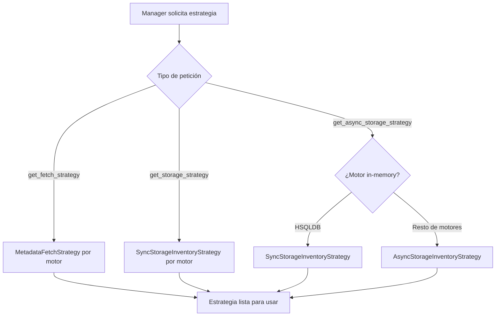

## Responsabilidad del módulo

Factory estático que resuelve, según el tipo de motor, las estrategias de obtención de metadatos (fetch) e inventario de almacenamiento (sync y async) que los managers utilizan internamente.

## Diagrama

## API pública

| Función/Clase | Firma simplificada | Descripción | Retorna |
|---|---|---|---|
| `MetadataStrategyFactory` | — | Factory (solo métodos estáticos; no se instancia) | — |
| `get_fetch_strategy` | `(db_type)` *(estático)* | Estrategia de fetch de metadatos para el motor | `MetadataFetchStrategy` |
| `get_storage_strategy` | `(db_type)` *(estático)* | Estrategia sync de inventario de almacenamiento | `SyncStorageInventoryStrategy` |
| `get_async_storage_strategy` | `(db_type)` *(estático)* | Estrategia async de inventario de almacenamiento (o sync para HSQLDB) | `AsyncStorageInventoryStrategy \| SyncStorageInventoryStrategy` |

## Contrato de entrada

| Parámetro | Tipo | Descripción | Restricciones |
|---|---|---|---|
| `db_type` | `str` | Tipo de motor de base de datos | Debe ser un motor reconocido por util_bbdd; se pasa directamente a las funciones de resolución de estrategia |

## Contrato de salida

- **`get_fetch_strategy`** — devuelve un objeto `MetadataFetchStrategy` con los métodos `build_sync_rows_fetcher`, `build_async_rows_fetcher`, `build_sync_text_fetcher` y `build_async_text_fetcher` que los managers usan para construir las llamadas de fetch de metadatos.
- **`get_storage_strategy`** — devuelve un `SyncStorageInventoryStrategy` con método `execute(manager, database, tablespace)` que retorna un `dict[str, Any]` con el inventario de almacenamiento.
- **`get_async_storage_strategy`** — devuelve `AsyncStorageInventoryStrategy` para la mayoría de motores (su `execute` devuelve una coroutine), o `SyncStorageInventoryStrategy` para HSQLDB (su `execute` devuelve un `dict` directamente, compatible con `asyncio.iscoroutine` check en el manager async).

## Errores y casos especiales

| Error | Cuándo ocurre |
|---|---|
| Depende de las funciones internas de resolución | Si `db_type` no tiene estrategia registrada, las funciones delegadas pueden lanzar `KeyError` o `ValueError` |

**Casos especiales:**
- `get_async_storage_strategy` devuelve intencionalmente una estrategia **sync** para HSQLDB (motor in-memory), ya que no tiene operaciones de almacenamiento bloqueantes. El manager async detecta esto con `asyncio.iscoroutine()` y maneja ambos casos sin cambios en el llamador.
- `MetadataStrategyFactory` no se instancia: todos sus métodos son `@staticmethod`. Usarla como instancia es técnicamente posible pero no aporta valor.
- La resolución de estrategia ocurre en el `__init__` de los managers, no en cada operación, por lo que el coste de resolución es constante por sesión.
