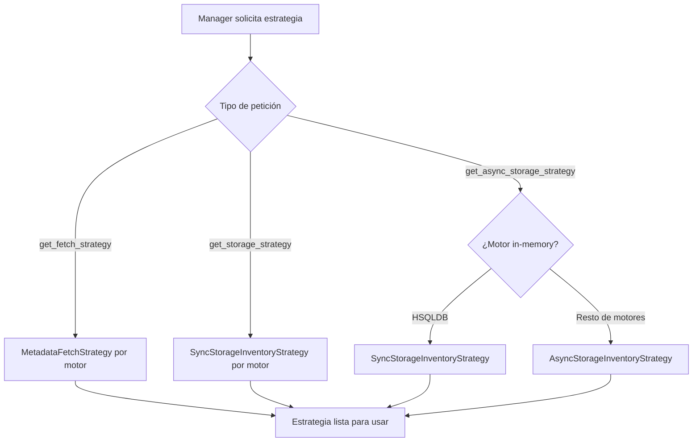

# Factory de Estrategias de Metadata (MetadataStrategyFactory)

Factory estático que resuelve, según el tipo de motor, las estrategias de obtención de metadatos e inventario de almacenamiento que los managers utilizan internamente.

## 1. Arquitectura y Diseño

## 2. Modelo de Datos / Contratos

### API pública

| Función/Clase | Firma simplificada | Descripción | Retorna |
|---|---|---|---|
| `MetadataStrategyFactory` | — | Factory de solo métodos estáticos; no se instancia | — |
| `get_fetch_strategy` | `(db_type)` *(estático)* | Estrategia de fetch de metadatos | `MetadataFetchStrategy` |
| `get_storage_strategy` | `(db_type)` *(estático)* | Estrategia sync de inventario de almacenamiento | `SyncStorageInventoryStrategy` |
| `get_async_storage_strategy` | `(db_type)` *(estático)* | Estrategia async de inventario (o sync para HSQLDB) | `AsyncStorageInventoryStrategy \| SyncStorageInventoryStrategy` |

### Contrato de entrada

| Parámetro | Tipo | Descripción | Restricciones |
|---|---|---|---|
| `db_type` | `str` | Tipo de motor de base de datos | Debe ser un motor reconocido; se pasa a las funciones de resolución |

### Contrato de salida

- **`get_fetch_strategy`** — `MetadataFetchStrategy` con métodos `build_sync_rows_fetcher`, `build_async_rows_fetcher`, `build_sync_text_fetcher` y `build_async_text_fetcher`.
- **`get_storage_strategy`** — `SyncStorageInventoryStrategy` con método `execute(manager, database, tablespace)` → `dict[str, Any]`.
- **`get_async_storage_strategy`** — `AsyncStorageInventoryStrategy` para la mayoría de motores, o `SyncStorageInventoryStrategy` para HSQLDB.

### Errores y casos especiales

| Error | Cuándo ocurre |
|---|---|
| `KeyError` / `ValueError` | `db_type` sin estrategia registrada en las funciones delegadas |

**Caso HSQLDB:** `get_async_storage_strategy` retorna intencionalmente una estrategia sync para HSQLDB (motor in-memory sin operaciones bloqueantes). El manager async detecta esto con `asyncio.iscoroutine()` y maneja ambos casos.

## 3. Componentes y Clases

*No aplica para este módulo.* `MetadataStrategyFactory` es la única clase de este módulo y no se instancia; solo expone métodos estáticos.

## 4. Dependencias y Requisitos

| Dependencia | Propósito | Requerida | Comportamiento sin ella |
|---|---|---|---|
| Estrategias de motor (internas) | Implementaciones concretas por motor | Sí | `KeyError` al solicitar estrategia para motor no registrado |

## 5. Ejemplos Relacionados

!!! info "Ejemplo en preparación"
    Pendiente — crear ejemplo en docs/examples/managers-metadata-factory.md
