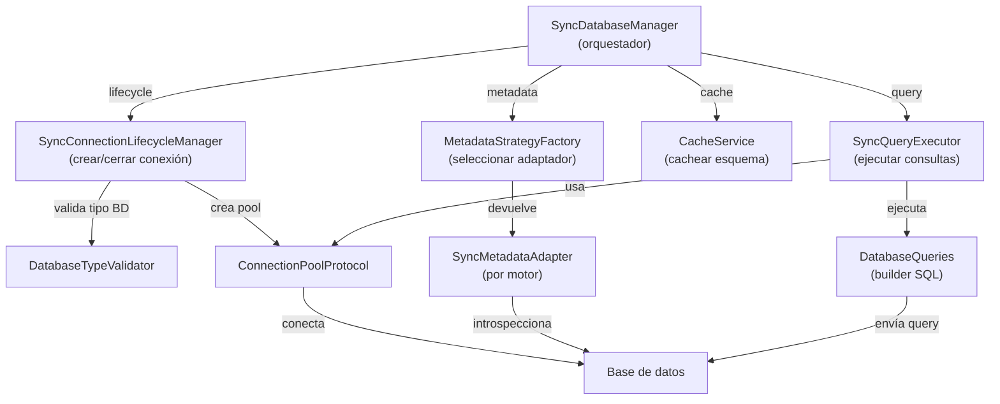

# SyncDatabaseManager — Referencia Técnica Interna

Orquesta el ciclo de vida completo de conexiones sincrónicas a múltiples tipos de bases de datos, delegando tareas especializadas a componentes dedicados: Lifecycle, Metadata, Query y Cache.

## 1. Arquitectura y Diseño

## 2. Modelo de Datos / Contratos

### API pública

| Método | Firma simplificada | Descripción | Retorna |
|---|---|---|---|
| `__init__` | `(db_type, credenciales, pool_config?)` | Constructor; valida tipo BD e inicializa pool | — |
| `introspect` | `()` | Obtiene esquema completo (tablas, columnas, constraints, índices) | `DatabaseSchema` |
| `execute` | `(query: str)` | Ejecuta SELECT; devuelve filas | `Rows` |
| `close` | `()` | Cierra todas las conexiones y libera recursos | — |
| `__enter__` / `__exit__` | — | Context manager | — |

### Contrato de entrada

| Parámetro | Tipo | Descripción | Restricciones |
|---|---|---|---|
| `db_type` | `str` | Tipo de motor | Debe estar en la lista de drivers soportados |
| `host` | `str` | Hostname o IP | Hostname o IP válida |
| `port` | `int` | Puerto del servidor | 1–65535 |
| `user` | `str` | Usuario de BD | No vacío |
| `password` | `str` | Contraseña | Puede ser vacío para BD local |
| `database` | `str` | Nombre de base de datos | Requerido |
| `pool_config` | `dict` (opt.) | Configuración del pool | Ejemplo: `{"min_size": 2, "max_size": 10}` |

### Contrato de salida

- **`introspect()`** — `DatabaseSchema` con `tables` (lista de objetos con `name`, `columns`, `constraints`).
- **`execute(query)`** — `list[tuple[Any, ...]]`; lista vacía si no hay filas.
- Comportamiento idéntico al documentado en `managers-sync.md`; este documento describe la arquitectura interna.

### Errores y casos especiales

| Error | Cuándo ocurre |
|---|---|
| `ValidationError` | `db_type` no reconocido o `database` faltante |
| `DriverError` | Driver Python del motor no instalado |
| `ConnectionError` | Servidor no alcanzable o credenciales inválidas |

## 3. Componentes y Clases

| Componente | Responsabilidad |
|---|---|
| `SyncConnectionLifecycleManager` | Apertura, cierre y gestión del pool |
| `MetadataStrategyFactory` | Selección del adaptador de metadatos por motor |
| `CacheService` | Caché en memoria de metadatos por sesión |
| `SyncQueryExecutor` | Ejecución de consultas SQL sobre la conexión activa |
| `SyncMetadataAdapter` | Implementación de introspección específica por motor |

## 4. Dependencias y Requisitos

| Dependencia | Propósito | Requerida | Comportamiento sin ella |
|---|---|---|---|
| `SyncConnectionLifecycleManager` (interno) | Gestión del ciclo de vida | Sí | Módulo no funciona |
| `MetadataStrategyFactory` (interno) | Estrategia de metadatos | Sí | Módulo no funciona |
| `SyncQueryExecutor` (interno) | Ejecución de queries | Sí | Módulo no funciona |
| Driver Python del motor | Conexión nativa con la BD | Sí (motor-específico) | `DriverError` al inicializar |

## 5. Ejemplos Relacionados

- [Ejemplo: Conectar e Introspeccionar Base de Datos](../examples/example-connect-introspect.md) — Ciclo de vida completo de `SyncDatabaseManager`
